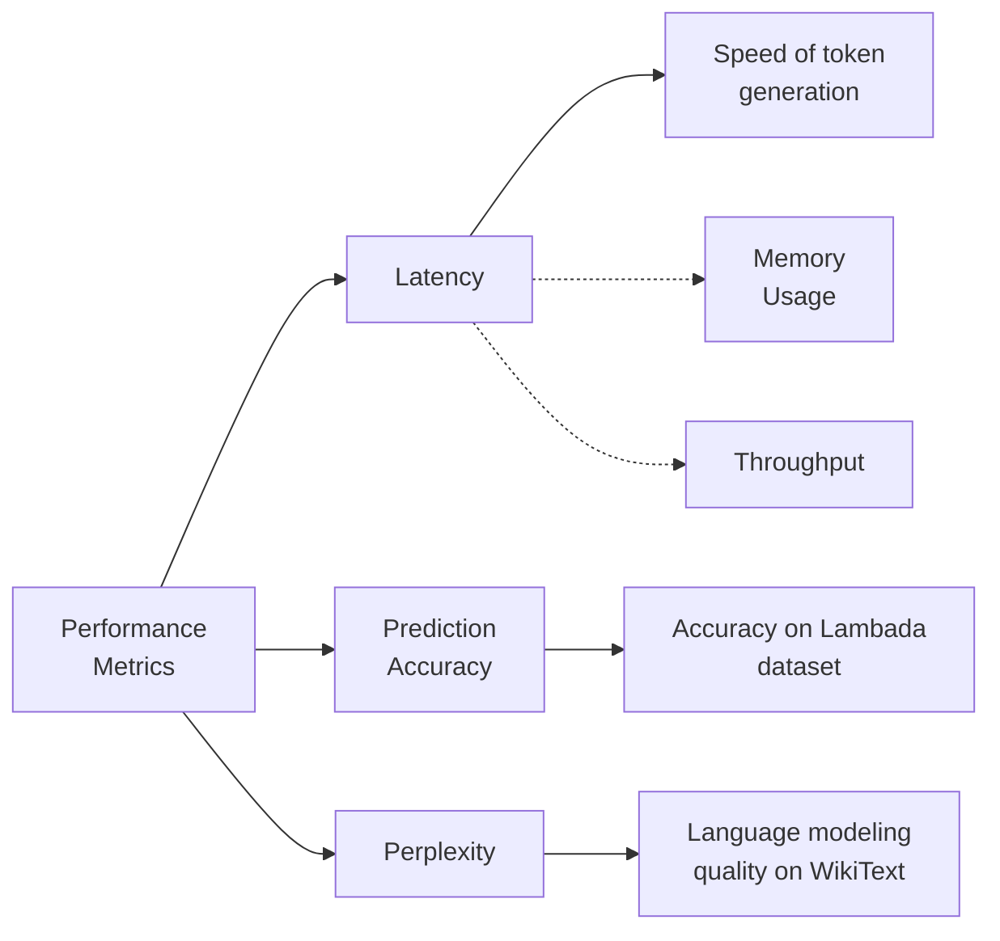
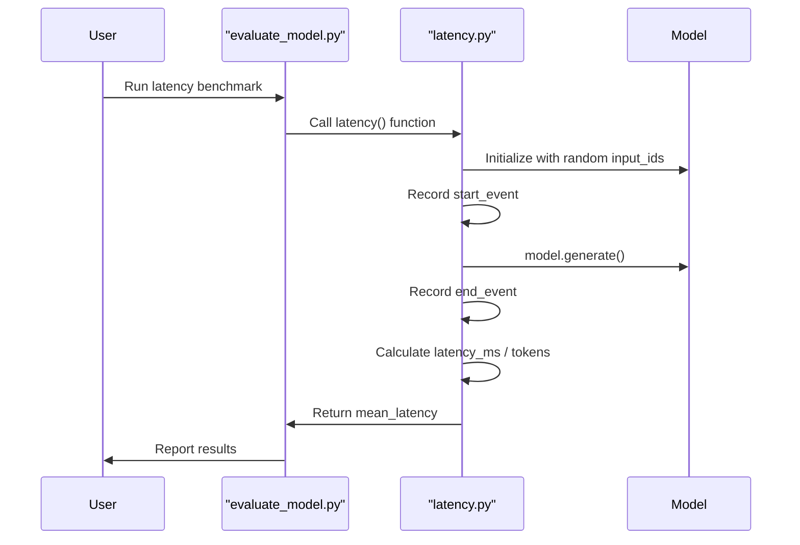
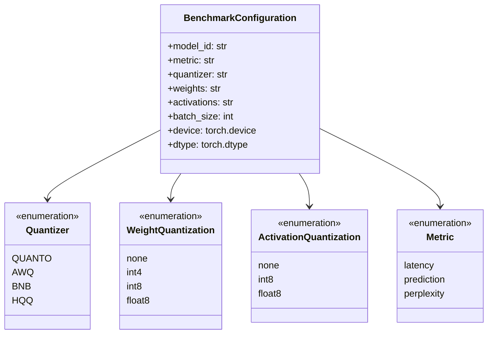
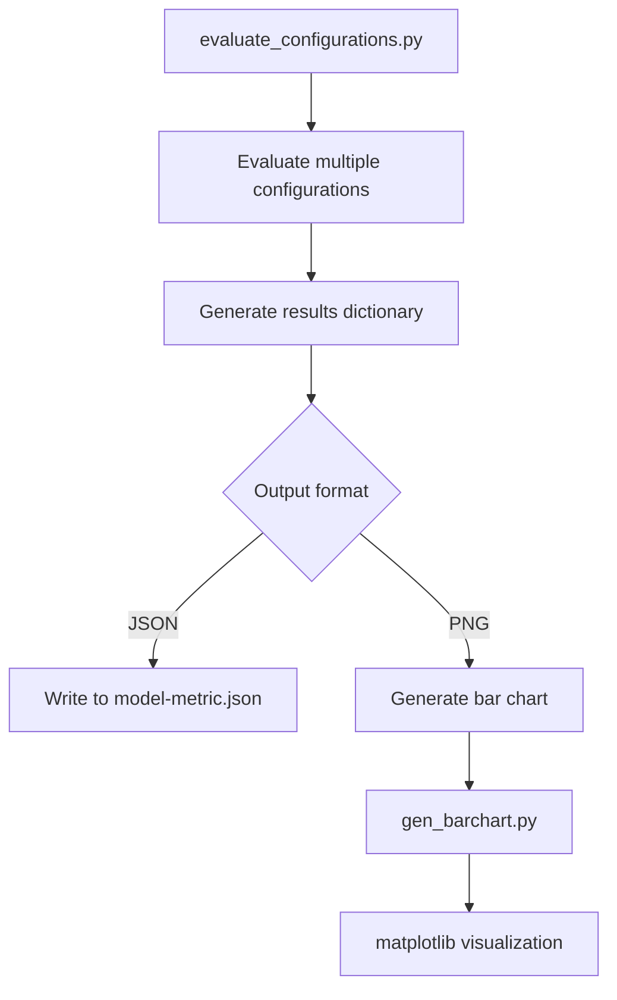
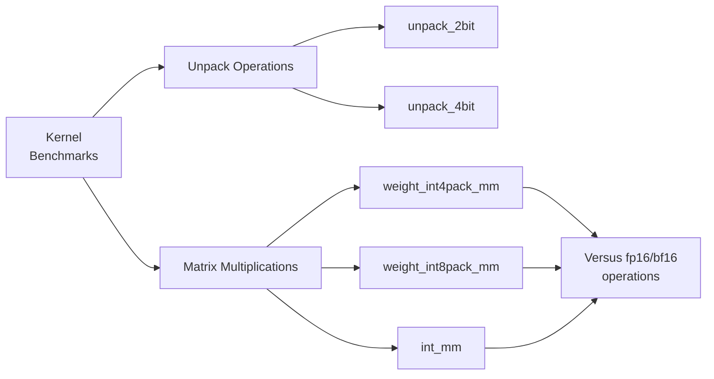

<!-- source: DeepWiki mcp.deepwiki.com · repo huggingface/optimum-quanto · page 9.1 Performance Metrics · fetched 2026-10-26 -->

# Performance Metrics

<details>
<summary>Relevant source files</summary>

The following files were used as context for generating this wiki page:

- [bench/generation/README.md](bench/generation/README.md)
- [bench/generation/evaluate_configurations.py](bench/generation/evaluate_configurations.py)
- [bench/generation/evaluate_model.py](bench/generation/evaluate_model.py)
- [bench/generation/gen_barchart.py](bench/generation/gen_barchart.py)
- [bench/generation/metrics/latency.py](bench/generation/metrics/latency.py)
- [bench/generation/setup/hqq.py](bench/generation/setup/hqq.py)
- [bench/kernels/benchmark.py](bench/kernels/benchmark.py)
- [bench/torch_kernels/test_int_mm.py](bench/torch_kernels/test_int_mm.py)
- [bench/torch_kernels/test_weight_int4pack_mm.py](bench/torch_kernels/test_weight_int4pack_mm.py)
- [bench/torch_kernels/test_weight_int8pack_mm.py](bench/torch_kernels/test_weight_int8pack_mm.py)

</details>


This page details the performance metrics used to evaluate quantized models in optimum-quanto. Performance metrics are essential for understanding the trade-offs between model size, inference speed, and output quality when applying quantization techniques. For general information about the quantization workflow, see [Workflow Guide](#7).

## Overview of Metrics

Optimum-quanto uses three primary metrics to evaluate quantized models:



Sources: [bench/generation/README.md:1-7](), [bench/generation/evaluate_model.py:15-85]()

## Core Metrics Implementation

The metrics are implemented in the `bench/generation/metrics` directory and can be invoked through the `evaluate_model.py` utility:

### 1. Latency

Measures the time required to generate each token in milliseconds. Lower values indicate faster inference.



Key measurement details:
- Measures time per token across multiple iterations
- Supports different devices (CUDA, MPS, XPU, CPU)
- Tracks peak memory usage during generation
- Customizable batch size, input length, and generation length

Sources: [bench/generation/metrics/latency.py:15-119](), [bench/generation/evaluate_model.py:78-79]()

### 2. Prediction Accuracy

Evaluates how well the model predicts the last token in prompts from the Lambada dataset, which assesses the impact of quantization on model capabilities.

Implementation details:
- Uses the Lambada dataset for evaluation
- Measures percentage of correctly predicted tokens
- Higher values indicate better preservation of model quality

Sources: [bench/generation/evaluate_model.py:80-81](), [bench/generation/README.md:6]()

### 3. Perplexity

Measures the model's perplexity on the WikiText dataset, which is a standard metric for evaluating language models. Lower perplexity indicates better language modeling capabilities.

Implementation details:
- Evaluates on WikiText dataset following the standard approach from Transformers
- Normalized by sentence length
- Lower values indicate better language modeling quality

Sources: [bench/generation/evaluate_model.py:82-83](), [bench/generation/README.md:7]()

## Benchmark Configuration

The benchmark system supports various configurations to evaluate quantization performance across different settings:



Sources: [bench/generation/evaluate_model.py:51-76](), [bench/generation/evaluate_configurations.py:26-61]()

### Supported Parameters

| Parameter | Options | Description |
|-----------|---------|-------------|
| Quantizer | quanto, awq, bnb, hqq | Quantization library to use |
| Weights | none, int4, int8, float8 | Weight quantization format |
| Activations | none, int8, float8 | Activation quantization format |
| Device | cuda, mps, xpu, cpu | Hardware to run benchmarks on |
| Metric | latency, prediction, perplexity | Performance metric to evaluate |
| Batch Size | Integer (default: 32) | Batch size during evaluation |
| dtype | fp16, bf16 | Floating-point precision for unquantized parts |

Sources: [bench/generation/evaluate_model.py:86-116](), [bench/generation/evaluate_configurations.py:29-38]()

## Visualization and Analysis

The benchmarking scripts can generate visual comparisons of different quantization configurations:



Sources: [bench/generation/evaluate_configurations.py:97-116](), [bench/generation/gen_barchart.py:15-74]()

### Result Interpretation

When analyzing benchmark results, consider these aspects:

1. **Latency vs Quality Trade-off**: Lower precision generally leads to faster inference but might decrease prediction accuracy or increase perplexity.

2. **Weight vs Activation Quantization**: Weight quantization typically has a larger impact on model size, while activation quantization impacts runtime memory usage.

3. **Hardware-Specific Performance**: Different quantization methods perform differently across hardware platforms.

4. **Memory Usage**: Tracked during latency benchmarks to help understand resource requirements.

Examples from real models show that:
- 4-bit weight quantization can achieve 2-4x speedup with minimal quality degradation
- 8-bit weight quantization generally preserves most of the model quality
- Activation quantization provides additional speedup but may impact quality more significantly

Sources: [bench/generation/README.md:13-82]()

## Low-Level Kernel Benchmarks

In addition to model-level benchmarks, optimum-quanto provides tools for benchmarking low-level kernels to understand the performance benefits of specialized quantized operations:



Sources: [bench/kernels/benchmark.py:15-122](), [bench/torch_kernels/test_weight_int4pack_mm.py:15-137](), [bench/torch_kernels/test_weight_int8pack_mm.py:15-69](), [bench/torch_kernels/test_int_mm.py:15-78]()

### Kernel Measurement

For each kernel, the benchmarks measure:
- Execution time compared to equivalent floating-point operations
- Relative speedup from quantization
- Error metrics (e.g., mean absolute error) compared to full-precision results

These benchmarks help identify which operations benefit most from quantization and inform further optimization efforts.

Sources: [bench/torch_kernels/test_weight_int4pack_mm.py:101-133](), [bench/kernels/benchmark.py:35-86]()

## Running Performance Benchmarks

To evaluate a model's performance with optimum-quanto, use the `evaluate_model.py` script:

```bash
python -m bench.generation.evaluate_model \
  --model facebook/opt-350m \
  --metric latency \
  --quantizer quanto \
  --weights int4 \
  --activations float8 \
  --device cuda \
  --batch_size 1
```

For benchmarking multiple configurations at once, use `evaluate_configurations.py`:

```bash
python -m bench.generation.evaluate_configurations \
  --model facebook/opt-350m \
  --metric prediction \
  --device cuda \
  --batch_size 32 \
  --png \
  --json
```

Sources: [bench/generation/evaluate_model.py:86-133](), [bench/generation/evaluate_configurations.py:64-116]()

## Performance Considerations

When evaluating quantized models, consider these factors:

1. **Model Architecture Sensitivity**: Different model architectures (Transformer variants) respond differently to quantization.

2. **Task Dependency**: Some tasks are more resilient to quantization than others.

3. **Quality-Speed Tradeoff**: Choose the right balance based on your application requirements.

4. **Hardware Acceleration**: Certain quantization formats are better supported on specific hardware.

5. **Batch Size Impact**: Performance scaling with batch size can differ between quantized and unquantized models.

By using optimum-quanto's performance metrics, you can make informed decisions about which quantization techniques best suit your specific use case and hardware environment.

Sources: [bench/generation/README.md:1-82](), [bench/generation/evaluate_model.py:51-85]()

---

