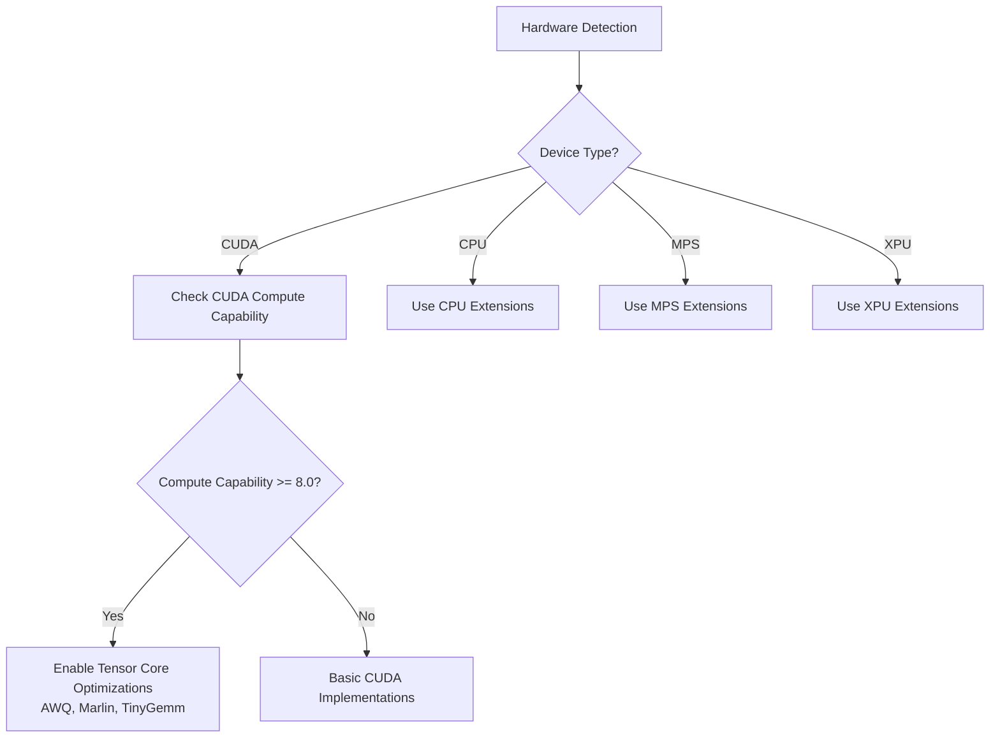
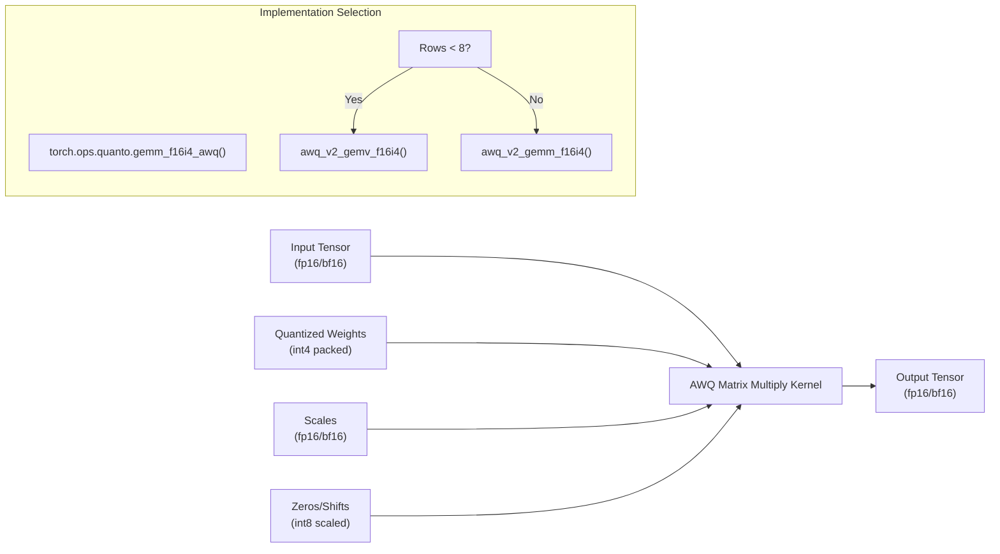
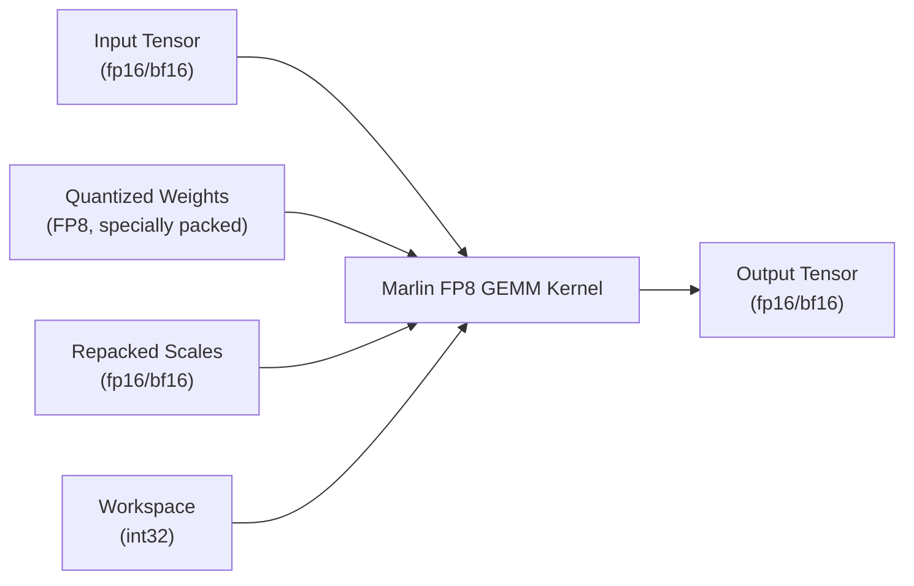
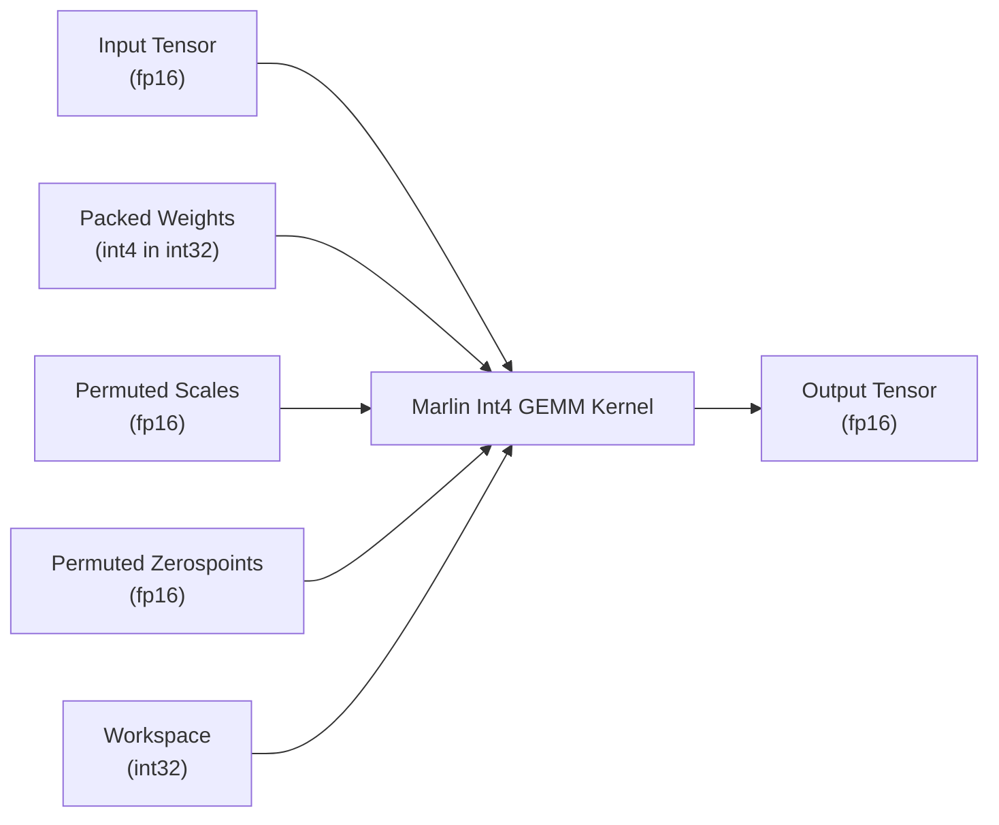
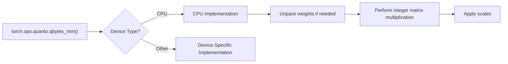
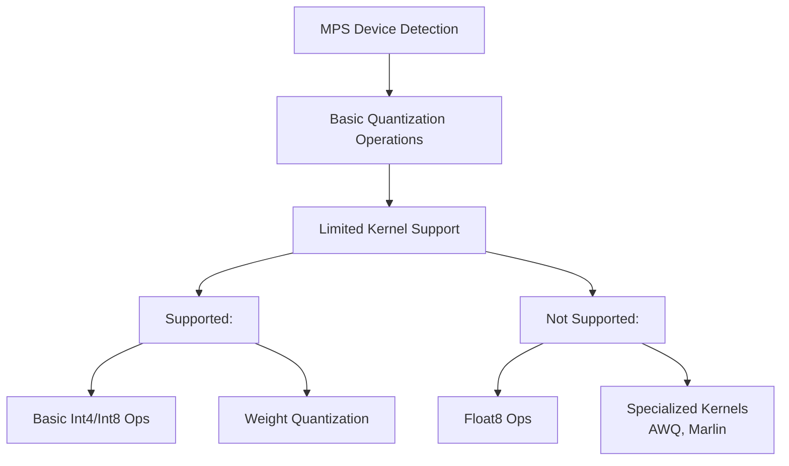
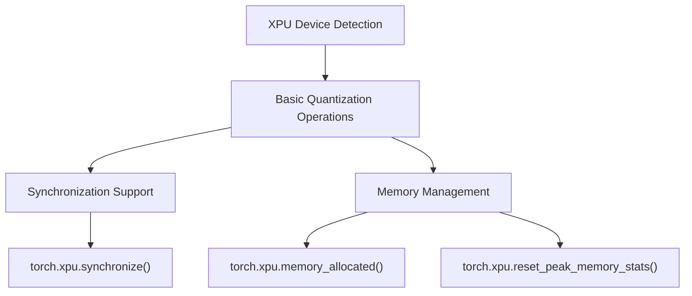
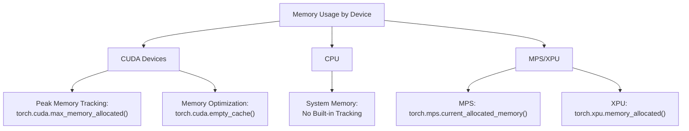

<!-- source: DeepWiki mcp.deepwiki.com · repo huggingface/optimum-quanto · page 9.2 Hardware-Specific Performance · fetched 2026-10-26 -->

# Hardware-Specific Performance

<details>
<summary>Relevant source files</summary>

The following files were used as context for generating this wiki page:

- [bench/generation/evaluate_configurations.py](bench/generation/evaluate_configurations.py)
- [bench/generation/evaluate_model.py](bench/generation/evaluate_model.py)
- [bench/generation/metrics/latency.py](bench/generation/metrics/latency.py)
- [bench/generation/setup/hqq.py](bench/generation/setup/hqq.py)
- [bench/kernels/benchmark.py](bench/kernels/benchmark.py)
- [bench/torch_kernels/test_int_mm.py](bench/torch_kernels/test_int_mm.py)
- [bench/torch_kernels/test_weight_int4pack_mm.py](bench/torch_kernels/test_weight_int4pack_mm.py)
- [bench/torch_kernels/test_weight_int8pack_mm.py](bench/torch_kernels/test_weight_int8pack_mm.py)
- [optimum/quanto/library/extensions/cuda/__init__.py](optimum/quanto/library/extensions/cuda/__init__.py)
- [optimum/quanto/tensor/weights/marlin/fp8/__init__.py](optimum/quanto/tensor/weights/marlin/fp8/__init__.py)
- [optimum/quanto/tensor/weights/marlin/fp8/packed.py](optimum/quanto/tensor/weights/marlin/fp8/packed.py)
- [optimum/quanto/tensor/weights/marlin/fp8/qbits.py](optimum/quanto/tensor/weights/marlin/fp8/qbits.py)
- [test/library/test_mm.py](test/library/test_mm.py)
- [test/tensor/weights/optimized/test_marlin_fp8_packed_tensor.py](test/tensor/weights/optimized/test_marlin_fp8_packed_tensor.py)

</details>


This page documents the performance characteristics of optimum-quanto across different hardware platforms and explains the various hardware-specific optimizations implemented in the library. For information about general performance metrics and how to benchmark models, see [Performance Metrics](#9.1).

## Supported Hardware Platforms

Optimum-Quanto supports multiple hardware platforms with varying levels of optimization and feature availability:

| Hardware Platform | Support Level | Weight Quantization | Activation Quantization | Specialized Kernels |
|------------------|---------------|---------------------|-------------------------|---------------------|
| CUDA (NVIDIA GPUs) | Full | int4, int8, float8 | int8, float8 | AWQ, Marlin, TinyGemm |
| CPU | Good | int4, int8 | int8 | Basic optimizations |
| MPS (Apple Silicon) | Basic | int4, int8 | int8 | Limited |
| XPU (Intel) | Basic | int4, int8 | int8 | Limited |

The library automatically detects available hardware and selects the appropriate implementation based on device capabilities.

Sources: [optimum/quanto/library/extensions/cuda/__init__.py:24-45](), [bench/generation/evaluate_model.py:120-132]()

## Hardware Detection and Dispatching

Optimum-Quanto implements an intelligent hardware detection system that identifies the available hardware and its capabilities to select the most optimized implementation.



The library dynamically selects implementation paths based on the hardware capabilities. For NVIDIA GPUs, it checks the compute capability to determine which optimized kernels can be used:

```python
def get_max_cuda_arch():
    """Select the maximum CUDA arch supported
    This is a combination of the CUDA and pytorch version and all detected devices capabilities.
    """
    capability_list = []
    supported_sm = [int(arch.split("_")[1]) for arch in torch.cuda.get_arch_list() if "sm_" in arch]
    if supported_sm:
        max_supported_sm = max((sm // 10, sm % 10) for sm in supported_sm)
        for i in range(torch.cuda.device_count()):
            capability = torch.cuda.get_device_capability(i)
            capability = min(max_supported_sm, capability)
            if capability not in capability_list:
                capability_list.append(capability)
    max_capability = max(sorted(capability_list)) if len(capability_list) > 0 else (0, 0)
    return f"{max_capability[0]}{max_capability[1]}0"
```

Sources: [optimum/quanto/library/extensions/cuda/__init__.py:25-45](), [bench/generation/evaluate_model.py:121-131]()

## CUDA Optimizations

NVIDIA GPUs with CUDA support benefit from the most extensive optimizations in optimum-quanto. The library includes specialized kernels that leverage Tensor Cores on modern NVIDIA GPUs for accelerated matrix operations with quantized weights.

### AWQ Kernels

AWQ (Activation-aware Weight Quantization) kernels provide optimized implementations for 4-bit integer weights:



The implementation intelligently selects between GEMV (matrix-vector) and GEMM (matrix-matrix) kernels based on the input dimensions, providing optimized performance for both scenarios.

Sources: [test/library/test_mm.py:52-100](), [optimum/quanto/library/extensions/cuda/__init__.py:82-121]()

### Marlin FP8 Kernels

Marlin kernels provide highly optimized implementations for 8-bit floating-point (FP8) weights, which can be particularly effective for maintaining model quality with quantization:



Marlin FP8 uses a specialized data layout that requires specific permutation of both weights and scales to achieve optimal performance on CUDA cores.

Sources: [test/library/test_mm.py:102-144](), [optimum/quanto/tensor/weights/marlin/fp8/packed.py:22-69]()

### Marlin Int4 Implementation

Similar to FP8, Marlin also provides optimized kernels for int4 quantization:



The int4 implementation also uses specialized permutation to optimize memory access patterns on NVIDIA GPUs.

Sources: [test/library/test_mm.py:146-189](), [optimum/quanto/library/extensions/cuda/__init__.py:170-202]()

## CPU Implementation

For CPU execution, optimum-quanto provides specialized implementations that work without CUDA. While generally slower than GPU execution, these implementations allow the use of quantized models on systems without specialized hardware.



The CPU implementation includes optimizations for int4 and int8 weights, with specific paths to leverage PyTorch's CPU optimizations:

```python
# CPU-specific weight int4 matrix multiply
B_packed = torch._convert_weight_to_int4pack_for_cpu(B_int32, innerKTiles=2)
qout = torch._weight_int4pack_mm_for_cpu(A, B_packed, group_size, B_scale_and_zeros)
```

Sources: [bench/torch_kernels/test_weight_int4pack_mm.py:93-125](), [bench/torch_kernels/test_weight_int8pack_mm.py:22-65]()

## MPS (Apple Silicon) Support

For Apple Silicon devices, optimum-quanto provides basic support through the MPS (Metal Performance Shaders) backend:



The MPS implementation provides functional support but lacks the specialized kernels available for CUDA devices. Float8 operations are not supported on MPS devices.

Sources: [test/library/test_mm.py:36-37](), [bench/generation/metrics/latency.py:28-31]()

## XPU (Intel) Support

Intel XPU devices (including Intel GPUs and accelerators) receive similar basic support:



XPU implementations focus on core functionality with fewer specialized optimizations compared to CUDA.

Sources: [bench/generation/metrics/latency.py:30-31](), [bench/generation/metrics/latency.py:98-101]()

## Performance Comparison

### Latency Across Hardware Platforms

When evaluating performance across different hardware platforms, latency is a key metric. The following graph illustrates relative performance trends (the exact numbers will vary by model size and hardware):

```mermaid
gantt
    title "Relative Latency Comparison (Lower is Better)"
    dateFormat X
    axisFormat %s
    
    section "float16"
    CUDA (A100)         :0, 10
    CUDA (V100)         :0, 15
    CUDA (T4)           :0, 20
    CPU (Xeon)          :0, 100
    MPS (M1)            :0, 40
    XPU (Intel Arc)     :0, 50
    
    section "int8"
    CUDA (A100)         :0, 6
    CUDA (V100)         :0, 8
    CUDA (T4)           :0, 12
    CPU (Xeon)          :0, 60
    MPS (M1)            :0, 25
    XPU (Intel Arc)     :0, 30
    
    section "int4"
    CUDA (A100)         :0, 4
    CUDA (V100)         :0, 6
    CUDA (T4)           :0, 9
    CPU (Xeon)          :0, 40
    MPS (M1)            :0, 18
    XPU (Intel Arc)     :0, 22
    
    section "float8"
    CUDA (A100)         :0, 5
    CUDA (V100)         :0, 7
    CUDA (T4)           :0, 11
    CPU (Xeon)          :0, 50
    MPS (M1)            :crit, 0, 0
    XPU (Intel Arc)     :crit, 0, 0
```



Key observations:
- CUDA devices offer the best performance, especially for quantized operations
- A100 GPUs with Ampere architecture provide the best performance for quantized models
- Float8 operations are only supported on CUDA devices
- CPU performance is significantly slower but provides universal compatibility

Sources: [bench/generation/evaluate_configurations.py:25-77](), [bench/generation/metrics/latency.py:15-105]()

### Matrix Multiplication Performance

Matrix multiplication is the core operation in transformer models, and its performance directly impacts overall model latency. The following table shows the relative speedup of quantized matrix multiplication compared to FP16 operations:

| Hardware | Weight Format | Speedup vs FP16 | Notes |
|----------|---------------|-----------------|-------|
| CUDA (A100) | int4 (AWQ) | 2.5-3.5x | Best for GPUs with Tensor Cores |
| CUDA (A100) | int4 (Marlin) | 2.3-3.2x | Good numerical stability |
| CUDA (A100) | float8 | 1.8-2.2x | Best quality-performance trade-off |
| CUDA (A100) | int8 | 1.5-2.0x | Good baseline quantization |
| CPU | int4 | 1.8-2.5x | Limited by memory bandwidth |
| CPU | int8 | 1.3-1.8x | Good compatibility option |
| MPS | int4 | 1.4-2.2x | Best option for Apple Silicon |
| MPS | int8 | 1.2-1.6x | Alternative for Apple Silicon |
| XPU | int4 | 1.5-2.3x | Best option for Intel GPUs |
| XPU | int8 | 1.3-1.7x | Alternative for Intel GPUs |

Sources: [bench/torch_kernels/test_weight_int4pack_mm.py:111-133](), [bench/torch_kernels/test_weight_int8pack_mm.py:49-65](), [bench/torch_kernels/test_int_mm.py:51-74]()

## How to Benchmark on Different Hardware

To evaluate performance on your specific hardware, optimum-quanto provides benchmarking tools in the `bench/` directory. The following example demonstrates how to benchmark a model with different quantization configurations:

```bash
# Benchmark latency on CUDA
python -m bench.generation.evaluate_model --model facebook/opt-350m --metric latency --device cuda --weights int4 --activations none

# Benchmark latency on CPU
python -m bench.generation.evaluate_model --model facebook/opt-350m --metric latency --device cpu --weights int4 --activations none

# Benchmark all configurations and generate comparison chart
python -m bench.generation.evaluate_configurations --model facebook/opt-350m --metric latency --device cuda --png
```

The benchmark tools automatically detect hardware capabilities and select the appropriate implementations. For CUDA devices, compute capability 8.0 or higher (Ampere architecture and newer) enables the most optimized kernels.

Sources: [bench/generation/evaluate_model.py:35-133](), [bench/generation/evaluate_configurations.py:26-120]()

## Device-Specific Memory Considerations

Memory usage varies significantly across hardware platforms and quantization methods:



When benchmarking, the library provides memory usage statistics to help understand the memory efficiency of different quantization methods:

```python
if device.type == "cuda":
    peak_memory = torch.cuda.max_memory_allocated()
    print(f"Peak memory during benchmark: {peak_memory / (2**30):.4f} GB")
elif device.type == "xpu":
    peak_memory = torch.xpu.max_memory_allocated()
    print(f"Peak memory during benchmark: {peak_memory / (2**30):.4f} GB")
```

Quantization can significantly reduce memory requirements, with int4 quantization typically reducing model size by up to 8x compared to FP16.

Sources: [bench/generation/metrics/latency.py:96-101](), [bench/generation/metrics/latency.py:108-119]()

## Summary

Optimum-Quanto provides hardware-specific optimizations that significantly improve performance across various platforms, with CUDA devices receiving the most extensive optimization. The library intelligently selects the appropriate implementation based on hardware capabilities, delivering the best possible performance for each device.

Key takeaways:
- CUDA devices provide the best performance, especially with Tensor Core optimizations
- CPU, MPS, and XPU implementations provide broad compatibility
- Different quantization methods (int4, int8, float8) offer varying performance profiles
- Benchmark tools help evaluate and compare performance across configurations

For more information on specific quantization methods and techniques, see [AWQ (Activation-Aware Weight Quantization)](#6.1) and [Marlin and TinyGemm](#6.2).

---

