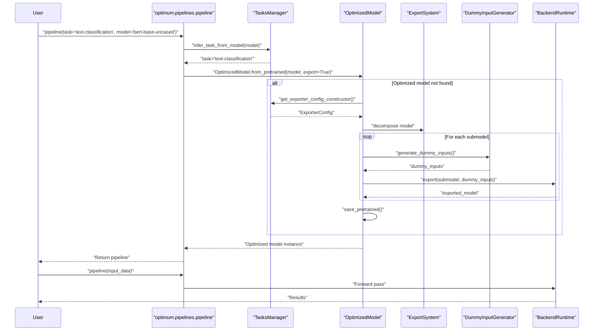

<!-- source: DeepWiki mcp.deepwiki.com · repo huggingface/optimum · page 1 Overview · fetched 2026-10-26 -->

# Overview

<details>
<summary>Relevant source files</summary>

The following files were used as context for generating this wiki page:

- [README.md](README.md)
- [docs/source/index.mdx](docs/source/index.mdx)
- [docs/source/installation.mdx](docs/source/installation.mdx)
- [notebooks/README.md](notebooks/README.md)
- [optimum/version.py](optimum/version.py)

</details>


**🤗 Optimum** is an extension of Hugging Face's Transformers, Diffusers, TIMM, and Sentence-Transformers libraries that provides optimization tools for training and running models on specialized hardware platforms [README.md:17-29](). The library acts as a unified interface layer between popular model libraries and hardware-specific acceleration backends, enabling developers to optimize models for ONNX Runtime, Intel OpenVINO, AWS Inferentia, Intel Gaudi, AMD GPUs/NPUs, and other platforms while maintaining API compatibility with the base libraries [README.md:17-29]().

Sources: [README.md:1-29](), [docs/source/index.mdx:13-18]()

---

## 1.1. Installation and Setup

Optimum can be installed as a lightweight core package with optional dependencies using Python's package installation extras [README.md:31-65](). Hardware-specific extensions are managed through the `EXTRAS_REQUIRE` system, allowing developers to target specific accelerators such as ONNX Runtime, OpenVINO, or AWS Neuron without installing unnecessary toolchains [README.md:31-52]().

For detailed installation guides, environment setup, and verification instructions, see [Installation and Setup](#1.1).

Sources: [README.md:31-65](), [docs/source/installation.mdx:1-45]()

---

## 1.2. Package Architecture and Subpackages

Optimum implements a modular namespace package architecture where the core package (`optimum`) defines foundational abstractions like `OptimizedModel` [optimum/modeling_base.py]() and `TasksManager` [optimum/exporters/tasks.py](), while hardware-specific integrations reside in dedicated `optimum-*` subpackages [setup.py:94](). These subpackages integrate seamlessly through entry points and shared utility interfaces.

For a deep dive into the namespace package design, package interdependencies, and the extension architecture, see [Package Architecture and Subpackages](#1.2).

Sources: [setup.py:45-99](), [README.md:69-152]()

---

## Core System Architecture

Title: "Core System Architecture and Code Entity Relationships"
```mermaid
graph TB
    subgraph ["User Entry Points"]
        CLI["optimum.commands.optimum_cli"]
        PipelineFactory["optimum.pipelines.pipeline"]
    end
    
    subgraph ["Model Registry and Configuration"]
        TasksManager["TasksManager"]
        ExporterConfigBase["ExporterConfig"]
        NormalizedConfig["NormalizedConfig"]
    end
    
    subgraph ["Input Generation"]
        DummyInputGen["DummyInputGenerator"]
    end
    
    subgraph ["Model Abstraction"]
        OptimizedModel["OptimizedModel"]
    end
    
    subgraph ["Optimization"]
        GPTQQuant["GPTQQuantizer"]
        FXTransform["Transformation"]
    end
    
    subgraph ["Infrastructure"]
        ImportUtils["import_utils"]
        BaseConfig["BaseConfig"]
    end
    
    CLI --> TasksManager
    PipelineFactory --> TasksManager
    PipelineFactory --> OptimizedModel
    
    TasksManager --> ExporterConfigBase
    TasksManager --> NormalizedConfig
    ExporterConfigBase --> DummyInputGen
    
    OptimizedModel --> BaseConfig
    
    GPTQQuant --> ImportUtils
    FXTransform --> ImportUtils
    
    TasksManager --> ImportUtils
```
Sources: [setup.py:1-99](), [docs/source/_toctree.yml:1-63]()

---

## Model Lifecycle Workflow

Title: "Model Loading, Export, and Inference Sequence"

Sources: [README.md:69-152](), [docs/source/_toctree.yml:26-30]()

---

## Version Information

The current core library version is defined in `optimum/version.py` as `__version__ = "2.4.0.dev0"` [optimum/version.py:15]().

Sources: [optimum/version.py:1-15](), [setup.py:6-12]()

---

