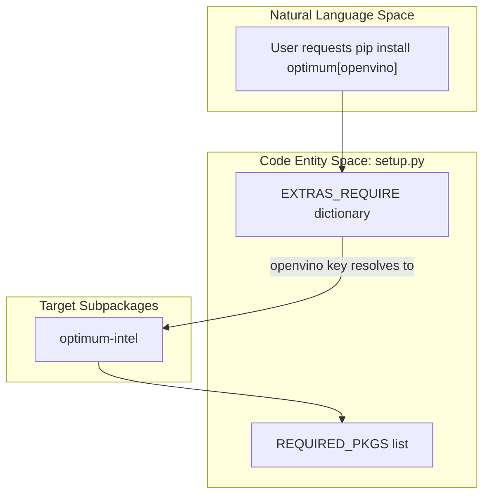
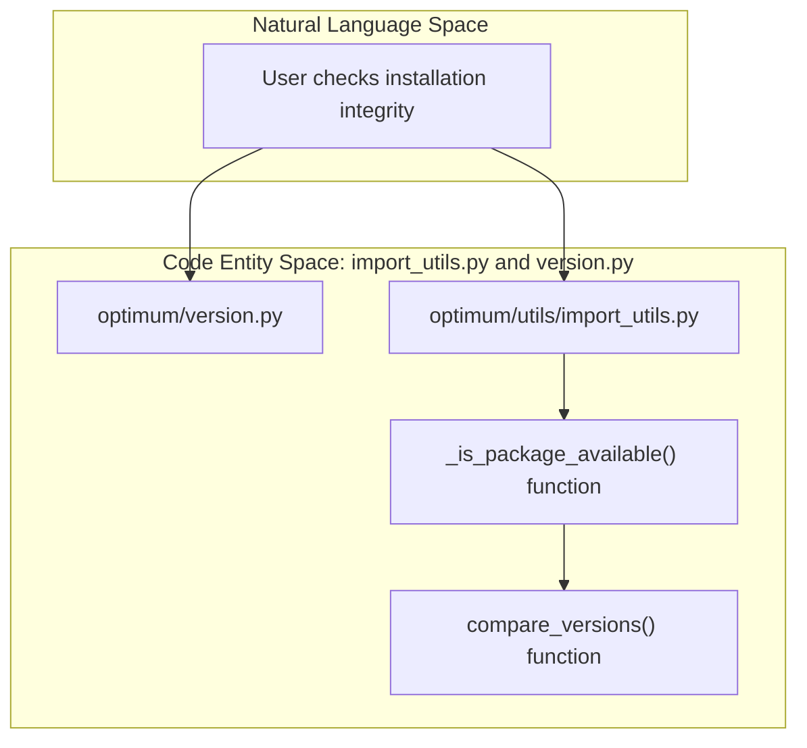

<!-- source: DeepWiki mcp.deepwiki.com · repo huggingface/optimum · page 1.1 Installation and Setup · fetched 2026-10-26 -->

# Installation and Setup

<details>
<summary>Relevant source files</summary>

The following files were used as context for generating this wiki page:

- [Makefile](Makefile)
- [README.md](README.md)
- [docs/README.md](docs/README.md)
- [docs/source/installation.mdx](docs/source/installation.mdx)
- [notebooks/README.md](notebooks/README.md)
- [optimum/utils/import_utils.py](optimum/utils/import_utils.py)
- [pyproject.toml](pyproject.toml)
- [setup.py](setup.py)

</details>


This page provides technical documentation on installing and configuring the `optimum` core package and its hardware-specific extensions. It details the setup configuration, the `EXTRAS_REQUIRE` dependency mapping system, source installation mechanics, and runtime environment verification utilities.

## Purpose and Scope

The installation system is engineered around a modular architecture, isolating the core Hugging Face Transformers integration from hardware-accelerated backends (`optimum-onnx`, `optimum-intel`, `optimum-habana`, etc.). This scope covers setup definitions, package requirements resolution, and environment verification functions.

Sources: [setup.py:65-94](), [README.md:27-29]()

## Base Installation and Core Requirements

The core `optimum` package requires specific base dependencies to interface with Hugging Face ecosystem libraries. These requirements are declared in `setup.py` under `REQUIRED_PKGS`.

| Dependency | Minimum Version Requirement | Code Identifier / Citation |
|------------|---------------------------|----------------------------|
| `transformers` | `>=4.29` | `[setup.py:16-16]()` |
| `torch` | `>=1.11` | `[setup.py:17-17]()` |
| `packaging` | Any | `[setup.py:18-18]()` |
| `numpy` | Any | `[setup.py:19-19]()` |
| `huggingface_hub` | `>=1.31.0` | `[setup.py:20-20]()` |

To install the core library without any hardware accelerator extensions:

```bash
python -m pip install optimum
```

Sources: [setup.py:15-21]()

## Accelerator-Specific Installation and the EXTRAS_REQUIRE System

Hardware-specific features and backend runtimes are mapped through the `EXTRAS_REQUIRE` dictionary in `setup.py`. This mechanism allows users to install specific subpackages by appending extra specifiers.

| Extra Name | Target Package or Requirement | Citation |
|------------|-----------------------------|----------|
| `amd` | `optimum-amd` | `[setup.py:45-45]()` |
| `furiosa` | `optimum-furiosa` | `[setup.py:46-46]()` |
| `graphcore` | `optimum-graphcore` | `[setup.py:47-47]()` |
| `habana` | `optimum-habana>=1.17.0` | `[setup.py:48-48]()` |
| `intel` | `optimum-intel>=1.23.0` | `[setup.py:49-49]()` |
| `nncf` | `optimum-intel[nncf]>=1.23.0` | `[setup.py:50-50]()` |
| `neural-compressor` | `optimum-intel[neural-compressor]>=1.23.0` | `[setup.py:51-51]()` |
| `onnx` | `optimum-onnx` | `[setup.py:52-52]()` |
| `onnxruntime` | `optimum-onnx[onnxruntime]` | `[setup.py:53-53]()` |
| `onnxruntime-gpu` | `optimum-onnx[onnxruntime-gpu]` | `[setup.py:54-54]()` |
| `openvino` | `optimum-intel[openvino]>=1.23.0` | `[setup.py:55-55]()` |
| `quanto` | `optimum-quanto>=0.2.4` | `[setup.py:56-56]()` |

Installation command pattern utilizing the upgrade strategy:

```bash
python -m pip install --upgrade --upgrade-strategy eager optimum[accelerator_name]
```

Sources: [setup.py:44-56](), [README.md:41-54]()

## Installation from Source

For development or bleeding-edge integrations, packages can be installed directly from Git repositories using `pip` URL specifiers:

```bash
python -m pip install git+https://github.com/huggingface/optimum.git
```

For hardware extensions from source:

```bash
python -m pip install optimum[onnxruntime]@git+https://github.com/huggingface/optimum.git
```

Sources: [README.md:55-65](), [docs/source/installation.mdx:35-45]()

### Dependency Mapping and Resolution Flow

Diagram Title: "Dependency Mapping and Resolution Flow"



Sources: [setup.py:15-21](), [setup.py:44-56]()

## Runtime Import Validation and Version Management

Optimum utilizes `optimum/utils/import_utils.py` to check for optional package availability and enforce version compatibility at runtime. The function `_is_package_available` queries `importlib.metadata` and `importlib.util` to verify installed package distributions.

```python
from optimum.utils.import_utils import _is_package_available, is_torch_version

# Checks if a package distribution is present in the environment
has_openvino = _is_package_available("openvino")
```

Minimum version constants defined in the import utility module include:
- `TORCH_MINIMUM_VERSION`: `2.1.0` (`[optimum/utils/import_utils.py:29-29]()`)
- `TRANSFORMERS_MINIMUM_VERSION`: `4.36.0` (`[optimum/utils/import_utils.py:30-30]()`)
- `DIFFUSERS_MINIMUM_VERSION`: `0.22.0` (`[optimum/utils/import_utils.py:31-31]()`)
- `GPTQMODEL_MINIMUM_VERSION`: `7.0.0` (`[optimum/utils/import_utils.py:32-32]()`)

Sources: [optimum/utils/import_utils.py:16-79](), [optimum/utils/import_utils.py:29-33]()

## Developer, Quality, and Build Tools

Development environments are provisioned via dedicated development extras inside `EXTRAS_REQUIRE`:
- `dev`: Combines `TESTS_REQUIRE` and `QUALITY_REQUIRE` (`[setup.py:58-58]()`).
- `tests`: Includes `pytest`, `accelerate`, `parameterized`, `pytest-xdist`, and testing assets (`[setup.py:23-38]()`).
- `quality`: Includes `black~=23.1` and `ruff==0.1.5` (`[setup.py:40-40]()`).
- `benchmark`: Includes `optuna`, `tqdm`, `evaluate`, etc. (`[setup.py:42-42]()`).

Repository automation tasks are standardized via the `Makefile`:
| Makefile Command | Target Action | Implementation |
|------------------|---------------|----------------|
| `make style` | Code formatting & linting | `black .` and `ruff check . --fix` (`[Makefile:22-24]()`) |
| `make test` | Execution of unit test suite | `python -m pytest tests` (`[Makefile:27-28]()`) |
| `make doc` | Documentation compilation | `doc-builder build optimum docs/source/` (`[Makefile:46-51]()`) |

Sources: [setup.py:23-63](), [Makefile:18-51]()

## Installation Verification and Data Flow

Diagram Title: "Runtime Environment Verification Data Flow"



Sources: [setup.py:7-10](), [optimum/utils/import_utils.py:39-78](), [optimum/utils/import_utils.py:121-138]()

---

