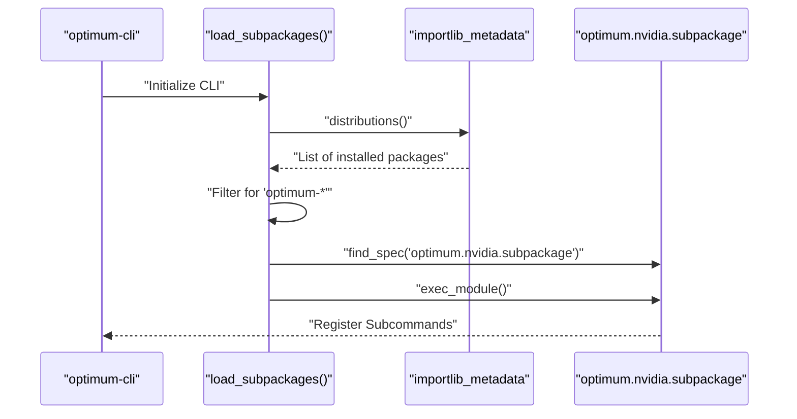
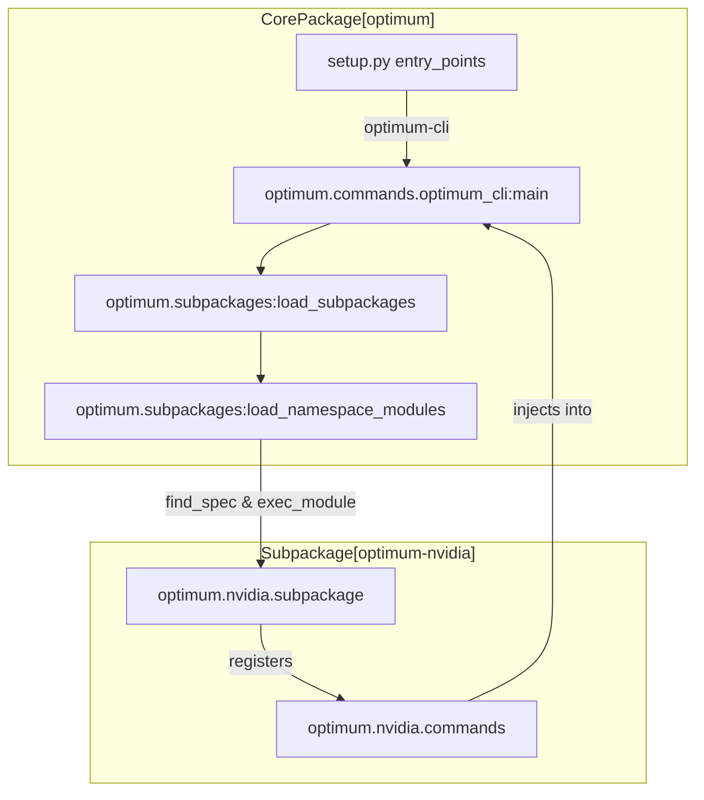

<!-- source: DeepWiki mcp.deepwiki.com · repo huggingface/optimum · page 1.2 Package Architecture and Subpackages · fetched 2026-10-26 -->

# Package Architecture and Subpackages

Relevant source files

The following files were used as context for generating this wiki page:

- [docs/source/index.mdx](docs/source/index.mdx)
- [optimum/subpackages.py](optimum/subpackages.py)
- [optimum/utils/import_utils.py](optimum/utils/import_utils.py)
- [setup.py](setup.py)

## Overview and Scope

This document details the package architecture of the 🤗 Optimum library, focusing on its namespace package design, how hardware-specific `optimum-*` subpackages integrate with the core library, and the dynamic extension architecture that enables modular backend loading without hard-coded dependencies.

Sources: [setup.py:65-70](), [optimum/subpackages.py:1-78]()

## Namespace Package Structure

Optimum uses Python's namespace package capability to allow multiple independent distributions to contribute to the `optimum` namespace. The `setup.py` file uses `find_namespace_packages(include=["optimum*"])` to manage this hierarchy [setup.py:92-92]().

### Integration via EXTRAS_REQUIRE

The core `optimum` package acts as a central hub. It defines an `EXTRAS_REQUIRE` dictionary in `setup.py` that maps hardware backends to their respective subpackages [setup.py:44-63](). This system allows users to install only the necessary dependencies for their target hardware.

| Extra Name | Subpackage / Dependency | Hardware Target |
| :--- | :--- | :--- |
| `amd` | `optimum-amd` | AMD Instinct GPUs & Ryzen AI |
| `furiosa` | `optimum-furiosa` | FuriosaAI WARBOY |
| `graphcore` | `optimum-graphcore` | Graphcore IPU |
| `habana` | `optimum-habana>=1.17.0` | Intel Gaudi (HPU) |
| `intel` | `optimum-intel>=1.23.0` | Intel CPU/GPU (OpenVINO, IPEX) |
| `onnxruntime` | `optimum-onnx[onnxruntime]` | Cross-platform ONNX Runtime |
| `quanto` | `optimum-quanto>=0.2.4` | Quantization backend |

Sources: [setup.py:44-63](), [README.md:27-54]()

## Modular Extension Architecture

The integration between the core and subpackages is facilitated by a dynamic loading system defined in `optimum/subpackages.py`. This architecture allows subpackages to register their own CLI commands and backend-specific logic without being hard-coded into the core repository.

### Subpackage Loading Mechanism

The function `load_subpackages()` triggers the discovery of installed extensions by looking for a `subpackage` module within any installed distribution starting with `optimum-` [optimum/subpackages.py:72-78]().

Title: "Subpackage Loading Sequence"

Sources: [optimum/subpackages.py:16-78]()

Key functions in this process include:
- `load_namespace_modules(namespace, module)`: Iterates through installed distributions via `importlib_metadata.distributions()`. If a distribution matches the namespace prefix (e.g., `optimum-`), it attempts to load the specified module (e.g., `subpackage`) [optimum/subpackages.py:30-70]().
- `load_subpackages()`: High-level entry point that invokes `load_namespace_modules("optimum", "subpackage")` [optimum/subpackages.py:72-78]().

Sources: [optimum/subpackages.py:30-78]()

## Code Entity Relationship

The following diagram bridges the natural language concept of "Subpackages" to the specific code entities that implement the integration.

Title: "Code Entity Relationship for Namespace Extension"

Sources: [setup.py:98-98](), [optimum/subpackages.py:30-78]()

## Data Flow: From Installation to Execution

When a user interacts with Optimum, the data flow for backend selection follows a modular path:

1.  **Installation**: User runs `pip install optimum[intel]`. This triggers the installation of `optimum-intel` as defined in `EXTRAS_REQUIRE` [setup.py:49-49]().
2.  **CLI Discovery**: When `optimum-cli` is executed, it invokes `load_subpackages()`, which queries installed distributions and executes any matching `subpackage.py` modules [optimum/subpackages.py:72-78]().
3.  **Command Registration**: The subpackage uses entry points and registration utilities to inject hardware-specific commands into the root CLI.
4.  **Backend Routing**: High-level APIs and helper modules check package availability via `_is_package_available()` in `import_utils.py` to route execution to the appropriate backend implementation [optimum/utils/import_utils.py:39-78]().

Sources: [setup.py:44-63](), [optimum/subpackages.py:30-78](), [optimum/utils/import_utils.py:39-118]()

---

