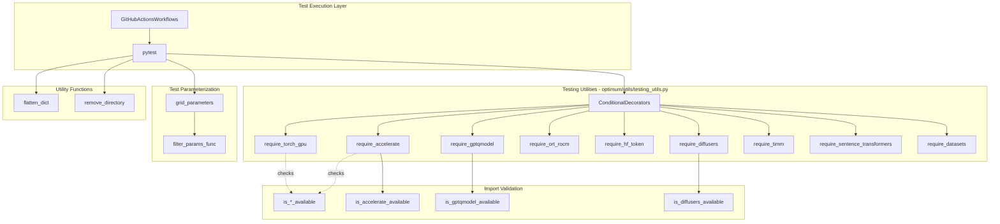
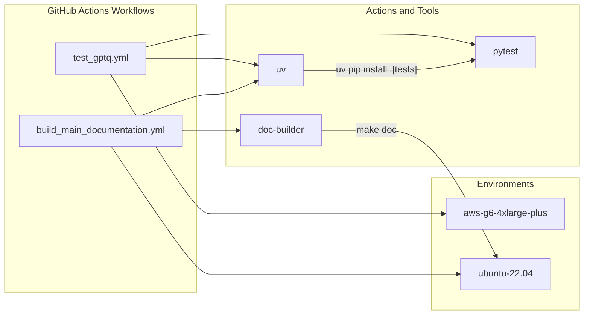

<!-- source: DeepWiki mcp.deepwiki.com · repo huggingface/optimum · page 10 Development and Testing · fetched 2026-10-26 -->

# Development and Testing

Relevant source files

The following files were used as context for generating this wiki page:

- [.github/ISSUE_TEMPLATE/bug-report.yml](.github/ISSUE_TEMPLATE/bug-report.yml)
- [.github/ISSUE_TEMPLATE/config.yml](.github/ISSUE_TEMPLATE/config.yml)
- [.github/ISSUE_TEMPLATE/feature-request.yml](.github/ISSUE_TEMPLATE/feature-request.yml)
- [CODE_OF_CONDUCT.md](CODE_OF_CONDUCT.md)
- [CONTRIBUTING.md](CONTRIBUTING.md)
- [Makefile](Makefile)
- [docs/README.md](docs/README.md)
- [pyproject.toml](pyproject.toml)

This section covers the development infrastructure and testing systems that support the Optimum library. It is intended for contributors and maintainers who need to understand how to run tests, use development utilities, configure CI/CD pipelines, and build documentation.

**Scope**: This page provides a high-level overview of the testing utilities, CI/CD workflows, and documentation build system. For detailed information on specific subsystems, see:
- Testing utilities and decorators: [Testing Utilities and Decorators](#10.1)
- CI/CD pipeline configuration: [CI/CD Workflows](#10.2)
- Documentation system: [Documentation System](#10.3)

## Testing Infrastructure Overview

The Optimum testing infrastructure is built on `pytest` [pyproject.toml:33-45]() and provides a comprehensive set of utilities for testing across different hardware backends, dependency configurations, and execution environments. The core testing utilities are located in `optimum/utils/testing_utils.py` and provide conditional test execution based on available dependencies and hardware.

### Key Testing Components

| Component | Purpose | Key Files / Entities |
|-----------|---------|-----------|
| **Test Decorators** | Skip tests conditionally based on available dependencies/hardware | `require_*` decorators [optimum/utils/testing_utils.py:54-152]() |
| **Test Parameterization** | Generate test grids for testing multiple configurations | `grid_parameters` [optimum/utils/testing_utils.py:154-191]() |
| **CI/CD Workflows** | Automated testing across platforms and Python versions | `.github/workflows/*.yml` [.github/workflows/test_gptq.yml:1-54]() |

### Testing Utilities Architecture

The following diagram maps the testing infrastructure components to their implementation in the codebase, bridging natural language concepts to concrete code entities.

**Testing System Entity Map**

Sources: [optimum/utils/testing_utils.py:1-203](), [pyproject.toml:33-45]()

### Conditional Test Execution

The testing utilities provide decorators that skip tests when required dependencies or hardware are unavailable. This allows the test suite to run in various environments without failures due to missing optional dependencies.

**Available Decorators**:

| Decorator | Condition | Usage |
|-----------|-----------|-------|
| `require_torch_gpu` | CUDA available via PyTorch | GPU-dependent tests [optimum/utils/testing_utils.py:68-75]() |
| `require_accelerate` | `accelerate` library installed | Tests using accelerate features [optimum/utils/testing_utils.py:54-58]() |
| `require_gptqmodel` | `gptqmodel` library installed | GPTQ quantization tests [optimum/utils/testing_utils.py:61-65]() |
| `require_ort_rocm` | `ROCMExecutionProvider` available | AMD GPU tests with ONNX Runtime [optimum/utils/testing_utils.py:77-86]() |
| `require_hf_token` | `HF_AUTH_TOKEN` env variable set | Tests requiring Hub authentication [optimum/utils/testing_utils.py:88-97]() |
| `require_ort_training` | `onnxruntime.training` + `torch_ort` | ONNX Runtime training tests [optimum/utils/testing_utils.py:127-135]() |

For details, see [Testing Utilities and Decorators](#10.1).

Sources: [optimum/utils/testing_utils.py:40-203]()

### Test Parameterization with `grid_parameters`

The `grid_parameters` function generates all combinations of test parameters [optimum/utils/testing_utils.py:154-191](), enabling comprehensive testing across multiple configurations. It supports yielding dictionaries for direct use with `pytest` parameterization and includes an optional `filter_params_func` to exclude specific combinations.

Sources: [optimum/utils/testing_utils.py:154-191]()

## CI/CD Workflows

The CI/CD system uses GitHub Actions to test the library across multiple platforms and hardware configurations.

### Workflow Architecture

The workflows are designed to handle the modular nature of Optimum, often installing core and subpackages in tandem to verify integration.

**CI/CD Pipeline Entity Map**

Sources: [.github/workflows/test_gptq.yml:1-54](), [.github/workflows/build_main_documentation.yml:1-77]()

### Key Workflows
- **GPTQ Testing**: Runs on specialized GPU runners (`aws-g6-4xlarge-plus`) using NVIDIA CUDA containers to validate quantization logic [.github/workflows/test_gptq.yml:27-33]().
- **Documentation Build**: Automates the generation and hosting of documentation, including the merging of subpackage docs [.github/workflows/build_main_documentation.yml:15-77]().

For details, see [CI/CD Workflows](#10.2).

Sources: [.github/workflows/test_gptq.yml:1-54](), [.github/workflows/build_main_documentation.yml:1-77]()

## Documentation System

Optimum uses `doc-builder` to maintain high-quality technical documentation [Makefile:43-51](), [docs/README.md:62-65](). The system is designed to provide a unified view of the core library and its various hardware-specific subpackages.

### Documentation Build Process
The build process involves:
1. **Generation**: Using `doc-builder` to process Markdown and docstrings [Makefile:46-51]().
2. **Combination**: Running custom scripts or commands to merge documentation from subpackages like `nvidia`, `intel`, `onnx`, and `habana` [docs/README.md:34-44]().
3. **Deployment**: Pushing the built artifacts to the designated target repository [docs/README.md:28-30]().

For details, see [Documentation System](#10.3).

Sources: [Makefile:43-51](), [docs/README.md:1-184]()

---

