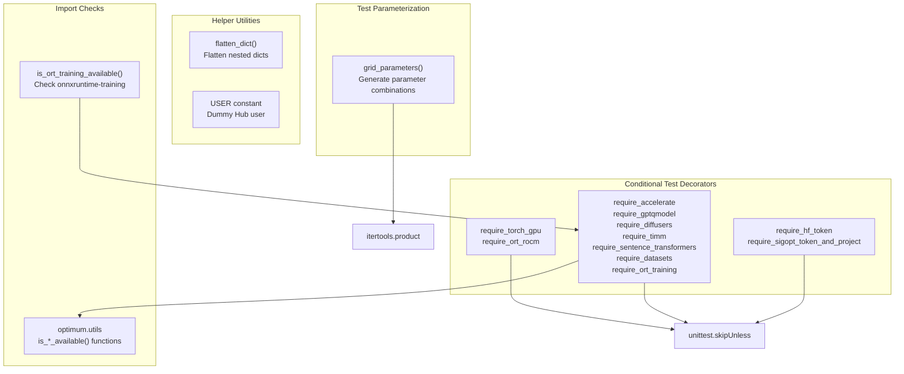
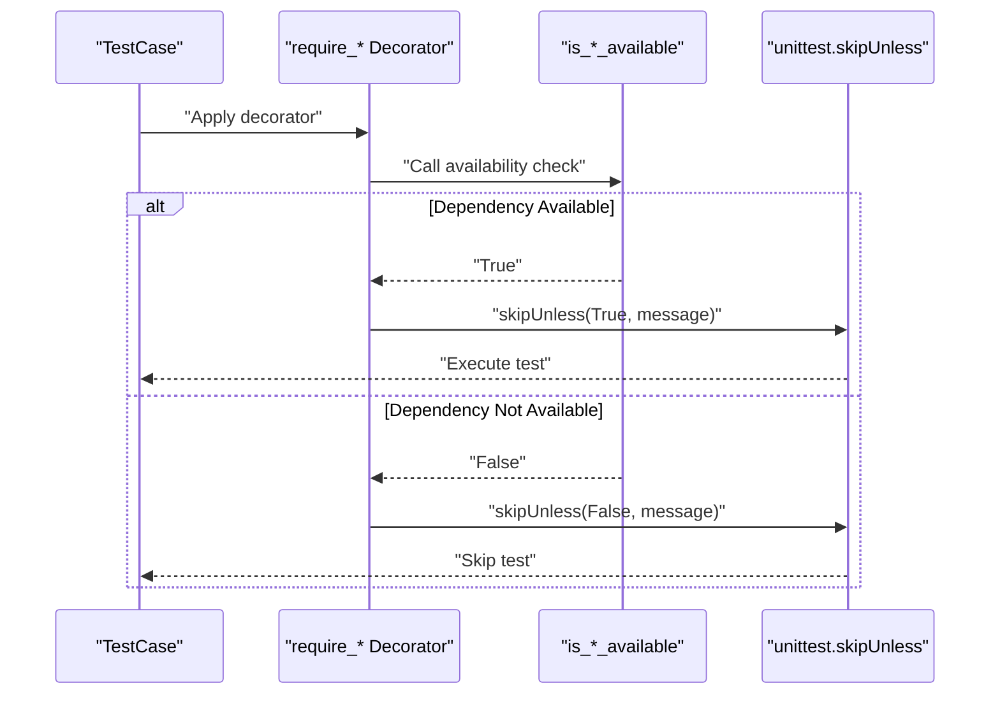
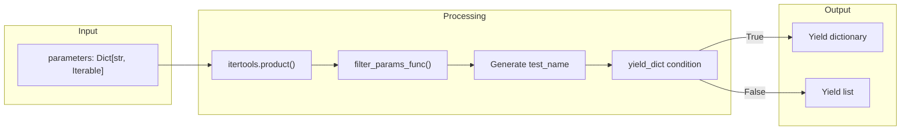

<!-- source: DeepWiki mcp.deepwiki.com · repo huggingface/optimum · page 10.1 Testing Utilities and Decorators · fetched 2026-10-26 -->

# Testing Utilities and Decorators

<details>
<summary>Relevant source files</summary>

The following files were used as context for generating this wiki page:

- [.github/PULL_REQUEST_TEMPLATE.md](.github/PULL_REQUEST_TEMPLATE.md)
- [docs/conftest.py](docs/conftest.py)
- [optimum/conftest.py](optimum/conftest.py)
- [optimum/utils/testing_utils.py](optimum/utils/testing_utils.py)
- [tests/run_doctest.sh](tests/run_doctest.sh)
- [tests/utils/documentation_tests.txt](tests/utils/documentation_tests.txt)

</details>


## Purpose and Scope

This document covers the testing infrastructure provided by the `optimum/utils/testing_utils.py` module. The testing utilities provide conditional test execution decorators, test parameterization helpers, and utility functions for managing test environments. These tools enable tests to be executed selectively based on available hardware, installed dependencies, and environment configuration.

For information about CI/CD workflows that use these utilities, see [CI/CD Workflows](10.2). For details on import and dependency checking, see [Import and Dependency Management](5.3).

## Overview

The testing utilities module provides three main categories of functionality:

1. **Conditional Test Decorators**: Skip tests based on hardware availability, library installation, or environment variables.
2. **Test Parameterization**: Generate test cases across parameter grids.
3. **Helper Utilities**: Functions for data structure manipulation and environment configuration.

**Module Diagram: Testing Utilities Structure**



Sources: [optimum/utils/testing_utils.py:1-203]()

## Conditional Test Execution Decorators

The testing utilities provide decorators that wrap `unittest.skipUnless` to conditionally execute tests based on runtime availability checks. Each decorator evaluates whether required dependencies, hardware, or credentials are available and skips the test if not.

### Hardware and Backend Decorators

These decorators check for specific hardware or execution provider availability:

#### require_torch_gpu

Skips tests that require CUDA-capable GPU hardware. Checks `torch.cuda.is_available()` to determine if CUDA is accessible.

**Implementation**: [optimum/utils/testing_utils.py:68-74]()

#### require_ort_rocm

Skips tests that require the `ROCMExecutionProvider` for ONNX Runtime. Verifies that `ROCMExecutionProvider` is the first (highest priority) provider in `onnxruntime.get_available_providers()`.

**Implementation**: [optimum/utils/testing_utils.py:77-85]()

### Library and Package Decorators

These decorators check for optional library installations using availability checking functions:

#### require_accelerate

Skips tests requiring the `accelerate` library. Uses `is_accelerate_available()` to check installation.

**Implementation**: [optimum/utils/testing_utils.py:54-58]()

#### require_gptqmodel

Skips tests requiring `gptqmodel` for quantization. Uses `is_gptqmodel_available()` to check installation.

**Implementation**: [optimum/utils/testing_utils.py:61-65]()

#### require_diffusers

Skips tests requiring the `diffusers` library. Uses `is_diffusers_available()` to check installation.

**Implementation**: [optimum/utils/testing_utils.py:138-139]()

#### require_timm

Skips tests requiring the `timm` (PyTorch Image Models) library. Uses `is_timm_available()` to check installation.

**Implementation**: [optimum/utils/testing_utils.py:142-143]()

#### require_sentence_transformers

Skips tests requiring the `sentence-transformers` library. Uses `is_sentence_transformers_available()` to check installation.

**Implementation**: [optimum/utils/testing_utils.py:146-147]()

#### require_datasets

Skips tests requiring the `datasets` library. Uses `is_datasets_available()` to check installation.

**Implementation**: [optimum/utils/testing_utils.py:150-151]()

#### require_ort_training

Skips tests requiring ONNX Runtime training components. Performs a check via `is_ort_training_available()` that:

1. Verifies `onnxruntime.training` module is available via `importlib.util.find_spec`.
2. Checks that `torch_ort` is installed.
3. Attempts to run `python -m torch_ort.configure` via `subprocess.run` to ensure proper configuration.

**Implementation**: [optimum/utils/testing_utils.py:114-135]()

**Availability Logic Diagram**



Sources: [optimum/utils/testing_utils.py:54-151](), [optimum/utils/testing_utils.py:114-135]()

### Environment and Credential Decorators

These decorators check for required environment variables or credentials:

#### require_hf_token

Skips tests requiring a Hugging Face Hub authentication token. Checks for the `HF_AUTH_TOKEN` environment variable.

**Implementation**: [optimum/utils/testing_utils.py:88-97]()

#### require_sigopt_token_and_project

Skips tests requiring SigOpt API integration. Checks for both `SIGOPT_API_TOKEN` and `SIGOPT_PROJECT` environment variables.

**Implementation**: [optimum/utils/testing_utils.py:100-111]()

**Environment Check Table**

| Decorator | Environment Variable(s) | Purpose |
|-----------|-------------------------|---------|
| `require_hf_token` | `HF_AUTH_TOKEN` | Access private Hub models |
| `require_sigopt_token_and_project` | `SIGOPT_API_TOKEN`, `SIGOPT_PROJECT` | SigOpt hyperparameter optimization |

Sources: [optimum/utils/testing_utils.py:88-111]()

## Test Parameterization with grid_parameters

The `grid_parameters` function generates an iterable over the Cartesian product of multiple parameter values, enabling comprehensive testing with minimal code duplication.

### Function Signature

```python
def grid_parameters(
    parameters: Dict[str, Iterable[Any]],
    yield_dict: bool = False,
    add_test_name: bool = True,
    filter_params_func: Optional[Callable[[Tuple], Tuple]] = None,
) -> Iterable
```

**Implementation**: [optimum/utils/testing_utils.py:154-191]()

### Key Features

1. **Cartesian Product**: Uses `itertools.product(*parameters.values())` to generate every combination of the provided parameter iterables. [optimum/utils/testing_utils.py:174]()
2. **Filtering**: If `filter_params_func` is provided, it can modify the parameter list or return `None` to exclude the combination entirely. [optimum/utils/testing_utils.py:175-178]()
3. **Naming**: Automatically generates a `test_name` by joining string representations of the parameters with underscores. [optimum/utils/testing_utils.py:180]()
4. **Output Formats**:
   - If `yield_dict=True`, it returns a dictionary mapping keys from the input `parameters` to their sampled values, optionally including the `test_name`. [optimum/utils/testing_utils.py:181-187]()
   - If `yield_dict=False` (default), it returns a list containing the `test_name` followed by the sampled values. [optimum/utils/testing_utils.py:189-190]()

**Parameter Grid Logic**



Sources: [optimum/utils/testing_utils.py:154-191]()

## Helper Utilities

### flatten_dict

Recursively flattens nested dictionaries. If a value is a `MutableMapping`, its contents are extended into the parent list. Note that this implementation replaces parent keys with nested keys rather than creating path-like keys.

**Implementation**: [optimum/utils/testing_utils.py:40-51]()

### USER Constant

Defines a dummy user string `__DUMMY_OPTIMUM_USER__` used specifically for Hub-related testing.

**Implementation**: [optimum/utils/testing_utils.py:37]()

Sources: [optimum/utils/testing_utils.py:37-51]()

## CI Integration

These utilities are utilized in the library's continuous integration workflows to ensure tests run in appropriate target environments.

Sources: [tests/utils/documentation_tests.txt:1-46]()

---

