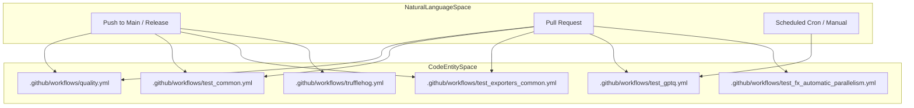
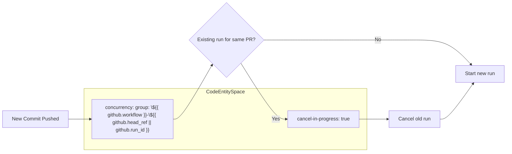
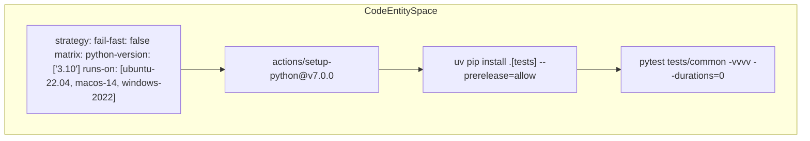
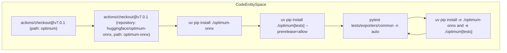

<!-- source: DeepWiki mcp.deepwiki.com · repo huggingface/optimum · page 10.2 CI/CD Workflows · fetched 2026-10-26 -->

# CI/CD Workflows

<details>
<summary>Relevant source files</summary>

The following files were used as context for generating this wiki page:

- [.github/dependabot.yml](.github/dependabot.yml)
- [.github/workflows/quality.yml](.github/workflows/quality.yml)
- [.github/workflows/stale.yml](.github/workflows/stale.yml)
- [.github/workflows/style_bot.yml](.github/workflows/style_bot.yml)
- [.github/workflows/test_common.yml](.github/workflows/test_common.yml)
- [.github/workflows/test_exporters_common.yml](.github/workflows/test_exporters_common.yml)
- [.github/workflows/test_fx_automatic_parallelism.yml](.github/workflows/test_fx_automatic_parallelism.yml)
- [.github/workflows/test_gptq.yml](.github/workflows/test_gptq.yml)
- [.github/workflows/test_utils.yml](.github/workflows/test_utils.yml)
- [.github/workflows/trufflehog.yml](.github/workflows/trufflehog.yml)
- [.github/workflows/upload_pr_documentation.yml](.github/workflows/upload_pr_documentation.yml)

</details>


This page documents the GitHub Actions workflows that automate testing across multiple platforms and ensure integration with Optimum subpackages. The CI/CD system provides comprehensive validation through matrix testing, subpackage integration checks, quality controls, and hardware-accelerated test suites. For detailed information about the testing utilities used within these workflows, see page 10.1.

## Overview of CI/CD Workflows

Optimum uses GitHub Actions workflows defined in `.github/workflows/` to automate testing, code quality checks, and maintenance. Workflows are categorized by their testing scope and dependencies:

**Workflow Organization**

| Workflow File | Test Scope | Subpackage Dependency | Platform Matrix / Runner |
|--------------|------------|----------------------|--------------------------|
| `quality.yml` | Code style and linting (black, ruff) | None | `ubuntu-22.04` [.github/workflows/quality.yml:15-19]() |
| `test_common.yml` | Common core tests | None | `ubuntu-22.04`, `macos-14`, `windows-2022` [.github/workflows/test_common.yml:24-25]() |
| `test_utils.yml` | Utility tests needing datasets | None | `ubuntu-22.04`, `macos-14`, `windows-2022` [.github/workflows/test_utils.yml:23-24]() |
| `test_exporters_common.yml` | Exporter and ONNX common tests | `optimum-onnx` | `ubuntu-22.04`, `windows-2022` [.github/workflows/test_exporters_common.yml:23-25]() |
| `test_gptq.yml` | GPTQ quantization tests | None (CUDA container) | `aws-g6-4xlarge-plus` (GPU) [.github/workflows/test_gptq.yml:27-29]() |
| `test_fx_automatic_parallelism.yml` | FX Automatic Parallelism tests | None (CUDA container) | `aws-g5-12xlarge-plus` (GPU) [.github/workflows/test_fx_automatic_parallelism.yml:26-27]() |
| `trufflehog.yml` | Secret leakage scanning | None | `ubuntu-latest` [.github/workflows/trufflehog.yml:7-8]() |

**Workflow Trigger Strategy and Code Entity Mapping**


Sources:
- [.github/workflows/quality.yml:3-7]()
- [.github/workflows/test_common.yml:3-7]()
- [.github/workflows/test_exporters_common.yml:3-7]()
- [.github/workflows/test_gptq.yml:3-19]()
- [.github/workflows/test_fx_automatic_parallelism.yml:3-15]()
- [.github/workflows/trufflehog.yml:1-3]()

## Workflow Structure and Common Patterns

All test workflows follow a consistent structure defined in their YAML configuration, implementing concurrency controls and environment variables:

**Common Workflow Structure**

```yaml
# Example structure from test_common.yml
name: Common / Python - Test

on:
  push:
    branches: [main, v*-release]
  pull_request:
    branches: [main]

concurrency:
  group: ${{ github.workflow }}-${{ github.head_ref || github.run_id }}
  cancel-in-progress: true

env:
  UV_SYSTEM_PYTHON: 1
  UV_TORCH_BACKEND: cpu
  TRANSFORMERS_IS_CI: true
```

**Concurrency Control Pattern & Code Entities**


Sources:
- [.github/workflows/test_common.yml:9-17]()
- [.github/workflows/quality.yml:9-11]()

## Platform Matrix Testing

Core workflows use matrix testing to validate functionality across multiple operating systems and Python versions using `uv` for fast dependency installation:

**Test Matrix Configuration and Execution Flow**



The matrix configuration from [.github/workflows/test_common.yml:20-27]():

```yaml
strategy:
  fail-fast: false
  matrix:
    python-version: ["3.10"]
    runs-on: [ubuntu-22.04, macos-14, windows-2022]

runs-on: ${{ matrix.runs-on }}
```

Sources:
- [.github/workflows/test_common.yml:20-45]()
- [.github/workflows/test_utils.yml:20-44]()

## Subpackage Integration Testing

The `test_exporters_common.yml` workflow tests Optimum core functionality in conjunction with `optimum-onnx` to ensure proper integration. It checks out both repositories and runs tests under both standard and editable modes.

**Subpackage Integration Workflow Pattern**



Sources:
- [.github/workflows/test_exporters_common.yml:30-69]()

## Specialized Hardware and Acceleration Workflows

Workflows such as `test_gptq.yml` and `test_fx_automatic_parallelism.yml` target specific GPU instances and run containerized test environments with CUDA support:

- **GPTQ Quantization Tests (`test_gptq.yml`)**: Runs on `aws-g6-4xlarge-plus` nodes using `nvidia/cuda:12.8.1-cudnn-devel-ubuntu22.04` container with `--gpus all` and `gptqmodel` dependencies [.github/workflows/test_gptq.yml:27-51]().
- **FX Automatic Parallelism Tests (`test_fx_automatic_parallelism.yml`)**: Runs on `aws-g5-12xlarge-plus` nodes using `nvidia/cuda:12.4.1-devel-ubuntu22.04` container to validate tensor parallelism across multiple devices [.github/workflows/test_fx_automatic_parallelism.yml:26-59]().

Sources:
- [.github/workflows/test_gptq.yml:27-54]()
- [.github/workflows/test_fx_automatic_parallelism.yml:26-59]()

## Environment Controls and Quality Checks

### Quality and Security Workflows
- **`quality.yml`**: Enforces code style using `black --check .` and `ruff .` [.github/workflows/quality.yml:38-44]().
- **`trufflehog.yml`**: Performs deep credential and secret leak scanning across git history via `trufflesecurity/trufflehog` [.github/workflows/trufflehog.yml:7-15]().
- **`style_bot.yml`**: Automatically applies code formatting when triggered by issue comments via `huggingface/huggingface_hub/.github/workflows/style-bot-action.yml` [.github/workflows/style_bot.yml:1-19]().

### Maintenance
- **`stale.yml`**: Automatically manages issues and pull requests by marking stale items after 30 days (issues) or 90 days (PRs), while exempting core labels such as `bug`, `exporters`, `onnx`, and `quantization` [.github/workflows/stale.yml:15-24]().

Sources:
- [.github/workflows/quality.yml:38-44]()
- [.github/workflows/trufflehog.yml:7-15]()
- [.github/workflows/style_bot.yml:1-19]()
- [.github/workflows/stale.yml:15-24]()

---

