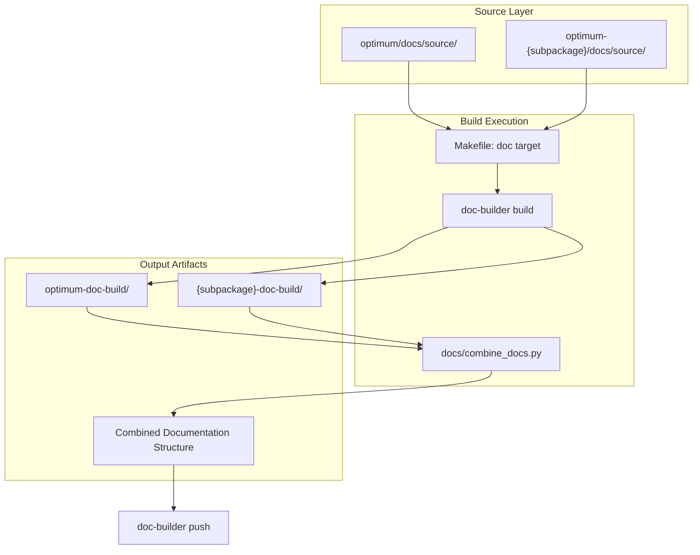
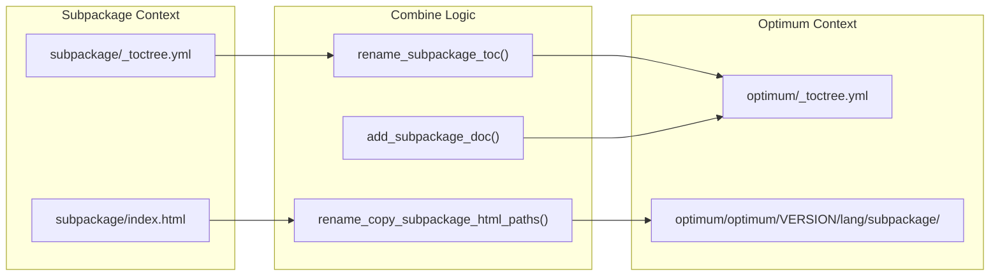

<!-- source: DeepWiki mcp.deepwiki.com · repo huggingface/optimum · page 10.3 Documentation System · fetched 2026-10-26 -->

# Documentation System

Relevant source files

The following files were used as context for generating this wiki page:

- [.github/workflows/build_main_documentation.yml](.github/workflows/build_main_documentation.yml)
- [.github/workflows/build_pr_documentation.yml](.github/workflows/build_pr_documentation.yml)
- [docs/combine_docs.py](docs/combine_docs.py)
- [docs/source/_toctree.yml](docs/source/_toctree.yml)
- [docs/source/furiosa_overview.mdx](docs/source/furiosa_overview.mdx)
- [docs/source/notebooks.md](docs/source/notebooks.md)
- [docs/source/nvidia_overview.mdx](docs/source/nvidia_overview.mdx)

## Purpose and Scope

The documentation system for 🤗 Optimum is designed to provide a unified portal for the core library and its various hardware-specific subpackages (e.g., `optimum-habana`, `optimum-intel`, `optimum-neuron`). It leverages `hf-doc-builder` to transform Markdown/MDX sources and Python docstrings into HTML documentation hosted on the Hugging Face website.

The system handles:
1. **Core Documentation**: Building the main `optimum` documentation package.
2. **Subpackage Integration**: Merging documentation from separate hardware-specific repositories into a single cohesive structure.
3. **CI/CD Orchestration**: Automating builds for pull request previews and main branch releases via GitHub Actions.

Sources: [.github/workflows/build_main_documentation.yml:1-77](), [.github/workflows/build_pr_documentation.yml:1-76]()

## Architecture Overview

The system uses a multi-stage pipeline where documentation is built independently for each package and then merged using a specialized utility script (`docs/combine_docs.py`).

### Data Flow and Build Orchestration

The following diagram illustrates the flow from source files to the published documentation portal.

**Documentation Build Pipeline**

Sources: [.github/workflows/build_main_documentation.yml:54-77](), [docs/combine_docs.py:12-22]()

## Documentation Building Components

### Makefile Integration
The primary entry point for building documentation in local environments or CI is via `doc-builder` commands wrapped around the source tree. The configuration specifies target directories and version strings.

The `doc` target executes `doc-builder build` targeting the `docs/source/` directory [.github/workflows/build_main_documentation.yml:54-59]().

Sources: [.github/workflows/build_main_documentation.yml:54-59]()

### Subpackage Merging (`combine_docs.py`)
Because Optimum is structured with multiple hardware-specific repositories, the `docs/combine_docs.py` script merges separate builds into the main documentation tree.

**Logical Path Transformation**

Sources: [docs/combine_docs.py:24-38](), [docs/combine_docs.py:41-83](), [docs/combine_docs.py:99-135]()

**Key Functions and Logic in `docs/combine_docs.py`:**
*   `rename_subpackage_toc(subpackage, toc)`: Recursively modifies the `local` paths in a subpackage's table of contents to include the subpackage name as a parent folder prefix [docs/combine_docs.py:24-38]().
*   `rename_copy_subpackage_html_paths(subpackage, subpackage_path, optimum_path, version)`: Physically copies and relocates HTML files from the subpackage build directory into the correct nested structure within the main Optimum build directory [docs/combine_docs.py:41-83]().
*   `add_subpackage_doc(base_toc, subpackage)`: Handles special cases for external documentation (like `optimum-habana`, `optimum-neuron`, `optimum-intel`, etc.) by inserting specific sections into the main TOC structure [docs/combine_docs.py:99-135]().
*   `EXTERNAL_DOCUMENTATION`: A mapping dictionary defining external subpackage keys and their display names [docs/combine_docs.py:87-94]().

Sources: [docs/combine_docs.py:1-175]()

## Automation and CI/CD

The documentation build process is fully automated via GitHub Actions workflows, supporting both pull request validation and main branch publication.

### Main Branch Workflow
The `Build main documentation` workflow runs on pushes to `main`, release branches, or manual triggers [.github/workflows/build_main_documentation.yml:3-10]().

1.  **Environment Setup**: Installs Node.js, Python, `uv`, and `doc-builder` [.github/workflows/build_main_documentation.yml:20-53]().
2.  **Version Detection**: Extracts the version string from `optimum/version.py`. If it ends with `.dev0`, the version is set to `main`; otherwise, it maps to `v<version>` [.github/workflows/build_main_documentation.yml:35-46]().
3.  **Build and Combine**: Installs the local package, builds docs with `doc-builder`, and executes `docs/combine_docs.py` passing subpackages (`nvidia`, `habana`, `intel`, `neuron`, `tpu`, `furiosa`, `executorch`, `onnx`) [.github/workflows/build_main_documentation.yml:54-66]().
4.  **Publishing**: Uses `doc-builder push` to upload the final artifacts to the remote `hf-doc-build/doc-build` repository [.github/workflows/build_main_documentation.yml:68-77]().

Sources: [.github/workflows/build_main_documentation.yml:1-77]()

### Pull Request Preview Workflow
The `Build PR documentation` workflow triggers on pull requests modifying Python code, documentation MDX files, or workflow configurations [.github/workflows/build_pr_documentation.yml:3-12]().

1.  **Isolated Build**: Builds the documentation for the PR branch using version string `pr_<PR_NUMBER>` [.github/workflows/build_pr_documentation.yml:51-57]().
2.  **Subpackage Integration**: Combines available subpackage documentation [.github/workflows/build_pr_documentation.yml:59-64]().
3.  **Artifact Upload**: Saves commit metadata (`commit_sha`, `pr_number`) and uploads the generated `doc-build-artifact` for preview validation [.github/workflows/build_pr_documentation.yml:66-76]().

Sources: [.github/workflows/build_pr_documentation.yml:1-76]()

## Contribution Guidelines

### Navigation and Structure
The documentation structure and navigation hierarchy are centrally defined in `docs/source/_toctree.yml`. 
*   New documentation pages (Markdown `.md` or MDX `.mdx` files) must be added under `docs/source/` and registered inside `_toctree.yml` [docs/source/_toctree.yml:1-63]().
*   Overview pages exist for specialized extensions such as Nvidia (`docs/source/nvidia_overview.mdx`) and Furiosa (`docs/source/furiosa_overview.mdx`) [docs/source/nvidia_overview.mdx:1-3](), [docs/source/furiosa_overview.mdx:1-3]().

Sources: [docs/source/_toctree.yml:1-63](), [docs/source/nvidia_overview.mdx:1-3](), [docs/source/furiosa_overview.mdx:1-3]()

---

