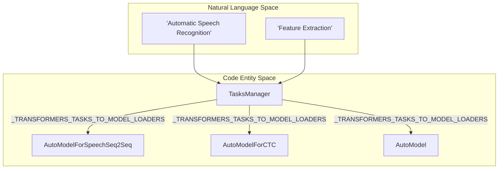
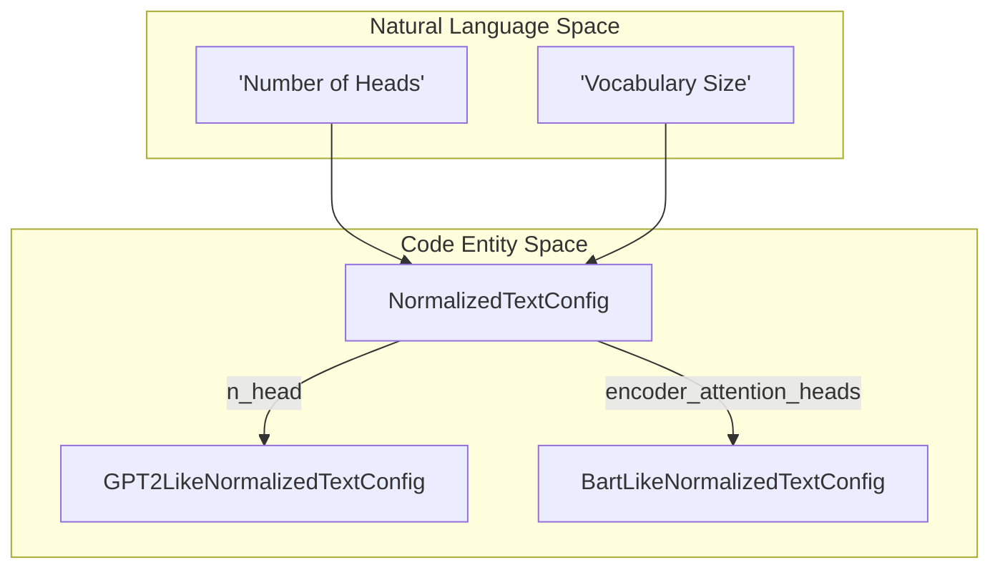

<!-- source: DeepWiki mcp.deepwiki.com · repo huggingface/optimum · page 11 Glossary · fetched 2026-10-26 -->

# Glossary

Relevant source files

The following files were used as context for generating this wiki page:

- [docs/source/llm_quantization/usage_guides/quantization.mdx](docs/source/llm_quantization/usage_guides/quantization.mdx)
- [optimum/exporters/tasks.py](optimum/exporters/tasks.py)
- [optimum/gptq/quantizer.py](optimum/gptq/quantizer.py)
- [optimum/modeling_base.py](optimum/modeling_base.py)
- [optimum/utils/__init__.py](optimum/utils/__init__.py)
- [optimum/utils/file_utils.py](optimum/utils/file_utils.py)
- [optimum/utils/input_generators.py](optimum/utils/input_generators.py)
- [optimum/utils/normalized_config.py](optimum/utils/normalized_config.py)
- [tests/gptq/test_quantization.py](tests/gptq/test_quantization.py)

This glossary defines codebase-specific terms, jargon, and domain concepts used within the Optimum library. It provides technical details on implementation and links to the relevant code entities.

## Core Abstractions

### OptimizedModel
The base class for all models that run on optimized backends (e.g., ONNX Runtime, OpenVINO). It acts as a wrapper around the optimized engine while maintaining a Transformers-compatible interface, such as `from_pretrained` and `save_pretrained` methods [optimum/modeling_base.py:93-96]().

*   **Implementation**: It inherits from a dummy `PreTrainedModel` to ensure compatibility with Transformers pipelines [optimum/modeling_base.py:89-93]().
*   **Key Attributes**:
    *   `model`: The underlying inference engine object [optimum/modeling_base.py:104]().
    *   `config`: The model configuration (usually a `PretrainedConfig`) [optimum/modeling_base.py:105]().
    *   `preprocessors`: A list of preprocessors (tokenizer, feature extractor, etc.) associated with the model [optimum/modeling_base.py:106]().

Sources: [optimum/modeling_base.py:15-106]()

### TasksManager
The central registry for mapping model architectures to specific tasks and their corresponding export configurations [optimum/exporters/tasks.py:118-121](). It handles the logic of determining which `ExporterConfig` should be used for a given model type and task (e.g., `text-generation` for a `Llama` model).

*   **Mappings**: It maintains internal dictionaries for Transformers, Diffusers, and Timm models [optimum/exporters/tasks.py:125-134]().
*   **Auto-loading**: It defines which `AutoModel` class should be used for specific tasks, such as `AutoModelForCausalLM` for `text-generation` [optimum/exporters/tasks.py:168]().

**Code Entity Mapping: Task Name to Auto Model Loaders**

Sources: [optimum/exporters/tasks.py:118-168]()

### NormalizedConfig
A wrapper system that provides a unified interface to access model configuration attributes across different architectures [optimum/utils/normalized_config.py:25-32](). Since different models use different names for the same concept (e.g., `n_head` in GPT-2 vs `num_attention_heads` in BERT), `NormalizedConfig` maps these to a standard set of keys.

*   **Standard Keys**: Examples include `VOCAB_SIZE`, `HIDDEN_SIZE`, and `NUM_LAYERS` [optimum/utils/normalized_config.py:87-93]().
*   **Fallback Logic**: If an attribute is not found, it checks the model's `attribute_map` [optimum/utils/normalized_config.py:65-68]().

**Code Entity Mapping: Configuration Normalization**

Sources: [optimum/utils/normalized_config.py:25-93](), [optimum/utils/normalized_config.py:160-167]()

---

## Export & Input Generation

### DummyInputGenerator
An abstract base class for generating representative input tensors required for model tracing and export [optimum/utils/input_generators.py:93-96](). It supports various modalities including text, vision, and audio.

*   **Shapes**: Uses `DEFAULT_DUMMY_SHAPES` for consistent dimensions (e.g., `batch_size: 2`, `sequence_length: 16`) [optimum/utils/input_generators.py:44-59]().
*   **Framework Support**: Can generate tensors for both PyTorch (`pt`) and NumPy (`np`) [optimum/utils/input_generators.py:157-164]().

Sources: [optimum/utils/input_generators.py:44-164]()

### Tasks and Task Names
Standardized strings used to identify the objective of a model. These names align with the Hugging Face Hub's pipeline tags [optimum/exporters/tasks.py:139-168](). Examples include:
*   `text-generation`
*   `image-classification`
*   `automatic-speech-recognition`

Sources: [optimum/exporters/tasks.py:118-168]()

---

## Quantization (GPTQ)

### GPTQQuantizer
A high-level API for performing GPTQ (Generalized Post-Training Quantization) on LLMs [optimum/gptq/quantizer.py:64-69](). It supports 2, 3, 4, and 8-bit quantization [optimum/gptq/quantizer.py:94]().

*   **Key Parameters**:
    *   `bits`: Quantization precision [optimum/gptq/quantizer.py:94]().
    *   `dataset`: Calibration data used to calculate Hessian matrices [optimum/gptq/quantizer.py:96]().
    *   `desc_act`: Whether to use activation order (act-order) [optimum/gptq/quantizer.py:104]().
*   **Backends**: Integrates with `gptqmodel` for optimized kernels [optimum/gptq/quantizer.py:49-55]().

Sources: [optimum/gptq/quantizer.py:64-140](), [docs/source/llm_quantization/usage_guides/quantization.mdx:1-103]()

---

## Parallelization (FX)

### ParallelExecutionCtx
A context object that stores state for automatic model parallelism during the `torch.fx` transformation process.

*   **State Management**: Tracks `compile_times`, `example_inputs`, and the `last_optimized_graph_module`.
*   **Weight Mapping**: Stores the `weight_map` used to load parameters across distributed processes.

Sources: [optimum/modeling_base.py:1-120]()

### parallelize_model
The entry-point API for applying automatic model parallelism to a model via `torch.compile` and custom FX passes.

Sources: [optimum/modeling_base.py:1-120]()

---

## Infrastructure & Environment

### EXTRAS_REQUIRE
A dictionary in setup routines and package configuration that defines optional dependency groups for different hardware accelerators.
*   `onnxruntime`: Installs `optimum-onnx` and `onnxruntime`.
*   `intel`: Installs `optimum-intel`.
*   `habana`: Installs `optimum-habana`.

Sources: [optimum/utils/__init__.py:1-116]()

### Import Utilities
Functions located in `optimum/utils/import_utils.py` used to check for the presence of specific libraries at runtime.
*   `is_torch_available()`: Checks for PyTorch [optimum/utils/__init__.py:51]().
*   `is_onnxruntime_available()`: Checks for ONNX Runtime distributions [optimum/utils/__init__.py:42]().
*   `is_gptqmodel_available()`: Checks for GPT-QModel availability [optimum/utils/__init__.py:40]().

Sources: [optimum/utils/__init__.py:30-57]()