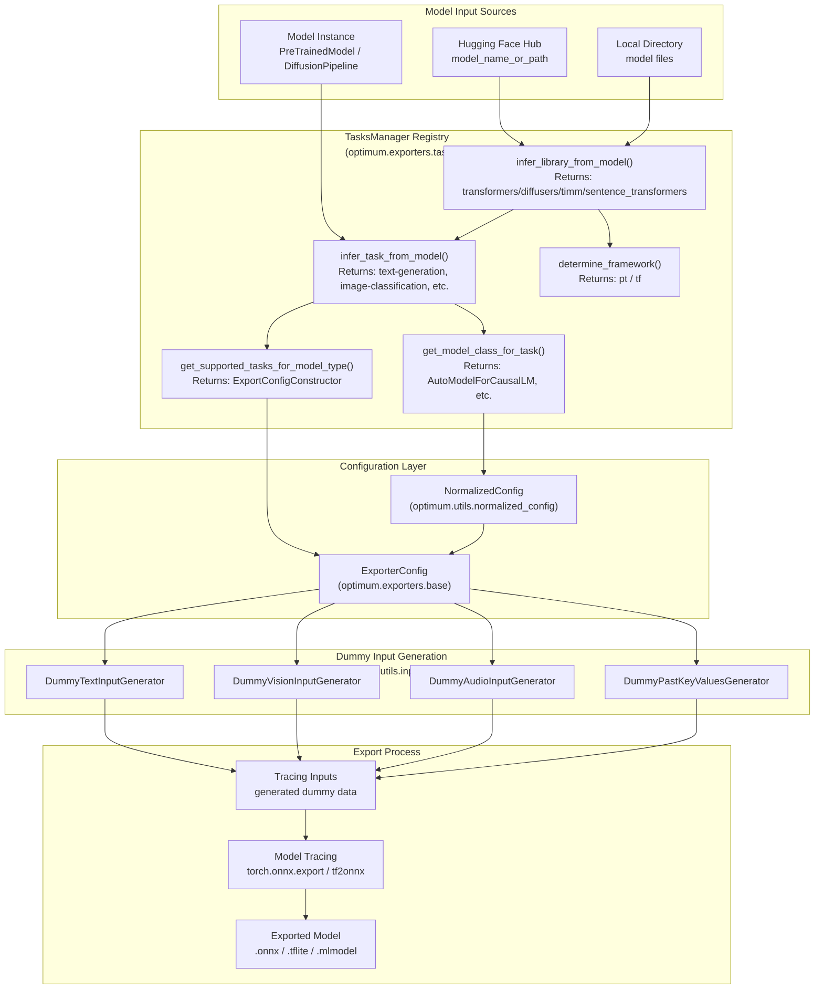
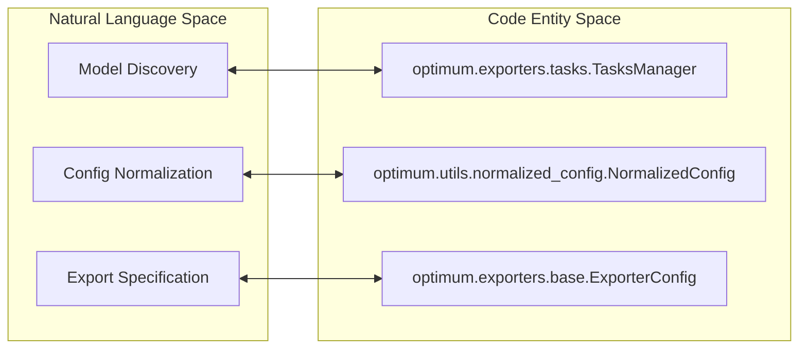
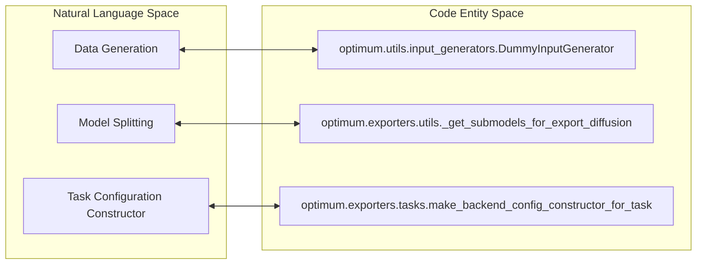

<!-- source: DeepWiki mcp.deepwiki.com · repo huggingface/optimum · page 2 Model Export System · fetched 2026-10-26 -->

# Model Export System

Relevant source files

The following files were used as context for generating this wiki page:

- [optimum/exporters/base.py](optimum/exporters/base.py)
- [optimum/exporters/tasks.py](optimum/exporters/tasks.py)
- [optimum/exporters/utils.py](optimum/exporters/utils.py)
- [optimum/utils/normalized_config.py](optimum/utils/normalized_config.py)

## Purpose and Scope

The Model Export System is the core infrastructure in Optimum responsible for converting models from various libraries (`transformers`, `diffusers`, `timm`, `sentence_transformers`) into optimized formats suitable for hardware accelerators. This system handles model discovery, configuration normalization, dummy input generation, and the orchestration of the export process to formats like ONNX, TFLite, and CoreML.

This document covers the high-level architecture of the export pipeline. Detailed implementation details for specific subsystems are covered in the child pages.

Sources: [optimum/exporters/tasks.py:1-46](), [optimum/exporters/base.py:1-35]()

---

## System Architecture Overview

The Model Export System consists of several major subsystems that work together to enable model conversion:

**Diagram: Model Export System Architecture and Data Flow**

Sources: [optimum/exporters/tasks.py:118-121](), [optimum/exporters/base.py:77-106](), [optimum/utils/normalized_config.py:25-32]()

---

## Core Subsystems

### [TasksManager Core](#2.1)
The `TasksManager` [optimum/exporters/tasks.py:118]() is the central registry and inference engine. It maintains mappings between tasks, model types, and export configurations. It is responsible for determining libraries, tasks, and frameworks from model inputs [optimum/exporters/tasks.py:62-115]().

For details, see [TasksManager Core](#2.1).

Sources: [optimum/exporters/tasks.py:62-121]()

### [NormalizedConfig System](#2.2)
`NormalizedConfig` [optimum/utils/normalized_config.py:25]() provides a unified interface to access model configuration parameters. It abstracts away naming inconsistencies across different model architectures.

For details, see [NormalizedConfig System](#2.2).

Sources: [optimum/utils/normalized_config.py:25-47]()

### [ExporterConfig Framework](#2.3)
`ExporterConfig` [optimum/exporters/base.py:77]() is the abstract base class defining how a specific model architecture should be exported for a given backend, including input/output tensors and validation tolerances [optimum/exporters/base.py:77-110]().

For details, see [ExporterConfig Framework](#2.3).

Sources: [optimum/exporters/base.py:77-110]()

### [Dummy Input Generation](#2.4)
The `DummyInputGenerator` system creates representative synthetic data needed for model tracing across text, vision, audio, and multimodal architectures [optimum/exporters/base.py:85-86]().

For details, see [Dummy Input Generation](#2.4).

Sources: [optimum/exporters/base.py:85-86]()

### [Model Decomposition and Export Process](#2.5)
Complex models are decomposed into submodels during export. For example, encoder-decoder models and diffusion pipelines are split into separate component models [optimum/exporters/utils.py:88-189]().

For details, see [Model Decomposition and Export Process](#2.5).

Sources: [optimum/exporters/utils.py:88-189]()

---

## Code Entity Mappings

The following diagrams bridge natural language concepts to the specific code entities that implement them within the codebase.

### Diagram: Conceptual to Code Mapping for Discovery and Configuration

**Diagram: Conceptual to Code Mapping for Discovery and Configuration**

Sources: [optimum/exporters/tasks.py:118](), [optimum/utils/normalized_config.py:25](), [optimum/exporters/base.py:77]()

### Diagram: Conceptual to Code Mapping for Inputs and Decomposition

**Diagram: Conceptual to Code Mapping for Inputs and Decomposition**

Sources: [optimum/exporters/utils.py:88](), [optimum/exporters/tasks.py:52]()

---

