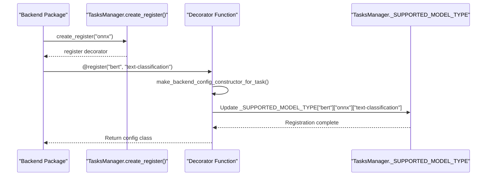
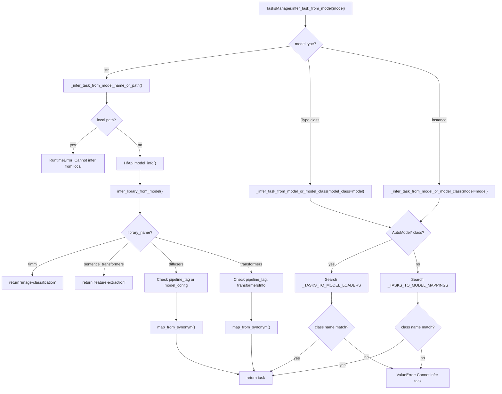
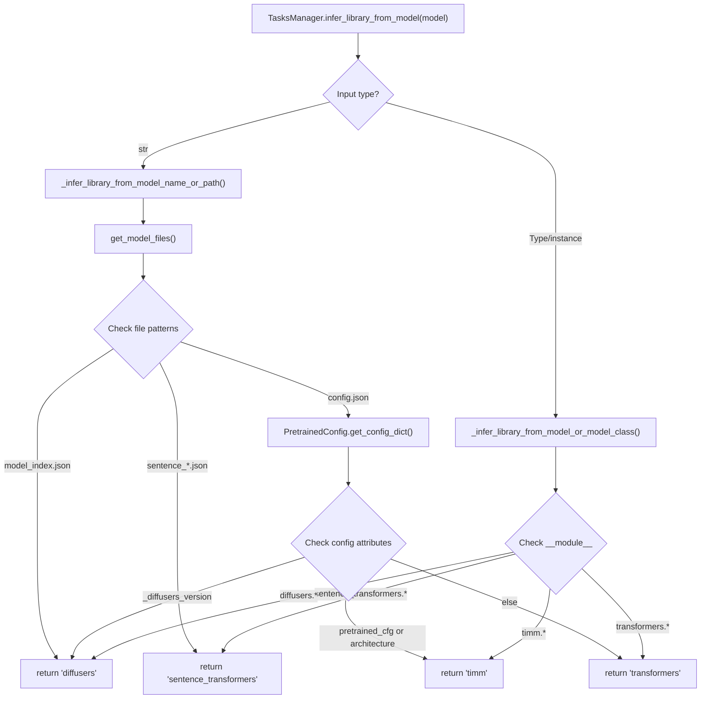
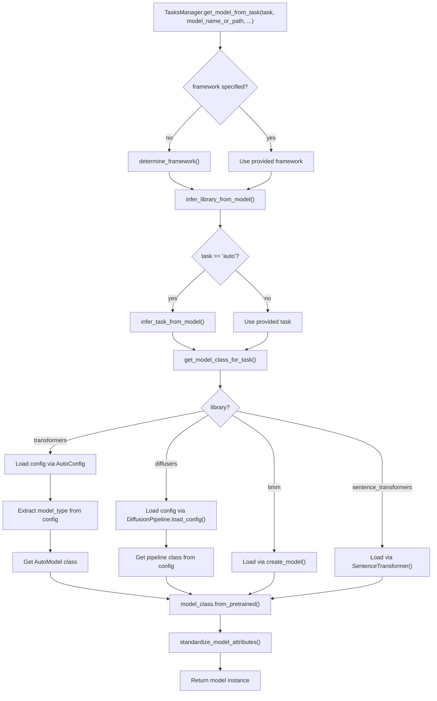
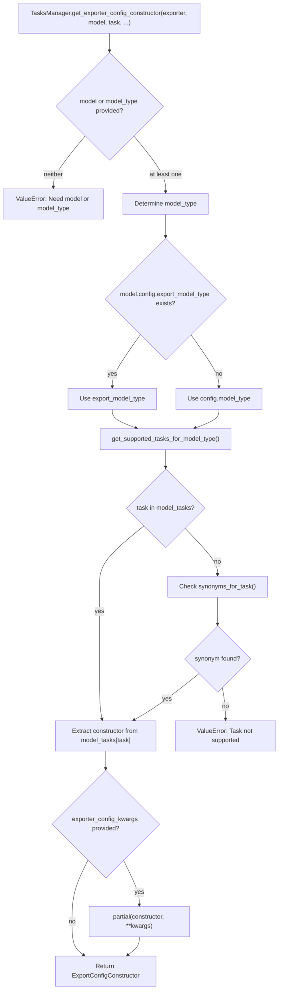
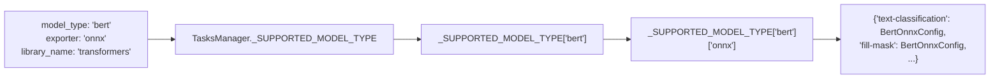
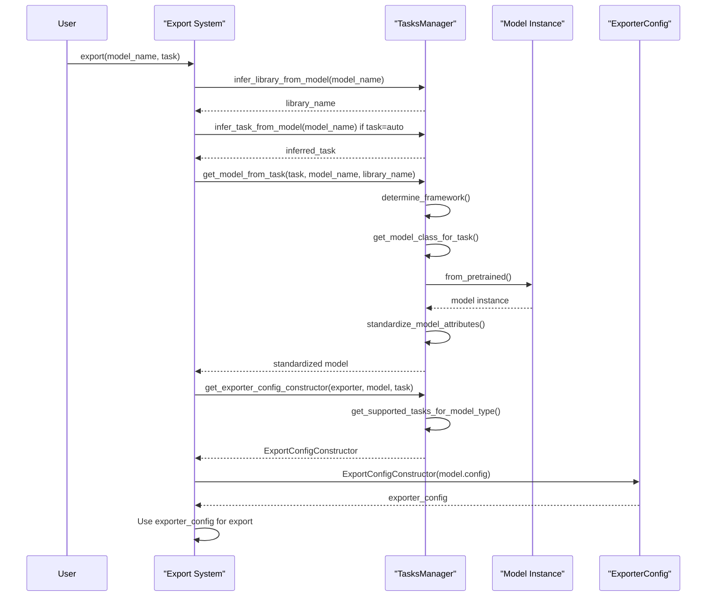

<!-- source: DeepWiki mcp.deepwiki.com · repo huggingface/optimum · page 2.1 TasksManager Core · fetched 2026-10-26 -->

# TasksManager Core

<details>
<summary>Relevant source files</summary>

The following files were used as context for generating this wiki page:

- [docs/source/exporters/task_manager.mdx](docs/source/exporters/task_manager.mdx)
- [optimum/exporters/tasks.py](optimum/exporters/tasks.py)
- [optimum/utils/normalized_config.py](optimum/utils/normalized_config.py)
- [tests/exporters/common/test_tasks_manager.py](tests/exporters/common/test_tasks_manager.py)

</details>


## Purpose and Scope

The `TasksManager` class ([optimum/exporters/tasks.py:118-1313]()) is the central registry system in Optimum that manages the relationships between model types, tasks, and export configurations. It serves three primary functions:

1. **Registry Management**: Maintains mappings between model architectures, tasks they support, and backend-specific export configurations.
2. **Automatic Inference**: Determines the task and library for a given model from various sources (HuggingFace Hub, local files, model instances).
3. **Model and Config Construction**: Loads models and constructs appropriate export configurations for different backends.

For information about the ExporterConfig classes that TasksManager constructs, see [ExporterConfig Framework](#2.3). For details on the NormalizedConfig system used alongside TasksManager, see [NormalizedConfig System](#2.2).

Sources: [optimum/exporters/tasks.py:1-1313]()

---

## Registry Architecture

### Core Registries

TasksManager maintains multiple class-level registry dictionaries that map between tasks, model types, and backend-specific configurations:

**Library and Task Registry Structure**

```mermaid
graph TB
    subgraph "Library-Level Registries"
        TM["TasksManager Class"]
        TTML["_TRANSFORMERS_TASKS_TO_MODEL_LOADERS<br/>{task -> AutoModel class name}"]
        DTML["_DIFFUSERS_TASKS_TO_MODEL_LOADERS<br/>{task -> AutoPipeline class name}"]
        STML["_SENTENCE_TRANSFORMERS_TASKS_TO_MODEL_LOADERS<br/>{task -> SentenceTransformer}"]
        TIMMML["_TIMM_TASKS_TO_MODEL_LOADERS<br/>{task -> create_model}"]
        LibMap["_LIBRARY_TO_TASKS_TO_MODEL_LOADER_MAP<br/>{library -> tasks_to_loaders}"]
    end
    
    subgraph "Model Type Registries"
        TTMM["_TRANSFORMERS_TASKS_TO_MODEL_MAPPINGS<br/>{task -> {model_type -> model_class}}"]
        DTMM["_DIFFUSERS_TASKS_TO_MODEL_MAPPINGS<br/>{task -> {model_type -> model_class}}"]
        SMT["_SUPPORTED_MODEL_TYPE<br/>{model_type -> {backend -> {task -> ExportConfig}}}"]
        DSMT["_DIFFUSERS_SUPPORTED_MODEL_TYPE"]
        TSMT["_TIMM_SUPPORTED_MODEL_TYPE"]
        SSMT["_SENTENCE_TRANSFORMERS_SUPPORTED_MODEL_TYPE"]
        LibTypes["_LIBRARY_TO_SUPPORTED_MODEL_TYPES"]
    end
    
    subgraph "Special Mappings"
        SYN["_SYNONYM_TASK_MAP<br/>{synonym -> canonical_task}"]
        CUSTOM["_CUSTOM_CLASSES<br/>{(framework, model_type, task) -> (library, class_name)}"]
        ENCODER["_ENCODER_DECODER_TASKS<br/>tuple of encoder-decoder tasks"]
    end
    
    TM --> TTML
    TM --> DTML
    TM --> STML
    TM --> TIMMML
    TM --> LibMap
    
    TM --> TTMM
    TM --> DTMM
    TM --> SMT
    TM --> DSMT
    TM --> TSMT
    TM --> SSMT
    TM --> LibTypes
    
    TM --> SYN
    TM --> CUSTOM
    TM --> ENCODER
    
    LibMap --> TTML
    LibMap --> DTML
    LibMap --> STML
    LibMap --> TIMMML
    
    LibTypes --> SMT
    LibTypes --> DSMT
    LibTypes --> TSMT
    LibTypes --> SSMT
```

Sources: [optimum/exporters/tasks.py:123-286]()

**Registry Types:**

| Registry | Purpose | Example Entry |
|----------|---------|---------------|
| `_TRANSFORMERS_TASKS_TO_MODEL_LOADERS` | Maps task to AutoModel class name | `"text-generation": "AutoModelForCausalLM"` |
| `_SUPPORTED_MODEL_TYPE` | Maps model type to backend configs | `"bert": {"onnx": {"text-classification": BertOnnxConfig}}` |
| `_SYNONYM_TASK_MAP` | Normalizes task name variants | `"causal-lm": "text-generation"` |
| `_CUSTOM_CLASSES` | Special model-task combinations | `("pt", "pix2struct", "image-to-text"): ("transformers", "Pix2StructForConditionalGeneration")` |

Sources: [optimum/exporters/tasks.py:123-286]()

### Task-to-Model Loader Mappings

The `_TRANSFORMERS_TASKS_TO_MODEL_LOADERS` dictionary ([optimum/exporters/tasks.py:139-173]()) defines which AutoModel class handles each task:

```python
_TRANSFORMERS_TASKS_TO_MODEL_LOADERS = {
    "text-generation": "AutoModelForCausalLM",
    "text2text-generation": "AutoModelForSeq2SeqLM",
    "automatic-speech-recognition": ("AutoModelForSpeechSeq2Seq", "AutoModelForCTC"),
    # ... more mappings
}
```

Note that some tasks map to tuples of AutoModel classes ([optimum/exporters/tasks.py:143]()). For example, `"automatic-speech-recognition"` can use either `AutoModelForSpeechSeq2Seq` or `AutoModelForCTC`, allowing the system to handle different ASR architectures.

Sources: [optimum/exporters/tasks.py:139-195]()

### Model Type Registration System

The `_SUPPORTED_MODEL_TYPE` registry ([optimum/exporters/tasks.py:256]()) follows a nested structure:
`{model_type: {backend: {task: ExportConfigConstructor}}}`.

Backends register support for specific model types and tasks using the `create_register` method ([optimum/exporters/tasks.py:287-340]()):

**Model Registration Flow**

Sources: [optimum/exporters/tasks.py:287-340](), [optimum/exporters/tasks.py:52-59](), [tests/exporters/common/test_tasks_manager.py:79-112]()

---

## Task Inference System

### Inference Flow

TasksManager provides the `infer_task_from_model()` method ([optimum/exporters/tasks.py:797-851]()) that automatically determines a model's task from multiple sources:

**Task Inference Logic**

Sources: [optimum/exporters/tasks.py:797-851](), [optimum/exporters/tasks.py:709-795](), [optimum/exporters/tasks.py:661-707]()

### From Model Name or Path

For string inputs, `_infer_task_from_model_name_or_path()` ([optimum/exporters/tasks.py:709-795]()) queries the HuggingFace Hub API:

**For Transformers models:**
1. Check `model_info.pipeline_tag` ([optimum/exporters/tasks.py:770-773]())
2. Check `model_info.transformersInfo["pipeline_tag"]` ([optimum/exporters/tasks.py:777-779]())
3. Check `model_info.transformersInfo["auto_model"]` and match against `_TRANSFORMERS_TASKS_TO_MODEL_LOADERS` ([optimum/exporters/tasks.py:780-790]())

**For Diffusers models:**
1. Check `model_info.pipeline_tag` ([optimum/exporters/tasks.py:753-756]())
2. Parse `model_config["diffusers"]["_class_name"]` and match against `_DIFFUSERS_TASKS_TO_MODEL_MAPPINGS` ([optimum/exporters/tasks.py:757-766]())

Sources: [optimum/exporters/tasks.py:709-795]()

### From Model Instance or Class

For model instances or classes, `_infer_task_from_model_or_model_class()` ([optimum/exporters/tasks.py:661-707]()) uses two strategies:

**Strategy 1: Match AutoModel class name** ([optimum/exporters/tasks.py:675-689]())
```python
if target_class_name.startswith("AutoModel"):
    for task_name, model_loaders in _TRANSFORMERS_TASKS_TO_MODEL_LOADERS.items():
        # ... check if class name matches any loader
```

**Strategy 2: Match against model mappings** ([optimum/exporters/tasks.py:691-703]())
```python
if target_class_module.startswith("transformers"):
    for task_name, model_mapping in _TRANSFORMERS_TASKS_TO_MODEL_MAPPINGS.items():
        # ... check if class name matches any model in mapping
```

Sources: [optimum/exporters/tasks.py:661-707]()

### Task Synonym Normalization

The `map_from_synonym()` method ([optimum/exporters/tasks.py:428-432]()) normalizes task name variations:

| Synonym | Canonical Task |
|---------|----------------|
| `"causal-lm"` | `"text-generation"` |
| `"seq2seq-lm"` | `"text2text-generation"` |
| `"sentence-similarity"` | `"feature-extraction"` |
| `"stable-diffusion"` | `"text-to-image"` |

Sources: [optimum/exporters/tasks.py:203-229](), [optimum/exporters/tasks.py:428-432]()

---

## Library Inference System

### Library Detection Flow

The `infer_library_from_model()` method ([optimum/exporters/tasks.py:956-1000]()) determines which library (transformers, diffusers, timm, sentence_transformers) a model belongs to:

**Library Identification Flow**

Sources: [optimum/exporters/tasks.py:956-1000](), [optimum/exporters/tasks.py:883-954](), [optimum/exporters/tasks.py:853-881]()

### File-Based Detection

The `_infer_library_from_model_name_or_path()` method ([optimum/exporters/tasks.py:883-954]()) examines repository files:

| File Pattern | Inferred Library | Line Reference |
|--------------|------------------|----------------|
| `model_index.json` | `diffusers` | [optimum/exporters/tasks.py:924-925]() |
| `sentence_*.json` or `config_sentence_transformers.json` | `sentence_transformers` | [optimum/exporters/tasks.py:926-930]() |
| `config.json` with `pretrained_cfg` attribute | `timm` | [optimum/exporters/tasks.py:942-943]() |
| `config.json` with `_diffusers_version` attribute | `diffusers` | [optimum/exporters/tasks.py:944-945]() |
| `config.json` (default) | `transformers` | [optimum/exporters/tasks.py:947-947]() |

Sources: [optimum/exporters/tasks.py:883-954]()

---

## Model Loading and Construction

### get_model_from_task Method

The `get_model_from_task()` static method ([optimum/exporters/tasks.py:1073-1224]()) is the primary entry point for loading models:

**Model Loading Pipeline**

Sources: [optimum/exporters/tasks.py:1073-1224]()

**Key Parameters:**

| Parameter | Purpose | Line Reference |
|-----------|---------|----------------|
| `task` | Task to load model for (or `"auto"` to infer) | [optimum/exporters/tasks.py:1091-1091]() |
| `model_name_or_path` | HF Hub ID or local path | [optimum/exporters/tasks.py:1076-1076]() |
| `framework` | `"pt"` (only supported) | [optimum/exporters/tasks.py:1081-1081]() |
| `library_name` | Library to use (or auto-detect) | [optimum/exporters/tasks.py:1084-1084]() |
| `torch_dtype` | Model precision | [optimum/exporters/tasks.py:1082-1082]() |
| `device` | Device to load on | [optimum/exporters/tasks.py:1083-1083]() |

Sources: [optimum/exporters/tasks.py:1073-1224]()

### Model Class Resolution

The `get_model_class_for_task()` method ([optimum/exporters/tasks.py:445-528]()) resolves which class to instantiate:

**Custom Classes Override** ([optimum/exporters/tasks.py:479-483]())
```python
if (framework, model_type, task) in TasksManager._CUSTOM_CLASSES:
    library, class_name = TasksManager._CUSTOM_CLASSES[(framework, model_type, task)]
    loaded_library = importlib.import_module(library)
    return getattr(loaded_library, class_name)
```

**Standard Auto Classes** ([optimum/exporters/tasks.py:485-528]())
- For transformers: Use `_TRANSFORMERS_TASKS_TO_MODEL_LOADERS`.
- Handle multiple loaders by checking model type against `_model_mapping` ([optimum/exporters/tasks.py:512-516]()).

Sources: [optimum/exporters/tasks.py:445-528](), [optimum/exporters/tasks.py:231-241]()

### Model Standardization

After loading, `standardize_model_attributes()` ([optimum/exporters/tasks.py:1002-1052]()) normalizes model attributes across libraries:

**For Diffusers models** ([optimum/exporters/tasks.py:1021-1033]())
- Infers `model_type` from class name by searching `_DIFFUSERS_TASKS_TO_MODEL_MAPPINGS`.
- Sets `model.config.export_model_type` to enable uniform access.

**For Timm models** ([optimum/exporters/tasks.py:1035-1039]())
- Creates `model.config` from `model.pretrained_cfg`.
- Sets `model.config.export_model_type = model.pretrained_cfg["architecture"]`.

**For Sentence Transformers** ([optimum/exporters/tasks.py:1041-1051]())
- Extracts underlying transformer or CLIP model config.
- Sets `model.config.export_model_type` appropriately.

Sources: [optimum/exporters/tasks.py:1002-1052]()

---

## Export Configuration Construction

### get_exporter_config_constructor Method

The `get_exporter_config_constructor()` method ([optimum/exporters/tasks.py:1226-1312]()) creates the appropriate `ExportConfigConstructor` for a model and backend:

**Exporter Configuration Selection**

Sources: [optimum/exporters/tasks.py:1226-1312](), [optimum/exporters/tasks.py:49-49]()

The method returns an `ExportConfigConstructor` ([optimum/exporters/tasks.py:49-49]()), which is a callable that takes a `PretrainedConfig` and returns an `ExporterConfig` instance.

Sources: [optimum/exporters/tasks.py:1226-1312](), [optimum/exporters/tasks.py:49-49]()

### get_supported_tasks_for_model_type

This method ([optimum/exporters/tasks.py:342-401]()) retrieves the task-to-config mapping for a specific model type and backend:

**Registry Lookup Logic**

Sources: [optimum/exporters/tasks.py:342-401](), [optimum/exporters/tasks.py:252-254]()

**Error Cases:**
- Model type not in registry → raises `KeyError` with supported types ([optimum/exporters/tasks.py:389-393]()).
- Backend not supported for model type → raises `KeyError` with supported backends ([optimum/exporters/tasks.py:394-399]()).
- Uses default model type if available ([optimum/exporters/tasks.py:381-387]()).

Sources: [optimum/exporters/tasks.py:342-401](), [optimum/exporters/tasks.py:252-254]()

### Configuration Constructor Creation

The `make_backend_config_constructor_for_task()` function ([optimum/exporters/tasks.py:52-59]()) wraps config classes:

```python
def make_backend_config_constructor_for_task(config_cls: Type, task: str) -> ExportConfigConstructor:
    if "-with-past" in task:
        if not getattr(config_cls, "SUPPORTS_PAST", False):
            raise ValueError(f"{config_cls} does not support tasks with past.")
        constructor = partial(config_cls, use_past=True, task=task.replace("-with-past", ""))
    else:
        constructor = partial(config_cls, task=task)
    return constructor
```

This handles the special case of KV cache support for generative models (tasks ending in `"-with-past"`).

Sources: [optimum/exporters/tasks.py:52-59]()

---

## Helper Utilities

### Framework Detection

The `determine_framework()` method ([optimum/exporters/tasks.py:579-659]()) inspects model files to determine if it's PyTorch:

**Detection Logic:**
1. List all files via `get_model_files()` ([optimum/exporters/tasks.py:531-577]()).
2. Check for PyTorch weight files ([optimum/exporters/tasks.py:620-628]()):
   - `pytorch_model.bin` or `pytorch_model-*.bin`
   - `model.safetensors` or `model-*.safetensors`
3. For diffusers, check for `model_index.json` + weight files ([optimum/exporters/tasks.py:632-636]()).
4. For sentence transformers, check for `config_sentence_transformers.json` ([optimum/exporters/tasks.py:637-639]()).

Sources: [optimum/exporters/tasks.py:579-659](), [optimum/exporters/tasks.py:531-577]()

### Task Retrieval

| Method | Purpose | Line Reference |
|--------|---------|----------------|
| `get_all_tasks()` | Returns list of all supported tasks across all libraries | [optimum/exporters/tasks.py:1053-1071]() |
| `synonyms_for_task()` | Returns all synonym variations of a task | [optimum/exporters/tasks.py:417-426]() |
| `map_from_synonym()` | Normalizes synonym to canonical task name | [optimum/exporters/tasks.py:428-432]() |
| `get_supported_model_type_for_task()` | Returns model types supporting a task (transformers-specific) | [optimum/exporters/tasks.py:403-415]() |

Sources: [optimum/exporters/tasks.py:403-432](), [optimum/exporters/tasks.py:1053-1071]()

---

## Integration with Export Pipeline

The TasksManager serves as the orchestrator in the export pipeline:

**Export Orchestration Sequence**

Sources: [optimum/exporters/tasks.py:118-1313]()

---

## Special Model Types

### Encoder-Decoder Models

The `_ENCODER_DECODER_TASKS` tuple ([optimum/exporters/tasks.py:243-250]()) identifies tasks requiring encoder-decoder decomposition:

```python
_ENCODER_DECODER_TASKS = (
    "automatic-speech-recognition",
    "document-question-answering",
    "feature-extraction-with-past",
    "image-to-text",
    "text2text-generation",
    "visual-question-answering",
)
```

These tasks require special handling in the export process (see [Model Decomposition and Export Process](#2.5)).

Sources: [optimum/exporters/tasks.py:243-250]()

### Custom Model Classes

The `_CUSTOM_CLASSES` dictionary ([optimum/exporters/tasks.py:231-241]()) maps specific `(framework, model_type, task)` tuples to custom class implementations:

```python
_CUSTOM_CLASSES = {
    ("pt", "pix2struct", "image-to-text"): ("transformers", "Pix2StructForConditionalGeneration"),
    ("pt", "vision-encoder-decoder", "document-question-answering"): ("transformers", "VisionEncoderDecoderModel"),
    # ... more custom mappings
}
```

These override the standard AutoModel loading for special cases where the auto classes don't include certain architectures.

Sources: [optimum/exporters/tasks.py:231-241]()

---

## CLI and Model Type Support

### Supported Model Types

The `_SUPPORTED_CLI_MODEL_TYPE` set ([optimum/exporters/tasks.py:280-285]()) defines which model types can be exported via CLI:

```python
_SUPPORTED_CLI_MODEL_TYPE = (
    set(_SUPPORTED_MODEL_TYPE.keys())
    | set(_DIFFUSERS_SUPPORTED_MODEL_TYPE.keys())
    | set(_TIMM_SUPPORTED_MODEL_TYPE.keys())
    | set(_SENTENCE_TRANSFORMERS_SUPPORTED_MODEL_TYPE.keys())
) - _UNSUPPORTED_CLI_MODEL_TYPE
```

The `_UNSUPPORTED_CLI_MODEL_TYPE` set ([optimum/exporters/tasks.py:267-279]()) excludes diffusers subcomponents (e.g., `"unet-2d-condition"`, `"vae-decoder"`) that shouldn't be exported directly.

Sources: [optimum/exporters/tasks.py:267-285]()

---

