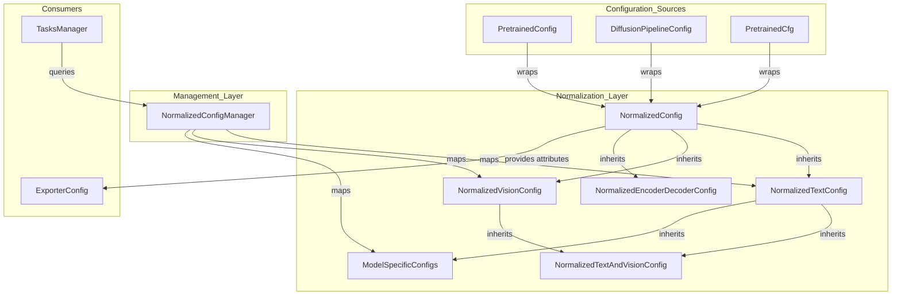
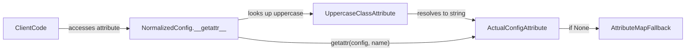
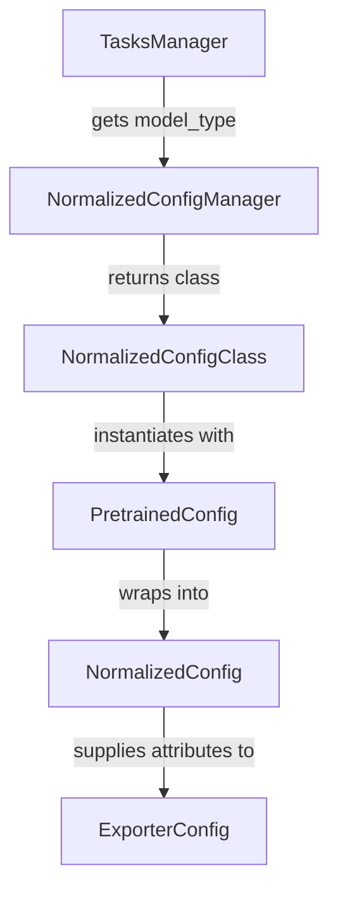

<!-- source: DeepWiki mcp.deepwiki.com · repo huggingface/optimum · page 2.2 NormalizedConfig System · fetched 2026-10-26 -->

# NormalizedConfig System

Relevant source files

The following files were used as context for generating this wiki page:

- [docs/source/utils/dummy_input_generators.mdx](docs/source/utils/dummy_input_generators.mdx)
- [docs/source/utils/normalized_config.mdx](docs/source/utils/normalized_config.mdx)
- [optimum/exporters/tasks.py](optimum/exporters/tasks.py)
- [optimum/utils/normalized_config.py](optimum/utils/normalized_config.py)

## Purpose and Scope

The `NormalizedConfig` system provides unified access to model configuration attributes across different architectures in the Optimum library. Different model architectures use varying naming conventions for similar concepts (e.g., `n_head` vs `num_attention_heads` for the number of attention heads). This system normalizes these differences, enabling export and optimization code to work consistently across all supported models without architecture-specific branching.

This document covers the configuration normalization layer implemented in `optimum/utils/normalized_config.py`. For information about how the export system uses these normalized configs, see [ExporterConfig Framework](#2.3). For the registry that manages model types and their configurations, see [TasksManager Core](#2.1).

## System Architecture

The `NormalizedConfig` system consists of three main components: configuration sources, the normalization class hierarchy, and the `NormalizedConfigManager` registry.

Diagram: NormalizedConfig System Architecture

Sources: [optimum/utils/normalized_config.py:1-332](), [optimum/exporters/tasks.py:118-134]()

## Core Components

### NormalizedConfig Base Class

The `NormalizedConfig` class is the foundation of the normalization system. It wraps a `PretrainedConfig` object and provides attribute access translation through Python's `__getattr__` mechanism.

Diagram: Attribute Resolution Data Flow

**Key Methods and Attributes**:

| Method/Attribute | Purpose |
|-----------------|---------|
| `__init__(config, allow_new, **kwargs)` | Wraps a config object and optionally sets custom normalized attributes [optimum/utils/normalized_config.py:34-42]() |
| `__getattr__(attr_name)` | Intercepts attribute access, performs normalization lookup [optimum/utils/normalized_config.py:48-72]() |
| `with_args(**kwargs)` | Class method that returns a partial constructor with preset arguments [optimum/utils/normalized_config.py:44-46]() |
| `has_attribute(attr_name)` | Checks if a normalized attribute exists without raising an exception [optimum/utils/normalized_config.py:74-79]() |

**Attribute Resolution Process**:

1. Convert requested attribute name to uppercase (e.g., `hidden_size` → `HIDDEN_SIZE`) [optimum/utils/normalized_config.py:53]()
2. Look up the class attribute to get the actual config attribute name [optimum/utils/normalized_config.py:53]()
3. Handle dot notation for nested attributes (e.g., `"text_config.hidden_size"`) [optimum/utils/normalized_config.py:57-61]()
4. Attempt to retrieve from the wrapped config [optimum/utils/normalized_config.py:63]()
5. If not found, check `config.attribute_map` as fallback [optimum/utils/normalized_config.py:66-68]()
6. Raise `AttributeError` if attribute cannot be resolved [optimum/utils/normalized_config.py:71]()

Sources: [optimum/utils/normalized_config.py:25-80]()

### Normalized Config Hierarchy

The system defines a hierarchy of normalized config classes for different model categories:

- **`NormalizedTextConfig`**: Defines standard text attributes (`VOCAB_SIZE`, `HIDDEN_SIZE`, `NUM_LAYERS`, `NUM_ATTENTION_HEADS`, `EOS_TOKEN_ID`) [optimum/utils/normalized_config.py:87-93]()
- **`NormalizedTextConfigWithGQA`**: Extends text config with `NUM_KEY_VALUE_HEADS` [optimum/utils/normalized_config.py:95-97]()
- **`NormalizedVisionConfig`**: Defines vision attributes (`IMAGE_SIZE`, `NUM_CHANNELS`, `INPUT_SIZE`) [optimum/utils/normalized_config.py:106-110]()
- **`NormalizedSeq2SeqConfig`**: Maps encoder and decoder specific layer and attention head counts [optimum/utils/normalized_config.py:99-104]()
- **`NormalizedTextAndVisionConfig`**: Routes attribute access to either text or vision config based on the attribute type [optimum/utils/normalized_config.py:125-135]()
- **`NormalizedEncoderDecoderConfig`**: Delegates to encoder or decoder normalized config classes [optimum/utils/normalized_config.py:142-157]()
- **`NormalizedSegformerConfig`**: Returns `0` for list-valued attributes to allow optimizer inference [optimum/utils/normalized_config.py:112-123]()
- **`NormalizedTimeSeriesForecastingConfig`**: Defines time-series attributes (`NUM_INPUT_CHANNELS`, `CONTEXT_LENGTH`) [optimum/utils/normalized_config.py:82-85]()

Sources: [optimum/utils/normalized_config.py:82-157]()

### Model-Specific Configuration Factories

The system supports model-specific attribute mappings using the `with_args()` factory pattern [optimum/utils/normalized_config.py:44-46]().

**Common Model-Specific Configs**:

| Config Name | Used By | Attribute Mappings |
|-------------|---------|-------------------|
| `BartLikeNormalizedTextConfig` | BART, Pegasus, Marian, M-BART | `num_attention_heads` → `encoder_attention_heads`, `hidden_size` → `d_model` [optimum/utils/normalized_config.py:160-163]() |
| `GPT2LikeNormalizedTextConfig` | GPT-2, GPT-J, CodeGen, ImageGPT | `num_attention_heads` → `n_head`, `hidden_size` → `n_embd` [optimum/utils/normalized_config.py:164-167]() |
| `T5LikeNormalizedTextConfig` | T5, mT5, LongT5 | `num_attention_heads` → `num_heads`, `hidden_size` → `d_model` [optimum/utils/normalized_config.py:168-171]() |
| `MPTNormalizedTextConfig` | MPT | `num_attention_heads` → `n_heads`, `hidden_size` → `d_model`, `num_layers` → `n_layers` [optimum/utils/normalized_config.py:172-176]() |
| `WhisperLikeNormalizedTextConfig` | Whisper | `hidden_size` → `d_model` [optimum/utils/normalized_config.py:182-184]() |

Sources: [optimum/utils/normalized_config.py:160-207]()

## NormalizedConfigManager

The `NormalizedConfigManager` class maintains the registry mapping model types to their appropriate normalized config classes [optimum/utils/normalized_config.py:209-332]().

**API Methods**:

| Method | Purpose | Returns |
|--------|---------|---------|
| `check_supported_model(model_type: str)` | Validates that a model type has a normalized config [optimum/utils/normalized_config.py:321-324]() | Raises `KeyError` if unsupported |
| `get_normalized_config_class(model_type: str)` | Retrieves the normalized config class for a model type [optimum/utils/normalized_config.py:326-332]() | `Type[NormalizedConfig]` |

Sources: [optimum/utils/normalized_config.py:209-332]()

## Integration with Export System

The `NormalizedConfig` system is primarily used by the export pipeline and `TasksManager` to access model configurations uniformly.

Diagram: Integration with TasksManager and ExporterConfig

Sources: [optimum/exporters/tasks.py:118-134](), [optimum/utils/normalized_config.py:1-332]()

## Configuration Extension and Customization

The system allows adding custom attributes via the `allow_new=True` parameter in `NormalizedConfig.__init__` [optimum/utils/normalized_config.py:34-42](), enabling specialized configurations without modifying core classes.

Sources: [optimum/utils/normalized_config.py:34-46]()

---

