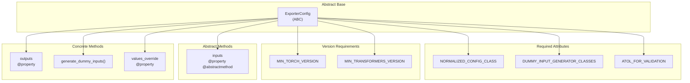
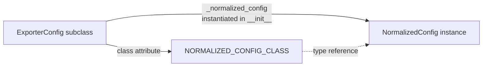
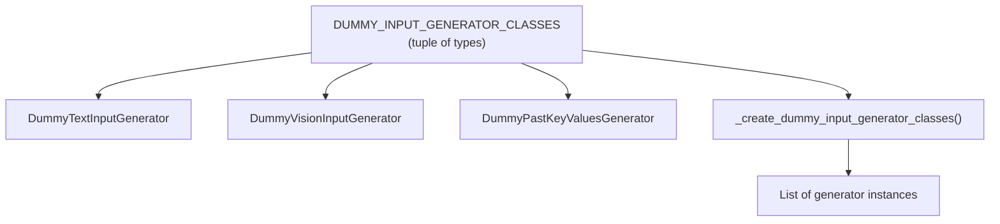
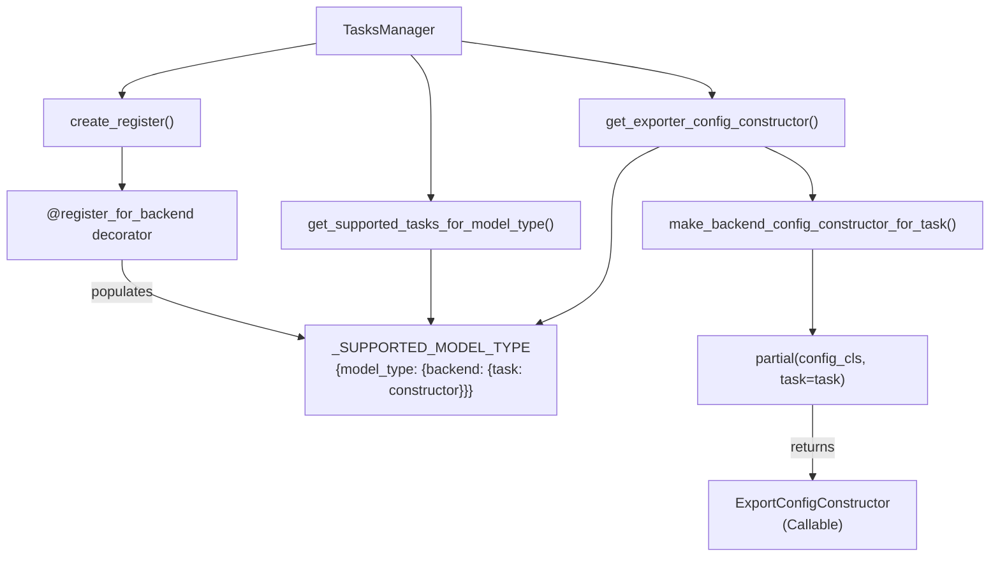
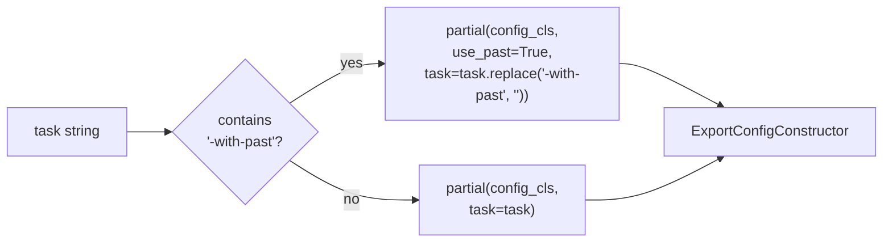
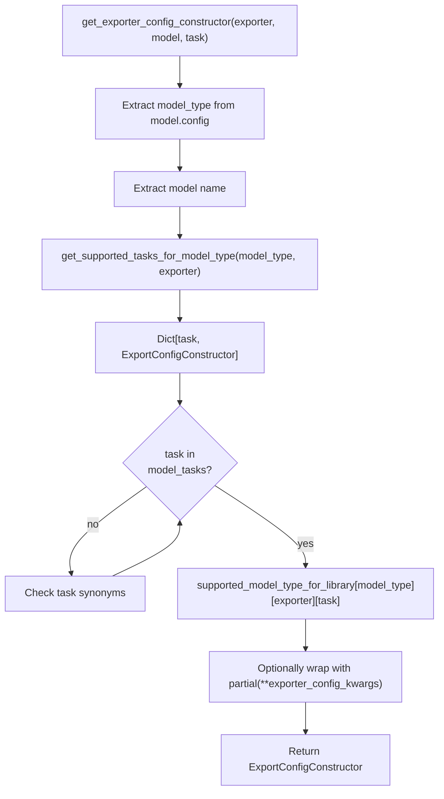
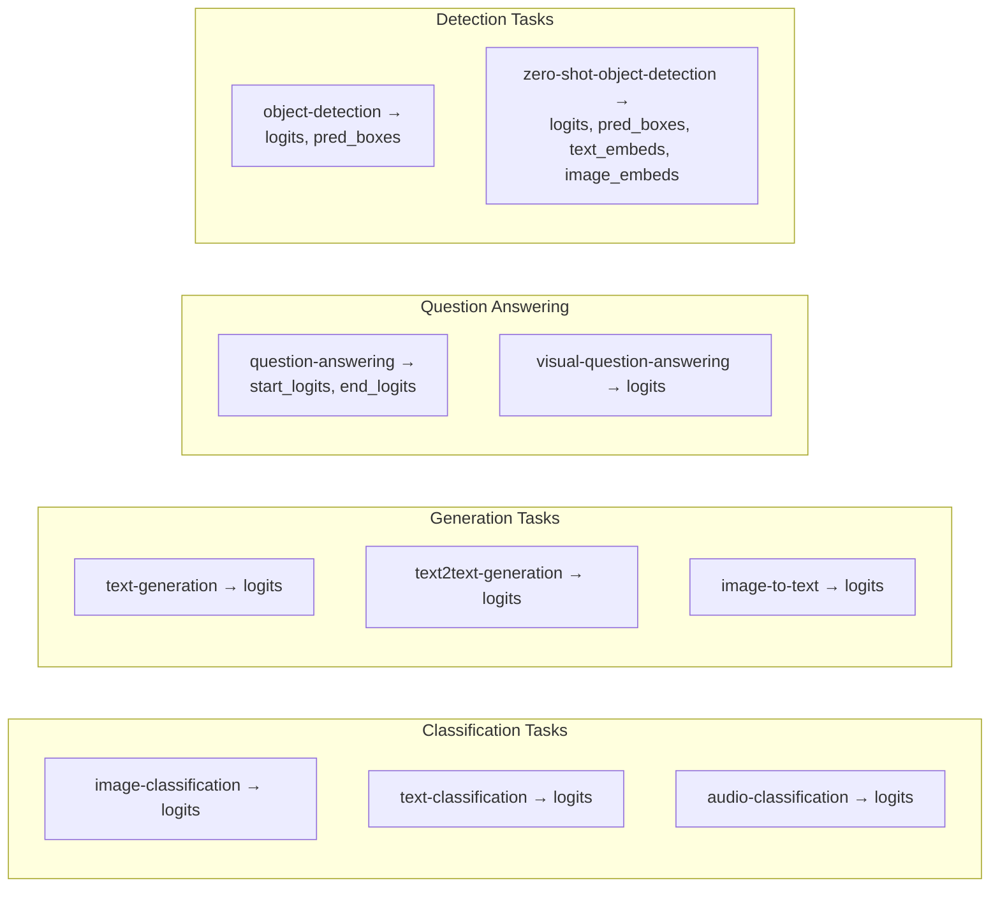

<!-- source: DeepWiki mcp.deepwiki.com · repo huggingface/optimum · page 2.3 ExporterConfig Framework · fetched 2026-10-26 -->

# ExporterConfig Framework

<details>
<summary>Relevant source files</summary>

The following files were used as context for generating this wiki page:

- [optimum/exporters/base.py](optimum/exporters/base.py)
- [optimum/exporters/error_utils.py](optimum/exporters/error_utils.py)

</details>


## Purpose and Scope

The ExporterConfig Framework defines the metadata and behavior required to export models to different backend formats. Each `ExporterConfig` subclass specifies how a particular model type should be exported, including input/output tensor specifications, dummy input generation strategies, and validation parameters.

For information about the TasksManager that uses ExporterConfig to coordinate exports, see [TasksManager Core](#2.1). For details on the NormalizedConfig system that ExporterConfig depends on, see [NormalizedConfig System](#2.2). For the dummy input generation that ExporterConfig orchestrates, see [Dummy Input Generation](#2.4).

Sources: [optimum/exporters/base.py:77-106]()

## ExporterConfig Base Class

The abstract `ExporterConfig` class serves as the contract that all backend-specific export configurations must implement. It is defined in [optimum/exporters/base.py:77-241]().



**Diagram: ExporterConfig Structure**

The base class is initialized with:

| Parameter | Type | Description |
|-----------|------|-------------|
| `config` | `PretrainedConfig` | The model's Transformers configuration |
| `task` | `str` | The task name (e.g., "text-generation", "feature-extraction") |
| `int_dtype` | `str` | Integer tensor dtype: "int64", "int32", or "int8" |
| `float_dtype` | `str` | Float tensor dtype: "fp32", "fp16", or "bf16" |

Sources: [optimum/exporters/base.py:77-153]()

## Required Class Attributes

Each `ExporterConfig` subclass must define several class attributes that control the export process:

### NORMALIZED_CONFIG_CLASS

A reference to a `NormalizedConfig` subclass that provides unified access to model configuration attributes. This allows the exporter to access properties like `num_attention_heads` or `hidden_size` regardless of how the source model names these attributes.



**Diagram: NormalizedConfig Integration**

Sources: [optimum/exporters/base.py:108](), [optimum/exporters/base.py:151]()

### DUMMY_INPUT_GENERATOR_CLASSES

A tuple of `DummyInputGenerator` subclasses that know how to create representative inputs for the model. The framework instantiates these generators and uses them to populate the input dictionary.



**Diagram: Dummy Input Generator Classes**

Sources: [optimum/exporters/base.py:109](), [optimum/exporters/base.py:155-162]()

### ATOL_FOR_VALIDATION

The absolute tolerance for output validation during export. Can be a float (applies to all tasks) or a dictionary mapping task names to specific tolerance values. If validation fails to meet this threshold, an `AtolError` may be raised by the exporter utilities.

Sources: [optimum/exporters/base.py:110](), [optimum/exporters/error_utils.py:22-23]()

### MIN_TORCH_VERSION and MIN_TRANSFORMERS_VERSION

Version constraints that must be satisfied for the export to proceed. The base class provides `is_torch_support_available` and `is_transformers_support_available` properties that check these versions. If requirements are not met, a `MinimumVersionError` is raised.

Sources: [optimum/exporters/base.py:111-112](), [optimum/exporters/base.py:200-221](), [optimum/exporters/error_utils.py:38-39]()

## Abstract Property: inputs

The most critical method each subclass must implement is the `inputs` property, which defines the input tensor axis specifications:

```python
@property
@abstractmethod
def inputs(self) -> Dict[str, Dict[int, str]]:
    """
    Returns: A mapping of input names to axis definitions.
    Example: {
        "input_ids": {0: "batch", 1: "sequence"},
        "attention_mask": {0: "batch", 1: "sequence"}
    }
    """
```

This specification is used by backend exporters to:
- Understand the shape semantics of each input
- Configure dynamic axes for formats like ONNX
- Generate appropriate dummy inputs

Sources: [optimum/exporters/base.py:164-173]()

## Concrete Methods and Properties

### outputs Property

Returns the expected output tensor names for the given task. The base implementation uses `_TASK_TO_COMMON_OUTPUTS` mapping:

| Task | Common Outputs |
|------|----------------|
| text-generation | ["logits"] |
| feature-extraction | ["last_hidden_state"] |
| question-answering | ["start_logits", "end_logits"] |
| object-detection | ["logits", "pred_boxes"] |

Sources: [optimum/exporters/base.py:176-184](), [optimum/exporters/base.py:113-140]()

### values_override Property

Provides configuration overrides to apply before export. The default implementation disables `use_cache` if the model config has this attribute, which is necessary for certain export formats:

```python
@property
def values_override(self) -> Optional[Dict[str, Any]]:
    if hasattr(self._config, "use_cache"):
        return {"use_cache": False}
    return None
```

Sources: [optimum/exporters/base.py:187-197]()

### generate_dummy_inputs Method

The method that orchestrates dummy input generation:

```mermaid
sequenceDiagram
    participant Caller
    participant EC as ExporterConfig
    participant Create as _create_dummy_input_generator_classes
    participant Gens as DummyInputGenerator instances
    
    Caller->>EC: generate_dummy_inputs(framework="pt", **kwargs)
    EC->>Create: _create_dummy_input_generator_classes(**kwargs)
    Create->>Gens: Instantiate each DUMMY_INPUT_GENERATOR_CLASSES
    Gens-->>EC: List of generators
    
    loop For each input name in self.inputs
        EC->>Gens: Find generator that supports_input(input_name)
        Gens->>EC: generate(input_name, framework, int_dtype, float_dtype)
    end
    
    EC-->>Caller: Dict of dummy inputs
```

**Diagram: Dummy Input Generation Flow**

The method iterates through all input names defined in `self.inputs`, finds an appropriate generator from the instantiated list, and generates a dummy tensor for each input.

Sources: [optimum/exporters/base.py:223-241]()

## Integration with TasksManager

The `TasksManager` class uses a registration system to map model types and tasks to `ExporterConfig` constructors. The relationship is:



**Diagram: TasksManager Integration**

Sources: [optimum/exporters/tasks.py:288-340](), [optimum/exporters/tasks.py:52-59](), [optimum/exporters/tasks.py:1227-1312]()

## ExportConfigConstructor Type

The `ExportConfigConstructor` is a callable type that constructs an `ExporterConfig` instance from a `PretrainedConfig`:

```python
ExportConfigConstructor = Callable[["PretrainedConfig"], "ExporterConfig"]
```

When a task includes "-with-past" suffix, the constructor is wrapped with `use_past=True`:



**Diagram: Constructor Creation with Past Key Values Support**

Sources: [optimum/exporters/tasks.py:49](), [optimum/exporters/tasks.py:52-59]()

## Registration Pattern

Backend implementations register their `ExporterConfig` subclasses using the pattern:

```python
# Example registration (pseudo-code from backend implementations)
register_for_backend = TasksManager.create_register("onnx")

@register_for_backend("bert", "feature-extraction", "text-classification", "token-classification")
class BertOnnxConfig(ExporterConfig):
    NORMALIZED_CONFIG_CLASS = NormalizedTextConfig
    DUMMY_INPUT_GENERATOR_CLASSES = (DummyTextInputGenerator,)
    
    @property
    def inputs(self):
        return {
            "input_ids": {0: "batch", 1: "sequence"},
            "attention_mask": {0: "batch", 1: "sequence"},
            "token_type_ids": {0: "batch", 1: "sequence"},
        }
```

The `create_register` method returns a decorator factory that:
1. Validates the task names against known tasks
2. Creates a constructor using `make_backend_config_constructor_for_task`
3. Stores the constructor in the appropriate nested dictionary structure

Sources: [optimum/exporters/tasks.py:288-340]()

## Model Type to Configuration Mapping

The `get_exporter_config_constructor` method retrieves the appropriate constructor through this lookup process:



**Diagram: Constructor Retrieval Process**

The method supports:
- Automatic model type extraction from `model.config.export_model_type` or `model.config.model_type`
- Task synonym resolution (e.g., "causal-lm" → "text-generation")
- Default model types for libraries like timm
- Optional constructor parameter injection via `exporter_config_kwargs`

Sources: [optimum/exporters/tasks.py:1227-1312]()

## Library-Specific Registries

The framework maintains separate registries for different libraries:

| Registry Variable | Library | Description |
|-------------------|---------|-------------|
| `_SUPPORTED_MODEL_TYPE` | transformers | Main registry for Transformers models |
| `_DIFFUSERS_SUPPORTED_MODEL_TYPE` | diffusers | Diffusion pipeline models |
| `_TIMM_SUPPORTED_MODEL_TYPE` | timm | TIMM vision models |
| `_SENTENCE_TRANSFORMERS_SUPPORTED_MODEL_TYPE` | sentence_transformers | Sentence embedding models |

These are unified through `_LIBRARY_TO_SUPPORTED_MODEL_TYPES`:

```python
_LIBRARY_TO_SUPPORTED_MODEL_TYPES = {
    "diffusers": _DIFFUSERS_SUPPORTED_MODEL_TYPE,
    "sentence_transformers": _SENTENCE_TRANSFORMERS_SUPPORTED_MODEL_TYPE,
    "timm": _TIMM_SUPPORTED_MODEL_TYPE,
    "transformers": _SUPPORTED_MODEL_TYPE,
}
```

Sources: [optimum/exporters/tasks.py:256-266]()

## Task to Common Outputs Mapping

The `_TASK_TO_COMMON_OUTPUTS` class attribute defines standard output names for each task:



**Diagram: Task Output Specifications**

This mapping ensures consistent output naming across different model types performing the same task.

Sources: [optimum/exporters/base.py:113-140]()

## Diffusion and Multi-component Exports

For complex models like Stable Diffusion, the export process involves decomposing the pipeline into submodels (text encoder, UNet/Transformer, VAE). The `_get_submodels_for_export_diffusion` function identifies these components and sets their `export_model_type` config attribute based on the `_DIFFUSERS_CLASS_NAME_TO_SUBMODEL_TYPE` mapping.

```python
_DIFFUSERS_CLASS_NAME_TO_SUBMODEL_TYPE = {
    "CLIPTextModel": "clip-text",
    "CLIPTextModelWithProjection": "clip-text-with-projection",
    "FluxTransformer2DModel": "flux-transformer-2d",
    "SD3Transformer2DModel": "sd3-transformer-2d",
    "UNet2DConditionModel": "unet-2d-condition",
    "T5EncoderModel": "t5-encoder",
}
```

Sources: [optimum/exporters/utils.py:74-81](), [optimum/exporters/utils.py:88-165]()

## Configuration Override Mechanism

The `values_override` property allows temporary modification of model configuration during export. Common use cases include:

1. **Disabling KV Cache**: Setting `use_cache=False` for models that support it, required for static graph export
2. **Forcing Specific Modes**: Some backends require specific attention implementations or operations

Subclasses can override this property to provide backend-specific or model-specific overrides:

```python
@property
def values_override(self) -> Optional[Dict[str, Any]]:
    overrides = super().values_override or {}
    # Add backend-specific overrides
    overrides.update({
        "torchscript": True,
        "use_merged_linear": False,
    })
    return overrides
```

Sources: [optimum/exporters/base.py:187-197]()

## Deprecation Note

The original `ExportConfig` class has been deprecated in favor of `ExporterConfig`. The `__init_subclass__` hook emits a warning when subclasses are created:

```python
class ExportConfig(ABC):
    def __init_subclass__(cls, **kwargs):
        super().__init_subclass__(**kwargs)
        logger.warning(
            "The `ExportConfig` class is deprecated and will be removed in a future version. "
            "Please use `ExporterConfig` instead."
        )
```

Sources: [optimum/exporters/base.py:68-74]()

---

