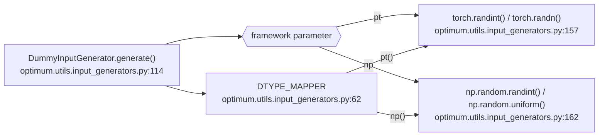
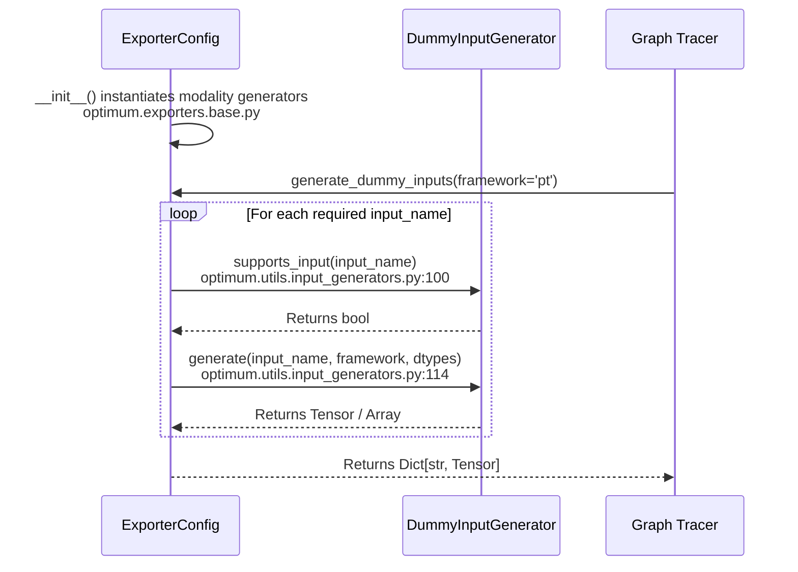

<!-- source: DeepWiki mcp.deepwiki.com · repo huggingface/optimum · page 2.4 Dummy Input Generation · fetched 2026-10-26 -->

# Dummy Input Generation

Relevant source files

The following files were used as context for generating this wiki page:

- [docs/source/utils/dummy_input_generators.mdx](docs/source/utils/dummy_input_generators.mdx)
- [docs/source/utils/normalized_config.mdx](docs/source/utils/normalized_config.mdx)
- [optimum/utils/__init__.py](optimum/utils/__init__.py)
- [optimum/utils/input_generators.py](optimum/utils/input_generators.py)
- [tests/utils/test_dummpy_input_generators.py](tests/utils/test_dummpy_input_generators.py)

## Purpose and Scope

The Dummy Input Generation system provides a framework for creating representative tensor inputs required for model tracing and export within the Optimum library [optimum/utils/input_generators.py:15](). During model export, execution backends like ONNX Runtime or OpenVINO require concrete input examples to trace the computational graph. The `DummyInputGenerator` hierarchy generates appropriate dummy inputs based on the underlying model configuration, task type, and input modality (text, vision, audio, or multimodal) [optimum/utils/input_generators.py:93-133]().

This page covers the `DummyInputGenerator` class hierarchy and its concrete implementations defined in `optimum.utils.input_generators`. For details on the export pipeline consuming these inputs, see [Model Decomposition and Export Process](#2.5). For model metadata provisioning, see [NormalizedConfig System](#2.2).

Sources: `optimum/utils/input_generators.py:15-133]()`

---

## Architecture Overview

The dummy input generation system is built around an abstract base class pattern where modality-specific and architecture-specific subclasses implement tensor generation strategies for different tensor signatures [optimum/utils/input_generators.py:93-133]().

**Diagram 1: Dummy Input Generator Class Hierarchy (Natural Language to Code Entity Space)**

```mermaid
graph TB
    subgraph "BaseCodeSpace"
        Base["DummyInputGenerator<br/>optimum.utils.input_generators.py:93<br/>supports_input()<br/>generate()"]
    end
    
    subgraph "ModalityCodeSpace"
        Text["DummyTextInputGenerator<br/>optimum.utils.input_generators.py:363<br/>input_ids, attention_mask"]
        Vision["DummyVisionInputGenerator<br/>optimum.utils.input_generators.py:795<br/>pixel_values, pixel_mask"]
        Audio["DummyAudioInputGenerator<br/>optimum.utils.input_generators.py:883<br/>input_features, input_values"]
        Timestep["DummyTimestepInputGenerator<br/>optimum.utils.input_generators.py:926<br/>timestep, text_embeds"]
    end
    
    subgraph "DecoderCodeSpace"
        DecoderText["DummyDecoderTextInputGenerator<br/>optimum.utils.input_generators.py:519<br/>decoder_input_ids"]
        Seq2SeqDecoder["DummySeq2SeqDecoderTextInputGenerator<br/>optimum.utils.input_generators.py:567<br/>encoder_outputs"]
        PastKV["DummyPastKeyValuesGenerator<br/>optimum.utils.input_generators.py:620<br/>past_key_values"]
        Seq2SeqPastKV["DummySeq2SeqPastKeyValuesGenerator<br/>optimum.utils.input_generators.py:667<br/>cross-attention KV"]
    end
    
    subgraph "ModelSpecificCodeSpace"
        GPTBigCode["GPTBigCodeDummyPastKeyValuesGenerator<br/>optimum.utils.input_generators.py:1108"]
        Bloom["BloomDummyPastKeyValuesGenerator<br/>optimum.utils.input_generators.py:1167"]
        Falcon["FalconDummyPastKeyValuesGenerator<br/>optimum.utils.input_generators.py:1275"]
        Mistral["MistralDummyPastKeyValuesGenerator<br/>optimum.utils.input_generators.py:1318"]
        DeepSeekV3["DeepSeekV3DummyPastKeyValuesGenerator<br/>optimum.utils.input_generators.py:1191"]
    end
    
    Base --> Text
    Base --> Vision
    Base --> Audio
    Base --> Timestep
    Base --> DecoderText
    Base --> PastKV
    
    Text --> Seq2SeqDecoder
    DecoderText --> Seq2SeqDecoder
    
    PastKV --> Seq2SeqPastKV
    PastKV --> GPTBigCode
    PastKV --> Bloom
    PastKV --> Falcon
    PastKV --> Mistral
    PastKV --> DeepSeekV3
```

Sources: `optimum/utils/input_generators.py:93-1392]`, `optimum/utils/__init__.py:58-104()`

---

## Base `DummyInputGenerator` Class

### Core Interface

The abstract base class `DummyInputGenerator` defines the primary contract required for all input generators [optimum/utils/input_generators.py:93-133]():

| Method | Purpose | Parameters | Code Reference |
|--------|---------|------------|----------------|
| `supports_input(input_name)` | Check if generator supports an input prefix | `input_name`: Name of input | [optimum/utils/input_generators.py:100-112]() |
| `generate(input_name, framework, int_dtype, float_dtype)` | Abstract method to create dummy tensor | `input_name`, `framework`, `int_dtype`, `float_dtype` | [optimum/utils/input_generators.py:114-133]() |

Subclasses define `SUPPORTED_INPUT_NAMES` tuples, and `supports_input()` performs prefix matching [optimum/utils/input_generators.py:98-112]().

### Framework and Dtype Support

Generators dispatch tensor creation to PyTorch (`pt`) or NumPy (`np`) based on the requested framework [optimum/utils/input_generators.py:134-165]().

**Diagram 2: Framework Dispatch and Dtype Mapping System**

The `DTYPE_MAPPER` utility class [optimum/utils/input_generators.py:62-91]() maps string specifiers (`"fp32"`, `"fp16"`, `"bf16"`, `"int64"`, etc.) to framework-native data types.

Sources: `optimum/utils/input_generators.py:32-133]()`, `optimum/utils/input_generators.py:134-165()`

---

## Static Tensor Generation Methods

The base class provides several static helper methods to construct standardized random tensors:

- **`random_int_tensor()`**: Generates random integer tensors within `[min_value, max_value)` [optimum/utils/input_generators.py:134-165]().
- **`random_mask_tensor()`**: Creates left- or right-padded binary attention masks [optimum/utils/input_generators.py:166-212]().
- **`random_float_tensor()`**: Generates continuous uniform floating-point tensors [optimum/utils/input_generators.py:213-244]().
- **Utility Methods**: `constant_tensor()` [optimum/utils/input_generators.py:245-274](), `concat_inputs()` [optimum/utils/input_generators.py:292-316](), and `pad_input_on_dim()` [optimum/utils/input_generators.py:317-361]().

Sources: `optimum/utils/input_generators.py:134-361()`

---

## Text Input Generators

### `DummyTextInputGenerator`

`DummyTextInputGenerator` generates encoder-side text inputs (`input_ids`, `attention_mask`, `token_type_ids`, `position_ids`) using dimension attributes extracted from `NormalizedConfig` [optimum/utils/input_generators.py:363-434](). When `task == "multiple-choice"`, it automatically inserts a `num_choices` dimension [optimum/utils/input_generators.py:425-428]().

### Model-Specific Text Variants

- **`LongformerDummyTextInputGenerator`**: Generates `global_attention_mask` tensors initialized to zero [optimum/utils/input_generators.py:436-465]().
- **`DummyXPathSeqInputGenerator`**: Constructs 3D XPath sequences for document understanding models (`[batch_size, sequence_length, max_depth]`) [optimum/utils/input_generators.py:467-517]().
- **`BartDummyTextInputGenerator`**: Inserts EOS tokens into `input_ids` at random positions for specific classification tasks [optimum/utils/input_generators.py:1804-1842]().

Sources: `optimum/utils/input_generators.py:363-517]()`, `optimum/utils/input_generators.py:1804-1842()`

---

## Decoder and Seq2Seq Generators

- **`DummyDecoderTextInputGenerator`**: Generates decoder inputs such as `decoder_input_ids` and `decoder_attention_mask` [optimum/utils/input_generators.py:519-528]().
- **`DummySeq2SeqDecoderTextInputGenerator`**: Extends decoder generation by incorporating `encoder_outputs` or `encoder_hidden_states` with shapes derived from `NormalizedEncoderDecoderConfig` [optimum/utils/input_generators.py:567-618]().

Sources: `optimum/utils/input_generators.py:519-618()`

---

## Past Key Values Generators

Autoregressive caching requires past key values (`past_key_values`):
- **`DummyPastKeyValuesGenerator`**: Builds a list of length `num_layers`, where each element is a tuple `(past_key, past_value)` with shape `[batch, num_attention_heads, seq_len, head_dim]` [optimum/utils/input_generators.py:620-665]().
- **`DummySeq2SeqPastKeyValuesGenerator`**: Builds 4-element tuples per layer accounting for decoder self-attention and encoder-decoder cross-attention [optimum/utils/input_generators.py:667-752]().

Sources: `optimum/utils/input_generators.py:620-752()`

---

## Architecture-Specific Past Key Values

Different model families override KV cache tensor shapes to support specialized attention mechanisms:

- **Multi-Query Attention (MQA)**: `GPTBigCodeDummyPastKeyValuesGenerator` [optimum/utils/input_generators.py:1108-1165]() and `FalconDummyPastKeyValuesGenerator` [optimum/utils/input_generators.py:1275-1316]() adjust head counts and key-value tensor structures.
- **Grouped-Query Attention (GQA)**: `MistralDummyPastKeyValuesGenerator` [optimum/utils/input_generators.py:1318-1354]() and `GemmaDummyPastKeyValuesGenerator` [optimum/utils/input_generators.py:1356-1392]() utilize `num_key_value_heads`.
- **Custom Structures**: `BloomDummyPastKeyValuesGenerator` flattens batch and head dimensions for older transformers [optimum/utils/input_generators.py:1167-1189](), while `DeepSeekV3DummyPastKeyValuesGenerator` separates rope and nope head dimensions [optimum/utils/input_generators.py:1191-1236]().

Sources: `optimum/utils/input_generators.py:1108-1392()`

---

## Vision, Audio, and Diffusion Generators

- **Vision (`DummyVisionInputGenerator`)**: Generates `pixel_values`, `pixel_mask`, and visual embedding inputs by resolving dimensions from `NormalizedVisionConfig` or preprocessor configurations [optimum/utils/input_generators.py:795-881]().
- **Audio (`DummyAudioInputGenerator`)**: Generates `input_features` (mel spectrograms) and `input_values` (raw waveforms) [optimum/utils/input_generators.py:883-924]().
- **Diffusion (`DummyTimestepInputGenerator`)**: Produces `timestep`, `text_embeds`, and `time_ids` for diffusion pipelines [optimum/utils/input_generators.py:926-979](). Specialized classes like `DummyFluxTransformerVisionInputGenerator` handle complex multi-modal diffusion token layouts [optimum/utils/input_generators.py:1630-1649]().

Sources: `optimum/utils/input_generators.py:795-979]()`, `optimum/utils/input_generators.py:1630-1649()`

---

## Integration with Export Pipeline

**Diagram 3: Integration Flow from ExporterConfig to Dummy Generators (Code Entity Space)**

Sources: `optimum/utils/input_generators.py:93-133]()`, `tests/utils/test_dummpy_input_generators.py:56-120()`

---

