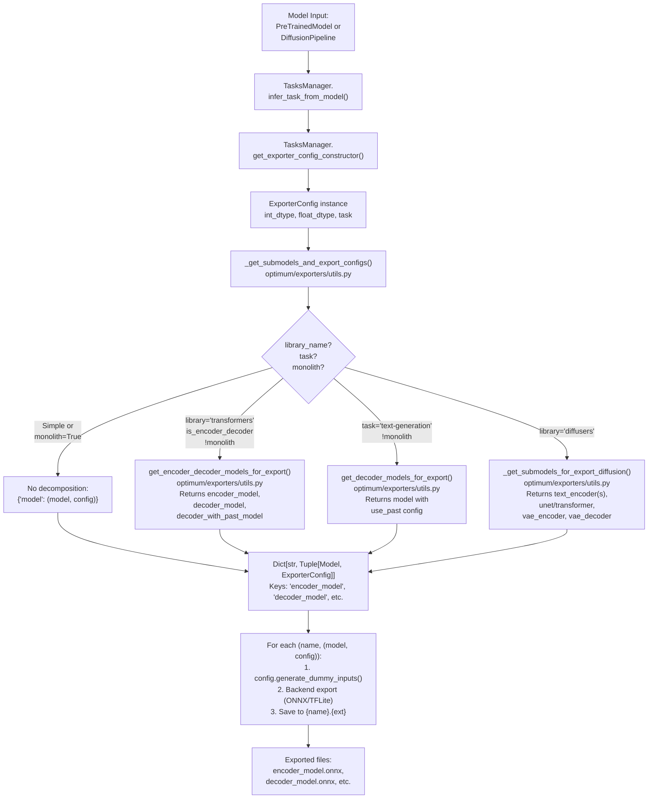
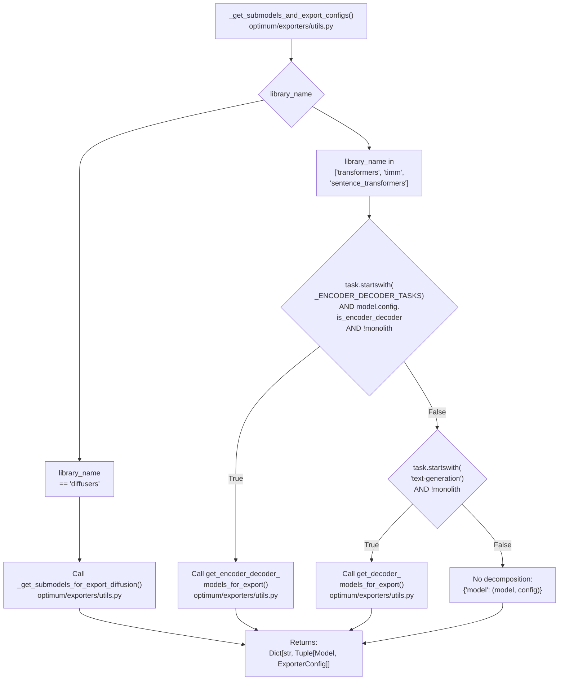

<!-- source: DeepWiki mcp.deepwiki.com · repo huggingface/optimum · page 2.5 Model Decomposition and Export Process · fetched 2026-10-26 -->

# Model Decomposition and Framework Export Pipeline

Relevant source files

The following files were used as context for generating this wiki page:

- [optimum/exporters/utils.py](optimum/exporters/utils.py)
- [optimum/utils/modeling_utils.py](optimum/utils/modeling_utils.py)
- [optimum/utils/save_utils.py](optimum/utils/save_utils.py)

## Purpose and Scope

This page details how complex models (encoder-decoder, diffusion pipelines, and special architectures) are decomposed into exportable submodels and the complete export execution flow. Model decomposition is the systematic process of splitting multi-component architectures into separate neural network modules that can be traced, exported, and executed independently or in coordinated sequences.

The export execution flow encompasses:
- **Decomposition decision logic** based on model architecture and task.
- **Submodel extraction** and configuration creation for each component.
- **Dummy input generation** per submodel for tracing.
- **Backend-specific export** of each component to target formats.

For task inference that determines decomposition strategy, see page 2.1 (TasksManager Core). For configuration management of individual submodels, see page 2.2 (NormalizedConfig System) and page 2.3 (ExporterConfig Framework). For input generation during export, see page 2.4 (Dummy Input Generation).

---

## Export Workflow Overview

The export process follows a consistent pattern regardless of the target format (ONNX, TFLite, CoreML). The workflow coordinates between `TasksManager`, `ExporterConfig`, and model decomposition utilities to prepare models for tracing and conversion.

**High-Level Export Flow with Function Calls**

Sources: [optimum/exporters/utils.py:1-179]()

---

## Model Decomposition Strategies

Model decomposition is necessary for architectures that are too complex to export as a single monolithic model, or where separate components enable optimization strategies like KV caching. The decomposition strategy is determined by the model architecture and task.

### Decomposition Decision Logic

The decomposition strategy is determined in `_get_submodels_and_export_configs()`. The decision flow examines the model's library, architecture flags, task type, and the `monolith` parameter.

Sources: [optimum/exporters/utils.py:68-179]()

---

### Encoder-Decoder Decomposition

Encoder-decoder models are split into separate encoder and decoder components. When KV caching is enabled (`use_past=True`), an additional decoder variant is created that accepts past key-values as input.

**Decomposition Functions:** 
- `_get_submodels_for_export_encoder_decoder()` at [optimum/exporters/utils.py:175-179]()
- `_get_submodels_for_export_decoder()` at [optimum/exporters/utils.py:168-173]()

**Component Breakdown**

| Component Name | Model Part | Behavior | KV Cache |
|----------------|-----------|----------|----------|
| `encoder_model` | `model.get_encoder()` | Encoder behavior | N/A |
| `decoder_model` | Full model | Decoder behavior | `use_past=True`, `use_past_in_inputs=False` |
| `decoder_with_past_model` | Full model | Decoder behavior | `use_past=True`, `use_past_in_inputs=True` |

Sources: [optimum/exporters/utils.py:168-179]()

---

### Diffusion Pipeline Decomposition

Diffusion models are decomposed into multiple neural network components via `_get_submodels_for_export_diffusion()`. Each component serves a distinct purpose in the generation pipeline.

**Component Mapping:**

| Component Name | Diffusers Attribute / Class | Export Model Type Key |
|----------------|----------------------------|------------------------|
| `text_encoder` | `pipeline.text_encoder` | `_DIFFUSERS_CLASS_NAME_TO_SUBMODEL_TYPE` |
| `unet` | `pipeline.unet` | `unet-2d-condition` |
| `transformer` | `pipeline.transformer` | `flux-transformer-2d` / `sd3-transformer-2d` |
| `vae_encoder` | `pipeline.vae` (patched forward) | N/A |
| `vae_decoder` | `pipeline.vae` (patched forward) | N/A |

**VAE Forward Method Patching**

The VAE is split into separate encoder and decoder components by patching the `forward` method on deep-copied instances:
1. `vae_encoder.forward = lambda sample: {"latent_parameters": vae_encoder.encode(x=sample)["latent_dist"].parameters}` [optimum/exporters/utils.py:156-156]()
2. `vae_decoder.forward = lambda latent_sample: vae_decoder.decode(z=latent_sample)` [optimum/exporters/utils.py:162-162]()

Sources: [optimum/exporters/utils.py:74-165]()

---

## Constants and Naming Conventions

The export system uses consistent naming conventions for submodel files, defined as module-level constants:

| Constant | Value | Purpose |
|----------|-------|---------|
| `ENCODER_NAME` | `"encoder_model"` | Encoder component filename |
| `DECODER_NAME` | `"decoder_model"` | Decoder component filename (first pass) |
| `DECODER_WITH_PAST_NAME` | `"decoder_with_past_model"` | Decoder with KV cache filename |
| `DECODER_MERGED_NAME` | `"decoder_model_merged"` | Merged decoder model filename |

Sources: [optimum/exporters/utils.py:68-71]()

---

## Summary

The model decomposition and export pipeline operates by:
1. Identifying model architecture and tasks through `TasksManager`.
2. Invoking specific decomposition utilities (`_get_submodels_for_export_diffusion`, `_get_submodels_for_export_encoder_decoder`, etc.).
3. Configuring distinct input/output behaviors for submodels (such as KV-cache configurations and VAE function patching).
4. Exporting each discrete submodel artifact independently to target backends.

Sources: [optimum/exporters/utils.py:1-179]()

---

