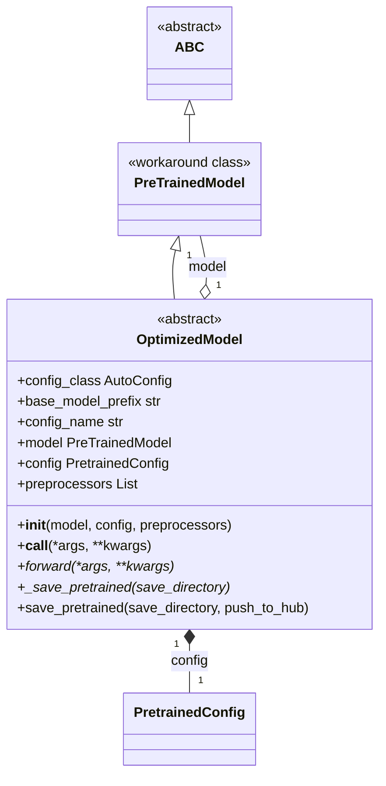

<!-- source: DeepWiki mcp.deepwiki.com · repo huggingface/optimum · page 3 Optimized Model Management · fetched 2026-10-26 -->

# Optimized Model Management

<details>
<summary>Relevant source files</summary>

The following files were used as context for generating this wiki page:

- [optimum/modeling_base.py](optimum/modeling_base.py)
- [optimum/utils/file_utils.py](optimum/utils/file_utils.py)

</details>


## Purpose and Scope

This document explains the `OptimizedModel` abstraction, which provides a unified interface for loading, saving, and using models that have been optimized for specific hardware backends. The `OptimizedModel` class serves as the base abstraction that all backend-specific optimized models inherit from (e.g., `ORTModel` for ONNX Runtime, `OVModel` for OpenVINO).

This page covers the high-level architecture and patterns for optimized model management. For implementation details of specific topics, see:
- **OptimizedModel base class internals**: For details, see [OptimizedModel Base Class](#3.1)
- **Loading and saving mechanisms**: For details, see [from_pretrained and save_pretrained](#3.2)
- **Hugging Face Hub integration**: For details, see [Hub Integration and File Utilities](#3.3)

For information about how models are exported to optimized formats before being wrapped in `OptimizedModel`, see [Model Export System](#2).

---

## Architecture Overview

The `OptimizedModel` class (defined in `optimum/modeling_base.py`) serves as the central abstraction for all optimized models in the Optimum ecosystem. It provides a consistent interface that mirrors Transformers' `PreTrainedModel` API while enabling backend-specific optimizations.

### System-to-Code Mapping

```mermaid
graph TB
    subgraph "User Interface Space"
        User["UserCode"]
        Pipeline["pipeline() API"]
    end
    
    subgraph "Core Abstraction Space optimum/modeling_base.py"
        OptimizedModel["OptimizedModel"]
        PreTrainedModel["PreTrainedModel"]
        PretrainedConfig["PretrainedConfig"]
    end
    
    subgraph "Backend Implementation Space"
        ORTModel["ORTModel<br/>optimum.onnxruntime"]
        OVModel["OVModel<br/>optimum.intel"]
    end
    
    subgraph "Utility Space optimum/utils/file_utils.py"
        ValidateFile["validate_file_exists()"]
        FindFiles["find_files_matching_pattern()"]
    end
    
    User --> Pipeline
    User --> OptimizedModel
    Pipeline --> OptimizedModel
    
    OptimizedModel --> PretrainedConfig
    PreTrainedModel <|-- OptimizedModel
    
    ORTModel -.->|"inherits"| OptimizedModel
    OVModel -.->|"inherits"| OptimizedModel
    
    OptimizedModel --> ValidateFile
    OptimizedModel --> FindFiles
    
    style OptimizedModel stroke-width:3px
```

**Sources**: [optimum/modeling_base.py:89-107](), [optimum/utils/file_utils.py:26-93]()

### Key Design Principles

The `OptimizedModel` architecture follows these principles:

| Principle | Implementation | Benefit |
|-----------|---------------|---------|
| **Abstraction** | Backend-agnostic base class with abstract methods | Consistent API across all hardware backends |
| **Factory Pattern** | `from_pretrained()` class method | Unified loading mechanism with export-on-demand |
| **Composition** | Wraps underlying model + config + preprocessors | Separates concerns while maintaining context |
| **Hub Integration** | Built-in `push_to_hub()` and Hub-aware loading | Seamless model sharing and distribution |
| **Compatibility** | Inherits from `PreTrainedModel` workaround | Works with Transformers pipelines |

**Sources**: [optimum/modeling_base.py:88-107]()

---

## Core Class Structure

The `OptimizedModel` class defines the contract that all backend implementations must fulfill. It combines three key components and exposes both abstract methods (for backend implementation) and concrete methods (for shared functionality). For comprehensive documentation of the class hierarchy and abstract methods, see [OptimizedModel Base Class](#3.1).

### Class Hierarchy and Components



**Sources**: [optimum/modeling_base.py:89-162]()

---

## Model Lifecycle

The `OptimizedModel` supports a complete lifecycle from loading through inference to saving and distribution. 

### Loading and Saving Workflows

For detailed information on `from_pretrained` parameter parsing, configuration handling, export-on-demand logic, and serialization, see [from_pretrained and save_pretrained](#3.2). 

The `save_pretrained` method delegates weight persistence to the backend-specific `_save_pretrained` implementation while saving configurations and preprocessors at the base level [optimum/modeling_base.py:118-152]().

**Sources**: [optimum/modeling_base.py:118-162](), [optimum/modeling_base.py:308-419]()

---

## File Organization and Hub Integration

The `OptimizedModel` system uses specific file organization patterns and utility functions to locate and validate model files across local storage and the Hugging Face Hub. For complete details on `push_to_hub` functionality and file utilities, see [Hub Integration and File Utilities](#3.3).

**Sources**: [optimum/modeling_base.py:171-203](), [optimum/utils/file_utils.py:15-93]()

---

## Summary

The `OptimizedModel` class provides the foundational abstraction for all optimized models in Optimum:

- **Unified interface**: Consistent API across all hardware backends.
- **Flexible loading**: Support for both pre-optimized artifacts and export-on-demand.
- **Hub integration**: Seamless push/pull with Hugging Face Hub.
- **Extensibility**: Clear abstract methods for backend implementation.

**Related pages**:
- For detailed class API documentation: see [OptimizedModel Base Class](#3.1)
- For loading/saving implementation details: see [from_pretrained and save_pretrained](#3.2)
- For Hub and file utilities: see [Hub Integration and File Utilities](#3.3)

**Sources**: [optimum/modeling_base.py:88-163](), [optimum/utils/file_utils.py:15-93]()

---

