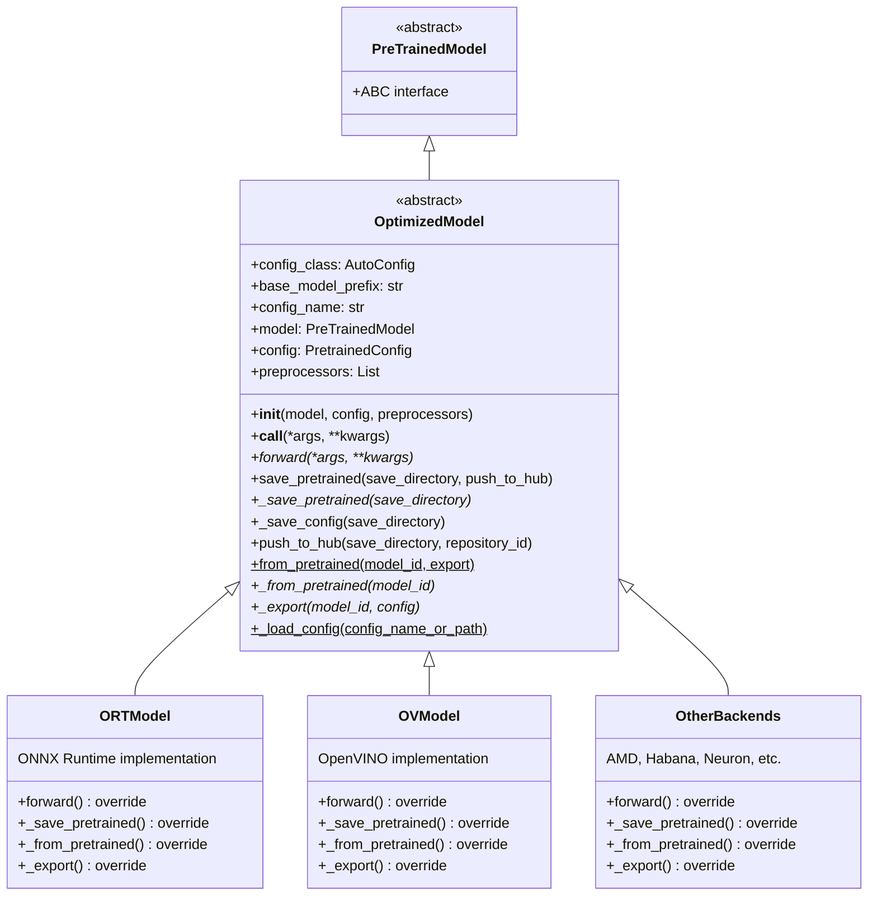
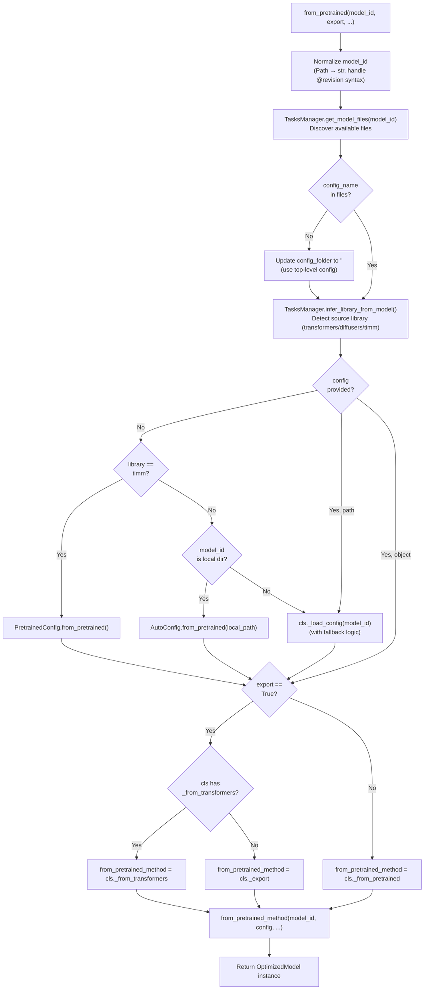
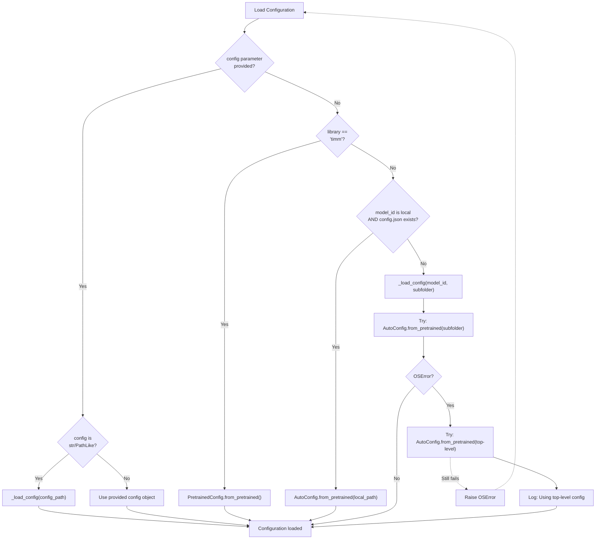

<!-- source: DeepWiki mcp.deepwiki.com · repo huggingface/optimum · page 3.1 OptimizedModel Base Class · fetched 2026-10-26 -->

# OptimizedModel Base Class

<details>
<summary>Relevant source files</summary>

The following files were used as context for generating this wiki page:

- [optimum/modeling_base.py](optimum/modeling_base.py)
- [optimum/quantization_base.py](optimum/quantization_base.py)
- [optimum/utils/file_utils.py](optimum/utils/file_utils.py)

</details>


## Purpose and Scope

The `OptimizedModel` class is the foundational abstract base class for all optimized model implementations in Optimum. It provides a unified interface for loading, saving, and executing models that have been optimized for specific hardware backends (ONNX Runtime, OpenVINO, etc.). This class establishes the contract that all backend-specific implementations must follow while providing common functionality for Hub integration, configuration management, and model lifecycle operations.

This page documents the base class structure, abstract methods, and common functionality. For details on specific loading/saving mechanisms, see [from_pretrained and save_pretrained](#3.2). For Hub integration, see [Hub Integration and File Utilities](#3.3). For backend-specific implementations (`ORTModel`, `OVModel`), refer to documentation for those subpackages.

Sources: `[optimum/modeling_base.py:15-43]()`

---

## Class Hierarchy and Core Architecture

The `OptimizedModel` class serves as the abstract base for all backend-specific optimized model implementations. It inherits from a minimal `PreTrainedModel` abstraction to enable compatibility with Transformers pipelines.

### Class Hierarchy Diagram



Sources: `[optimum/modeling_base.py:89-96]()`, `[optimum/modeling_base.py:93-107]()`

---

## Core Attributes and Initialization

The `OptimizedModel` class maintains three core attributes that are initialized during construction:

| Attribute | Type | Description |
|-----------|------|-------------|
| `model` | `PreTrainedModel` | The underlying model instance (backend-specific format) |
| `config` | `PretrainedConfig` | The model's configuration object |
| `preprocessors` | `List[PreprocessorT]` | Associated tokenizers, feature extractors, or processors |

### Class-Level Configuration

| Attribute | Value | Description |
|-----------|-------|-------------|
| `config_class` | `AutoConfig` | Configuration class used for loading |
| `base_model_prefix` | `"optimized_model"` | Prefix for model attribute naming |
| `config_name` | `CONFIG_NAME` | Name of configuration file (typically `"config.json"`) |

### Initialization Method

```python
def __init__(
    self,
    model: "PreTrainedModel",
    config: "PretrainedConfig",
    preprocessors: Optional[List["PreprocessorT"]] = None,
):
    self.model = model
    self.config = config
    self.preprocessors = preprocessors or []
```

The `__call__` method delegates to `forward()`, enabling models to be invoked directly as callables.

Sources: `[optimum/modeling_base.py:94-96]()`, `[optimum/modeling_base.py:98-109]()`

---

## Abstract Methods: Backend Implementation Contract

Subclasses must implement four abstract methods that define backend-specific behavior. These methods establish the contract between the base class and concrete implementations.

### Abstract Method Specifications

#### 1. `forward(*args, **kwargs)`

**Purpose:** Execute the model's forward pass with backend-specific inference logic.

**Implementation Requirements:**
- Accept arbitrary positional and keyword arguments (backend-dependent)
- Return model outputs in the appropriate format
- Handle backend-specific tensor formats and execution

Location: `[optimum/modeling_base.py:111-116]()`

---

#### 2. `_save_pretrained(save_directory)`

**Purpose:** Serialize model weights and backend-specific artifacts to disk.

**Implementation Requirements:**
- Save all model files (weights, graph definitions, etc.) to `save_directory`
- Follow backend-specific serialization formats (e.g., `.onnx`, `.xml/.bin`)
- Ensure saved artifacts can be reloaded via `_from_pretrained()`

Location: `[optimum/modeling_base.py:156-162]()`

---

#### 3. `_from_pretrained(model_id, ...)`

**Purpose:** Load a previously exported/optimized model from disk or Hub.

**Implementation Requirements:**
- Load model from local directory or Hugging Face Hub
- Handle backend-specific file formats
- Instantiate the optimized model with loaded artifacts
- Support standard Hub arguments (subfolder, revision, cache_dir, etc.)

Location: `[optimum/modeling_base.py:269-284]()` (referencing class method pattern)

---

#### 4. `_export(model_id, config, ...)`

**Purpose:** Export a vanilla Transformers model to the optimized backend format.

**Implementation Requirements:**
- Load source model from Transformers/Diffusers
- Perform export to backend format (e.g., ONNX tracing, OpenVINO compilation)
- Apply optional optimizations (quantization, graph transformations)
- Return an instantiated `OptimizedModel` with the exported model

Location: `[optimum/modeling_base.py:286-304]()` (referencing export pattern)

---

### Abstract Methods Interaction Diagram

```mermaid
graph TB
    subgraph "Abstract Methods Contract"
        forward["forward(*args, **kwargs)"]
        save["_save_pretrained(save_directory)"]
        load["_from_pretrained(model_id, ...)"]
        export["_export(model_id, config, ...)"]
    end
    
    subgraph "Backend Implementation"
        ort_forward["ORTModel.forward()"]
        ort_save["ORTModel._save_pretrained()"]
        ort_load["ORTModel._from_pretrained()"]
        ort_export["ORTModel._export()"]
    end
    
    subgraph "Concrete Base Methods"
        save_pretrained["save_pretrained()"]
        from_pretrained["from_pretrained()"]
        call["__call__()"]
    end
    
    call --> forward
    save_pretrained --> save
    from_pretrained --> load
    from_pretrained --> export
    
    forward -.->|"implements"| ort_forward
    save -.->|"implements"| ort_save
    load -.->|"implements"| ort_load
    export -.->|"implements"| ort_export
```

Sources: `[optimum/modeling_base.py:111-116]()`, `[optimum/modeling_base.py:156-162]()`, `[optimum/modeling_base.py:269-304]()`

---

## Concrete Methods: Provided Functionality

The `OptimizedModel` base class implements several concrete methods that provide common functionality across all backends.

### Configuration Management

#### `_save_config(save_directory)`

Persists the model's configuration to `config.json` by delegating to the config's `save_pretrained()` method.

Location: `[optimum/modeling_base.py:164-169]()` (referenced via `save_pretrained`)

---

#### `_load_config(config_name_or_path, ...)`

Class method that loads a `PretrainedConfig` from local path or Hub. Implements fallback logic:
1. Attempt to load from specified subfolder
2. If not found, retry at top level and log informational message

**Key Features:**
- Handles `subfolder` with automatic fallback
- Supports all Hub loading options (revision, cache_dir, token, etc.)
- Uses `AutoConfig.from_pretrained()` for automatic config type detection

Location: `[optimum/modeling_base.py:228-267]()`

---

### Model Persistence

#### `save_pretrained(save_directory, push_to_hub=False, **kwargs)`

Public method for saving a model. Orchestrates the saving process:

1. Validates `save_directory` is a directory (not a file)
2. Creates directory if it doesn't exist
3. Calls `_save_config()` to save configuration
4. Iterates over `self.preprocessors`, saving each
5. Calls abstract `_save_pretrained()` for backend-specific serialization
6. Optionally calls `push_to_hub()` if requested

Location: `[optimum/modeling_base.py:118-154]()`

---

### Hub Integration

#### `push_to_hub(save_directory, repository_id, private=None, token=None)`

Uploads model artifacts to Hugging Face Hub:

1. Creates or validates repository existence via `HfApi.create_repo()`
2. Walks through `save_directory` recursively
3. Uploads each file to the Hub repository
4. Handles exceptions from `HfApi.upload_file()` gracefully

Location: `[optimum/modeling_base.py:171-203]()`

---

#### `git_config_username_and_email(git_user=None, git_email=None)`

Helper method for configuring git credentials globally. Used when pushing to Hub repositories.

Location: `[optimum/modeling_base.py:204-226]()`

Sources: `[optimum/modeling_base.py:118-267]()`

---

## The `from_pretrained` Workflow

The `from_pretrained()` class method is the primary entry point for loading models. It implements sophisticated logic for configuration loading, file discovery, and routing to the appropriate loading method.

### from_pretrained Method Signature

```python
@classmethod
@add_start_docstrings(FROM_PRETRAINED_START_DOCSTRING)
def from_pretrained(
    cls,
    model_id: Union[str, Path],
    config: Optional[PretrainedConfig] = None,
    export: bool = False,
    # hub options
    subfolder: str = "",
    revision: str = "main",
    force_download: bool = False,
    local_files_only: bool = False,
    trust_remote_code: bool = False,
    cache_dir: str = HUGGINGFACE_HUB_CACHE,
    token: Optional[Union[bool, str]] = None,
    **kwargs,
) -> "OptimizedModel":
```

Location: `[optimum/modeling_base.py:307-322]()`

---

### from_pretrained Execution Flow



Sources: `[optimum/modeling_base.py:307-419]()`

---

### Key from_pretrained Behaviors

#### Revision Syntax Handling

The method supports legacy `model_id@revision` syntax but warns users to use the `revision` parameter instead.

Location: `[optimum/modeling_base.py:331-339]()`

---

#### File Discovery and Subfolder Resolution

Uses `TasksManager.get_model_files()` to discover available files, then adjusts the `config_folder` based on whether `config_name` is found in the specified subfolder.

Location: `[optimum/modeling_base.py:341-354]()`

---

#### Library Inference

Calls `TasksManager.infer_library_from_model()` to detect whether the model is from `transformers`, `diffusers`, or `timm`.

Location: `[optimum/modeling_base.py:356-363]()`

---

#### Export vs. Load Decision

The `export` parameter determines the code path:
- **`export=False` (default):** Calls `_from_pretrained()` to load an existing optimized model
- **`export=True`:** Calls `_export()` (or legacy `_from_transformers()`) to export from source

Location: `[optimum/modeling_base.py:394-418]()`

Sources: `[optimum/modeling_base.py:307-419]()`

---

## Configuration Loading Strategy

The `OptimizedModel` class implements a sophisticated configuration loading strategy with multiple fallback mechanisms to handle various model repository structures.

### Configuration Loading Decision Tree



Sources: `[optimum/modeling_base.py:228-267]()`, `[optimum/modeling_base.py:360-392]()`

---

### Subfolder Fallback Mechanism

The `_load_config()` method implements automatic fallback when configuration is not found in the specified subfolder:

1. **Primary attempt:** Load from `subfolder` path
2. **Catch `OSError`:** If config not found in subfolder
3. **Secondary attempt:** Retry at repository root (empty subfolder)
4. **Log message:** Inform user that top-level config is being used

Location: `[optimum/modeling_base.py:251-266]()`

Sources: `[optimum/modeling_base.py:228-267]()`

---

## File Utilities Integration

The `OptimizedModel` class integrates with file utility functions for validation and discovery operations during loading.

### File Validation

The `validate_file_exists()` function (from `optimum.utils.file_utils`) checks for file existence in both local directories and Hub repositories:

```python
def validate_file_exists(
    model_name_or_path: Union[str, Path],
    filename: str,
    subfolder: str = "",
    revision: Optional[str] = None,
    token: Optional[Union[bool, str]] = None,
) -> bool:
```

**Behavior:**
- **Local:** Uses `os.path.isfile()` to check filesystem
- **Remote:** Uses `HfApi.file_exists()` to query Hub

Location: `[optimum/utils/file_utils.py:26-45]()`

---

### Pattern Matching

The `find_files_matching_pattern()` function enables discovery of model artifacts matching specific patterns:

```python
def find_files_matching_pattern(
    model_name_or_path: Union[str, Path],
    pattern: str,
    glob_pattern: str = "**/*",
    subfolder: str = "",
    token: Optional[Union[bool, str]] = None,
    revision: Optional[str] = None,
) -> List[Path]:
```

Location: `[optimum/utils/file_utils.py:48-93]()`

Sources: `[optimum/utils/file_utils.py:26-93]()`

---

## Summary: OptimizedModel Responsibilities

The `OptimizedModel` base class provides a clear separation of concerns:

### Abstract (Backend-Specific)
- Model inference execution (`forward`)
- Format-specific serialization (`_save_pretrained`)
- Optimized model loading (`_from_pretrained`)
- Model export from source (`_export`)

### Concrete (Common Across Backends)
- Configuration management (`_save_config`, `_load_config`)
- Preprocessor handling (tokenizers, feature extractors)
- Hub integration (`push_to_hub`, git configuration)
- Loading orchestration (`from_pretrained` routing logic)
- Save orchestration (`save_pretrained` workflow)

### Design Philosophy

The class follows the Template Method pattern: concrete methods in the base class orchestrate high-level workflows while delegating backend-specific operations to abstract methods implemented by subclasses.

Sources: `[optimum/modeling_base.py:93-419]()`

---

