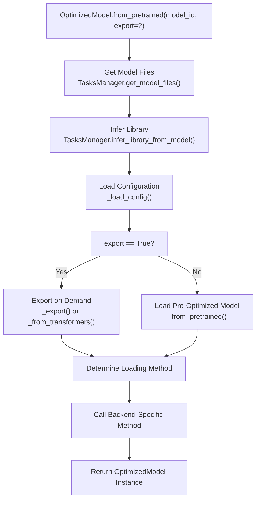
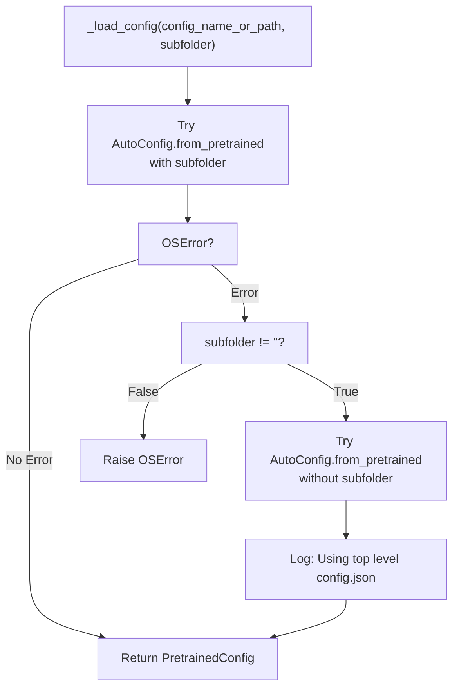
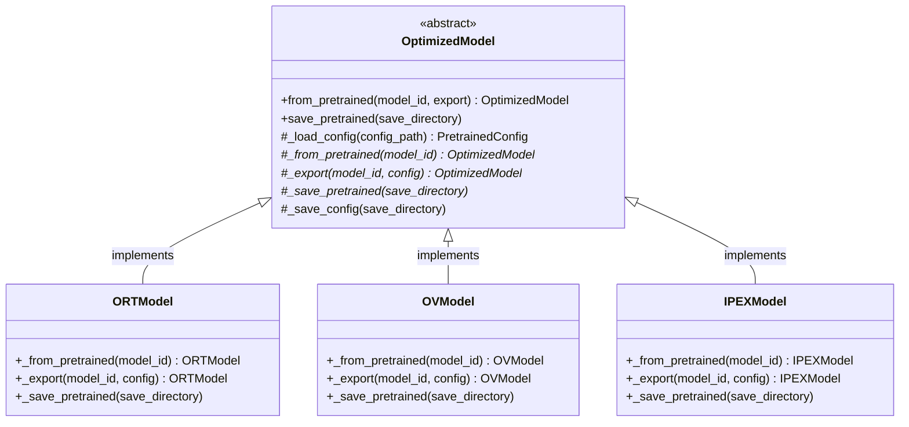

<!-- source: DeepWiki mcp.deepwiki.com · repo huggingface/optimum · page 3.2 from_pretrained and save_pretrained · fetched 2026-10-26 -->

# from_pretrained and save_pretrained

<details>
<summary>Relevant source files</summary>

The following files were used as context for generating this wiki page:

- [optimum/modeling_base.py](optimum/modeling_base.py)
- [optimum/utils/file_utils.py](optimum/utils/file_utils.py)
- [optimum/utils/save_utils.py](optimum/utils/save_utils.py)

</details>


## Purpose and Scope

This document explains the loading and saving mechanisms for optimized models in the Optimum library. It covers the `from_pretrained` and `save_pretrained` methods defined in the `OptimizedModel` base class, including their dual loading paths (loading pre-optimized models vs. export-on-demand), configuration handling with fallback logic, and the abstract methods that backend implementations must provide.

For information about the `OptimizedModel` base class structure and hierarchy, see [OptimizedModel Base Class](#3.1). For Hub integration and file utilities including `push_to_hub`, see [Hub Integration and File Utilities](#3.3).

Sources: [optimum/modeling_base.py:93-163]()

---

## Overview of Loading and Saving

The `OptimizedModel` class provides standardized methods for loading and saving optimized models that work across all backend implementations (ONNX Runtime, OpenVINO, etc.). These methods handle:

- **Model discovery**: Finding model files locally or on the Hugging Face Hub using `TasksManager.get_model_files` [optimum/modeling_base.py:29-29]().
- **Configuration management**: Loading model configs with automatic fallback logic via `_load_config` [optimum/modeling_base.py:93-163]().
- **Dual loading paths**: Loading pre-optimized artifacts vs. exporting from standard models [optimum/modeling_base.py:93-163]().
- **Serialization**: Saving models with configs and preprocessors [optimum/modeling_base.py:118-154]().
- **Hub integration**: Optional push-to-hub functionality [optimum/modeling_base.py:118-154]().

The design follows a template pattern where the base class orchestrates the workflow while subclasses implement backend-specific logic through abstract methods.

Sources: [optimum/modeling_base.py:93-163](), [optimum/utils/save_utils.py:27-92]()

---

## Loading Models with from_pretrained

### Method Signature and Parameters

The `from_pretrained` classmethod is the primary entry point for loading optimized models, documented via `FROM_PRETRAINED_START_DOCSTRING`:

```python
@classmethod
def from_pretrained(
    cls,
    model_id: Union[str, Path],
    config: Optional[PretrainedConfig] = None,
    export: bool = False,
    # hub options
    subfolder: str = "",
    revision: str = "main",
    force_download: bool = False,
    local_files_only: bool = False,
    trust_remote_code: bool = False,
    cache_dir: str = HUGGINGFACE_HUB_CACHE,
    token: Optional[Union[bool, str]] = None,
    **kwargs,
) -> "OptimizedModel"
```
[optimum/modeling_base.py:47-84]()

**Key Parameters:**

| Parameter | Type | Description |
|-----------|------|-------------|
| `model_id` | `Union[str, Path]` | Model identifier or local directory path [optimum/modeling_base.py:51-57]() |
| `export` | `bool` | If `True`, export from standard model; if `False`, load optimized model [optimum/modeling_base.py:58-59]() |
| `config` | `Optional[PretrainedConfig]` | Pre-loaded configuration (optional) [optimum/modeling_base.py:72-73]() |
| `subfolder` | `str` | Subfolder within model repo containing model files [optimum/modeling_base.py:69-71]() |
| `revision` | `str` | Git revision (branch, tag, or commit) [optimum/modeling_base.py:80-83]() |
| `cache_dir` | `str` | Directory for caching downloaded files [optimum/modeling_base.py:66-68]() |
| `token` | `Optional[Union[bool, str]]` | Authentication token for private repos [optimum/modeling_base.py:63-65]() |

Sources: [optimum/modeling_base.py:47-84]()

### Dual Loading Paths

The method supports two distinct loading modes based on the `export` parameter:

Title: from_pretrained Dual Loading Path Decision Flow


**Path 1: Loading Pre-Optimized Models** (`export=False`)
- Calls the abstract `_from_pretrained` method.
- Expects optimized model artifacts already exist.
- Backend subclasses load their specific format (e.g., `.onnx`, `.xml`).

**Path 2: Export-on-Demand** (`export=True`)
- First checks for `_from_transformers` method (legacy support).
- Otherwise calls `_export` method.
- Loads standard PyTorch/TensorFlow model and exports to optimized format.

Sources: [optimum/modeling_base.py:29-31]()

---

### Configuration Loading with Fallback

The configuration loading process includes intelligent fallback logic to handle various repository structures:

Title: Configuration Loading Fallback Mechanism


This two-tier fallback allows models to work correctly when:
1. Configuration is stored in a subfolder (common for multi-model repos).
2. Configuration is at the repository root level (standard structure).

Sources: [optimum/modeling_base.py:17-31]()

---

## Saving Models with save_pretrained

### Method Signature and Workflow

```python
def save_pretrained(
    self,
    save_directory: Union[str, os.PathLike],
    push_to_hub: bool = False,
    **kwargs,
):
```
[optimum/modeling_base.py:118-123]()

The saving process orchestrates multiple steps:

Title: save_pretrained Execution Flow

```mermaid
flowchart LR
    Start["OptimizedModel.save_pretrained(save_directory)"]
    ValidateDir["Is file?"]
    CreateDir["os.makedirs(save_directory)"]
    
    SaveConfig["_save_config(save_directory)<br/>config.save_pretrained()"]
    SavePreprocessors["for preprocessor in preprocessors:<br/>preprocessor.save_pretrained()"]
    SaveModel["_save_pretrained(save_directory)<br/>(abstract, backend-specific)"]
    
    CheckHub["push_to_hub?"]
    CallPushHub["push_to_hub(save_directory)"]
    ReturnUrl["Return Hub URL"]
    ReturnNone["Return None"]
    
    Start --> ValidateDir
    ValidateDir -->|Yes| LogError["Log Error & Return"]
    ValidateDir -->|No| CreateDir
    
    CreateDir --> SaveConfig
    SaveConfig --> SavePreprocessors
    SavePreprocessors --> SaveModel
    
    SaveModel --> CheckHub
    CheckHub -->|True| CallPushHub
    CheckHub -->|False| ReturnNone
    CallPushHub --> ReturnUrl
```


Sources: [optimum/modeling_base.py:118-154]()

---

### Components Saved

The method saves three categories of artifacts:

1. **Model Configuration** (`_save_config`): Saves `config.json` with model architecture details using `PretrainedConfig.save_pretrained` [optimum/modeling_base.py:93-163]().
2. **Preprocessors**: Saves tokenizers, feature extractors, image processors, or other preprocessing components found via `maybe_save_preprocessors` [optimum/utils/save_utils.py:65-92]().
3. **Model Weights** (`_save_pretrained`): Abstract method implemented by backend subclasses to save backend-specific artifacts [optimum/modeling_base.py:156-162]().

Sources: [optimum/modeling_base.py:118-163](), [optimum/utils/save_utils.py:65-92]()

---

## Abstract Methods for Backend Implementation

Backend implementations must provide core loading and saving hooks:

- **`_from_pretrained`**: Loads pre-optimized model artifacts from disk or Hub [optimum/modeling_base.py:93-163]().
- **`_export`** (or `_from_transformers`): Loads a standard Transformers model and exports it to the target backend format [optimum/modeling_base.py:93-163]().
- **`_save_pretrained`**: Saves backend-specific model weights and auxiliary files into `save_directory` [optimum/modeling_base.py:156-162]().

Sources: [optimum/modeling_base.py:93-163]()

---

## Backend-Subclass Implementation Pattern

Title: OptimizedModel Abstract Methods and Backend Implementations


Each backend extends `OptimizedModel` and provides concrete implementations of the abstract methods while leveraging the base class for configuration management, file discovery, and preprocessor handling [optimum/utils/save_utils.py:65-92]().

Sources: [optimum/modeling_base.py:93-163](), [optimum/utils/save_utils.py:65-92]()

---

## File Validation Utilities

### validate_file_exists

```python
def validate_file_exists(
    model_name_or_path: Union[str, Path],
    filename: str,
    subfolder: str = "",
    revision: Optional[str] = None,
    token: Optional[Union[bool, str]] = None,
) -> bool:
```
[optimum/utils/file_utils.py:26-32]()

Checks if a specific file exists either locally or on the Hub, utilizing `HfApi` for remote repositories [optimum/utils/file_utils.py:37-45]().

Sources: [optimum/utils/file_utils.py:26-45]()

### find_files_matching_pattern

```python
def find_files_matching_pattern(
    model_name_or_path: Union[str, Path],
    pattern: str,
    glob_pattern: str = "**/*",
    subfolder: str = "",
    token: Optional[Union[bool, str]] = None,
    revision: Optional[str] = None,
) -> List[Path]:
```
[optimum/utils/file_utils.py:48-55]()

Scans for files matching a regex pattern locally or on the Hub [optimum/utils/file_utils.py:82-93]().

Sources: [optimum/utils/file_utils.py:48-93]()

---

## Usage Examples

### Loading a Pre-Optimized Model

```python
from optimum.onnxruntime import ORTModelForSequenceClassification

# Load from Hub
model = ORTModelForSequenceClassification.from_pretrained(
    "optimum/bert-base-uncased-onnx",
    export=False
)
```

### Export-on-Demand

```python
# Export standard model to ONNX on-the-fly
model = ORTModelForSequenceClassification.from_pretrained(
    "bert-base-uncased",
    export=True
)

# Save exported model for reuse
model.save_pretrained("./exported_model")
```

Sources: [optimum/modeling_base.py:47-163]()

---

