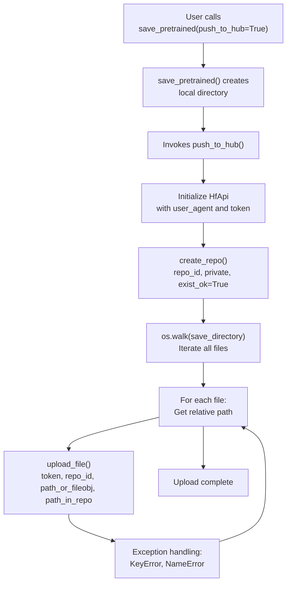
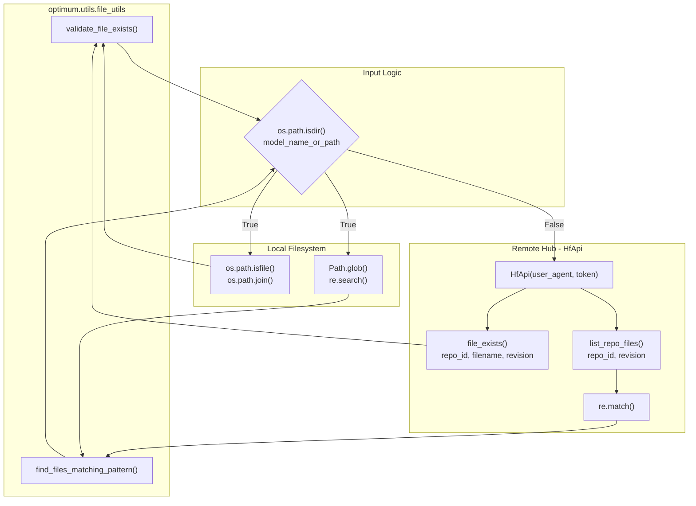

<!-- source: DeepWiki mcp.deepwiki.com · repo huggingface/optimum · page 3.3 Hub Integration and File Utilities · fetched 2026-10-26 -->

# Hub Integration and File Utilities

Relevant source files

The following files were used as context for generating this wiki page:

- [optimum/modeling_base.py](optimum/modeling_base.py)
- [optimum/utils/constant.py](optimum/utils/constant.py)
- [optimum/utils/file_utils.py](optimum/utils/file_utils.py)

This document covers the Hugging Face Hub integration capabilities of `OptimizedModel` and the file utility functions for working with both local and remote model repositories. This includes the `push_to_hub()` method for uploading models to the Hub and utilities for validating and discovering files across local directories and remote repositories.

---

## Overview

The Hub integration system provides two primary capabilities:

1. **Model Upload**: The `push_to_hub()` method enables uploading optimized models to the Hugging Face Hub after saving them locally.
2. **File Utilities**: Helper functions for validating file existence and discovering files matching patterns, supporting both local directories and remote Hub repositories.

These capabilities enable optimized models to participate in the same Hub-based workflows as standard Transformers models, including sharing, versioning, and discovery.

---

## Hub Upload Functionality

### push_to_hub Method

The `push_to_hub()` method is implemented in the `OptimizedModel` base class and handles uploading a locally saved model to the Hugging Face Hub. It is typically invoked automatically when `save_pretrained()` is called with `push_to_hub=True`.

**Method Signature and Parameters**

[optimum/modeling_base.py:171-177]()

| Parameter | Type | Description |
|-----------|------|-------------|
| `save_directory` | `str` | Local directory containing the saved model files |
| `repository_id` | `str` | Target repository ID on the Hub (format: `username/repo-name`) |
| `private` | `Optional[bool]` | Whether to create a private repository (None uses Hub default) |
| `token` | `Optional[Union[bool, str]]` | Authentication token for Hub access |

**Return Value**: Repository URL as a string.

### Hub Upload Workflow

The following diagram illustrates the complete upload process from local save to Hub repository:

Title: OptimizedModel Hub Upload Data Flow

**Hub Upload Process Details**

Sources: [optimum/modeling_base.py:171-203]()

1. **API Initialization** [optimum/modeling_base.py:178]()
   - Creates an `HfApi` instance with appropriate user agent headers using `http_user_agent()`.
   - Uses the provided token for authentication.

2. **Repository Creation** [optimum/modeling_base.py:180-185]()
   - Calls `create_repo()` with `exist_ok=True` to ensure repository exists.
   - Respects the `private` parameter for repository visibility.

3. **File Upload Loop** [optimum/modeling_base.py:187-202]()
   - Walks the entire save directory tree using `os.walk()`.
   - For each file, constructs the local path and Hub path.
   - Uploads each file individually using `upload_file()`.
   - Handles exceptions (`KeyError`, `NameError`) that may occur during upload with a silent pass.

### Integration with save_pretrained

The `push_to_hub()` method is designed to work seamlessly with `save_pretrained()`:

[optimum/modeling_base.py:118-154]()

When `save_pretrained()` is called with `push_to_hub=True`:
1. The model is first saved to the local `save_directory`.
2. Configuration is saved via `_save_config()` [optimum/modeling_base.py:148]().
3. Preprocessors (tokenizers, feature extractors) are saved [optimum/modeling_base.py:149-150]().
4. Backend-specific model files are saved via the abstract `_save_pretrained()` [optimum/modeling_base.py:151]().
5. Finally, `push_to_hub()` is invoked to upload everything [optimum/modeling_base.py:153-154]().

**Important Considerations**:
- The `save_directory` must be a valid directory path, not a file [optimum/modeling_base.py:142-144]().
- The directory is created if it doesn't exist [optimum/modeling_base.py:146]().

Sources: [optimum/modeling_base.py:118-154](), [optimum/modeling_base.py:171-203]()

---

## Git Configuration Utility

The `OptimizedModel` class includes a utility method for configuring Git credentials, which may be useful when working with Hub repositories that require Git operations.

### git_config_username_and_email Method

[optimum/modeling_base.py:204-226]()

This method sets global Git configuration for username and email:

**Parameters**:
- `git_user` (`str`, optional): Git username to configure.
- `git_email` (`str`, optional): Git email to configure.

**Behavior**:
- Uses `subprocess` to execute `git config --global` commands [optimum/modeling_base.py:218-226]().
- Sets `user.name` if `git_user` is provided.
- Sets `user.email` if `git_email` is provided.
- Raises `EnvironmentError` if Git commands fail.

Sources: [optimum/modeling_base.py:204-226]()

---

## File Validation and Discovery Utilities

The `optimum.utils.file_utils` module provides two key functions for working with files across local and remote repositories:

### validate_file_exists Function

[optimum/utils/file_utils.py:26-45]()

Checks whether a specific file exists in either a local directory or a Hub repository.

**Behavior**:
- For local paths: Uses `os.path.isfile()` to check file existence [optimum/utils/file_utils.py:37-38]().
- For Hub repos: Uses `HfApi(user_agent=http_user_agent(), token=token).file_exists()` to query the Hub [optimum/utils/file_utils.py:40-45]().

### find_files_matching_pattern Function

[optimum/utils/file_utils.py:48-93]()

Scans a local directory or Hub repository to find all files matching a specified pattern.

**Behavior**:
- Compiles the pattern with subfolder prefix using `re.compile(subfolder + pattern)` [optimum/utils/file_utils.py:83]().
- For local paths:
  - Uses `Path(model_path).glob(glob_pattern)` [optimum/utils/file_utils.py:85]().
  - Filters results using `re.search(pattern, str(p))` [optimum/utils/file_utils.py:86]().
- For Hub repos:
  - Uses `HfApi(...).list_repo_files(model_path, ...)` to get all files [optimum/utils/file_utils.py:88-90]().
  - Filters using `re.match(pattern, p)` [optimum/utils/file_utils.py:91]().

Sources: [optimum/utils/file_utils.py:26-93]()

---

## File Utility Architecture

The following diagram shows how file utilities abstract away the differences between local and remote file operations:

Title: File Utility Abstraction Layer

Sources: [optimum/utils/file_utils.py:26-93]()

---

## Code Entity Reference

The following table maps key functionality to specific code entities:

| Functionality | Code Entity | Location |
|---------------|-------------|----------|
| Hub upload orchestration | `OptimizedModel.push_to_hub()` | [optimum/modeling_base.py:171-203]() |
| Save with upload | `OptimizedModel.save_pretrained()` | [optimum/modeling_base.py:118-154]() |
| Git configuration | `OptimizedModel.git_config_username_and_email()` | [optimum/modeling_base.py:204-226]() |
| File existence check | `validate_file_exists()` | [optimum/utils/file_utils.py:26-45]() |
| Pattern-based file discovery | `find_files_matching_pattern()` | [optimum/utils/file_utils.py:48-93]() |
| Hub API client | `huggingface_hub.HfApi` | [optimum/modeling_base.py:24]() |
| User agent generation | `transformers.utils.http_user_agent()` | [optimum/modeling_base.py:27]() |

---

## Summary

The Hub integration and file utilities provide essential infrastructure for:

1. **Model Sharing**: Uploading optimized models to the Hugging Face Hub via `push_to_hub()`.
2. **Unified File Access**: Transparent file operations across local directories and remote repositories using `validate_file_exists()` and `find_files_matching_pattern()`.
3. **Model Discovery**: Finding and validating model artifacts during loading and export.

Sources: [optimum/modeling_base.py:1-226](), [optimum/utils/file_utils.py:1-93]()

---

