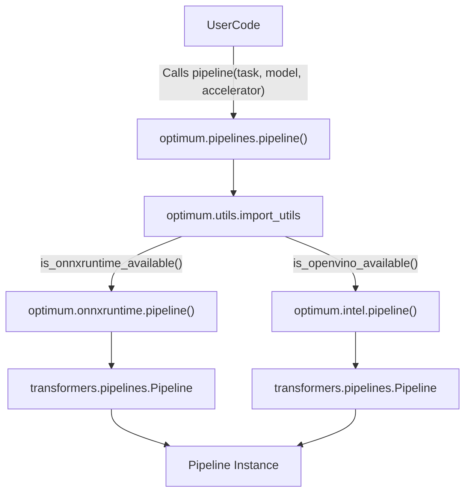
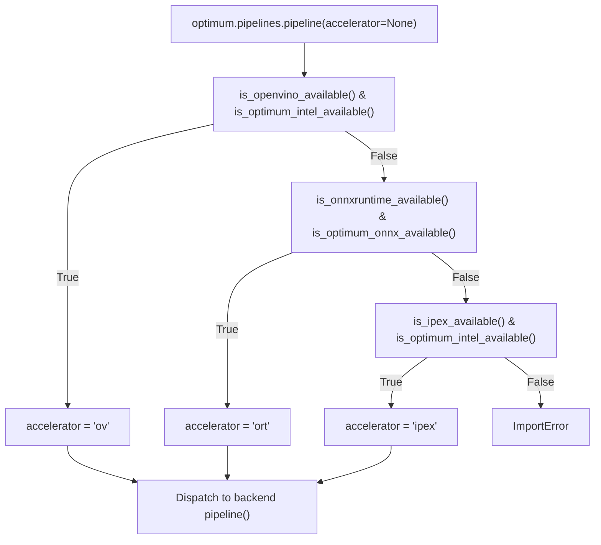

<!-- source: DeepWiki mcp.deepwiki.com · repo huggingface/optimum · page 4 Pipeline System and Inference · fetched 2026-10-26 -->

# Pipeline System and Inference

<details>
<summary>Relevant source files</summary>

The following files were used as context for generating this wiki page:

- [docs/source/_redirects.yml](docs/source/_redirects.yml)
- [docs/source/quicktour.mdx](docs/source/quicktour.mdx)
- [optimum/pipelines/__init__.py](optimum/pipelines/__init__.py)
- [tests/pipelines/test_pipelines.py](tests/pipelines/test_pipelines.py)

</details>


## Purpose and Scope

This document describes the high-level `pipeline()` API provided by Optimum for accelerated inference with automatic backend selection. The pipeline system provides a unified interface for running inference with hardware-accelerated models across different execution backends (ONNX Runtime, OpenVINO, Intel Extension for PyTorch).

For information about model export and optimization prior to inference, see [Model Export System](#2). For details about the `OptimizedModel` abstraction that pipelines use internally, see [Optimized Model Management](#3).

For deep technical details on backend routing, see [Pipeline Factory and Backend Routing](#4.1). For details on supported hardware, see [Supported Backend Accelerators](#4.2). For diffusion pipeline particulars, see [Diffusion Pipeline Support](#4.3).

**Sources:** [optimum/pipelines/__init__.py:1-125]()

## Overview

The Optimum pipeline system extends the familiar `transformers.pipeline()` API with automatic hardware acceleration. The key features are:

| Feature | Description |
|---------|-------------|
| **Unified API** | Single `pipeline()` function works across all backends |
| **Automatic Backend Selection** | Detects available accelerators and selects the best one |
| **Export-on-Demand** | Automatically exports PyTorch models to backend formats |
| **Drop-in Replacement** | Compatible with standard Transformers pipelines |

The pipeline system acts as a thin routing layer that delegates to backend-specific implementations while maintaining API compatibility with `transformers.pipeline()`.

**Sources:** [optimum/pipelines/__init__.py:47-69](), [docs/source/quicktour.mdx:15-91]()

## Pipeline Factory Function

### Function Signature

The `pipeline()` function is defined in [optimum/pipelines/__init__.py:48-68]() with parameters designed to mirror the Transformers API while adding an `accelerator` and other configuration fields.

```python
def pipeline(
    task: Optional[str] = None,
    model: Optional[Union[str, "PreTrainedModel"]] = None,
    config: Optional[Union[str, "PretrainedConfig"]] = None,
    tokenizer: Optional[Union[str, "PreTrainedTokenizer", "PreTrainedTokenizerFast"]] = None,
    feature_extractor: Optional[Union[str, "FeatureExtractionMixin "]] = None,
    image_processor: Optional[Union[str, "BaseImageProcessor"]] = None,
    processor: Optional[Union[str, "ProcessorMixin"]] = None,
    framework: Optional[str] = None,
    revision: Optional[str] = None,
    use_fast: bool = True,
    token: Optional[Union[str, bool]] = None,
    device: Optional[Union[int, str, "torch.device"]] = None,
    device_map: Optional[Union[str, dict[str, Union[int, str]]]] = None,
    torch_dtype: Optional[Union[str, "torch.dtype"]] = "auto",
    trust_remote_code: Optional[bool] = None,
    model_kwargs: Optional[dict[str, Any]] = None,
    pipeline_class: Optional[Any] = None,
    accelerator: Optional[str] = None,
    **kwargs: Any,
) -> "Pipeline"
```

### Core Parameters

| Parameter | Type | Description |
|-----------|------|-------------|
| `task` | `str` | Pipeline task (e.g., `"text-classification"`, `"summarization"`) [optimum/pipelines/__init__.py:82-114]() |
| `model` | `str` or model instance | Model identifier or instance of `ORTModel` or `OVModel` [optimum/pipelines/__init__.py:115-118]() |
| `accelerator` | `str` | Backend selection: `"ort"`, `"ov"`, or `"ipex"` [optimum/pipelines/__init__.py:66]() |
| `device` | `int`, `str`, or `torch.device` | Target device for execution [optimum/pipelines/__init__.py:60]() |

### Architecture Flow: User Request to Code Entities

Title: Pipeline Factory Code Entity Resolution



**Sources:** [optimum/pipelines/__init__.py:21-69](), [tests/pipelines/test_pipelines.py:52-63]()

## Backend Detection and Routing

### Automatic Backend Selection

When `accelerator=None`, the pipeline function implements priority-based detection utilizing functions from `optimum.utils.import_utils`. For details on how the routing logic works, see [Pipeline Factory and Backend Routing](#4.1).

Title: Backend Selection and Dispatch Flow



**Sources:** [optimum/pipelines/__init__.py:21-26](), [optimum/pipelines/__init__.py:216-238]()

### Backend Routing Implementation

Once the accelerator is determined, the pipeline function routes to backend-specific implementations. For an overview of these backends, see [Supported Backend Accelerators](#4.2).

| Accelerator | Module Import | Target Function |
|-------------|---------------|-----------------|
| `"ort"` | `from optimum.onnxruntime import pipeline` | `ort_pipeline()` |
| `"ov"` | `from optimum.intel import pipeline` | `intel_pipeline(accelerator="ov")` |
| `"ipex"` | `from optimum.intel import pipeline` | `intel_pipeline(accelerator="ipex")` |

**Sources:** [optimum/pipelines/__init__.py:240-280]()

## Supported Tasks

The pipeline system supports a wide range of tasks by delegating to specialized model wrapper classes like `ORTModelForXxx` or `OVModelForXxx`. For details, see [Supported Backend Accelerators](#4.2).

### Common Tasks

| Task | Description |
|------|-------------|
| `text-classification` | Sentiment analysis, topic classification [tests/pipelines/test_pipelines.py:52-63]() |
| `token-classification` | NER, POS tagging [tests/pipelines/test_pipelines.py:64-76]() |
| `question-answering` | Extractive QA [tests/pipelines/test_pipelines.py:77-90]() |
| `text-generation` | Autoregressive generation [tests/pipelines/test_pipelines.py:114-125]() |
| `image-classification` | Image categorization [tests/pipelines/test_pipelines.py:172-180]() |
| `automatic-speech-recognition` | Speech-to-text transcription [optimum/pipelines/__init__.py:85]() |

**Sources:** [optimum/pipelines/__init__.py:83-115](), [tests/pipelines/test_pipelines.py:52-180]()

## Diffusion Pipeline Support

Diffusion models require specialized handling because they consist of multiple submodels (UNet, VAE, Text Encoders). For detailed component naming and decomposition logic, see [Diffusion Pipeline Support](#4.3).

**Sources:** [optimum/exporters/utils.py:74-81]()

## Usage Patterns

### Accelerated Pipeline with Automatic Export

```python
from optimum.pipelines import pipeline

# Load a PyTorch model and automatically convert to OpenVINO
classifier = pipeline(
    "text-classification", 
    model="distilbert-base-uncased-finetuned-sst-2-english", 
    accelerator="ov"
)
```

**Sources:** [docs/source/quicktour.mdx:21-38]()

### ONNX Runtime Pipeline with Quantization

```python
from optimum.pipelines import pipeline
from optimum.onnxruntime import ORTModelForSequenceClassification

# Load a pre-quantized ONNX model
model = ORTModelForSequenceClassification.from_pretrained(
    "tmp/onnx/", 
    file_name="model_quantized.onnx"
)
classifier = pipeline("text-classification", model=model, accelerator="ort")
```

**Sources:** [docs/source/quicktour.mdx:82-89]()

## Testing Infrastructure

The pipeline system is verified across backends using a dedicated test suite located in `tests/pipelines/test_pipelines.py`.

**Sources:** [tests/pipelines/test_pipelines.py:34-50]()

---

