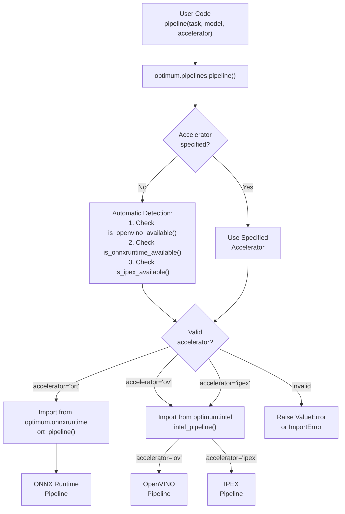
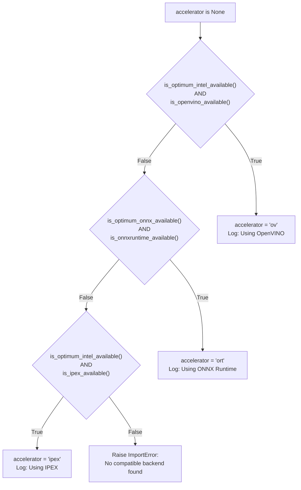
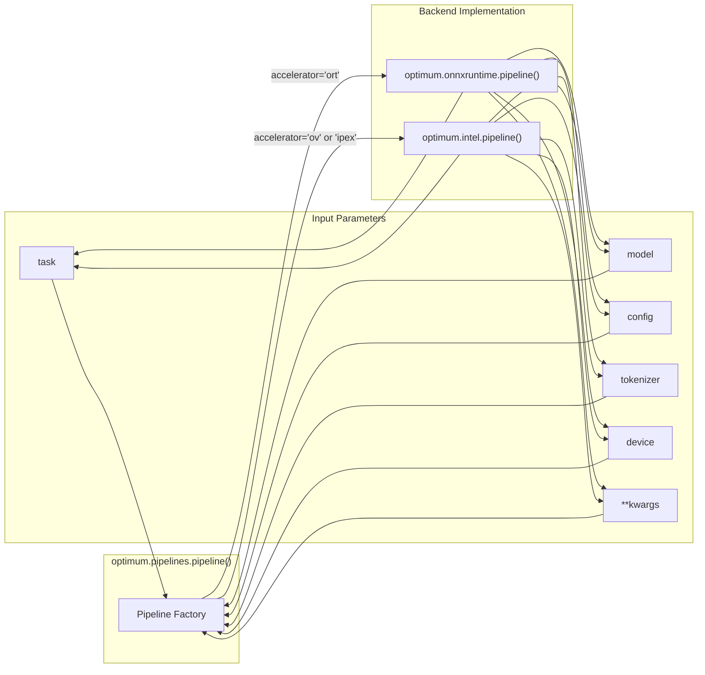
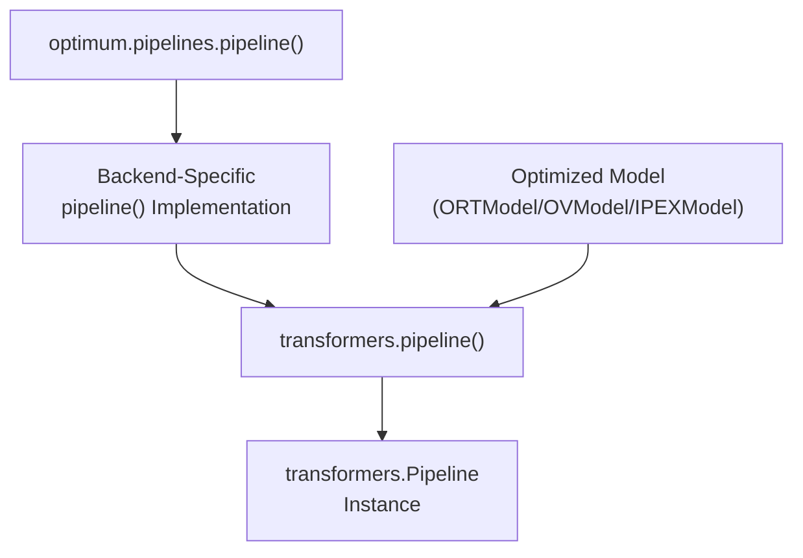

<!-- source: DeepWiki mcp.deepwiki.com · repo huggingface/optimum · page 4.1 Pipeline Factory and Backend Routing · fetched 2026-10-26 -->

# Pipeline Factory and Backend Routing

<details>
<summary>Relevant source files</summary>

The following files were used as context for generating this wiki page:

- [.github/workflows/test_pipelines.yml](.github/workflows/test_pipelines.yml)
- [docs/source/_redirects.yml](docs/source/_redirects.yml)
- [docs/source/quicktour.mdx](docs/source/quicktour.mdx)
- [optimum/pipelines/__init__.py](optimum/pipelines/__init__.py)
- [tests/pipelines/test_pipelines.py](tests/pipelines/test_pipelines.py)

</details>


## Purpose and Scope

The pipeline factory system provides a unified, high-level API for accelerated model inference in Optimum. It automatically detects available hardware accelerators and routes inference requests to the appropriate backend implementation (ONNX Runtime, OpenVINO, or IPEX). This page documents the `pipeline()` function in `optimum.pipelines` and its backend routing logic.

For information about backend-specific model classes and their implementations, see [Optimized Model Management](#3). For details about export and model optimization, see [Model Export System](#2).

## Architecture Overview

The pipeline factory implements a detection-selection-delegation pattern:



**Sources:** [optimum/pipelines/__init__.py:48-280](), [optimum/utils/import_utils.py:89-91]()

## The pipeline() Function

The `pipeline()` function serves as the entry point for creating accelerated inference pipelines. It has a similar signature to `transformers.pipeline()` but adds backend routing capabilities via the `accelerator` parameter.

### Function Signature

```python
def pipeline(
    task: Optional[str] = None,
    model: Optional[Union[str, "PreTrainedModel"]] = None,
    config: Optional[Union[str, "PretrainedConfig"]] = None,
    tokenizer: Optional[Union[str, "PreTrainedTokenizer", "PreTrainedTokenizerFast"]] = None,
    feature_extractor: Optional[Union[str, "FeatureExtractionMixin "]] = None,
    image_processor: Optional[Union[str, "BaseImageProcessor"]] = None,
    processor: Optional[Union[str, "ProcessorMixin"]] = None,
    framework: Optional[str] = None,
    revision: Optional[str] = None,
    use_fast: bool = True,
    token: Optional[Union[str, bool]] = None,
    device: Optional[Union[int, str, "torch.device"]] = None,
    device_map: Optional[Union[str, dict[str, Union[int, str]]]] = None,
    torch_dtype: Optional[Union[str, "torch.dtype"]] = "auto",
    trust_remote_code: Optional[bool] = None,
    model_kwargs: Optional[dict[str, Any]] = None,
    pipeline_class: Optional[Any] = None,
    accelerator: Optional[str] = None,
    **kwargs: Any,
) -> "Pipeline"
```

### Key Parameters

| Parameter | Type | Description |
|-----------|------|-------------|
| `task` | `Optional[str]` | Task identifier (e.g., "text-classification", "image-classification") |
| `model` | `Optional[Union[str, PreTrainedModel]]` | Model identifier or instance of `ORTModel` or `OVModel` |
| `accelerator` | `Optional[str]` | Backend accelerator: `"ort"`, `"ov"`, or `"ipex"`. If `None`, auto-detects. |
| `device` | `Optional[Union[int, str, torch.device]]` | Device placement (e.g., "cpu", "cuda:0") |
| `**kwargs` | `Any` | Additional arguments passed to backend pipeline implementations |

**Sources:** [optimum/pipelines/__init__.py:48-69](), [optimum/pipelines/__init__.py:82-197]()

## Backend Detection Logic

When `accelerator=None`, the system automatically detects available backends in a specific priority order using availability checks.



### Import Utility Functions

The detection relies on constants and utility functions from `optimum.utils.import_utils` that use `importlib` to check environment state.

| Function | Purpose | Implementation Detail |
|----------|---------|------------------------|
| `is_optimum_intel_available()` | Checks if `optimum.intel` is installed | [optimum/utils/import_utils.py:90]() |
| `is_openvino_available()` | Checks if OpenVINO runtime is available | [optimum/utils/import_utils.py:86]() |
| `is_optimum_onnx_available()` | Checks if `optimum.onnx` is installed | [optimum/utils/import_utils.py:89]() |
| `is_onnxruntime_available()` | Checks if ONNX Runtime is installed | [optimum/utils/import_utils.py:96-117]() |
| `is_ipex_available()` | Checks if `intel_extension_for_pytorch` is installed | [optimum/utils/import_utils.py:91]() |

**Sources:** [optimum/pipelines/__init__.py:216-238](), [optimum/utils/import_utils.py:81-118]()

## Backend Routing Mechanism

Once the accelerator is determined, the factory routes to the appropriate subpackage implementation.

### ONNX Runtime Routing

If `"ort"` is selected, the factory imports the pipeline factory from `optimum.onnxruntime`.

```python
if accelerator == "ort":
    from optimum.onnxruntime import pipeline as ort_pipeline
    
    return ort_pipeline(
        task=task,
        model=model,
        # ... all other parameters passed through
        **kwargs,
    )
```

**Sources:** [optimum/pipelines/__init__.py:240-262]()

### Intel Backend Routing (OpenVINO and IPEX)

For Intel-specific hardware acceleration, the factory delegates to `optimum.intel`.

```python
elif accelerator in ["ov", "ipex"]:
    from optimum.intel import pipeline as intel_pipeline
    
    return intel_pipeline(
        task=task,
        model=model,
        # ... all other parameters passed through
        accelerator=accelerator,
        **kwargs,
    )
```

Note that the `accelerator` parameter is passed into `intel_pipeline()`, which internally distinguishes between the OpenVINO Intermediate Representation (IR) and IPEX graph optimizations.

**Sources:** [optimum/pipelines/__init__.py:263-280]()

## Parameter Passthrough

The factory serves as a transparent wrapper for most arguments, ensuring that task-specific configurations (like `max_new_tokens` for generation) reach the underlying `transformers.Pipeline`.



**Sources:** [optimum/pipelines/__init__.py:243-262](), [optimum/pipelines/__init__.py:266-280]()

## Error Handling

The factory implements two specific error paths:

1.  **Invalid Accelerator Error**: Raised when the user provides an `accelerator` string not in `['ort', 'ov', 'ipex']`. [optimum/pipelines/__init__.py:280]()
2.  **Missing Dependencies Error**: Raised when `accelerator=None` and no supported backends are found in the environment. [optimum/pipelines/__init__.py:234-238]()

## Usage Examples

### Explicit Backend Selection

```python
from optimum.pipelines import pipeline

# Force ONNX Runtime backend
ort_classifier = pipeline(
    "text-classification",
    model="distilbert-base-uncased-finetuned-sst-2-english",
    accelerator="ort"
)

# Force OpenVINO backend
ov_classifier = pipeline(
    "image-classification",
    accelerator="ov"
)
```

**Sources:** [tests/pipelines/test_pipelines.py:54-55](), [docs/source/quicktour.mdx:36-37]()

### Using Pre-loaded Models

Users can pass an already instantiated `ORTModel` or `OVModel` directly to the factory.

```python
from optimum.pipelines import pipeline
from optimum.onnxruntime import ORTModelForSequenceClassification

model = ORTModelForSequenceClassification.from_pretrained(
    "distilbert-base-uncased-finetuned-sst-2-english",
    export=True
)
pipe = pipeline("text-classification", model=model, accelerator="ort")
```

**Sources:** [tests/pipelines/test_pipelines.py:252-260](), [docs/source/quicktour.mdx:85-87]()

## Supported Tasks

The factory maps the `task` string to the appropriate pipeline class. Supported categories include:

| Category | Task Names |
|----------|------------|
| **Audio** | `audio-classification`, `automatic-speech-recognition`, `zero-shot-audio-classification` |
| **Vision** | `image-classification`, `image-segmentation`, `object-detection`, `depth-estimation` |
| **Text** | `text-classification`, `token-classification`, `question-answering`, `text-generation`, `summarization` |
| **Multimodal** | `visual-question-answering`, `document-question-answering`, `image-to-text` |

**Sources:** [optimum/pipelines/__init__.py:84-115]()

## Integration with Transformers

The resulting object is a standard `transformers.Pipeline` instance. This ensures compatibility with existing post-processing logic and utility functions in the Transformers library.



**Sources:** [docs/source/quicktour.mdx:22-38](), [docs/source/quicktour.mdx:47-63](), [tests/pipelines/test_pipelines.py:55]()

---

