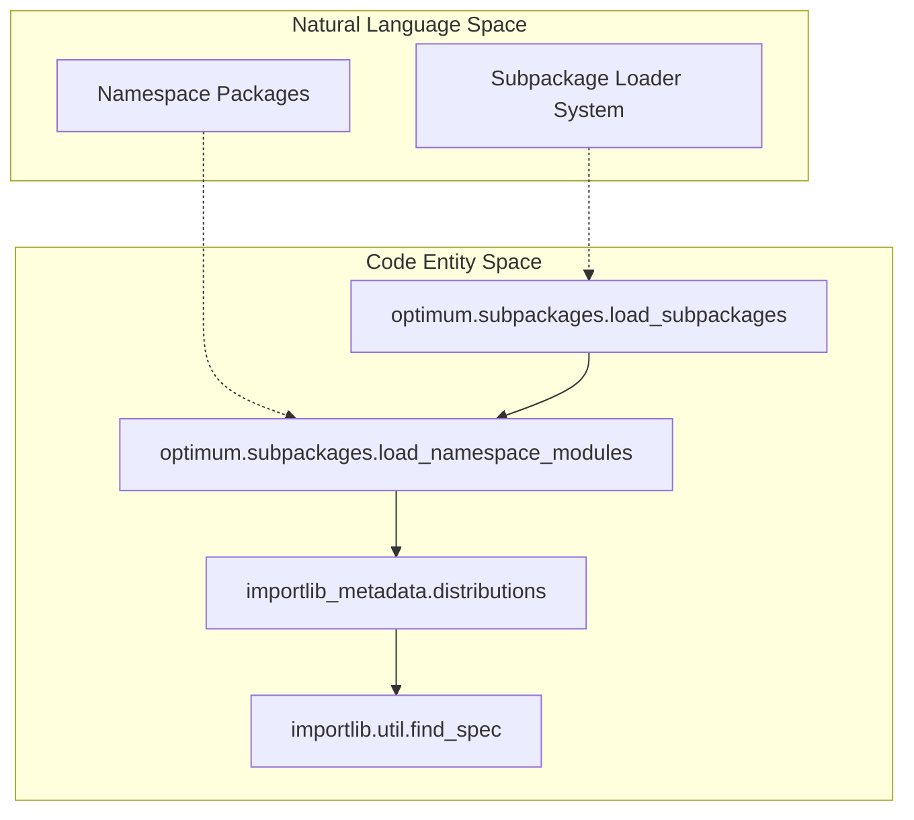
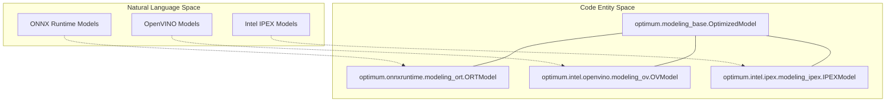

<!-- source: DeepWiki mcp.deepwiki.com · repo huggingface/optimum · page 4.2 Supported Backend Accelerators · fetched 2026-10-26 -->

# Supported Data and Backend Accelerators

Relevant source files

The following files were used as context for generating this wiki page:

- [README.md](README.md)
- [docs/source/index.mdx](docs/source/index.mdx)
- [docs/source/installation.mdx](docs/source/installation.mdx)
- [notebooks/README.md](notebooks/README.md)
- [optimum/subpackages.py](optimum/subpackages.py)

## Purpose and Scope

Optimum provides a unified interface to integrate third-party libraries from hardware partners and interface with their specific functionality. This is achieved through a modular namespace package architecture where the core `optimum` package provides base abstractions, while hardware-specific optimizations and runtime bindings are delivered via `optimum-*` subpackages (such as `optimum-onnx`, `optimum-intel`, `optimum-habana`, `optimum-neuron`, `optimum-nvidia`, `optimum-amd`, and `optimum-furiosa`) [README.md:41-51](), [docs/source/index.mdx:20-54](), [optimum/subpackages.py:41-78](). This page details the integration of major backends, the technical implementation of the `OptimizedModel` hierarchy, and the automated subpackage namespace module loading system [optimum/subpackages.py:30-78]().

---

## Supported Backend Accelerators Overview

Optimum supports a wide range of hardware acceleration backends. These are installed using the package extras system or corresponding subpackages [README.md:41-51](), [docs/source/installation.mdx:23-32]().

| Backend | Installation Extra | Primary Hardware | Subpackage / Integration |
| :--- | :--- | :--- | :--- |
| **ONNX Runtime** | `onnxruntime` / `onnx` | CPU, NVIDIA GPU | `optimum-onnx` [README.md:43-45](), [README.md:82]() |
| **OpenVINO** | `openvino` | Intel CPU/GPU/NPU | `optimum-intel` [README.md:46](), [docs/source/index.mdx:41-44]() |
| **Intel IPEX** | `ipex` | Intel CPU/GPU | `optimum-intel` [README.md:50]() |
| **Habana Gaudi** | `habana` | Gaudi HPU | `optimum-habana` [README.md:50](), [docs/source/index.mdx:45-48]() |
| **AWS Neuron** | `neuronx` | Trainium/Inferentia | `optimum-neuron` [README.md:49](), [docs/source/index.mdx:33-36]() |
| **NVIDIA TRT-LLM** | N/A (Docker) | NVIDIA GPU | `optimum-nvidia` [README.md:47](), [docs/source/index.mdx:29-32]() |
| **AMD ROCm** | `amd` | AMD GPU | `optimum-amd` [README.md:48]() |
| **FuriosaAI** | `furiosa` | Furiosa NPU | `optimum-furiosa` [README.md:51](), [docs/source/index.mdx:49-52]() |

Sources: [README.md:41-51](), [docs/source/index.mdx:23-54](), [docs/source/installation.mdx:23-32]()

---

## Subpackage Namespace Integration Architecture

The core `optimum` package uses a dynamic namespace loading utility to discover and load backend subpackages without incurring heavy startup penalties for unrelated modules [optimum/subpackages.py:30-78]().

### Natural Language to Code Entity Mapping: Subpackage Loading

Sources: [optimum/subpackages.py:30-78]()

---

## OptimizedModel Class Hierarchy

The `OptimizedModel` class serves as the primary abstraction for all backend-specific model implementations, inheriting from `transformers.PreTrainedModel` to maintain full ecosystem compatibility while adding backend execution methods.

### Natural Language to Code Entity Mapping: Optimized Model Hierarchy

Sources: [README.md:80-108](), [docs/source/index.mdx:62-67]()

---

## Backend-Specific Implementations

### ONNX Runtime (ORT)
Managed through `optimum-onnx` [README.md:82](), the ONNX Runtime integration provides format exporting, graph optimizations, and execution via `ORTModel` classes across execution providers such as CPU and CUDA [README.md:80-98]().

### Intel OpenVINO and IPEX
Consolidated under `optimum-intel` [README.md:100-108](), [docs/source/index.mdx:41-48]():
- **OpenVINO**: Focuses on static/dynamic graph optimization and quantization using NNCF [notebooks/README.md:23-31]().
- **IPEX**: Provides direct PyTorch integration for Intel architecture acceleration features [README.md:50]().

### Specialized Hardware Backends
- **Habana Gaudi**: Integrated via `optimum-habana` for high-throughput multi-node training and inference [README.md:50](), [notebooks/README.md:17-22]().
- **AWS Neuron**: Provided via `optimum-neuron` for AWS Trainium and Inferentia instances [README.md:49]().
- **NVIDIA TensorRT-LLM**: Integrated via `optimum-nvidia` container distributions [README.md:47]().

Sources: [README.md:41-112](), [docs/source/index.mdx:23-54](), [notebooks/README.md:15-36](), [optimum/subpackages.py:41-78]()

---

