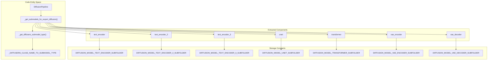

<!-- source: DeepWiki mcp.deepwiki.com · repo huggingface/optimum · page 4.3 Diffusion Pipeline Support · fetched 2026-10-26 -->

# Diffusion Pipeline Support

<details>
<summary>Relevant source files</summary>

The following files were used as context for generating this wiki page:

- [optimum/exporters/utils.py](optimum/exporters/utils.py)
- [optimum/utils/constant.py](optimum/utils/constant.py)

</details>


## Overview

Diffusion models (Stable Diffusion, SDXL, Stable Diffusion 3, Flux, etc.) in Optimum use a standardized set of constants and naming conventions to organize their multi-component architecture. Unlike single-model transformers, diffusion pipelines consist of multiple independent components (text encoders, UNets/transformers, VAE encoders/decoders) that are stored in separate subfolders with specific naming conventions.

This page documents the constants, submodel extraction utilities, and class mappings that enable consistent handling of diffusion model components across different backends and export workflows.

Sources: [optimum/utils/constant.py:1-27](), [optimum/exporters/utils.py:74-165]()

## Diffusion Model Subfolder and File Constants

Optimum defines standard subfolder names and file identifiers for each component of a diffusion pipeline. These constants ensure consistent directory structure across all backends and operations, such as ONNX export or OpenVINO conversion.

**Standard Subfolder Constants**

| Constant Name | Value | Purpose |
|--------------|-------|---------|
| `DIFFUSION_MODEL_TEXT_ENCODER_SUBFOLDER` | `"text_encoder"` | Primary text encoder (CLIP for SD v1/v2) |
| `DIFFUSION_MODEL_TEXT_ENCODER_2_SUBFOLDER` | `"text_encoder_2"` | Secondary text encoder (CLIP with projection for SDXL) |
| `DIFFUSION_MODEL_TEXT_ENCODER_3_SUBFOLDER` | `"text_encoder_3"` | Tertiary text encoder (T5 for SD3) |
| `DIFFUSION_MODEL_UNET_SUBFOLDER` | `"unet"` | UNet denoising model (SD v1/v2/XL) |
| `DIFFUSION_MODEL_TRANSFORMER_SUBFOLDER` | `"transformer"` | Transformer denoising model (Flux, SD3) |
| `DIFFUSION_MODEL_VAE_ENCODER_SUBFOLDER` | `"vae_encoder"` | VAE encoder component |
| `DIFFUSION_MODEL_VAE_DECODER_SUBFOLDER` | `"vae_decoder"` | VAE decoder component |
| `DIFFUSION_PIPELINE_CONFIG_FILE_NAME` | `"model_index.json"` | Pipeline-level configuration file |
| `DIFFUSION_MODEL_CONFIG_FILE_NAME` | `"config.json"` | Component-level configuration file |

Sources: [optimum/utils/constant.py:16-27]()

### Directory Structure Example

When a diffusion model is saved or exported using Optimum, it follows a standardized layout governed by `optimum.utils.constant`:

```
model_directory/
├── model_index.json              # DIFFUSION_PIPELINE_CONFIG_FILE_NAME
├── text_encoder/                 # DIFFUSION_MODEL_TEXT_ENCODER_SUBFOLDER
│   ├── config.json               # DIFFUSION_MODEL_CONFIG_FILE_NAME
│   └── model.onnx 
├── text_encoder_2/               # DIFFUSION_MODEL_TEXT_ENCODER_2_SUBFOLDER
│   ├── config.json
│   └── model.onnx
├── unet/                         # DIFFUSION_MODEL_UNET_SUBFOLDER
│   ├── config.json
│   └── model.onnx
├── vae_encoder/                  # DIFFUSION_MODEL_VAE_ENCODER_SUBFOLDER
│   ├── config.json
│   └── model.onnx
└── vae_decoder/                  # DIFFUSION_MODEL_VAE_DECODER_SUBFOLDER
    ├── config.json
    └── model.onnx
```

Sources: [optimum/utils/constant.py:16-27]()

## Submodel Extraction and Export Utilities

To export complex diffusion pipelines, Optimum decomposes a `DiffusionPipeline` into its constituent parts via `_get_submodels_for_export_diffusion` [optimum/exporters/utils.py:88-165](). This utility function inspects the pipeline instance, configures hidden state outputs for text encoders (especially for SDXL and SD3), configures UNet/Transformer aesthetics/time projection parameters, and splits the VAE into isolated encoder and decoder components with customized forward passes.

### Submodel Type Mapping

The mapping from diffusers class names to internal export model types is defined in `_DIFFUSERS_CLASS_NAME_TO_SUBMODEL_TYPE` [optimum/exporters/utils.py:74-81]():

```python
_DIFFUSERS_CLASS_NAME_TO_SUBMODEL_TYPE = {
    "CLIPTextModel": "clip-text",
    "CLIPTextModelWithProjection": "clip-text-with-projection",
    "FluxTransformer2DModel": "flux-transformer-2d",
    "SD3Transformer2DModel": "sd3-transformer-2d",
    "UNet2DConditionModel": "unet-2d-condition",
    "T5EncoderModel": "t5-encoder",
}
```

Sources: [optimum/exporters/utils.py:74-81]()

### Data Flow for Diffusion Submodel Extraction

The following diagram illustrates how `_get_submodels_for_export_diffusion` processes a `DiffusionPipeline` object into exportable submodels and associates them with subfolder constants.

**Diffusion Pipeline Component Decomposition**



Sources: [optimum/exporters/utils.py:74-165](), [optimum/utils/constant.py:16-27]()

## VAE Decomposition Details

The VAE model inside a diffusion pipeline is handled specially within `_get_submodels_for_export_diffusion`. Because the VAE encoder and decoder have distinct graph signatures, the utility clones `pipeline.vae` into separate objects and overrides their `.forward()` methods:

1.  **VAE Encoder (`vae_encoder`)**:
    ```python
    vae_encoder = copy.deepcopy(pipeline.vae)
    vae_encoder.forward = lambda sample: {"latent_parameters": vae_encoder.encode(x=sample)["latent_dist"].parameters}
    ```
    Sources: [optimum/exporters/utils.py:153-157]()

2.  **VAE Decoder (`vae_decoder`)**:
    ```python
    vae_decoder = copy.deepcopy(pipeline.vae)
    vae_decoder.forward = lambda latent_sample: vae_decoder.decode(z=latent_sample)
    ```
    Sources: [optimum/exporters/utils.py:160-162]()

## Summary

Diffusion pipeline support in Optimum provides:
-   **Standardized Constants**: Fixed strings for file and folder naming (`model_index.json`, `unet`, `transformer`, `vae_encoder`, `vae_decoder`, `text_encoder`, etc.) [optimum/utils/constant.py:16-27]().
-   **Automated Component Extraction**: The `_get_submodels_for_export_diffusion` function for dissecting `DiffusionPipeline` instances into discrete exportable submodels [optimum/exporters/utils.py:88-165]().
-   **Model Type Resolution**: Mapping tables (`_DIFFUSERS_CLASS_NAME_TO_SUBMODEL_TYPE`) linking diffusers classes to configuration types [optimum/exporters/utils.py:74-81]().

---

