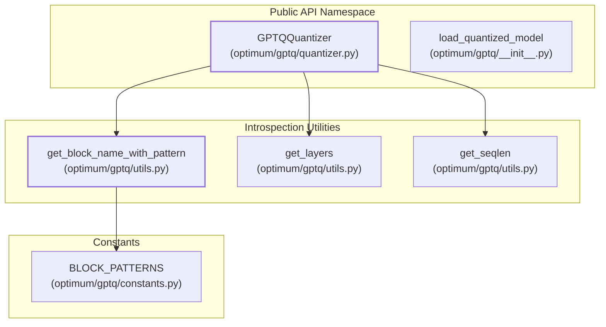
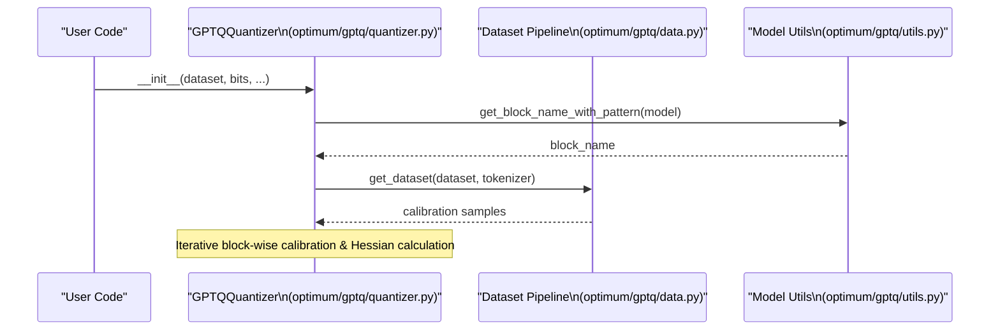
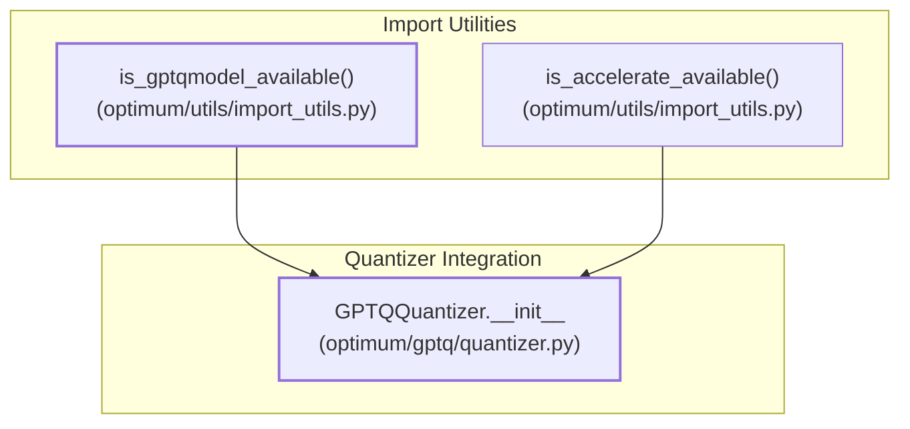

<!-- source: DeepWiki mcp.deepwiki.com · repo huggingface/optimum · page 5 Quantization · fetched 2026-10-26 -->

# Quantization

Relevant source files

The following files were used as context for generating this wiki page:

- [docs/source/concept_guides/quantization.mdx](docs/source/concept_guides/quantization.mdx)
- [docs/source/llm_quantization/usage_guides/quantization.mdx](docs/source/llm_quantization/usage_guides/quantization.mdx)
- [optimum/gptq/constants.py](optimum/gptq/constants.py)
- [optimum/gptq/quantizer.py](optimum/gptq/quantizer.py)
- [optimum/gptq/utils.py](optimum/gptq/utils.py)
- [tests/gptq/test_quantization.py](tests/gptq/test_quantization.py)

## Purpose and Scope

This page provides a high-level overview of quantization support in the Optimum library, focusing primarily on **GPTQ (Generative Pre-trained Transformer Quantization)** for large language models. Quantization reduces model size and accelerates inference by representing weights and activations in lower-precision data types (e.g., 4-bit integers instead of 32-bit floats) [docs/source/concept_guides/quantization.mdx:3-5]().

As a parent page, this section outlines the core sub-topics of Optimum's quantization architecture. For deep technical dives, refer to the following child pages:
- For the comprehensive guide on 4-bit quantization and multi-backend support, see [GPTQ Quantization System](#5.1).
- For details on the calibration process, dataset loading, and per-block workflow, see [Calibration and Dataset Preparation](#5.2).
- For version compatibility and backend checks, see [Import and Dependency Management](#5.3).

**Sources:** [docs/source/concept_guides/quantization.mdx:3-5](), [optimum/gptq/quantizer.py:64-91]()

---

## Overview of GPTQ Quantization

Optimum integrates with backends like `gptqmodel` to deliver a streamlined API for post-training GPTQ quantization [docs/source/llm_quantization/usage_guides/quantization.mdx:3-6](). The central orchestrator for this process is the `GPTQQuantizer` class defined in `optimum/gptq/quantizer.py` [optimum/gptq/quantizer.py:64-67](). It manages bit-precision configurations (2, 3, 4, or 8 bits), group sizes, dampening percentages, and activation reordering (`desc_act`) [optimum/gptq/quantizer.py:94-107]().

### Component Association Diagram

For detailed implementation specifics regarding `GPTQQuantizer`, model packing, and serialization round-trips, see [GPTQ Quantization System](#5.1).

**Sources:** [optimum/gptq/quantizer.py:64-137](), [optimum/gptq/utils.py:33-123](), [optimum/gptq/constants.py:16-26]()

---

## Calibration and Dataset Processing

To accurately quantize activation ranges and minimize degradation, GPTQ requires passing calibration data through the model [docs/source/concept_guides/quantization.mdx:133-137](). Optimum handles this via helper functions in `optimum/gptq/data.py` and configuration parameters inside `GPTQQuantizer` [optimum/gptq/quantizer.py:31-31](). Users can supply custom tokenized datasets or reference standard benchmarks like `wikitext2` or `c4` [optimum/gptq/quantizer.py:96-99]().

### Execution Flow Diagram

For a comprehensive explanation of dataset preparation, batching, tokenization, and caching block outputs, see [Calibration and Dataset Preparation](#5.2).

**Sources:** [optimum/gptq/quantizer.py:31-31](), [optimum/gptq/utils.py:70-85](), [docs/source/concept_guides/quantization.mdx:133-137]()

---

## Import and Dependency Management

Because quantization backends like `gptqmodel` or accelerator libraries like `accelerate` are optional or version-sensitive, Optimum implements a robust utility system to check backend availability at runtime [optimum/gptq/quantizer.py:27-56](). 

### Backend Checking Architecture

For details on how import checks are structured, how version compatibility is enforced, and how conditional imports are managed across backends, see [Import and Dependency Management](#5.3).

**Sources:** [optimum/gptq/quantizer.py:27-56](), [tests/gptq/test_quantization.py:29-30]()

---

