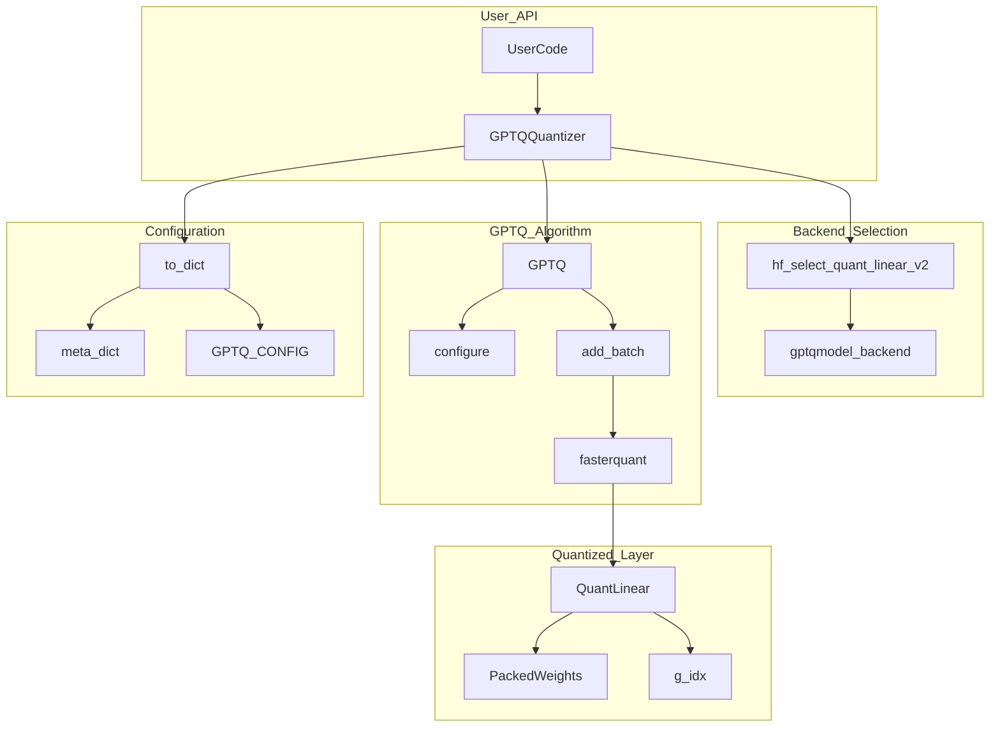
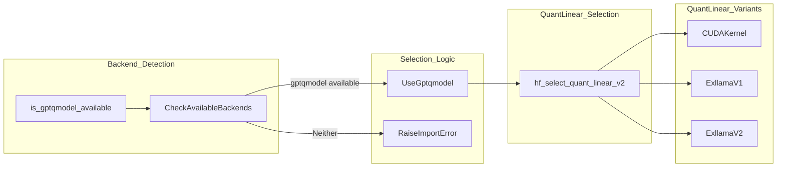
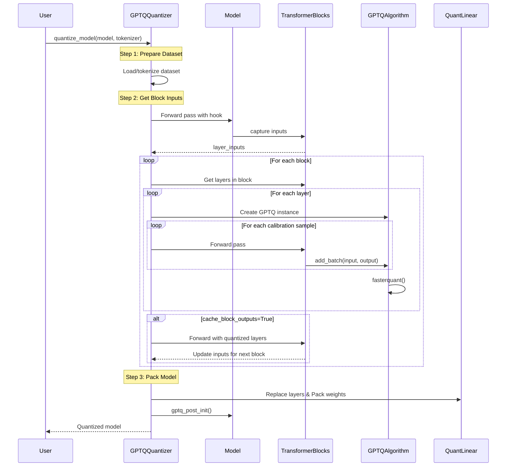

<!-- source: DeepWiki mcp.deepwiki.com · repo huggingface/optimum · page 5.1 GPTQ Quantization System · fetched 2026-10-26 -->

# GPTQ Quantization System

<details>
<summary>Relevant source files</summary>

The following files were used as context for generating this wiki page:

- [docs/source/concept_guides/quantization.mdx](docs/source/concept_guides/quantization.mdx)
- [docs/source/llm_quantization/usage_guides/quantization.mdx](docs/source/llm_quantization/usage_guides/quantization.mdx)
- [optimum/gptq/__init__.py](optimum/gptq/__init__.py)
- [optimum/gptq/constants.py](optimum/gptq/constants.py)
- [optimum/gptq/quantizer.py](optimum/gptq/quantizer.py)
- [optimum/gptq/utils.py](optimum/gptq/utils.py)
- [tests/gptq/test_quantization.py](tests/gptq/test_quantization.py)

</details>


## Purpose and Scope

This document describes the GPTQ (Gradient-based Post-Training Quantization) quantization system in Optimum, which enables 4-bit (and 2/3/8-bit) quantization of large language models with minimal accuracy loss. The system provides a unified API through the `GPTQQuantizer` class that supports multiple backend implementations.

This page covers the `GPTQQuantizer` API, backend selection, quantization workflow, and model conversion. For details about calibration datasets and the calibration process, see [Calibration and Dataset Preparation](#5.2). For backend availability checks and version management, see [Import and Dependency Management](#5.3).

Sources: [optimum/gptq/quantizer.py:64-141](), [docs/source/llm_quantization/usage_guides/quantization.mdx:1-55]()

## Overview

GPTQ is a post-training quantization technique that compresses model weights to low-bit representations (typically 4-bit) while maintaining model quality. The algorithm works by minimizing quantization error using second-order information (Hessian) computed from calibration data. Unlike dynamic quantization, GPTQ performs quantization once during a calibration phase, resulting in a smaller model with faster inference.

The Optimum implementation supports backend libraries such as `gptqmodel` [optimum/gptq/quantizer.py:49-55]().

**Key Features:**
- 2/3/4/8-bit quantization [optimum/gptq/quantizer.py:94-95]().
- Group-wise quantization with configurable group size [optimum/gptq/quantizer.py:100-101]().
- Act-order (`desc_act`) for improved accuracy [optimum/gptq/quantizer.py:103-107]().
- Symmetric and asymmetric quantization [optimum/gptq/quantizer.py:111-112]().
- Multiple kernel backends [optimum/gptq/quantizer.py:139-141]().
- CPU and GPU support [optimum/gptq/quantizer.py:60-61]().

Sources: [optimum/gptq/quantizer.py:49-61](), [optimum/gptq/quantizer.py:94-141](), [docs/source/concept_guides/quantization.mdx:1-137]()

## GPTQQuantizer Class Architecture



Sources: [optimum/gptq/quantizer.py:64-141](), [optimum/gptq/constants.py:28]()

## Configuration and Initialization

The `GPTQQuantizer` class is initialized with quantization hyperparameters:

| Parameter | Type | Default | Description |
|-----------|------|---------|-------------|
| `bits` | int | required | Quantization bits: 2, 3, 4, or 8 [optimum/gptq/quantizer.py:94-95]() |
| `dataset` | str/list | None | Calibration dataset or data [optimum/gptq/quantizer.py:96-99]() |
| `group_size` | int | 128 | Group size for quantization (-1 for per-column) [optimum/gptq/quantizer.py:100-101]() |
| `damp_percent` | float | 0.1 | Hessian dampening percentage [optimum/gptq/quantizer.py:102-103]() |
| `desc_act` | bool | False | Act-order quantization (reorder by activation size) [optimum/gptq/quantizer.py:103-107]() |
| `sym` | bool | True | Symmetric quantization [optimum/gptq/quantizer.py:111-112]() |
| `true_sequential` | bool | True | Sequential layer-wise quantization [optimum/gptq/quantizer.py:113-116]() |
| `format` | str | "gptq" | Weight format: "gptq" (v1) or "gptq_v2" [optimum/gptq/quantizer.py:134-135]() |
| `backend` | str | None | Backend selection [optimum/gptq/quantizer.py:139-141]() |
| `cache_block_outputs` | bool | True | Cache block outputs during quantization [optimum/gptq/quantizer.py:127-129]() |

**Initialization and Validation:**

```python
quantizer = GPTQQuantizer(
    bits=4,
    dataset=cls.dataset,
    group_size=128,
    sym=True,
    desc_act=False,
    act_group_aware=True,
    cache_block_outputs=True,
)
```

The constructor validates that `bits` is in `(2, 3, 4, 8)` and sets internal state for the chosen quantization method [optimum/gptq/quantizer.py:69-141]().

Sources: [optimum/gptq/quantizer.py:69-141](), [tests/gptq/test_quantization.py:83-92]()

## Backend Selection and QuantLinear Implementations



**Backend-Specific Behavior:**

- **gptqmodel**: Supports asymmetric quantization (`sym=False`), `gptq_v2` format, and various accelerated kernels [optimum/gptq/quantizer.py:49-55]().
- **Format conversion**: `gptqmodel` provides utilities like `hf_convert_gptq_v1_to_v2_format` and `hf_convert_gptq_v2_to_v1_format` for format compatibility [optimum/gptq/quantizer.py:53]().

Sources: [optimum/gptq/quantizer.py:49-55](), [tests/gptq/test_quantization.py:121-131]()

## Quantization Workflow



**Detailed Steps:**

1. **Dataset Preparation**: Uses `get_dataset` and `prepare_dataset` to handle calibration data [optimum/gptq/quantizer.py:31]().
2. **Block Inputs**: Captures the inputs to the first transformer block using hooks, identified via `get_block_name_with_pattern` [optimum/gptq/utils.py:70-85]().
3. **Per-Block Quantization**: Iterates through blocks. For each linear layer, it accumulates the Hessian matrix using `add_batch` and computes optimal quantization parameters via `fasterquant` [optimum/gptq/quantizer.py:50-51]().
4. **Packing**: Replaces standard `nn.Linear` layers with `QuantLinear` and packs weights into low-bit integers [optimum/gptq/quantizer.py:15-16]().
5. **Post-Initialization**: Executes `gptq_post_init` to prepare the model for inference [optimum/gptq/quantizer.py:54]().

Sources: [optimum/gptq/quantizer.py:31-55](), [optimum/gptq/utils.py:70-85](), [tests/gptq/test_quantization.py:93]()

## Serialization and Compatibility

The `GPTQQuantizer` handles the serialization of the quantized model and its configuration.

**Serialization Keys:**
The configuration dictionary includes keys such as `bits`, `group_size`, `desc_act`, `sym`, `true_sequential`, and `quant_method` [optimum/gptq/quantizer.py:246-267]().

**Metadata:**
It stores version information for both `optimum` and the chosen GPTQ backend in the `meta` field to ensure reproducibility [optimum/gptq/quantizer.py:136-138]().

**Compatibility:**
The system ensures compatibility with `transformers` and `gptqmodel`. A model quantized via `GPTQQuantizer` can be loaded using `AutoModelForCausalLM.from_pretrained` or `GPTQModel.load` [tests/gptq/test_quantization.py:167-168]().

Sources: [optimum/gptq/quantizer.py:136-138](), [optimum/gptq/constants.py:28](), [tests/gptq/test_quantization.py:147-168]()

## Utility Functions

The GPTQ system relies on several utility functions for model introspection:

- `get_layers`: Finds all linear layers (or other specified types) within a module [optimum/gptq/utils.py:33-67]().
- `get_seqlen`: Determines the maximum sequence length from the model configuration [optimum/gptq/utils.py:113-124]().
- `get_preceding_modules`: Identifies modules that occur before the first transformer block [optimum/gptq/utils.py:88-104]().
- `recurse_getattr`: Utility to get attributes from nested modules [optimum/utils/modeling_utils.py:28]().

Sources: [optimum/gptq/utils.py:33-124](), [optimum/gptq/quantizer.py:28-39]()

---

