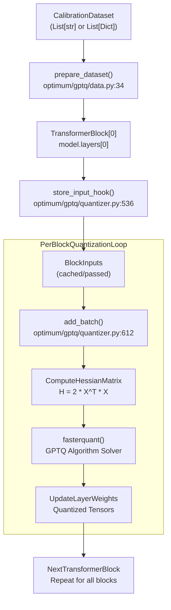
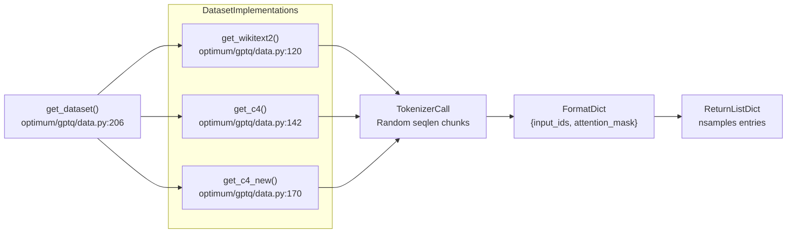
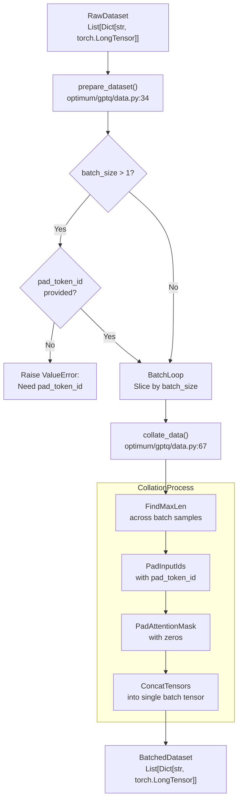
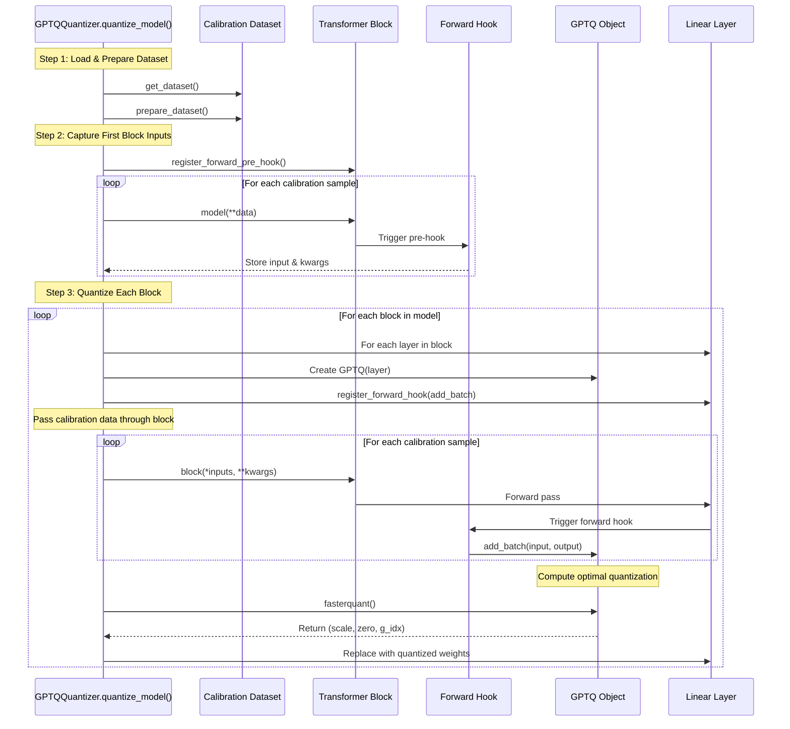

<!-- source: DeepWiki mcp.deepwiki.com · repo huggingface/optimum · page 5.2 Calibration and Dataset Preparation · fetched 2026-10-26 -->

# Calibration and Dataset Preparation

<details>
<summary>Relevant source files</summary>

The following files were used as context for generating this wiki page:

- [docs/source/llm_quantization/usage_guides/quantization.mdx](docs/source/llm_quantization/usage_guides/quantization.mdx)
- [optimum/gptq/data.py](optimum/gptq/data.py)
- [optimum/gptq/eval.py](optimum/gptq/eval.py)
- [optimum/gptq/quantizer.py](optimum/gptq/quantizer.py)
- [tests/gptq/test_quantization.py](tests/gptq/test_quantization.py)

</details>


## Purpose and Scope

This document explains the calibration process used in GPTQ quantization via [`optimum.gptq.GPTQQuantizer`] [optimum/gptq/quantizer.py:64](), focusing on how calibration datasets are loaded, prepared, and used to compute quantization parameters. Calibration is a critical step in post-training static quantization where representative data is passed through the model to determine optimal quantization ranges and Hessian matrices.

For the overall GPTQ quantization system architecture, see [GPTQ Quantization System](#5.1). For import utilities that check dataset library availability, see [Import and Dependency Management](#5.3).

Sources: [optimum/gptq/quantizer.py:64-137](), [optimum/gptq/data.py:34-117]()

---

## What is Calibration in GPTQ

Calibration in GPTQ is the process of using a small representative dataset to compute the optimal quantization parameters for each layer. Unlike dynamic quantization (which computes ranges at runtime), or simple range-based quantization (which uses min/max values), GPTQ uses calibration data to compute a Hessian matrix that captures the sensitivity of each weight to quantization error.

### The GPTQ Calibration Process

Title: "GPTQ Calibration Workflow and Code Entities"



**GPTQ Calibration Flow**: Calibration data passes through each block sequentially. For each block, activations are collected via forward hooks in `GPTQQuantizer` [optimum/gptq/quantizer.py:64]() to compute the Hessian matrix, which is then used to determine optimal quantized weights that minimize reconstruction error.

Sources: [optimum/gptq/quantizer.py:506-671](), [optimum/gptq/data.py:34-64]()

The key insight of GPTQ is that by computing the Hessian of the loss with respect to weights, we can find quantized weights that minimize the impact on the model's output. The Hessian captures second-order information about how sensitive each weight is to quantization.

---

## Supported Calibration Datasets

The GPTQ implementation provides three pre-configured calibration datasets that are commonly used in quantization research, accessed via dataset utilities in [optimum/gptq/data.py]():

| Dataset Name | Source | Description | Usage |
|-------------|---------|-------------|-------|
| `wikitext2` | Wikitext-2 dataset [optimum/gptq/data.py:120]() | Wikipedia articles, clean text | General-purpose calibration |
| `c4` | C4 (Colossal Clean Crawled Corpus) [optimum/gptq/data.py:142]() | Web-crawled text | Diverse text calibration |
| `c4-new` | C4 (alternative sampling) [optimum/gptq/data.py:170]() | Same as c4, different sampling | Alternative to c4 |

These datasets are accessed through the `get_dataset()` function, which handles downloading via `load_dataset` [optimum/gptq/data.py:26]() and tokenization automatically.

Sources: [optimum/gptq/data.py:206-245](), [optimum/gptq/data.py:120-196]()

### Dataset Loading Functions

Title: "Dataset Loading Architecture and Code Entities"



**Dataset Loading Architecture**: The `get_dataset()` function routes to specific dataset loaders (`get_wikitext2`, `get_c4`, `get_c4_new`) [optimum/gptq/data.py:120-170](), which download, tokenize, and format calibration data into a standardized dictionary format.

Sources: [optimum/gptq/data.py:206-245]()

### get_dataset Function Signature

The main entry point for loading calibration datasets:

```python
def get_dataset(
    dataset_name: str,        # 'wikitext2', 'c4', or 'c4-new'
    tokenizer: Any,           # Model tokenizer
    nsamples: int = 128,      # Number of calibration samples
    seqlen: int = 2048,       # Sequence length for each sample
    seed: int = 0,            # Random seed for reproducibility
    split: str = "train"      # 'train' or 'validation'
) -> List[Dict[str, torch.LongTensor]]
```

Each dataset loader returns a list of dictionaries with `input_ids` and `attention_mask` tensors of shape `[1, seqlen]`.

Sources: [optimum/gptq/data.py:206-245]()

---

## Dataset Preparation Pipeline

Once raw calibration data is loaded, it must be prepared for efficient use during quantization via `prepare_dataset()` [optimum/gptq/data.py:34]() and `collate_data()` [optimum/gptq/data.py:67](). This involves batching, padding, and converting to the appropriate tensor format.

### Dataset Preparation Flow

Title: "Dataset Preparation and Collation Workflow"



**Dataset Preparation Pipeline**: Raw tokenized samples are batched via `prepare_dataset()` and padded to uniform length using `collate_data()` [optimum/gptq/data.py:34-117]() for efficient processing during calibration.

Sources: [optimum/gptq/data.py:34-64](), [optimum/gptq/data.py:67-117]()

### Key Functions

#### prepare_dataset

Transforms a list of tokenized examples into batched format suitable for quantization [optimum/gptq/data.py:34]():

```python
def prepare_dataset(
    examples: List[Dict[str, torch.LongTensor]],
    batch_size: int = 1,
    pad_token_id: Optional[int] = None
) -> List[Dict[str, torch.LongTensor]]
```

**Key behavior:**
- Converts lists to `torch.LongTensor` if needed [optimum/gptq/data.py:53-55]()
- Requires `pad_token_id` when `batch_size > 1` for padding [optimum/gptq/data.py:56-59]()
- Uses `collate_data()` to batch samples together [optimum/gptq/data.py:60-63]()
- Returns list where each element is one batch [optimum/gptq/data.py:64]()

Sources: [optimum/gptq/data.py:34-64]()

#### collate_data

Handles the actual batching and padding of multiple samples [optimum/gptq/data.py:67]():

```python
def collate_data(
    blocks: List[Dict[str, torch.LongTensor]],
    contain_labels: bool = False,
    pad_token_id: Optional[int] = None
) -> Dict[str, torch.LongTensor]
```

**Implementation details:**
- Finds maximum sequence length across all samples in batch [optimum/gptq/data.py:96]()
- Pads `input_ids` by prepending `pad_token_id` values [optimum/gptq/data.py:102]()
- Pads `attention_mask` by prepending zeros [optimum/gptq/data.py:103]()
- Optionally handles labels (padded with -100) [optimum/gptq/data.py:108]()
- Concatenates all samples along batch dimension [optimum/gptq/data.py:111-115]()

Sources: [optimum/gptq/data.py:67-117]()

---

## Calibration Workflow During Quantization

The calibration data is used during the main quantization process to compute optimal quantization parameters. This happens in the `quantize_model()` method of [`optimum.gptq.GPTQQuantizer`] [optimum/gptq/quantizer.py:64]().

### Per-Block Quantization with Calibration

Title: "Per-Block Quantization Sequence and Hook Execution"



**Per-Block Calibration Sequence**: For each transformer block, calibration data passes through to collect activations via forward hooks. These activations are used to compute the Hessian matrix, which determines optimal quantized weights.

Sources: [optimum/gptq/quantizer.py:506-671]()

### Detailed Calibration Steps

#### Step 1: Prepare Calibration Data

The quantization process begins by loading and preparing calibration data within `GPTQQuantizer` [optimum/gptq/quantizer.py:64]():

```python
# If dataset is already tokenized (list of dicts with input_ids)
if isinstance(self.dataset, list) and not isinstance(self.dataset[0], str):
    dataset = self.dataset
else:
    # Load from dataset name (e.g., "c4", "wikitext2")
    if isinstance(self.dataset, str):
        dataset = get_dataset(self.dataset, tokenizer, seqlen=self.model_seqlen, split="train")
    # Or tokenize list of strings
    elif isinstance(self.dataset, list):
        dataset = [tokenizer(data, return_tensors="pt") for data in self.dataset]

# Prepare with batching
dataset = prepare_dataset(dataset, pad_token_id=self.pad_token_id, batch_size=self.batch_size)
```

Sources: [optimum/gptq/quantizer.py:479-504]()

#### Step 2: Capture Block Inputs

Before quantizing each block, the inputs to that block must be captured using the calibration data:

```python
def store_input_hook(_, input, *args):
    kwargs = args[0]
    if input is None:
        if "hidden_states" in kwargs:
            input = (nested_move_to(kwargs["hidden_states"], cur_layer_device),)
    layer_inputs.append(input)
    # ... capture other kwargs ...
    raise ValueError  # Stop forward pass after capturing

handle = blocks[0].register_forward_pre_hook(store_input_hook, with_kwargs=True)
for data in dataset:
    try:
        model(**data)  # Will stop at first block due to exception
    except ValueError:
        pass
handle.remove()
```

The hook captures the input tensors and keyword arguments (like attention masks, position IDs) that will be passed to the block. The `raise ValueError` stops the forward pass after capturing inputs.

Sources: [optimum/gptq/quantizer.py:536-560]()

#### Step 3: Per-Layer Hessian Computation

For each layer within a block, a forward hook collects activations to build the Hessian:

```python
for name in subset_layers:
    gptq[name] = GPTQ(subset_layers[name])
    # ...
    def add_batch(name):
        def tmp(_, input, output):
            gptq[name].add_batch(input[0].data, output.data)
        return tmp
    
    handles.append(subset_layers[name].register_forward_hook(add_batch(name)))

# Pass calibration data through block to collect activations
for j in range(len(dataset)):
    block(*layer_inputs[j], **layer_input_kwargs[j])
```

Each call to `add_batch()` updates the Hessian matrix using the layer's input activations. The GPTQ algorithm uses this Hessian to solve for optimal quantized weights.

Sources: [optimum/gptq/quantizer.py:609-637]()

---

## Evaluation and Perplexity

After quantization, it is common to evaluate the model's quality using perplexity via `evaluate_perplexity()` [optimum/gptq/eval.py:7]():

```python
from optimum.gptq.eval import evaluate_perplexity

ppl = evaluate_perplexity(model, tokenizer)
```

The `evaluate_perplexity` function uses the `wikitext-2-raw-v1` test split, calculating negative log-likelihood over 512-token sequences to derive the final perplexity score [optimum/gptq/eval.py:7-41]().

Sources: [optimum/gptq/eval.py:7-41]()

---

## Practical Considerations

### Number of Calibration Samples

The default number of calibration samples is 128, which provides a good balance between calibration quality and speed.

| Parameter | Type | Default | Description |
|-----------|------|---------|-------------|
| `dataset` | `Union[List[str], str, List[Dict]]` | `None` | Calibration dataset (required) [optimum/gptq/quantizer.py:72]() |
| `model_seqlen` | `Optional[int]` | Auto-detected | Sequence length for calibration samples [optimum/gptq/quantizer.py:79]() |
| `batch_size` | `int` | `1` | Number of samples per batch [optimum/gptq/quantizer.py:82]() |
| `pad_token_id` | `Optional[int]` | `None` | Required if `batch_size > 1` [optimum/gptq/quantizer.py:83]() |

Sources: [optimum/gptq/quantizer.py:72-89](), [optimum/gptq/data.py:206-245]()

---

