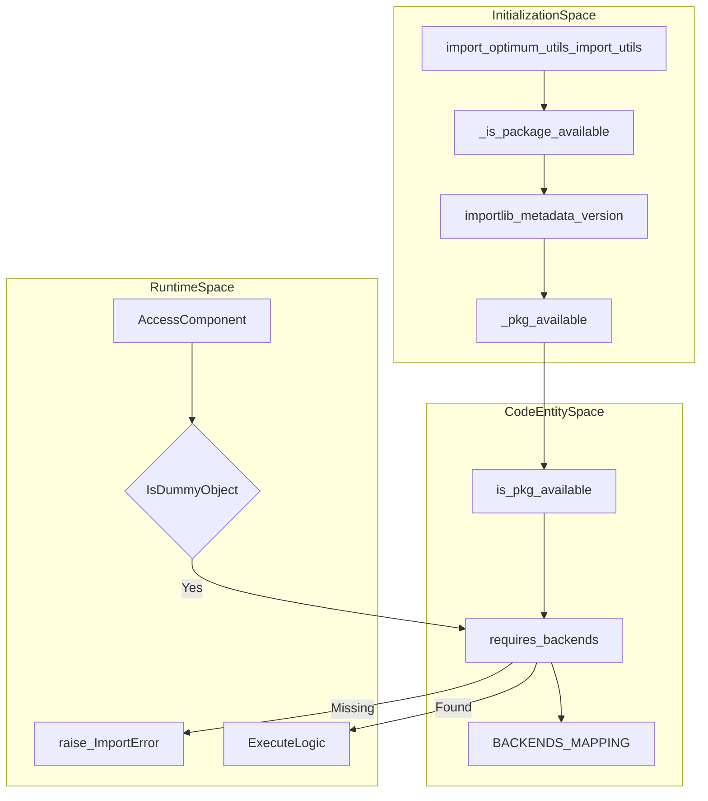
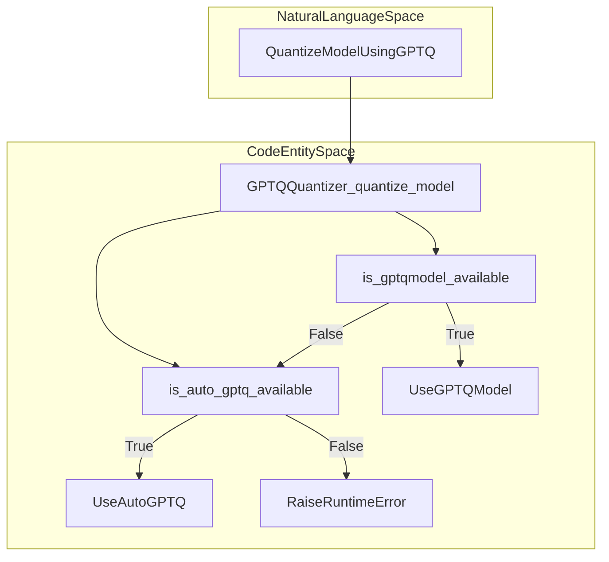

<!-- source: DeepWiki mcp.deepwiki.com · repo huggingface/optimum · page 5.3 Import and Dependency Management · fetched 2026-10-26 -->

# Import and Dependency Management

<details>
<summary>Relevant source files</summary>

The following files were used as context for generating this wiki page:

- [optimum/utils/import_utils.py](optimum/utils/import_utils.py)
- [setup.py](setup.py)

</details>


This document describes the import and dependency management system in Optimum, which handles optional dependencies, version compatibility checking, and graceful degradation when backends are unavailable. This system enables Optimum's modular architecture where different hardware backends can be installed independently.

## Overview and Purpose

Optimum supports numerous optional backends (ONNX Runtime, OpenVINO, auto-gptq, gptqmodel, etc.) that users may or may not have installed. The import utilities system provides:

1.  **Runtime availability checking** for optional packages.
2.  **Version compatibility validation** to ensure minimum requirements.
3.  **Helpful error messages** when dependencies are missing.
4.  **Lazy error generation** for uninstalled backends.
5.  **Multi-backend fallback logic** for quantization libraries.

All import management utilities are centralized in [optimum/utils/import_utils.py]().

Sources: [optimum/utils/import_utils.py:1-318]()

## Core Import Checking System

### Package Availability Detection

The `_is_package_available` function checks if a package is installed and is a proper distribution (not just an importable module) [optimum/utils/import_utils.py:39-43]().

**Function Signature:**
```python
def _is_package_available(
    pkg_name: str,
    return_version: bool = False,
    pkg_distributions: Optional[List[str]] = None,
) -> Union[Tuple[bool, str], bool]:
```

**Key Features:**
*   Uses `importlib.util.find_spec()` to check if the module exists [optimum/utils/import_utils.py:57]().
*   Uses `importlib.metadata.version()` to verify it is a real package and retrieve its version [optimum/utils/import_utils.py:68]().
*   Supports multiple package distribution names (e.g., `onnxruntime-gpu`, `onnxruntime-rocm`) via the `pkg_distributions` argument [optimum/utils/import_utils.py:66-73]().

Sources: [optimum/utils/import_utils.py:39-79]()

### Cached Availability Checks

At module import time, Optimum checks the availability of optional dependencies and caches the results as module-level variables.

| Variable | Package Checked | File Reference |
| :--- | :--- | :--- |
| `_torch_available` | torch | [optimum/utils/import_utils.py:94]() |
| `_transformers_available` | transformers | [optimum/utils/import_utils.py:93]() |
| `_diffusers_available` | diffusers | [optimum/utils/import_utils.py:92]() |
| `_onnx_available` | onnx | [optimum/utils/import_utils.py:82]() |
| `_onnxruntime_available` | onnxruntime (+ 15 variants) | [optimum/utils/import_utils.py:95-116]() |
| `_gptqmodel_available` | gptqmodel | [optimum/utils/import_utils.py:87]() |
| `_openvino_available` | openvino | [optimum/utils/import_utils.py:86]() |
| `_accelerate_available` | accelerate | [optimum/utils/import_utils.py:88]() |

The ONNX Runtime check is particularly robust, checking distributions ranging from `onnxruntime-gpu` to specialized versions like `onnxruntime-qnn` and `ort-migraphx-nightly` [optimum/utils/import_utils.py:95-116]().

Sources: [optimum/utils/import_utils.py:81-119]()

## Version Comparison System

### Minimum Version Requirements

Optimum defines minimum version constants for critical dependencies to ensure stability.

| Dependency | Minimum Version | Constant | File Reference |
| :--- | :--- | :--- | :--- |
| PyTorch | 2.1.0 | `TORCH_MINIMUM_VERSION` | [optimum/utils/import_utils.py:29]() |
| Transformers | 4.36.0 | `TRANSFORMERS_MINIMUM_VERSION` | [optimum/utils/import_utils.py:30]() |
| Diffusers | 0.22.0 | `DIFFUSERS_MINIMUM_VERSION` | [optimum/utils/import_utils.py:31]() |
| GPTQModel | 7.0.0 | `GPTQMODEL_MINIMUM_VERSION` | [optimum/utils/import_utils.py:32]() |

Sources: [optimum/utils/import_utils.py:29-34]()

### Version Comparison Functionality

The `compare_versions` function provides a flexible way to compare library versions using string operators mapped to standard `operator` functions [optimum/utils/import_utils.py:121-139]().

**Operation Mapping:**
```python
STR_OPERATION_TO_FUNC = {">": op.gt, ">=": op.ge, "==": op.eq, "!=": op.ne, "<=": op.le, "<": op.lt}
```
Sources: [optimum/utils/import_utils.py:36](), [optimum/utils/import_utils.py:121-139]()

### Library-Specific Version Checks

Convenience functions wrap these comparisons for major libraries:
*   `is_transformers_version(operation, reference_version)` [optimum/utils/import_utils.py:141-148]()
*   `is_diffusers_version(operation, reference_version)` [optimum/utils/import_utils.py:150-157]()
*   `is_torch_version(operation, reference_version)` [optimum/utils/import_utils.py:159-167]()

These functions return `False` if the library is not available, preventing crashes during feature detection [optimum/utils/import_utils.py:145-146]().

Sources: [optimum/utils/import_utils.py:121-176]()

## Import Flow and Error Handling

The diagram below illustrates the flow from package detection to runtime availability checks, bridging natural language requirements to code entities.

Title: "Import Validation Flow"

Sources: [optimum/utils/import_utils.py:39-79]()

### Backend Mapping and Error Messages

The backend mapping structure defines available backends with their check functions and error messages [optimum/utils/import_utils.py:279-311]().

Error message templates use `{0}` as a placeholder for the class or function name requesting the backend [optimum/utils/import_utils.py:246-249]().

Sources: [optimum/utils/import_utils.py:245-318]()

### DummyObject Metaclass

The `DummyObject` metaclass provides a mechanism for creating placeholder classes that raise helpful errors when accessed [optimum/utils/import_utils.py:318]().

```python
class DummyObject(type):
    def __getattr__(cls, key):
        if key.startswith("_"):
            return super().__getattr__(cls, key)
        requires_backends(cls, cls._backends)
```

Any class inheriting from this metaclass must define a `_backends` attribute. If the backends are missing, any attribute access on the class triggers an `ImportError` via `requires_backends` [optimum/utils/import_utils.py:318]().

Sources: [optimum/utils/import_utils.py:318]()

## Usage Patterns in the Codebase

### Multi-Backend Logic in Quantization

The GPTQ quantization system uses these utilities to choose between `gptqmodel` and `auto_gptq` backends.

Title: "GPTQ Backend Resolution Flow"

Sources: [optimum/gptq/quantizer.py:409-436]()

### Feature Availability Checks

Utilities are also used to detect specific features within a backend, such as CPU support for GPTQ:

```python
gptq_supports_cpu = (
    is_auto_gptq_available() and version.parse(importlib.metadata.version("auto-gptq")) > version.parse("0.4.2")
) or is_gptqmodel_available()
```
Sources: [optimum/gptq/quantizer.py:418-421]()

## Summary

The `import_utils` system ensures that Optimum remains lightweight by not forcing the installation of every supported hardware backend. By centralizing these checks, the library provides a consistent user experience with clear installation instructions when a required dependency is missing.

Sources: [optimum/utils/import_utils.py:1-318]()

---

