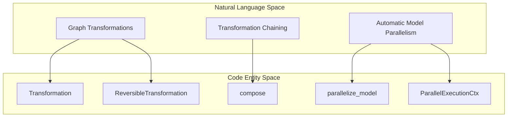
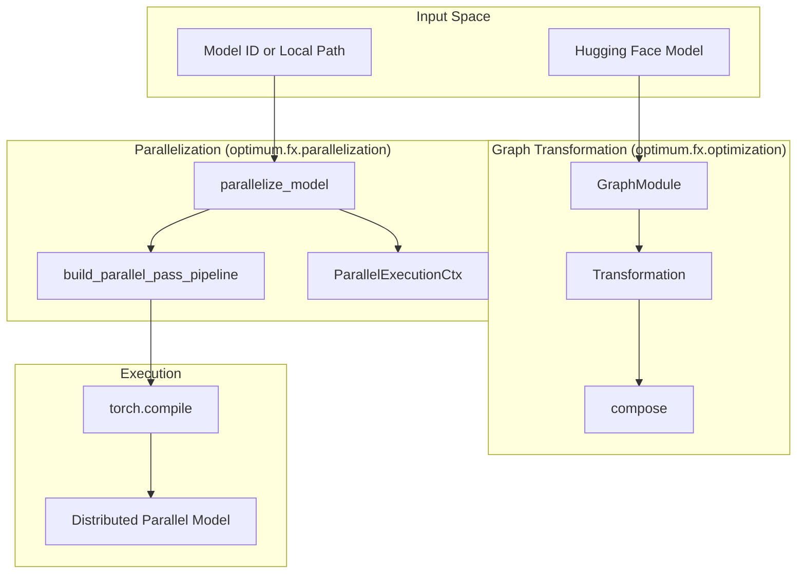
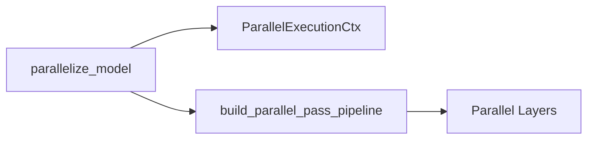

<!-- source: DeepWiki mcp.deepwiki.com · repo huggingface/optimum · page 6 Graph Optimization · fetched 2026-10-26 -->

# Graph Optimization

Relevant source files

The following files were used as context for generating this wiki page:

- [docs/source/torch_fx/concept_guides/symbolic_tracer.mdx](docs/source/torch_fx/concept_guides/symbolic_tracer.mdx)
- [docs/source/torch_fx/overview.mdx](docs/source/torch_fx/overview.mdx)
- [docs/source/torch_fx/package_reference/optimization.mdx](docs/source/torch_fx/package_reference/optimization.mdx)
- [optimum/configuration_utils.py](optimum/configuration_utils.py)
- [optimum/fx/__init__.py](optimum/fx/__init__.py)
- [optimum/fx/optimization/__init__.py](optimum/fx/optimization/__init__.py)
- [optimum/fx/optimization/transformations.py](optimum/fx/optimization/transformations.py)
- [optimum/fx/utils.py](optimum/fx/utils.py)
- [tests/fx/optimization/test_transformations.py](tests/fx/optimization/test_transformations.py)

## Purpose and Scope

Graph optimization in Optimum provides a framework for performing graph-level transformations on PyTorch models to improve inference and training performance. This is achieved through the `optimum.fx` module, which leverages PyTorch's `torch.fx` symbolic tracing and `torch.compile` capabilities to analyze and modify model computation graphs.

This document covers the graph optimization infrastructure, including the transformation system, transformation composition, and the automatic model parallelism subsystem.

Graph optimizations work by:
1. Symbolically tracing a PyTorch model into a graph representation or intercepting the graph during `torch.compile`.
2. Applying transformations that modify the graph structure (e.g., fusing layers, merging operations).
3. Preserving numerical equivalence (for most transformations) while improving efficiency.
4. Partitioning the graph for distributed execution across multiple devices.

For details on the core transformation logic, see [Torch.fx Transformation System](#6.1). For information on chaining these optimizations, see [Transformation Composition](#6.2). For details on distributed execution, see [Automatic Model Parallelism](#6.3).

Sources: [optimum/fx/optimization/transformations.py:85-126]()

## Architecture Overview

The graph optimization system bridges high-level optimization concepts with concrete Python classes and functions in the codebase.

### Natural Language to Code Entity Mapping

Sources: [optimum/fx/optimization/transformations.py:85-182](), [optimum/fx/optimization/transformations.py:741-821]()

### Optimization and Parallelization Flow

Sources: [optimum/fx/optimization/transformations.py:85-126]()

## Torch.fx Transformation System

The `Transformation` abstract base class defines the interface for all graph transformations [optimum/fx/optimization/transformations.py:85-106](). These transformations can be used to fuse operations or merge layers to reduce kernel launches and memory overhead.

| Class | Description |
|-------|-------------|
| `Transformation` | Base class for graph modifications. Implements `transform()` and `__call__()`. [optimum/fx/optimization/transformations.py:85-125]() |
| `ReversibleTransformation` | A transformation that can be undone using a `reverse()` method. [optimum/fx/optimization/transformations.py:176-195]() |

Transformations track their impact on the graph using a signature system, allowing users to query which nodes were modified by specific passes via `get_transformed_nodes()` [optimum/fx/optimization/transformations.py:128-173]().

For details, see [Torch.fx Transformation System](#6.1).

Sources: [optimum/fx/optimization/transformations.py:85-195]()

## Transformation Composition

To simplify complex optimization workflows, Optimum provides a `compose()` utility. This function chains multiple `Transformation` objects into a single callable transformation pipeline.

The composition system automatically manages reversibility: if all constituent transformations are reversible, the entire pipeline can be reversed.

For details, see [Transformation Composition](#6.2).

Sources: [optimum/fx/optimization/transformations.py:741-821]()

## Automatic Model Parallelism

The `optimum.fx.parallelization` subpackage provides an API for automatic tensor parallelism. It uses `torch.fx` to partition a model's computation graph across multiple devices, handling the insertion of collective communication operations automatically.

### Parallelization Components

Key entities in this subsystem include:
- `parallelize_model`: The high-level entry point that takes a model and a parallel execution context.
- `ParallelExecutionCtx`: Manages distributed state, process groups, and device assignments.
- `build_parallel_pass_pipeline`: Constructs the sequence of FX passes required to transform a standard model into a distributed one.

For details, see [Automatic Model Parallelism](#6.3).

Sources: [optimum/fx/optimization/transformations.py:85-126]()

## Configuration Management

Graph optimizations and parallelization are governed by configuration classes that inherit from `BaseConfig`. This ensures that optimization settings can be saved, loaded, and shared via the Hugging Face Hub [optimum/configuration_utils.py:36-40]().

| Entity | Role |
|--------|------|
| `BaseConfig` | Provides `save_pretrained` and `from_pretrained` for configuration settings. [optimum/configuration_utils.py:36-54]() |

Sources: [optimum/configuration_utils.py:36-126]()

---

