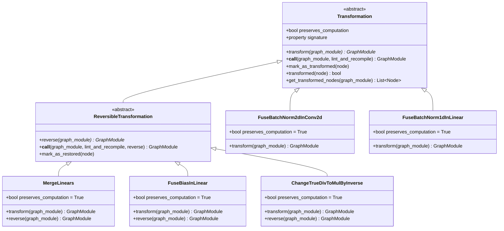
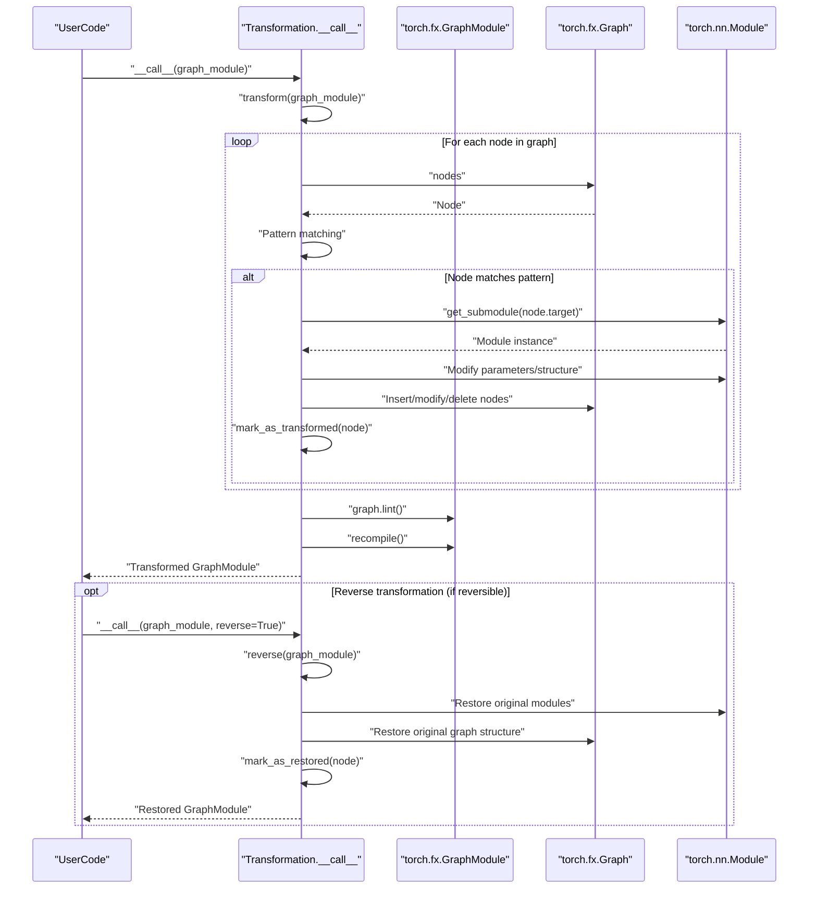
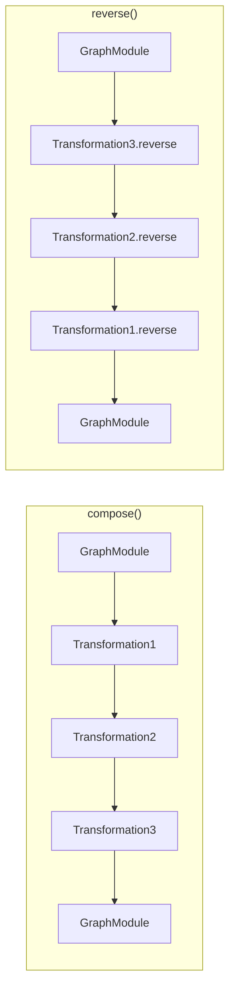

<!-- source: DeepWiki mcp.deepwiki.com · repo huggingface/optimum · page 6.1 Torch.fx Transformation System · fetched 2026-10-26 -->

# Torch.fx Transformation System

<details>
<summary>Relevant source files</summary>

The following files were used as context for generating this wiki page:

- [docs/source/torch_fx/usage_guides/optimization.mdx](docs/source/torch_fx/usage_guides/optimization.mdx)
- [optimum/configuration_utils.py](optimum/configuration_utils.py)
- [optimum/fx/__init__.py](optimum/fx/__init__.py)
- [optimum/fx/optimization/__init__.py](optimum/fx/optimization/__init__.py)
- [optimum/fx/optimization/transformations.py](optimum/fx/optimization/transformations.py)
- [optimum/fx/utils.py](optimum/fx/utils.py)
- [tests/fx/optimization/test_transformations.py](tests/fx/optimization/test_transformations.py)

</details>


## Purpose and Scope

The Torch.fx Transformation System provides a framework for applying graph-level optimizations to PyTorch models that have been traced using `torch.fx`. This system enables structural modifications to computational graphs while maintaining or improving model performance. Transformations can merge layers, fuse operations, change mathematical operations, and perform other graph rewrites.

This page documents the transformation framework itself—the base classes, lifecycle, composition mechanisms, and concrete implementations found in the `optimum.fx.optimization` module.

Sources: [optimum/fx/optimization/transformations.py:1-822](), [docs/source/torch_fx/usage_guides/optimization.mdx:1-38]()

## Architecture Overview

The transformation system is built on two abstract base classes that define the transformation interface, with concrete implementations providing specific optimization strategies.

### Class Hierarchy

The following diagram maps the conceptual optimization tasks (Natural Language Space) to their corresponding Python classes and methods in the codebase (Code Entity Space).



Sources: [optimum/fx/optimization/transformations.py:84-220](), [optimum/fx/optimization/transformations.py:237-802]()

### System Components

| Component | File Location | Purpose |
|-----------|---------------|---------|
| `Transformation` base class | [optimum/fx/optimization/transformations.py:84-173]() | Abstract interface for all transformations |
| `ReversibleTransformation` base class | [optimum/fx/optimization/transformations.py:175-234]() | Interface for transformations that can be undone |
| Concrete transformations | [optimum/fx/optimization/transformations.py:236-683]() | Specific optimization implementations |
| `compose()` function | [optimum/fx/optimization/transformations.py:721-801]() | Chains multiple transformations together |
| Version checking utilities | [optimum/fx/utils.py:21-43]() | Ensures transformers version compatibility |

Sources: [optimum/fx/optimization/__init__.py:1-24](), [optimum/fx/__init__.py:1-15]()

## Base Transformation Classes

### Transformation

The `Transformation` abstract base class defines the core interface for all graph transformations. Every transformation must implement the `transform()` method and can be invoked as a callable.

**Key attributes:**
- `preserves_computation` (bool): Whether the transformation maintains semantic equivalence. When `True`, the original and transformed graphs should produce identical outputs. [optimum/fx/optimization/transformations.py:93]()

**Key methods:**

| Method | Parameters | Returns | Description |
|--------|------------|---------|-------------|
| `transform()` | `graph_module: GraphModule` | `GraphModule` | Abstract method that performs the transformation [optimum/fx/optimization/transformations.py:96-106]() |
| `__call__()` | `graph_module: GraphModule`<br>`lint_and_recompile: bool = True` | `GraphModule` | Applies transformation and optionally lints/recompiles [optimum/fx/optimization/transformations.py:108-125]() |
| `mark_as_transformed()` | `node: Node` | `None` | Marks a node as transformed by this transformation [optimum/fx/optimization/transformations.py:137-147]() |
| `transformed()` | `node: Node` | `bool` | Checks if a node was transformed by this transformation [optimum/fx/optimization/transformations.py:149-159]() |
| `get_transformed_nodes()` | `graph_module: GraphModule` | `List[Node]` | Returns all nodes transformed by this transformation [optimum/fx/optimization/transformations.py:161-172]() |
| `signature` | property | `int` | Hash identifying this transformation instance [optimum/fx/optimization/transformations.py:127-135]() |

Sources: [optimum/fx/optimization/transformations.py:84-173]()

### ReversibleTransformation

The `ReversibleTransformation` class extends `Transformation` to support bidirectional transformations. This enables debugging, ablation studies, and transformation experimentation.

**Additional methods:**

| Method | Parameters | Returns | Description |
|--------|------------|---------|-------------|
| `reverse()` | `graph_module: GraphModule` | `GraphModule` | Abstract method that reverses the transformation [optimum/fx/optimization/transformations.py:184-195]() |
| `__call__()` | `graph_module: GraphModule`<br>`lint_and_recompile: bool = True`<br>`reverse: bool = False` | `GraphModule` | Applies forward or reverse transformation [optimum/fx/optimization/transformations.py:197-220]() |
| `mark_as_restored()` | `node: Node` | `None` | Marks a node as restored to original state [optimum/fx/optimization/transformations.py:222-233]() |

Sources: [optimum/fx/optimization/transformations.py:175-234]()

## Transformation Lifecycle

The following diagram illustrates the complete execution flow and data flow when applying a transformation to a traced PyTorch model using code-level execution steps:



Sources: [optimum/fx/optimization/transformations.py:108-125](), [optimum/fx/optimization/transformations.py:197-220]()

### Transformation Application Steps

1. **Invocation**: User calls the transformation instance with a `GraphModule` and optional parameters.
2. **Graph traversal**: The `transform()` method iterates through graph nodes.
3. **Pattern matching**: Each node is checked against transformation criteria.
4. **Module modification**: Matching modules are retrieved and their parameters/structure modified.
5. **Graph rewriting**: Nodes are inserted, modified, or deleted to reflect the transformation.
6. **Node marking**: Transformed nodes are marked with the transformation's signature using `mark_as_transformed`. [optimum/fx/optimization/transformations.py:137-147]()
7. **Validation**: The graph is linted using `graph.lint()` to ensure structural validity. [optimum/fx/optimization/transformations.py:123]()
8. **Recompilation**: The `GraphModule` is recompiled to generate new Python code. [optimum/fx/optimization/transformations.py:124]()
9. **Return**: The transformed `GraphModule` is returned.

Sources: [optimum/fx/optimization/transformations.py:108-125]()

## Concrete Transformations

### MergeLinears

The `MergeLinears` transformation identifies multiple `torch.nn.Linear` layers that receive the same input tensor and merges them into a single larger linear layer. This reduces memory traffic and can improve performance.

**Operation:**
```
Input
  ├─> Linear_1(out_features=64)  ──> Output_1
  ├─> Linear_2(out_features=128) ──> Output_2
  └─> Linear_3(out_features=256) ──> Output_3

Transforms to:

Input ──> MergedLinear(out_features=448) ──> Split
                                              ├─> Output_1 [0:64]
                                              ├─> Output_2 [64:192]
                                              └─> Output_3 [192:448]
```

**Implementation details:**
- Concatenates weights along the output dimension: [optimum/fx/optimization/transformations.py:288-295]()
- Handles bias terms by padding with zeros for layers without bias: [optimum/fx/optimization/transformations.py:245-248]()
- Replaces multiple `call_module` nodes with a single merged module and `getitem` operations: [optimum/fx/optimization/transformations.py:308-320]()
- Reverse transformation splits the merged linear back into separate layers: [optimum/fx/optimization/transformations.py:322-365]()

**Common usage:** Merging query, key, and value projections in attention layers (e.g., `BertSelfAttention`). [tests/fx/optimization/test_transformations.py:261-278]()

Sources: [optimum/fx/optimization/transformations.py:237-389]()

### FuseBiasInLinear

The `FuseBiasInLinear` transformation fuses the bias term of linear layers into the weight matrix by appending a column to the weight and concatenating a `1` to the input.

**Mathematical equivalence:**
```
Original: y = Wx + b
Fused:    y = [W | b] @ [x; 1]
```

**Implementation:**
- Inserts a concatenation operation before the linear layer: [optimum/fx/optimization/transformations.py:403-422]()
- Concatenates bias as an additional column in the weight matrix: [optimum/fx/optimization/transformations.py:424-426]()
- Sets `module.bias = None` after fusion: [optimum/fx/optimization/transformations.py:426]()
- Tracks inserted nodes for reversal: [optimum/fx/optimization/transformations.py:414-421]()

Sources: [optimum/fx/optimization/transformations.py:393-443](), [tests/fx/optimization/test_transformations.py:280-294]()

### ChangeTrueDivToMulByInverse

The `ChangeTrueDivToMulByInverse` transformation converts division operations to multiplication by the inverse when the denominator is static.

**Operation:**
```python
# Before: x / 2.0 (operator.truediv)
# After:  x * 0.5 (operator.mul)
```

**Implementation:**
- Scans for `call_function` nodes with target `operator.truediv`: [optimum/fx/optimization/transformations.py:458]()
- Only transforms when denominator is not a `torch.fx.Node` (i.e., is constant): [optimum/fx/optimization/transformations.py:460]()
- Replaces target and computes inverse: [optimum/fx/optimization/transformations.py:461-463]()

Sources: [optimum/fx/optimization/transformations.py:447-474](), [tests/fx/optimization/test_transformations.py:296-317]()

### FuseBatchNorm2dInConv2d

The `FuseBatchNorm2dInConv2d` transformation fuses `torch.nn.BatchNorm2d` layers that directly follow `torch.nn.Conv2d` layers into a single convolution.

**Implementation:**
- Checks for `BatchNorm2d` following `Conv2d` with no other users: [optimum/fx/optimization/transformations.py:516-522]()
- Computes fused weights and bias: [optimum/fx/optimization/transformations.py:549-555]()
- Replaces the convolution module in-place and removes batch norm: [optimum/fx/optimization/transformations.py:529-540]()

Sources: [optimum/fx/optimization/transformations.py:478-557](), [tests/fx/optimization/test_transformations.py:319-332]()

### FuseBatchNorm1dInLinear

The `FuseBatchNorm1dInLinear` transformation fuses `torch.nn.BatchNorm1d` layers that are adjacent to `torch.nn.Linear` layers.

**Cases handled:**
1. `Linear -> BatchNorm1d`: Fuses when linear output features equals batch norm num features. [optimum/fx/optimization/transformations.py:600-608]()
2. `BatchNorm1d -> Linear`: Fuses when batch norm num features equals linear input features. [optimum/fx/optimization/transformations.py:633-640]()

Sources: [optimum/fx/optimization/transformations.py:561-682](), [tests/fx/optimization/test_transformations.py:334-350]()

## Transformation Composition

The `compose()` function enables chaining multiple transformations together into a single composite transformation.



Sources: [optimum/fx/optimization/transformations.py:721-801]()

### Composition Behavior

The `compose()` function analyzes the input transformations and creates an appropriate composite transformation:

| Condition | Result |
|-----------|--------|
| All transformations are `ReversibleTransformation` | Returns `ComposeTransformation(ReversibleTransformation)` with `reverse()` method [optimum/fx/optimization/transformations.py:776-799]() |
| At least one non-reversible transformation | Returns `ComposeTransformation(Transformation)` without `reverse()` method [optimum/fx/optimization/transformations.py:752-772]() |
| `inplace=False` | Automatically prepends `DeepCopy()` to avoid modifying original [optimum/fx/optimization/transformations.py:734-735]() |

Sources: [optimum/fx/optimization/transformations.py:752-800]()

## Node Tracking and Signatures

The transformation system includes a mechanism for tracking which transformations have been applied to which nodes.

### Signature System

Each transformation instance has a unique signature computed from its class and attributes: [optimum/fx/optimization/transformations.py:127-135]()

```mermaid
graph TD
    Node["torch.fx.Node"]
    TransformationSet["node.transformations"]
    T1["Transformation_1"]
    T2["Transformation_2"]
    
    Node -->|has attribute| TransformationSet
    T1 -->|mark_as_transformed| TransformationSet
    T2 -->|mark_as_transformed| TransformationSet
    T1 -->|transformed(node)| Node
    T1 -.->|returns True if signature in set| TransformationSet
```

Sources: [optimum/fx/optimization/transformations.py:127-172](), [optimum/fx/optimization/transformations.py:222-233]()

**API methods:**

| Method | Purpose | Implementation |
|--------|---------|----------------|
| `mark_as_transformed(node)` | Adds transformation signature to node | [optimum/fx/optimization/transformations.py:137-147]() |
| `transformed(node)` | Checks if node was transformed | [optimum/fx/optimization/transformations.py:149-159]() |
| `get_transformed_nodes(graph_module)` | Returns all transformed nodes | [optimum/fx/optimization/transformations.py:161-172]() |
| `mark_as_restored(node)` | Removes transformation signature (reversible only) | [optimum/fx/optimization/transformations.py:222-233]() |

Sources: [optimum/fx/optimization/transformations.py:137-172](), [optimum/fx/optimization/transformations.py:222-233]()

## Version Compatibility

The torch.fx transformation system requires specific versions of the `transformers` library to function correctly.

**Minimum version required:** `transformers>=4.20.0.dev0` [optimum/fx/utils.py:21]()

**Version checking:**
The function `are_fx_features_available()` returns `True` if the installed `transformers` version meets the requirements. [optimum/fx/utils.py:30-31]()

Sources: [optimum/fx/utils.py:21-43]()

---

