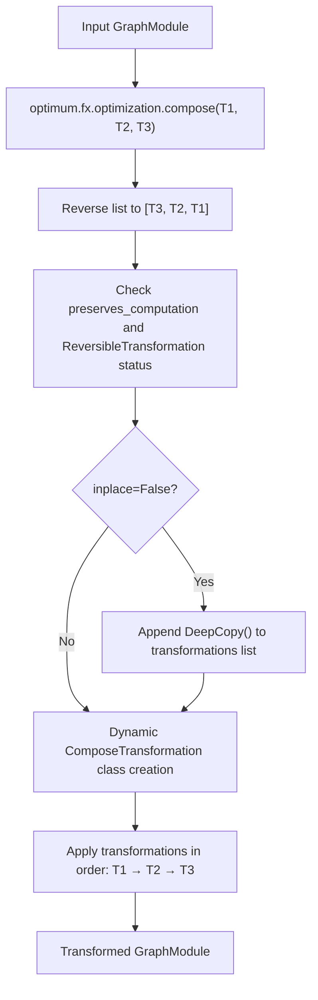
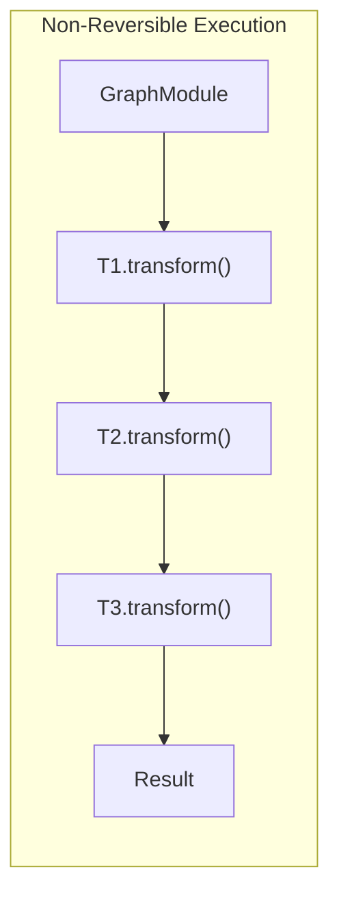
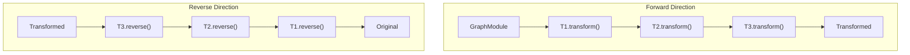

<!-- source: DeepWiki mcp.deepwiki.com · repo huggingface/optimum · page 6.2 Transformation Composition · fetched 2026-10-26 -->

# Transformation Composition

<details>
<summary>Relevant source files</summary>

The following files were used as context for generating this wiki page:

- [.github/workflows/test_fx_optimization.yml](.github/workflows/test_fx_optimization.yml)
- [optimum/configuration_utils.py](optimum/configuration_utils.py)
- [optimum/fx/__init__.py](optimum/fx/__init__.py)
- [optimum/fx/optimization/__init__.py](optimum/fx/optimization/__init__.py)
- [optimum/fx/optimization/transformations.py](optimum/fx/optimization/transformations.py)
- [optimum/fx/utils.py](optimum/fx/utils.py)
- [tests/fx/optimization/test_transformations.py](tests/fx/optimization/test_transformations.py)

</details>


## Purpose and Scope

This page documents the `compose()` function and the transformation composition system, which enables chaining multiple `torch.fx` graph transformations together into a single transformation operation. For details about individual transformation classes like `MergeLinears` and `FuseBiasInLinear`, see [Torch.fx Transformation System](6.1).

The composition system handles:
- Sequential application of multiple transformations.
- Preservation of reversibility when all component transformations are reversible.
- Computation preservation tracking across the chain.
- Optional deep copying to avoid modifying the original graph module.
- Automatic linting and recompilation management.

Sources: [optimum/fx/optimization/transformations.py:1-197]()

---

## The compose() Function

The `compose()` function is the primary API for combining transformations. It takes a variable number of `Transformation` objects and returns a new composed transformation that applies them sequentially.

**Function Signature:**
```python
def compose(*args: Transformation, inplace: bool = True) -> Transformation
```

**Parameters:**
| Parameter | Type | Default | Description |
|-----------|------|---------|-------------|
| `*args` | `Transformation` | Required | Variable number of transformations to compose |
| `inplace` | `bool` | `True` | Whether to modify the graph module in place or create a deep copy |

**Returns:** A new `ComposeTransformation` object (dynamically created class).

Sources: [optimum/fx/optimization/transformations.py:1-197]()

---

## Composition Execution Flow

The composition applies transformations in the order specified. Note that transformations are internally reversed before processing, so they execute in the expected order when reduced.

### Natural Language to Code Entity Space: Composition Flow



Sources: [optimum/fx/optimization/transformations.py:1-197](), [tests/fx/optimization/test_transformations.py:1-374]()

---

## Reversible vs Non-Reversible Composition

The `compose()` function automatically detects whether all input transformations are reversible and creates an appropriate composition class.

### Composition Behavior Matrix

| All Reversible? | Result Class | Can Reverse? | Preserves Computation |
|-----------------|--------------|--------------|----------------------|
| Yes | `ComposeTransformation(ReversibleTransformation)` | Yes | If all preserve |
| No | `ComposeTransformation(Transformation)` | No | If all preserve |

### Non-Reversible Composition

When any transformation is not reversible, the composition creates a standard `Transformation` subclass:



Sources: [optimum/fx/optimization/transformations.py:1-197]()

### Reversible Composition

When all transformations implement `ReversibleTransformation`, the composition creates both forward and reverse execution paths:



Sources: [optimum/fx/optimization/transformations.py:1-197]()

---

## Implementation Details

### Dynamic Class Creation

The `compose()` function dynamically creates a new class at runtime rather than instantiating a pre-existing class. This allows it to capture the specific transformations and their execution order in the class definition.

**For Non-Reversible Composition:**
The generated class inherits from `Transformation`.

**For Reversible Composition:**
The generated class inherits from `ReversibleTransformation`.

### Reduce Function Pattern

The composition uses `functools.reduce()` to build the execution chain. The reduce function wraps each transformation pair:

```python
def reduce_fn(f, g):
    def composition(graph_module, lint_and_recompile=False):
        return f(g(graph_module, lint_and_recompile=lint_and_recompile))
    return composition
```

This creates nested function calls: `T1(T2(T3(graph_module)))`, which executes as `T3 → T2 → T1`. Since the transformations list is reversed internally, the final execution order matches the input order.

Sources: [optimum/fx/optimization/transformations.py:1-197]()

---

## Deep Copy Behavior

The `inplace` parameter controls whether the composition modifies the original graph module or works on a copy.

### Deep Copy Composition (inplace=False)

When `inplace=False`, the `DeepCopy` transformation is automatically prepended to the transformation list. The `DeepCopy` transformation performs a deep copy of the graph module and preserves transformation metadata on nodes.


Sources: [optimum/fx/optimization/transformations.py:1-197]()

---

## Computation Preservation

The composition automatically tracks whether the entire chain preserves computation by verifying `preserves_computation` across all input transformations. The resulting `ComposeTransformation` class sets its `preserves_computation` flag accordingly.

Sources: [optimum/fx/optimization/transformations.py:1-197]()

---

## Usage Examples

### Basic Composition

```python
from optimum.fx.optimization import (
    ChangeTrueDivToMulByInverse,
    MergeLinears,
    compose
)

# Compose two reversible transformations
composition = compose(ChangeTrueDivToMulByInverse(), MergeLinears())

# Apply to traced model
transformed = composition(traced_model)
```

### Applying Reverse Transformation

```python
# Since both transformations are reversible, composition is reversible
restored = composition(transformed, reverse=True)
```

Sources: [tests/fx/optimization/test_transformations.py:1-374]()

---

## Linting and Recompilation

The composition system intelligently manages linting and recompilation to avoid redundant operations:

1. When calling individual transformations in the chain, `lint_and_recompile=False` is passed to intermediate steps.
2. Only the final transformation in the chain performs linting and recompilation (unless explicitly disabled).
3. This optimization reduces overhead when chaining many transformations.

The `Transformation.__call__()` method handles this logic by checking the `lint_and_recompile` flag.

Sources: [optimum/fx/optimization/transformations.py:1-197]()

---

## Testing and Validation

The composition system is validated by comparing the output of composed transformations against manual sequential application.

### Composition Equivalence Test

The test suite validates that manually chaining transformations produces the same result as using `compose()`:

```python
# Manual chaining
transformed = MergeLinears()(ChangeTrueDivToMulByInverse()(traced))

# Using compose
composition = compose(ChangeTrueDivToMulByInverse(), MergeLinears())
transformed_with_composition = composition(traced)

# Should produce identical code
assert transformed.code == transformed_with_composition.code
```

Sources: [tests/fx/optimization/test_transformations.py:1-374]()

---

## Related Transformations

### DeepCopy Transformation

The `DeepCopy` transformation is a special `ReversibleTransformation` that creates a deep copy of the graph module. It is automatically used when `inplace=False` is passed to `compose()`.

**Key implementation detail:** The deep copy operation must manually copy the `transformations` attribute on nodes, as `copy.deepcopy()` doesn't handle custom attributes.

Sources: [optimum/fx/optimization/transformations.py:1-197]()

### LintAndRecompile Transformation

The `LintAndRecompile` transformation explicitly performs linting and recompilation. It is used as a utility when building custom transformation chains outside of `compose()`.

Sources: [optimum/fx/optimization/transformations.py:1-197]()

---

