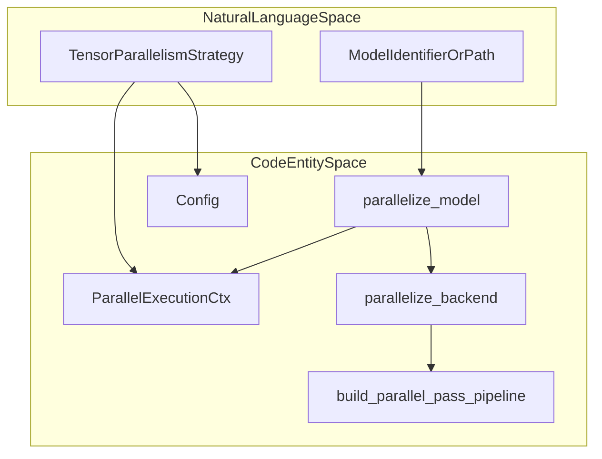
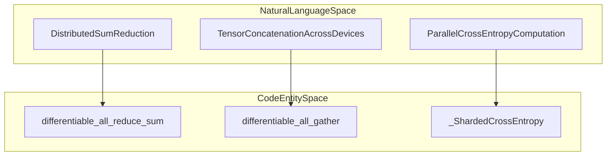

<!-- source: DeepWiki mcp.deepwiki.com · repo huggingface/optimum · page 6.3 Automatic Model Parallelism · fetched 2026-10-26 -->

# Automatic Model Parallelism

Relevant source files

The following files were used as context for generating this wiki page:

- [optimum/fx/parallelization/__init__.py](optimum/fx/parallelization/__init__.py)
- [optimum/fx/parallelization/api.py](optimum/fx/parallelization/api.py)
- [optimum/fx/parallelization/core.py](optimum/fx/parallelization/core.py)
- [optimum/fx/parallelization/decomp.py](optimum/fx/parallelization/decomp.py)
- [optimum/fx/parallelization/distributed/__init__.py](optimum/fx/parallelization/distributed/__init__.py)
- [optimum/fx/parallelization/distributed/dist_ops.py](optimum/fx/parallelization/distributed/dist_ops.py)
- [optimum/fx/parallelization/op_registry/op_handlers.py](optimum/fx/parallelization/op_registry/op_handlers.py)
- [optimum/fx/parallelization/parallel_layers/__init__.py](optimum/fx/parallelization/parallel_layers/__init__.py)
- [optimum/fx/parallelization/parallel_layers/embedding.py](optimum/fx/parallelization/parallel_layers/embedding.py)
- [optimum/fx/parallelization/parallel_layers/linear.py](optimum/fx/parallelization/parallel_layers/linear.py)
- [optimum/fx/parallelization/parallel_layers/loss.py](optimum/fx/parallelization/parallel_layers/loss.py)
- [optimum/fx/parallelization/passes.py](optimum/fx/parallelization/passes.py)
- [optimum/fx/parallelization/utils.py](optimum/fx/parallelization/utils.py)
- [tests/fx/parallelization/test_tensor_parallel.py](tests/fx/parallelization/test_tensor_parallel.py)

## Purpose and Scope
This document details the `fx/parallelization` subsystem within Optimum, which provides automated Tensor Parallelism (TP) for Transformer models using PyTorch FX (`torch.fx`) and `torch.compile`. The subsystem analyzes model computational graphs, decomposes high-level operations, solves for parallel execution axes, replaces standard layers with distributed equivalents, and inserts differentiable communication primitives.

---

## 1. Overview and API

The primary user-facing entry point for the subsystem is `parallelize_model`, which loads a model, initializes its metadata on a meta device, moves it to the target hardware device, and compiles it with a custom parallelization backend.

### Key Components

| Component | Code Entity | Description |
| :--- | :--- | :--- |
| Entry Point | `parallelize_model` | Loads model configuration/weights, sets up parameter metadata, and registers the compilation backend. [optimum/fx/parallelization/api.py:46-125]() |
| Execution Context | `ParallelExecutionCtx` | Tracks the tensor parallel process group (`tp_group`), device, compilation times, and caching structures for layers and parameters. [optimum/fx/parallelization/core.py:107-153]() |
| Static Configuration | `Config` | Holds static parameters such as linting/recompilation flags and sequence parallelism toggles. [optimum/fx/parallelization/core.py:155-178]() |
| Compilation Backend | `parallelize_backend` | Custom `torch.compile` backend function that invokes the pass pipeline on traced graphs. [optimum/fx/parallelization/api.py:35-43]() |

### Natural Language to Code Entity Mapping

Sources:
- `optimum/fx/parallelization/api.py:35-125` ()
- `optimum/fx/parallelization/core.py:107-180` ()

---

## 2. The Pass Pipeline

Graph transformations are organized into a pipeline of passes inheriting from `PassBase`. Each pass processes a `GraphModule` using the dynamic execution context (`ParallelExecutionCtx`) and static configuration (`Config`).

### Pipeline Stages
1. **Decomposition and Functionalization:** High-level PyTorch operators are lowered into core ATen operators via `DecompositionInterpreter`. Inplace operations are functionalized to streamline subsequent analysis. [optimum/fx/parallelization/decomp.py:78-144]()
2. **Parallel Axis Propagation:** The `ParallelAxisSolverPass` analyzes operator nodes in the graph using propagation handlers registered in `REGISTRY`. It performs a backtracking search to determine valid parallel axes across the computational graph. [optimum/fx/parallelization/passes.py:84-168](), [optimum/fx/parallelization/op_registry/op_handlers.py:25-50]()
3. **Layer Replacement:** Standard modules (`nn.Linear`, `nn.Embedding`, `nn.CrossEntropyLoss`) are swapped for their distributed counterparts.

Sources:
- `optimum/fx/parallelization/passes.py:45-168` ()
- `optimum/fx/parallelization/decomp.py:78-144` ()
- `optimum/fx/parallelization/op_registry/op_handlers.py:25-50` ()

---

## 3. Parallel Layers and Parameter Metadata

Parallel layers manage sharded weight slices and track parameter requirements using `ParameterMeta` and `ParameterSlice`.

### Parameter Metadata Structures
- `ParameterMeta`: Tracks whether a parameter is sharded (`is_parallel`), its sharding dimension (`dim`), whether it needs manual initialization (`need_initialize`), and its slice mapping (`mapping`). [optimum/fx/parallelization/core.py:70-105]()
- `ParameterSlice`: Defines the slice indices along the parallel axis corresponding to entries in the weight map. [optimum/fx/parallelization/core.py:47-68]()

### Concrete Parallel Layers
- `ColumnParallelLinear`: Splits weight matrices along `out_features` (dimension 0). Optionally gathers outputs via all-gather. [optimum/fx/parallelization/parallel_layers/linear.py:33-102]()
- `RowParallelLinear`: Splits weight matrices along `in_features` (dimension 1). Requires an input-parallel state and applies an all-reduce operation. [optimum/fx/parallelization/parallel_layers/linear.py:104-169]()
- `VocabParallelEmbedding`: Shards the vocabulary embedding table along dimension 0 across ranks, masking out-of-bounds indices and reducing results. [optimum/fx/parallelization/parallel_layers/embedding.py:25-86]()
- `VocabParallelCrossEntropyLoss`: Implements sharded cross-entropy loss computation (`_ShardedCrossEntropy`) across tensor parallel ranks without gathering full logits. [optimum/fx/parallelization/parallel_layers/loss.py:26-163]()

Sources:
- `optimum/fx/parallelization/core.py:47-105` ()
- `optimum/fx/parallelization/parallel_layers/linear.py:33-169` ()
- `optimum/fx/parallelization/parallel_layers/embedding.py:25-86` ()
- `optimum/fx/parallelization/parallel_layers/loss.py:26-163` ()

---

## 4. Distributed Operations and Data Flow

To ensure mathematical equivalence and support autograd backward passes, distributed primitives are implemented as custom `torch.autograd.Function` subclasses.

### Differentiable Distributed Primitives

| Operation Concept | Code Entity | Description |
| :--- | :--- | :--- |
| All-Reduce Sum | `differentiable_all_reduce_sum` | Performs `all_reduce` in forward pass and identity in backward pass. [optimum/fx/parallelization/distributed/dist_ops.py:98-107](), [optimum/fx/parallelization/distributed/dist_ops.py:133-134]() |
| All-Gather | `differentiable_all_gather` | Concatenates sharded tensors across ranks in forward, splits gradients in backward. [optimum/fx/parallelization/distributed/dist_ops.py:121-131](), [optimum/fx/parallelization/distributed/dist_ops.py:141-142]() |
| Scatter / Split | `differentiable_scatter` | Splits tensors across ranks in forward, all-gathers gradients in backward. [optimum/fx/parallelization/distributed/dist_ops.py:109-119](), [optimum/fx/parallelization/distributed/dist_ops.py:145-146]() |

### Concept-to-Code Mapping for Distributed Operations

Sources:
- `optimum/fx/parallelization/distributed/dist_ops.py:86-147` ()
- `optimum/fx/parallelization/parallel_layers/loss.py:26-106` ()

---

## 5. Recompilation Handling and Caching

When `torch.compile` triggers recompilations due to dynamic input shapes, newly instantiated parameters or replacement modules could inadvertently re-initialize weights. The `ParallelExecutionCtx` mitigates this by maintaining internal caches:

- `parallel_layer_cache`: Maps original layer identifiers to instantiated parallel module instances (`nn.Linear`, `nn.Embedding`). [optimum/fx/parallelization/core.py:121-127]()
- `param_cache`: Records newly created parameters to ensure weight persistence across recompilations. [optimum/fx/parallelization/core.py:128-132]()
- `compile_times`: Counter incremented on each compilation cycle. [optimum/fx/parallelization/api.py:41]()

Sources:
- `optimum/fx/parallelization/core.py:107-153` ()
- `optimum/fx/parallelization/api.py:35-43` ()
- `tests/fx/parallelization/test_tensor_parallel.py:98-131` ()

---

