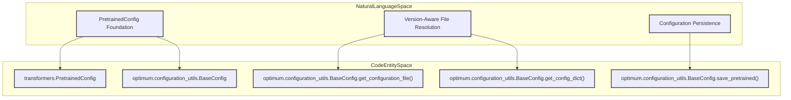
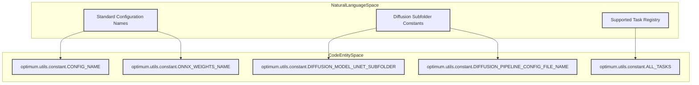

<!-- source: DeepWiki mcp.deepwiki.com · repo huggingface/optimum · page 7 Configuration and Utilities · fetched 2026-10-26 -->

# Configuration and Utilities

Relevant source files

The following files were used as context for generating this wiki page:

- [optimum/configuration_utils.py](optimum/configuration_utils.py)
- [optimum/fx/__init__.py](optimum/fx/__init__.py)
- [optimum/fx/optimization/__init__.py](optimum/fx/optimization/__init__.py)
- [optimum/fx/optimization/transformations.py](optimum/fx/optimization/transformations.py)
- [optimum/fx/utils.py](optimum/fx/utils.py)
- [optimum/utils/logging.py](optimum/utils/logging.py)
- [tests/fx/optimization/test_transformations.py](tests/fx/optimization/test_transformations.py)
- [tests/utils/prepare_for_doc_test.py](tests/utils/prepare_for_doc_test.py)

This page documents the configuration management system and shared utility structures used throughout the Optimum library. The configuration system provides infrastructure for loading, saving, and version-aware resolution of custom configuration files via `BaseConfig`, while the constants module defines standardized names for configuration files, model subfolders, and supported tasks.

As a parent page, this section provides a high-level summary of configuration and utility mechanisms. For deep technical details, see the child pages:
- For configuration loading, saving, and version-aware resolution, see [BaseConfig and Configuration Management](#7.1)
- For shared constants, model subfolders, and task definitions, see [Constants and Naming Conventions](#7.2)

---

## Configuration Management Overview

The configuration system in Optimum builds upon the Hugging Face `PretrainedConfig` class to support custom configuration file naming conventions and version-aware resolution. The primary entry point for optimized model configurations is `BaseConfig`, located in `optimum/configuration_utils.py`.

**Configuration System Entity Mapping**

Sources: [optimum/configuration_utils.py:24-44](), [optimum/configuration_utils.py:50-158]()

`BaseConfig` enables loading configurations that may adapt across different library releases by inspecting metadata within model repositories. For details on how configuration dictionaries are parsed, cached, and saved, see [BaseConfig and Configuration Management](#7.1).

---

## Shared Constants and Naming Conventions

Optimum relies on centralized constants for file naming, directory structures, and task identifiers across multiple hardware backends and export pipelines. These constants prevent hardcoded strings and ensure consistency when managing artifacts for ONNX, OpenVINO, diffusion pipelines, and other accelerated runtimes.

**Constants and Naming Conventions Entity Mapping**

Sources: [optimum/utils/constant.py:16-64]()

For a complete breakdown of configuration filenames, diffusion subfolder mappings (`unet`, `transformer`, `vae_decoder`, `text_encoder`), and task enumerations, see [Constants and Naming Conventions](#7.2).

---

