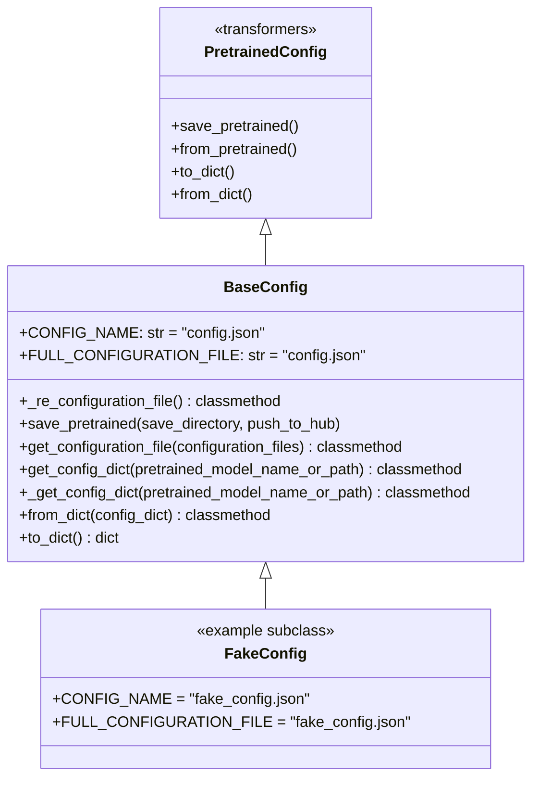
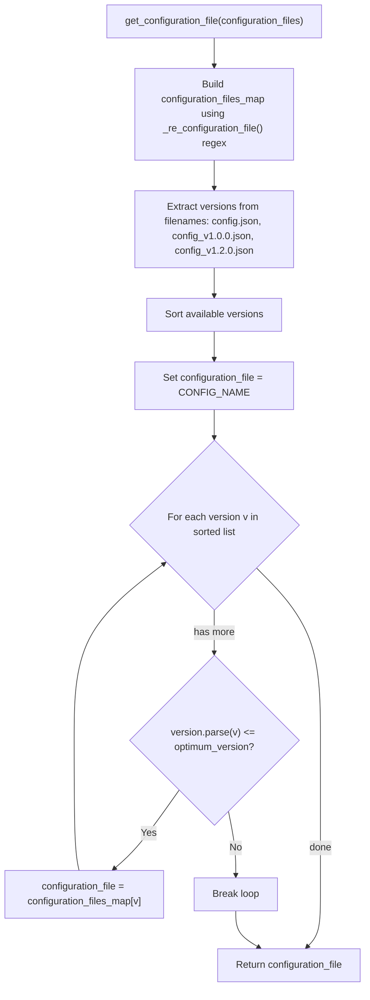
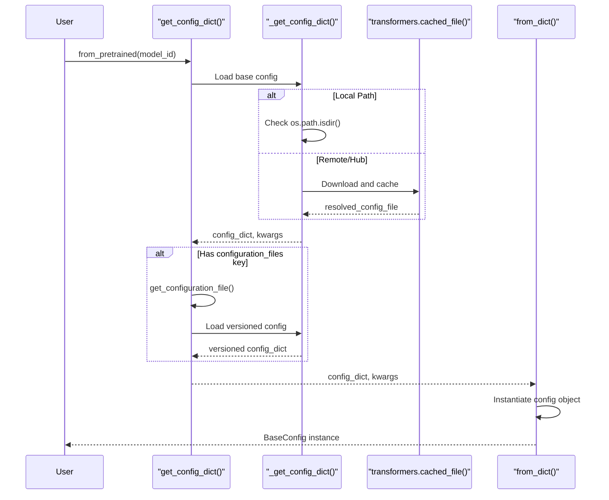
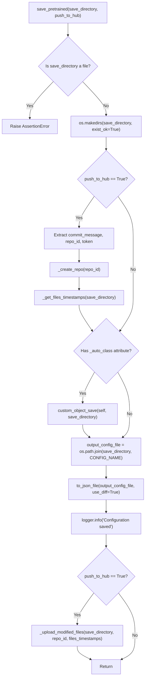
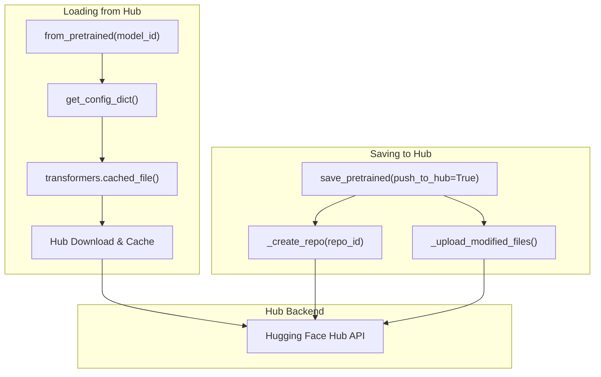
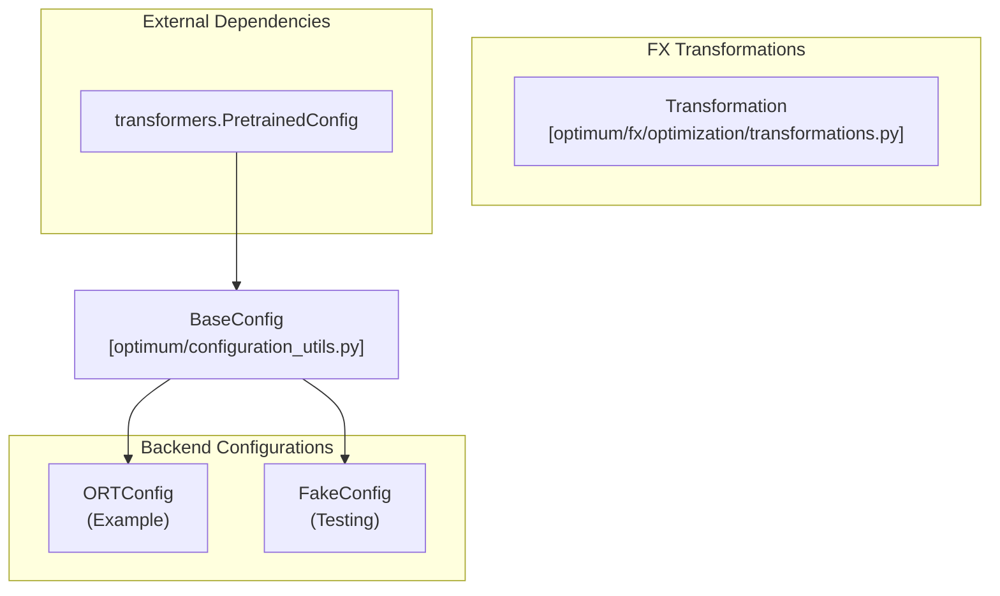

<!-- source: DeepWiki mcp.deepwiki.com · repo huggingface/optimum · page 7.1 BaseConfig and Configuration Management · fetched 2026-10-26 -->

# BaseConfig and Configuration Management

Relevant source files

The following files were used as context for generating this wiki page:

- [optimum/configuration_utils.py](optimum/configuration_utils.py)
- [optimum/fx/__init__.py](optimum/fx/__init__.py)
- [optimum/fx/optimization/__init__.py](optimum/fx/optimization/__init__.py)
- [optimum/fx/optimization/transformations.py](optimum/fx/optimization/transformations.py)
- [optimum/fx/utils.py](optimum/fx/utils.py)
- [tests/common/test_configuration_utils.py](tests/common/test_configuration_utils.py)
- [tests/fx/optimization/test_transformations.py](tests/fx/optimization/test_transformations.py)

## Purpose and Scope

The `BaseConfig` system provides a unified configuration management layer for Optimum that extends Transformers' `PretrainedConfig` while enabling custom configuration file names and version-aware file resolution. This system serves as the foundation for all configuration-related operations in Optimum, including loading from the Hub, saving to disk, and managing configuration compatibility across Optimum versions [optimum/configuration_utils.py:36-40]().

For model-specific configuration normalization, see [NormalizedConfig System](#2.2). For export-specific configuration, see [ExporterConfig Framework](#2.3). For backend-specific optimized model configurations, see [OptimizedModel Base Class](#3.1).

Sources: [optimum/configuration_utils.py:36-40]()

## BaseConfig Class Architecture

The `BaseConfig` class [optimum/configuration_utils.py:36-321]() provides the core configuration abstraction for Optimum. It inherits from `transformers.PretrainedConfig` to maintain API compatibility with the Transformers library while adding Optimum-specific functionality.

### Class Definition and Key Attributes

The class defines two critical constants:
- `CONFIG_NAME`: The primary configuration file name (default: `"config.json"`) [optimum/configuration_utils.py:42]().
- `FULL_CONFIGURATION_FILE`: The full configuration file name used in versioning (default: `"config.json"`) [optimum/configuration_utils.py:43]().

Subclasses override `CONFIG_NAME` to use different file names, such as `fake_config.json` used in testing [tests/common/test_configuration_utils.py:24-31]().

Sources: [optimum/configuration_utils.py:36-43](), [tests/common/test_configuration_utils.py:24-31]()

## Configuration File Resolution and Versioning

One of `BaseConfig`'s key features is **version-aware configuration file resolution**. This allows the same model repository to contain multiple configuration file versions, with the system automatically selecting the appropriate one based on the installed Optimum version.

### Version-Aware File Selection Flow

### Version Regex Pattern

The method `_re_configuration_file()` [optimum/configuration_utils.py:45-47]() constructs a regex pattern that matches versioned configuration files:

| Method | Pattern Example | Matches |
|--------|----------------|---------|
| `_re_configuration_file()` | `r"config(.*)\.json"` | `config.json`, `config_v1.0.0.json`, `config_v1.2.3.json` |

The regex extracts the version suffix from the filename by splitting `FULL_CONFIGURATION_FILE` and capturing any string between the base name and the `.json` extension [optimum/configuration_utils.py:47]().

### Version Selection Algorithm

The `get_configuration_file()` method [optimum/configuration_utils.py:96-126]() implements the following algorithm:

1. **Parse all configuration files** in the provided list using the regex pattern.
2. **Extract version strings** from matched filenames.
3. **Sort versions** in ascending order [optimum/configuration_utils.py:114]().
4. **Initialize** with the base `CONFIG_NAME`.
5. **Iterate through sorted versions**:
   - If `version.parse(v) <= version.parse(__version__)`, update to use that versioned file [optimum/configuration_utils.py:120-121]().
   - If `version.parse(v) > version.parse(__version__)`, break the loop [optimum/configuration_utils.py:125]().
6. **Return** the highest compatible version.

This ensures backward compatibility while allowing new Optimum versions to use updated configuration formats [optimum/configuration_utils.py:118-126]().

Sources: [optimum/configuration_utils.py:45-47](), [optimum/configuration_utils.py:96-126]()

## Loading Mechanisms

`BaseConfig` provides a two-stage configuration loading process that handles both local and remote (Hub) sources.

### Configuration Loading Flow

### Key Loading Methods

| Method | Purpose | Line Reference |
|--------|---------|----------------|
| `get_config_dict()` | Public entry point; handles version resolution | [optimum/configuration_utils.py:129-158]() |
| `_get_config_dict()` | Internal method; handles file downloading/caching | [optimum/configuration_utils.py:161-241]() |
| `from_dict()` | Instantiates config object from dictionary | [optimum/configuration_utils.py:244-296]() |

### Parameter Handling in _get_config_dict

The `_get_config_dict()` method [optimum/configuration_utils.py:161-241]() extracts and processes multiple parameters including `cache_dir`, `force_download`, `resume_download`, `proxies`, `token`, `local_files_only`, `revision`, and `subfolder` [optimum/configuration_utils.py:165-176](). These parameters are passed to `transformers.cached_file()` for Hub interaction [optimum/configuration_utils.py:200-213]().

### Configuration Dictionary to Object Conversion

The `from_dict()` method [optimum/configuration_utils.py:244-296]() performs the following operations:
1. **Instantiate config** using `cls(**config_dict)` [optimum/configuration_utils.py:263]().
2. **Handle special attributes**: Convert `pruned_heads` keys to integers [optimum/configuration_utils.py:265-266]().
3. **Apply kwargs overrides** to existing attributes [optimum/configuration_utils.py:277-285]().
4. **Log configuration** and optionally return unused kwargs [optimum/configuration_utils.py:287-296]().

Sources: [optimum/configuration_utils.py:129-296]()

## Saving Mechanisms

The `save_pretrained()` method [optimum/configuration_utils.py:50-93]() handles local saving and optional Hub pushing.

### Save Operation Flow

### Serialization with to_dict

The `to_dict()` method [optimum/configuration_utils.py:299-321]() serializes the configuration object by creating a deep copy of `self.__dict__` and adding metadata such as `transformers_version` and `optimum_version` [optimum/configuration_utils.py:307-308](). It also removes internal attributes like `_auto_class` and `_commit_hash` [optimum/configuration_utils.py:311-312]().

Sources: [optimum/configuration_utils.py:50-93](), [optimum/configuration_utils.py:299-321]()

## Hub Integration

`BaseConfig` leverages Transformers' Hub utilities for seamless remote model repository interaction.

### Hub Interaction Architecture

### Commit Hash Tracking

The system tracks configuration provenance using commit hashes. `extract_commit_hash` is used to identify the version of the file being loaded [optimum/configuration_utils.py:214](). This hash is then stored in the `config_dict` to ensure loaded configurations maintain their Git commit metadata [optimum/configuration_utils.py:148-149]().

Sources: [optimum/configuration_utils.py:27](), [optimum/configuration_utils.py:70-93](), [optimum/configuration_utils.py:148-149](), [optimum/configuration_utils.py:200-214]()

## Relationship with Other Optimum Systems

`BaseConfig` serves as a foundational layer that other Optimum systems build upon.

### System Integration Map

### Testing and Validation

The `ConfigTester` and `ConfigPushToHubTester` classes verify that configurations can be saved, loaded, and pushed to the Hugging Face Hub while preserving attributes [tests/common/test_configuration_utils.py:33-69](). These tests use a `FakeConfig` subclass to validate the `BaseConfig` lifecycle [tests/common/test_configuration_utils.py:24-31]().

Sources: [optimum/configuration_utils.py:36](), [tests/common/test_configuration_utils.py:24-69](), [optimum/fx/optimization/transformations.py:85]()

---

