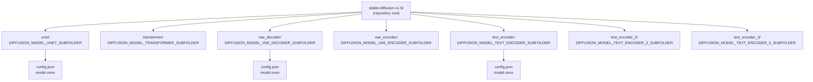
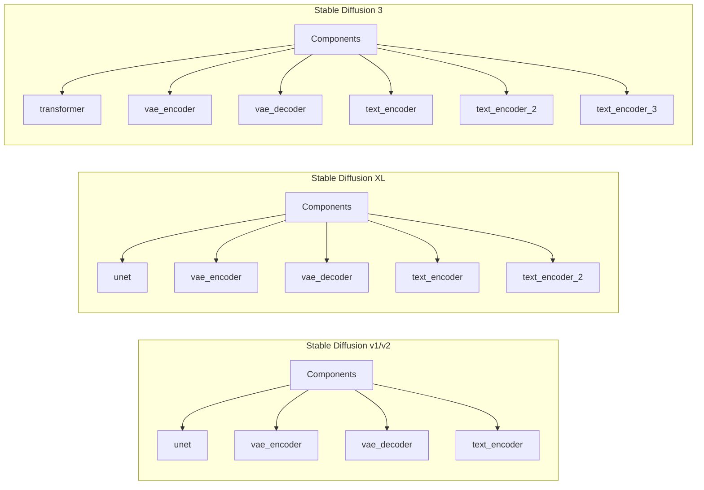
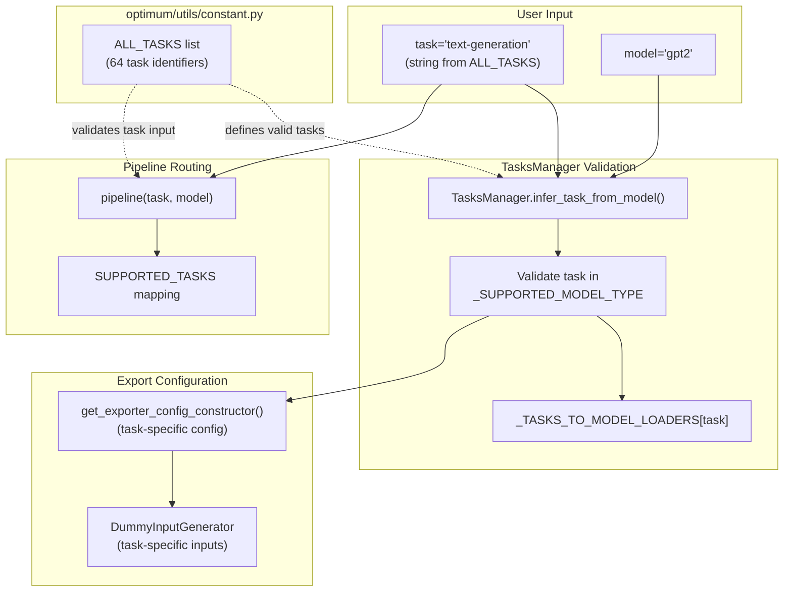
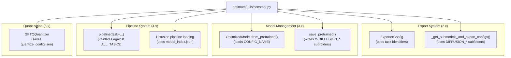

<!-- source: DeepWiki mcp.deepwiki.com · repo huggingface/optimum · page 7.2 Constants and Naming Conventions · fetched 2026-10-26 -->

# Constants and Naming Conventions

<details>
<summary>Relevant source files</summary>

The following files were used as context for generating this wiki page:

- [optimum/gptq/data.py](optimum/gptq/data.py)
- [optimum/gptq/eval.py](optimum/gptq/eval.py)
- [optimum/utils/constant.py](optimum/utils/constant.py)
- [optimum/utils/logging.py](optimum/utils/logging.py)
- [tests/utils/prepare_for_doc_test.py](tests/utils/prepare_for_doc_test.py)

</details>


## Purpose and Scope

This document catalogs the shared constants defined in the Optimum library that establish naming conventions for configuration files, model subcomponents, and task identifiers. These constants ensure consistency across model export, saving, loading, and inference operations.

For configuration management classes that use these constants, see [BaseConfig and Configuration Management](#7.1). For how task identifiers integrate with the model registry, see [TasksManager Core](#2.1). For diffusion-specific pipeline integration, see [Diffusion Pipeline Support](#4.3).

## Overview of Constant Categories

The Optimum library defines constants in [optimum/utils/constant.py:1-64]() that fall into four main categories:

| Category | Purpose | Primary Use Cases |
|----------|---------|-------------------|
| Configuration Files | Standard filenames for model configs | Loading/saving configurations across all model types |
| Diffusion Model Subfolders | Directory structure for diffusion model components | Model decomposition, export, and loading of Stable Diffusion variants |
| Task Identifiers | Canonical task names | Pipeline routing, model inference configuration, export task specification |
| Weight Files | Exported model filenames | ONNX model storage and loading |

**Sources:** [optimum/utils/constant.py:1-64]()

## Configuration File Constants

### Standard Configuration Files

```python
CONFIG_NAME = "config.json"
```

The `CONFIG_NAME` constant defines the standard filename for model configuration files [optimum/utils/constant.py:16-16](). This name is used universally across:
- `BaseConfig.save_pretrained()` operations
- `OptimizedModel.from_pretrained()` loading logic
- Hub repository structure validation

### Diffusion Pipeline Configuration

```python
DIFFUSION_PIPELINE_CONFIG_FILE_NAME = "model_index.json"
DIFFUSION_MODEL_CONFIG_FILE_NAME = "config.json"
```

Diffusion pipelines use two configuration files [optimum/utils/constant.py:25-26]():
- `model_index.json` - The top-level pipeline configuration that defines which components are present and their types.
- `config.json` - Individual component configurations within each subfolder.

**Sources:** [optimum/utils/constant.py:16-16](), [optimum/utils/constant.py:25-26]()

## Diffusion Model Component Naming

### Component Subfolder Structure

Diffusion models are decomposed into multiple subcomponents, each stored in a dedicated subfolder. The constants define the standard directory structure [optimum/utils/constant.py:18-24]():



**Diffusion Model Component Subfolder Structure**: Each diffusion model component is exported to its own subfolder using these constant names. The diagram shows how a typical Stable Diffusion repository is organized.

**Sources:** [optimum/utils/constant.py:18-24]()

### Subfolder Constant Definitions

| Constant | Value | Component Purpose |
|----------|-------|-------------------|
| `DIFFUSION_MODEL_UNET_SUBFOLDER` | `"unet"` | Main denoising U-Net architecture (Stable Diffusion v1/v2) |
| `DIFFUSION_MODEL_TRANSFORMER_SUBFOLDER` | `"transformer"` | Diffusion transformer architecture (Stable Diffusion v3, Flux) |
| `DIFFUSION_MODEL_VAE_DECODER_SUBFOLDER` | `"vae_decoder"` | VAE decoder for latent-to-image conversion |
| `DIFFUSION_MODEL_VAE_ENCODER_SUBFOLDER` | `"vae_encoder"` | VAE encoder for image-to-latent conversion |
| `DIFFUSION_MODEL_TEXT_ENCODER_SUBFOLDER` | `"text_encoder"` | Primary text encoder (CLIP) |
| `DIFFUSION_MODEL_TEXT_ENCODER_2_SUBFOLDER` | `"text_encoder_2"` | Secondary text encoder (SDXL, SD3) |
| `DIFFUSION_MODEL_TEXT_ENCODER_3_SUBFOLDER` | `"text_encoder_3"` | Tertiary text encoder (SD3) |

**Sources:** [optimum/utils/constant.py:18-24]()

### Component Selection by Architecture

Different diffusion architectures use different subsets of components:



**Component Composition by Diffusion Architecture**: Different Stable Diffusion versions use different combinations of components. SD3 uses a transformer instead of U-Net and requires three text encoders.

**Sources:** [optimum/utils/constant.py:18-24]()

## Task Identifier Constants

### The ALL_TASKS List

The `ALL_TASKS` constant defines all supported task identifiers in the Optimum ecosystem [optimum/utils/constant.py:30-64](). This list serves as the canonical source of valid task names:

```python
ALL_TASKS = [
    "audio-classification",
    "audio-frame-classification",
    "audio-xvector",
    "automatic-speech-recognition",
    "depth-estimation",
    "document-question-answering",
    "feature-extraction",
    "fill-mask",
    "image-classification",
    "image-segmentation",
    "image-text-to-text",
    "image-to-image",
    "image-to-text",
    "inpainting",
    "keypoint-detection",
    "mask-generation",
    "masked-im",
    "multiple-choice",
    "object-detection",
    "question-answering",
    "reinforcement-learning",
    "semantic-segmentation",
    "sentence-similarity",
    "text-classification",
    "text-generation",
    "text-to-audio",
    "text-to-image",
    "text2text-generation",
    "time-series-forecasting",
    "token-classification",
    "visual-question-answering",
    "zero-shot-image-classification",
    "zero-shot-object-detection",
]
```

**Sources:** [optimum/utils/constant.py:30-64]()

### Task Identifier Integration with TasksManager



**Task Identifier Integration**: The `ALL_TASKS` constant provides the canonical list of task names that flow through `TasksManager`, export configuration, and pipeline routing systems.

**Sources:** [optimum/utils/constant.py:30-64]()

### Example Task Usages

Task identifiers are used throughout the system:

1. **Pipeline Creation**: `pipeline("text-generation", model="gpt2", accelerator="onnx")`
2. **Export Specification**: `optimum-cli export onnx --task text-classification --model bert-base`
3. **Model Inference**: `TasksManager.infer_task_from_model("distilbert-base-uncased")` → `"fill-mask"`
4. **Configuration Loading**: `get_exporter_config_constructor(..., task="image-classification")`

## Weight File Naming

### ONNX Weight Filename

```python
ONNX_WEIGHTS_NAME = "model.onnx"  # TODO: remove and use the optimum-onnx one
```

This constant defines the default filename for exported ONNX models [optimum/utils/constant.py:28-28](). Note the TODO comment indicating this is planned for migration to the `optimum-onnx` package.

**Current Usage Pattern:**
- Single-file models: `model.onnx` in the model directory.
- Multi-component models: `<subfolder>/model.onnx` (e.g., `unet/model.onnx`).

**Sources:** [optimum/utils/constant.py:28-28]()

## Constant Usage Patterns

### Model Repository Structure

When a model is exported and saved, these constants determine the file layout:

```
model_repository/
├── config.json                    # CONFIG_NAME
├── model.onnx                     # ONNX_WEIGHTS_NAME (for simple models)
├── unet/                          # DIFFUSION_MODEL_UNET_SUBFOLDER
│   ├── config.json               # DIFFUSION_MODEL_CONFIG_FILE_NAME
│   └── model.onnx                # ONNX_WEIGHTS_NAME
├── vae_decoder/                   # DIFFUSION_MODEL_VAE_DECODER_SUBFOLDER
│   ├── config.json
│   └── model.onnx
├── text_encoder/                  # DIFFUSION_MODEL_TEXT_ENCODER_SUBFOLDER
│   ├── config.json
│   └── model.onnx
└── model_index.json               # DIFFUSION_PIPELINE_CONFIG_FILE_NAME
```

### Cross-System Constant References



**Cross-System Constant Usage**: Constants from `constant.py` are referenced throughout the codebase to ensure consistent naming and structure across export, model management, pipeline, and quantization systems.

**Sources:** [optimum/utils/constant.py:1-64]()

## Summary Table of All Constants

| Constant Name | Value | Category | Referenced By |
|---------------|-------|----------|---------------|
| `CONFIG_NAME` | `"config.json"` | Configuration | `BaseConfig`, `OptimizedModel`, all model loaders |
| `DIFFUSION_PIPELINE_CONFIG_FILE_NAME` | `"model_index.json"` | Diffusion | Diffusion pipeline loaders |
| `DIFFUSION_MODEL_CONFIG_FILE_NAME` | `"config.json"` | Diffusion | Individual component configs |
| `DIFFUSION_MODEL_UNET_SUBFOLDER` | `"unet"` | Diffusion | Model decomposition, SD v1/v2/XL |
| `DIFFUSION_MODEL_TRANSFORMER_SUBFOLDER` | `"transformer"` | Diffusion | Model decomposition, SD v3, Flux |
| `DIFFUSION_MODEL_VAE_DECODER_SUBFOLDER` | `"vae_decoder"` | Diffusion | All SD variants |
| `DIFFUSION_MODEL_VAE_ENCODER_SUBFOLDER` | `"vae_encoder"` | Diffusion | All SD variants |
| `DIFFUSION_MODEL_TEXT_ENCODER_SUBFOLDER` | `"text_encoder"` | Diffusion | All SD variants (primary) |
| `DIFFUSION_MODEL_TEXT_ENCODER_2_SUBFOLDER` | `"text_encoder_2"` | Diffusion | SDXL, SD3 (secondary) |
| `DIFFUSION_MODEL_TEXT_ENCODER_3_SUBFOLDER` | `"text_encoder_3"` | Diffusion | SD3 only (tertiary) |
| `ONNX_WEIGHTS_NAME` | `"model.onnx"` | Weights | ONNX export and loading |
| `ALL_TASKS` | `[64 task strings]` | Tasks | `TasksManager`, pipeline factory, CLI |

**Sources:** [optimum/utils/constant.py:1-64]()

---

