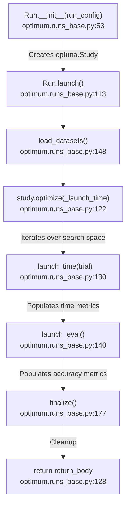
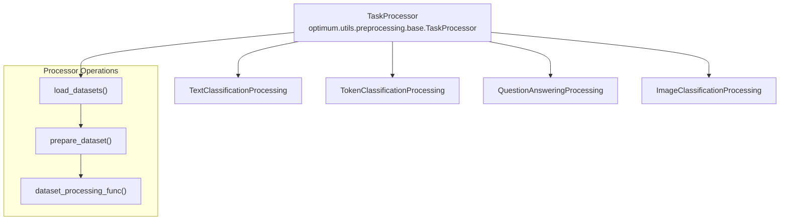

<!-- source: DeepWiki mcp.deepwiki.com · repo huggingface/optimum · page 8 Benchmarking and Evaluation · fetched 2026-10-26 -->

# Benchmarking and Evaluation

Relevant source files

The following files were used as context for generating this wiki page:

- [optimum/runs_base.py](optimum/runs_base.py)
- [optimum/utils/doc.py](optimum/utils/doc.py)
- [optimum/utils/runs.py](optimum/utils/runs.py)

The Optimum Run orchestration system provides a comprehensive framework for evaluating and benchmarking models before and after optimization. This system enables systematic comparison of model performance across different quantization approaches, batch sizes, and input lengths, while measuring both inference speed and task-specific accuracy metrics.

The Run system supports four primary tasks:
- Text classification
- Token classification  
- Question answering
- Image classification

Sources:
- [optimum/runs_base.py:29-34]()
- [optimum/runs_base.py:52-129]()
- [optimum/utils/runs.py:31-59]()

## Run Orchestration System Architecture

**Run Orchestration System Overview**

```mermaid
graph TB
    subgraph "Configuration Layer"
        RunConfig["RunConfig<br/>optimum.utils.runs.RunConfig"]
        DatasetArgs["DatasetArgs<br/>optimum.utils.runs.DatasetArgs"]
        TaskArgs["TaskArgs<br/>optimum.utils.runs.TaskArgs"]
        BenchmarkTimeArgs["BenchmarkTimeArgs<br/>optimum.utils.runs.BenchmarkTimeArgs"]
        FrameworkArgs["FrameworkArgs<br/>optimum.utils.runs.FrameworkArgs"]
        Calibration["Calibration<br/>optimum.utils.runs.Calibration"]
    end

    subgraph "Core Run System"
        Run["Run<br/>optimum.runs_base.Run"]
        study["optuna.Study<br/>optimum.runs_base.Run.__init__"]
        return_body["return_body dict<br/>optimum.runs_base.Run.return_body"]
    end

    subgraph "Task Processing"
        TaskProcessor["TaskProcessor<br/>optimum.utils.preprocessing.base.TaskProcessor"]
        task_processing_map["task_processing_map<br/>optimum.runs_base.task_processing_map"]
        TextClassProc["TextClassificationProcessing"]
        TokenClassProc["TokenClassificationProcessing"]
        QAProc["QuestionAnsweringProcessing"]
        ImageClassProc["ImageClassificationProcessing"]
    end

    subgraph "Performance Measurement"
        TimeBenchmark["TimeBenchmark<br/>optimum.runs_base.TimeBenchmark"]
        latencies["latencies: List[float]<br/>optimum.runs_base.TimeBenchmark.latencies"]
        throughput["throughput: float<br/>optimum.runs_base.TimeBenchmark.throughput"]
    end

    subgraph "Calibration"
        Calibrator["Calibrator<br/>optimum.runs_base.Calibrator"]
        calibration_dataset["calibration_dataset: Dataset"]
    end

    RunConfig --> DatasetArgs
    RunConfig --> TaskArgs
    RunConfig --> BenchmarkTimeArgs
    RunConfig --> FrameworkArgs
    RunConfig --> Calibration
    
    RunConfig --> Run
    Run --> study
    Run --> return_body
    Run --> task_processing_map
    
    task_processing_map --> TextClassProc
    task_processing_map --> TokenClassProc
    task_processing_map --> QAProc
    task_processing_map --> ImageClassProc
    
    Run --> TimeBenchmark
    TimeBenchmark --> latencies
    TimeBenchmark --> throughput
    
    Run --> Calibrator
    Calibrator --> calibration_dataset
```

The Run system consists of four main layers:

1. **Configuration Layer**: Dataclasses that specify all parameters for the benchmark.
2. **Core Run System**: The `Run` class that orchestrates the entire evaluation process.
3. **Task Processing**: Task-specific processors that handle dataset loading and preprocessing.
4. **Performance Measurement**: The `TimeBenchmark` class for latency/throughput tracking.

For details on the primary orchestration classes and configuration schemas, see [Run Orchestration and Configuration](#8.1).

Sources:
- [optimum/runs_base.py:52-180]()
- [optimum/utils/runs.py:84-299]()

## RunConfig Configuration

The `RunConfig` dataclass ([optimum/utils/runs.py:283-299]()) specifies all parameters for a benchmark run. It is composed of several nested dataclasses:

**RunConfig Parameters**

| Parameter | Type | Description | Required |
|-----------|------|-------------|----------|
| `model_name_or_path` | `str` | Model identifier on Hugging Face Hub or local path | Yes |
| `task` | `str` | One of: `"text-classification"`, `"token-classification"`, `"question-answering"`, `"image-classification"` | Yes |
| `quantization_approach` | `QuantizationApproach` | Either `"static"` or `"dynamic"` | Yes |
| `framework` | `Frameworks` | Backend framework (e.g., `"onnxruntime"`) | Yes |
| `dataset` | `DatasetArgs` | Dataset configuration | Yes |
| `framework_args` | `FrameworkArgs` | Framework-specific settings | Yes |
| `metrics` | `List[str]` | Metrics to evaluate | Yes |
| `batch_sizes` | `List[int]` | Batch sizes for throughput testing | No (default: `[4, 8]`) |
| `input_lengths` | `List[int]` | Sequence lengths for throughput testing | No (default: `[128]`) |
| `calibration` | `Calibration` | Calibration parameters for static quantization | Required if `quantization_approach="static"` |
| `time_benchmark_args` | `BenchmarkTimeArgs` | Time benchmark configuration | No |

Sources:
- [optimum/utils/runs.py:180-299]()

### Nested Configuration Objects

- **DatasetArgs** ([optimum/utils/runs.py:135-152]()): Parameters related to the dataset path, splits, and column keys.
- **Calibration** ([optimum/utils/runs.py:86-112]()): Parameters for post-training calibration (e.g., `method`, `num_calibration_samples`).
- **BenchmarkTimeArgs** ([optimum/utils/runs.py:169-178]()): Controls benchmark `duration` and `warmup_runs`.
- **FrameworkArgs** ([optimum/utils/runs.py:116-131]()): Backend-specific settings like ONNX `opset` and `optimization_level`.

Sources:
- [optimum/utils/runs.py:86-178]()

## Run Class Workflow

The `Run` class ([optimum/runs_base.py:52-180]()) is the base class that orchestrates the entire benchmark process.

**Run Execution Flow**

### Execution Phases
1. **Initialization**: Validates `RunConfig` and sets up the `optuna.Study` with a `GridSampler` over batch sizes and input lengths ([optimum/runs_base.py:72-75]()).
2. **Time Benchmarking**: The `_launch_time()` method is called for each trial to measure latency and throughput. Subclasses must implement this to perform the actual inference ([optimum/runs_base.py:130-138]()).
3. **Evaluation**: `launch_eval()` calculates task-specific metrics (like Accuracy or F1) on the provided dataset ([optimum/runs_base.py:140-146]()).
4. **Dataset Management**: `load_datasets()` handles the retrieval of evaluation and calibration datasets via the `TaskProcessor` ([optimum/runs_base.py:148-154]()).

For complete details on execution flow and configuration handling, see [Run Orchestration and Configuration](#8.1).

Sources:
- [optimum/runs_base.py:52-180]()

## Task Processors and Dataset Handling

Task processors bridge the gap between raw datasets and model-specific inputs. Each task (e.g., text classification) has a corresponding processor implementation.

**Task Processor Hierarchy**

The `task_processing_map` maps strings like `"question-answering"` to their respective classes ([optimum/runs_base.py:286-291]()). For details on how task processors handle data preprocessing, splitting, and tokenization, see [Task Processors and Dataset Handling](#8.2).

Sources:
- [optimum/runs_base.py:286-291]()

## TimeBenchmark Performance Measurement

The `TimeBenchmark` class ([optimum/runs_base.py:190-283]()) is the core utility for measuring raw performance.

**Measurement Methodology**:
- **Warmup**: Executes `warmup_runs` forward passes to stabilize the environment ([optimum/runs_base.py:263-264]()).
- **Tracking**: Uses the `track()` context manager to record `perf_counter_ns()` before and after model execution ([optimum/runs_base.py:211-220]()).
- **Dummy Inputs**: Automatically generates representative inputs (e.g., `pixel_values` for vision, `input_ids` for text) based on the model's required input names ([optimum/runs_base.py:242-260]()).
- **Statistics**: Calculates mean, standard deviation, and various percentiles (50th, 90th, 99th, etc.) ([optimum/runs_base.py:225-239]()).

Throughput is computed as the total number of forward passes divided by the total duration in nanoseconds, scaled to seconds ([optimum/runs_base.py:222-223]()).

Sources:
- [optimum/runs_base.py:182-283]()

---

