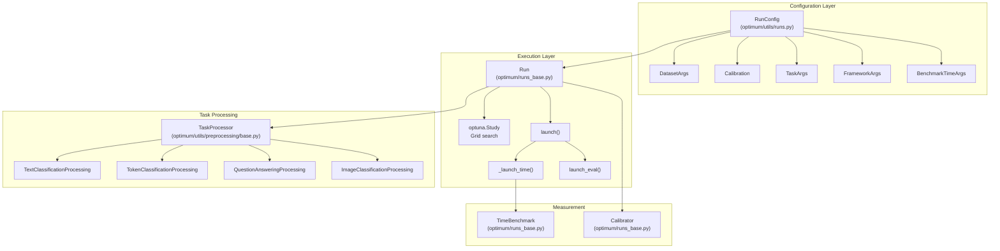
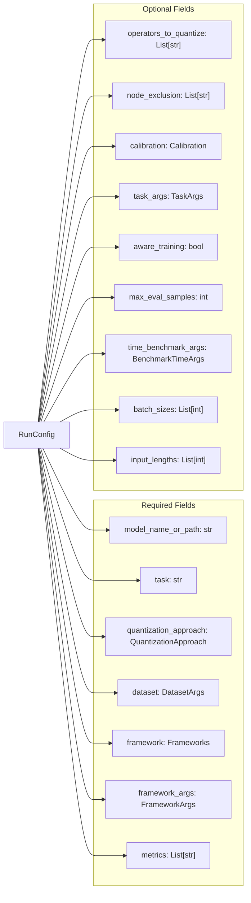
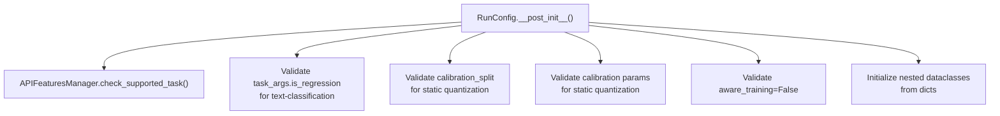
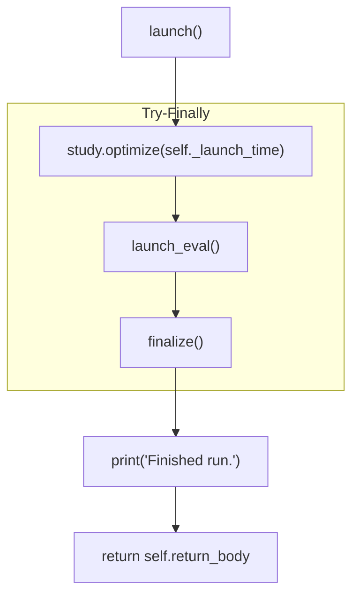
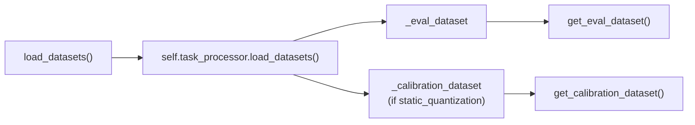

<!-- source: DeepWiki mcp.deepwiki.com · repo huggingface/optimum · page 8.1 Run Orchestration and Configuration · fetched 2026-10-26 -->

# Run Orchestration and Configuration

<details>
<summary>Relevant source files</summary>

The following files were used as context for generating this wiki page:

- [optimum/runs_base.py](optimum/runs_base.py)
- [optimum/utils/doc.py](optimum/utils/doc.py)
- [optimum/utils/runs.py](optimum/utils/runs.py)

</details>


## Purpose and Scope

This document describes the run orchestration system in Optimum, which provides a framework for evaluating and benchmarking model performance. A "run" compares a baseline transformers model against an optimized model, measuring latency, throughput, model size, and task-specific metrics across different batch sizes and input lengths.

The run system is primarily used for quantization evaluation (both static and dynamic) with ONNX Runtime, but the architecture is extensible to other optimization techniques and backends.

Sources: [optimum/runs_base.py:52-180](), [optimum/utils/runs.py:180-299]()

## System Architecture

The run orchestration system consists of three main components: configuration management, execution orchestration, and task-specific processing.

### Run System Entity Mapping
The following diagram maps high-level concepts to the specific code entities that implement them.



Sources: [optimum/runs_base.py:52-180](), [optimum/utils/runs.py:84-299](), [optimum/utils/preprocessing/base.py:41-250]()

## RunConfig: Configuration Dataclass

The `RunConfig` dataclass defines all parameters needed to execute a run. It combines multiple nested dataclasses to organize configuration into logical groups.

### Core Configuration Structure



Sources: [optimum/utils/runs.py:180-299]()

### Nested Configuration Dataclasses

The `RunConfig` aggregates several specialized configuration objects, many of which use the `@generate_doc_dataclass` decorator [optimum/utils/runs.py:84]() to automatically build attribute documentation from field metadata [optimum/utils/doc.py:19-46]().

| Dataclass | Purpose | Key Fields |
|-----------|---------|------------|
| `DatasetArgs` | Dataset specification | `path`, `eval_split`, `data_keys`, `ref_keys`, `calibration_split` [optimum/utils/runs.py:135-152]() |
| `Calibration` | Static quantization calibration | `method`, `num_calibration_samples`, `calibration_histogram_percentile` [optimum/utils/runs.py:86-112]() |
| `TaskArgs` | Task-specific parameters | `is_regression` (for text classification) [optimum/utils/runs.py:156-165]() |
| `FrameworkArgs` | Framework configuration | `opset`, `optimization_level` [optimum/utils/runs.py:116-131]() |
| `BenchmarkTimeArgs` | Timing parameters | `duration`, `warmup_runs` [optimum/utils/runs.py:169-178]() |

Sources: [optimum/utils/runs.py:84-178](), [optimum/utils/doc.py:19-46]()

### Configuration Validation

The `RunConfig.__post_init__` method validates configuration consistency:



Sources: [optimum/utils/runs.py:286-299]()

### Enumerations

The configuration system uses several enums for type safety:

```python
# From optimum/utils/runs.py
class Frameworks(str, Enum):
    onnxruntime = "onnxruntime"

class CalibrationMethods(str, Enum):
    minmax = "minmax"
    percentile = "percentile"
    entropy = "entropy"

class QuantizationApproach(str, Enum):
    static = "static"
    dynamic = "dynamic"
```

Sources: [optimum/utils/runs.py:60-73]()

### Default Values

`RunConfig` provides sensible defaults for optional parameters:

| Parameter | Default Value | Description |
|-----------|---------------|-------------|
| `operators_to_quantize` | `["Add", "MatMul"]` | Operators to quantize [optimum/utils/runs.py:210]() |
| `node_exclusion` | `["layernorm", "gelu", "residual", "gather", "softmax"]` | Nodes to exclude [optimum/utils/runs.py:214]() |
| `per_channel` | `False` | Whether to quantize per channel [optimum/utils/runs.py:222]() |
| `batch_sizes` | `[4, 8]` | Batch sizes for benchmarking [optimum/utils/runs.py:241]() |
| `input_lengths` | `[128]` | Input lengths for benchmarking [optimum/utils/runs.py:242]() |
| `aware_training` | `False` | Quantization-aware training [optimum/utils/runs.py:221]() |

Sources: [optimum/utils/runs.py:210-242]()

## Run Class: Execution Orchestration

The `Run` class orchestrates the complete evaluation workflow. It is an abstract base class defined in `optimum/runs_base.py` [optimum/runs_base.py:52]().

### Initialization

The `Run` constructor creates an Optuna study with a `GridSampler` [optimum/runs_base.py:72-75]() to systematically explore the parameter space defined by `batch_sizes` and `input_lengths`. It also captures hardware metadata using `cpu_info_command()` [optimum/utils/runs.py:75-81]() and `optimum` versioning info [optimum/runs_base.py:77-84]().

Sources: [optimum/runs_base.py:52-111](), [optimum/utils/runs.py:75-81]()

### Return Body Structure

The `Run` class builds a comprehensive results dictionary (`return_body`) that contains metadata and nested `evaluation` results [optimum/runs_base.py:86-111]().

Sources: [optimum/runs_base.py:86-111]()

### Execution Flow



The `launch()` method [optimum/runs_base.py:113-128]() executes three main phases:
1. **Time Benchmarking**: `study.optimize()` calls `_launch_time()` for each combination in the grid search [optimum/runs_base.py:122]().
2. **Metric Evaluation**: `launch_eval()` evaluates task-specific metrics [optimum/runs_base.py:123]().
3. **Cleanup**: `finalize()` removes temporary files [optimum/runs_base.py:125]().

Sources: [optimum/runs_base.py:113-128]()

### Dataset Management

The `Run` class provides methods for loading evaluation and calibration datasets via the `task_processor` [optimum/runs_base.py:148-154]().



Sources: [optimum/runs_base.py:148-175]()

## Task Processors and Time Benchmark / Calibrator

Task processors handle dataset loading and preprocessing in a backend-agnostic manner. 

The `TimeBenchmark` class [optimum/runs_base.py:190]() measures inference latency and throughput using a warmup phase followed by a benchmarking loop tracked via `perf_counter_ns()` [optimum/runs_base.py:4]().

The `Calibrator` class [optimum/runs_base.py:37]() serves as an abstract base for implementing post-training calibration routines required during static quantization setups.

Sources: [optimum/runs_base.py:37-49](), [optimum/runs_base.py:190-284]()

---

