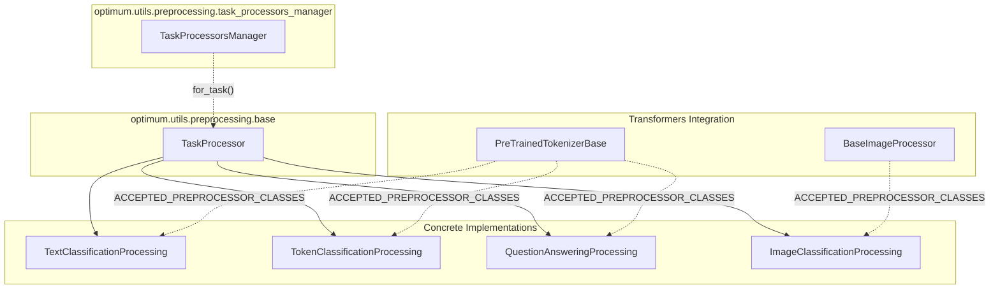
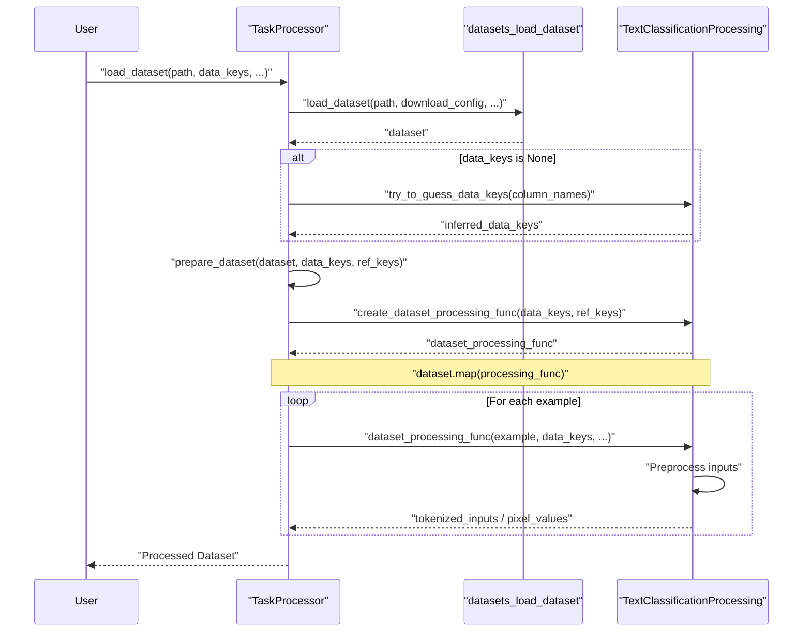

<!-- source: DeepWiki mcp.deepwiki.com · repo huggingface/optimum · page 8.2 Task Processors and Dataset Handling · fetched 2026-10-26 -->

# Task Processors and Dataset Handling

<details>
<summary>Relevant source files</summary>

The following files were used as context for generating this wiki page:

- [optimum/utils/preprocessing/__init__.py](optimum/utils/preprocessing/__init__.py)
- [optimum/utils/preprocessing/base.py](optimum/utils/preprocessing/base.py)
- [optimum/utils/preprocessing/image_classification.py](optimum/utils/preprocessing/image_classification.py)
- [optimum/utils/preprocessing/question_answering.py](optimum/utils/preprocessing/question_answering.py)
- [optimum/utils/preprocessing/task_processors_manager.py](optimum/utils/preprocessing/task_processors_manager.py)
- [optimum/utils/preprocessing/text_classification.py](optimum/utils/preprocessing/text_classification.py)
- [optimum/utils/preprocessing/token_classification.py](optimum/utils/preprocessing/token_classification.py)
- [tests/utils/test_task_processors.py](tests/utils/test_task_processors.py)

</details>


## Purpose and Scope

This document describes the `TaskProcessor` system, which provides task-specific dataset loading, preprocessing, and preparation for model evaluation and benchmarking. TaskProcessors abstract away the differences between tasks (text classification, token classification, question answering, image classification) by providing a unified interface for dataset operations while allowing task-specific customization.

For information about the Run orchestration system that uses `TaskProcessors`, see section 8.1. For the overall benchmarking architecture, see section 8.

---

## TaskProcessor Architecture Overview

The `TaskProcessor` system follows an abstract base class pattern where each supported task has a specialized implementation. The `TaskProcessorsManager` acts as a factory to retrieve the appropriate implementation based on the task name.

### Task Processor Entity Mapping

The following diagram maps the logical task concepts to the concrete classes implemented in the `optimum.utils.preprocessing` subpackage.



Sources: [optimum/utils/preprocessing/base.py:41-46](), [optimum/utils/preprocessing/task_processors_manager.py:29-35](), [optimum/utils/preprocessing/text_classification.py:33-34](), [optimum/utils/preprocessing/image_classification.py:34-35]()

---

## TaskProcessor Base Class

### Class Definition and Responsibilities

The `TaskProcessor` abstract base class is defined in [optimum/utils/preprocessing/base.py:41-250]() and serves as the foundation for all task-specific processors. Each subclass must define:

| Class Attribute | Type | Purpose |
|----------------|------|---------|
| `ACCEPTED_PREPROCESSOR_CLASSES` | `Tuple[Type, ...]` | Valid preprocessor types (tokenizer, image processor, etc.) |
| `DEFAULT_DATASET_ARGS` | `Union[str, Dict[str, Any]]` | Default dataset path or `load_dataset` arguments |
| `DEFAULT_DATASET_DATA_KEYS` | `Dict[str, str]` | Default column names for input data |
| `ALLOWED_DATA_KEY_NAMES` | `Set[str]` | Valid keys for `data_keys` parameter |
| `DEFAULT_REF_KEYS` | `List[str]` | Default column names for reference labels |

Sources: [optimum/utils/preprocessing/base.py:41-46]()

### Initialization and Configuration

`TaskProcessor` is initialized with a model configuration, preprocessor, and optional keyword arguments:

```python
def __init__(
    self,
    config: "PretrainedConfig",
    preprocessor: Preprocessor,
    preprocessor_kwargs: Optional[Dict[str, Any]] = None,
)
```

The initialization validates that the preprocessor is of an accepted type [optimum/utils/preprocessing/base.py:68-72]() and calls `create_defaults_and_kwargs_from_preprocessor_kwargs()` to separate default preprocessing parameters from custom keyword arguments [optimum/utils/preprocessing/base.py:76-78]().

Sources: [optimum/utils/preprocessing/base.py:48-78]()

### Abstract Methods

Each `TaskProcessor` subclass must implement:

1. **`dataset_processing_func()`** [optimum/utils/preprocessing/base.py:93-97]() - Transforms a single example by applying the preprocessor with task-specific logic.
2. **`try_to_guess_data_keys()`** [optimum/utils/preprocessing/base.py:120-122]() - Attempts to infer which dataset columns contain input data.
3. **`try_to_guess_ref_keys()`** [optimum/utils/preprocessing/base.py:124-126]() - Attempts to infer which dataset columns contain reference labels.

Sources: [optimum/utils/preprocessing/base.py:93-126]()

---

## Task-Specific Implementations

### Implementation Comparison

| Task | Implementation Class | Accepted Preprocessor | Default Dataset | Data Keys | Ref Keys |
|------|---------------------|----------------------|-----------------|-----------|----------|
| Text Classification | `TextClassificationProcessing` | `PreTrainedTokenizerBase` | `glue/sst2` | `primary`, `secondary` | `label` |
| Token Classification | `TokenClassificationProcessing` | `PreTrainedTokenizerBase` | `conll2003` | `primary` | `ner_tags`, `pos_tags`, `chunk_tags` |
| Question Answering | `QuestionAnsweringProcessing` | `PreTrainedTokenizerBase` | `squad_v2` | `question`, `context` | `answers` |
| Image Classification | `ImageClassificationProcessing` | `BaseImageProcessor` | `uoft-cs/cifar10` | `image` | `answers` |

Sources: [optimum/utils/preprocessing/text_classification.py:33-38](), [optimum/utils/preprocessing/token_classification.py:29-34](), [optimum/utils/preprocessing/question_answering.py:29-34](), [optimum/utils/preprocessing/image_classification.py:34-39]()

### Text Classification Processing

`TextClassificationProcessing` handles both single-sentence and sentence-pair classification tasks.

**Key Features:**
- Supports primary and optional secondary input text via `data_keys` [optimum/utils/preprocessing/text_classification.py:37]().
- Default preprocessing: `padding="max_length"`, `truncation=True`, `max_length=model_max_length` [optimum/utils/preprocessing/text_classification.py:47-50]().
- Guesses primary key from candidates: `sentence`, `text`, `premise` [optimum/utils/preprocessing/text_classification.py:65-69]().
- Guesses secondary key from candidates: `hypothesis` [optimum/utils/preprocessing/text_classification.py:72-76]().

Sources: [optimum/utils/preprocessing/text_classification.py:33-116]()

### Token Classification Processing

`TokenClassificationProcessing` handles sequence labeling tasks like NER and POS tagging.

**Key Features:**
- Only accepts single primary input (pre-tokenized text) [optimum/utils/preprocessing/token_classification.py:86-87]().
- Sets `is_split_into_words=True` by default since inputs are typically token lists [optimum/utils/preprocessing/token_classification.py:46]().
- Guesses data key from columns containing `token`, `text`, or `sentence` [optimum/utils/preprocessing/token_classification.py:62-66]().
- Guesses ref keys from columns containing `tag` [optimum/utils/preprocessing/token_classification.py:70-73]().

Sources: [optimum/utils/preprocessing/token_classification.py:29-100]()

### Question Answering Processing

`QuestionAnsweringProcessing` handles extractive QA tasks.

**Key Features:**
- Requires both `question` and `context` data keys [optimum/utils/preprocessing/question_answering.py:32-33]().
- Handles padding side to determine question-context order [optimum/utils/preprocessing/question_answering.py:44-45]().
- Configures stride and max length for handling long contexts [optimum/utils/preprocessing/question_answering.py:46-52]().
- Strips leading whitespace from questions before tokenization [optimum/utils/preprocessing/question_answering.py:63]().

Sources: [optimum/utils/preprocessing/question_answering.py:29-92]()

### Image Classification Processing

`ImageClassificationProcessing` handles vision classification tasks using torchvision transforms.

**Key Features:**
- Accepts `BaseImageProcessor` [optimum/utils/preprocessing/image_classification.py:35]().
- Constructs a `torchvision.transforms.Compose` pipeline including `Resize`, `CenterCrop`, `ToTensor`, and `Normalize` [optimum/utils/preprocessing/image_classification.py:57-64]().
- Extracts size information from the preprocessor's `size` dictionary [optimum/utils/preprocessing/image_classification.py:48-55]().
- Transforms images to RGB and converts to `pixel_values` in `torch.float32` [optimum/utils/preprocessing/image_classification.py:70]().

Sources: [optimum/utils/preprocessing/image_classification.py:34-115]()

---

## Dataset Loading and Processing Flow

The `load_dataset()` method in the base class orchestrates the retrieval and transformation of data.

### Preprocessing Sequence

The following diagram bridges the high-level dataset loading process to the internal functional calls within the `TaskProcessor` implementations.



**Key Features of the dataset loading process:**
- **Automatic split selection:** If `load_smallest_split=True`, selects the split with the fewest rows [optimum/utils/preprocessing/base.py:151-162]().
- **Sample limiting:** Can limit to first N samples via `num_samples` parameter [optimum/utils/preprocessing/base.py:167-173]().
- **Column inference:** Automatically guesses data and reference keys if not provided [optimum/utils/preprocessing/base.py:179-197]().
- **Column filtering:** Optionally removes columns not needed for model input or evaluation via `only_keep_necessary_columns` [optimum/utils/preprocessing/base.py:200-209]().

Sources: [optimum/utils/preprocessing/base.py:128-211]()

---

## Manager and Factory System

The `TaskProcessorsManager` provides a centralized way to access task-specific logic without direct imports of the concrete classes.

- **`get_task_processor_class_for_task(task)`**: Returns the class (e.g., `TextClassificationProcessing`) mapped to a task string [optimum/utils/preprocessing/task_processors_manager.py:38-45]().
- **`for_task(task, *args, **kwargs)`**: Factory method that instantiates the correct `TaskProcessor` for the given task [optimum/utils/preprocessing/task_processors_manager.py:48-49]().

Sources: [optimum/utils/preprocessing/task_processors_manager.py:29-49]()

---

