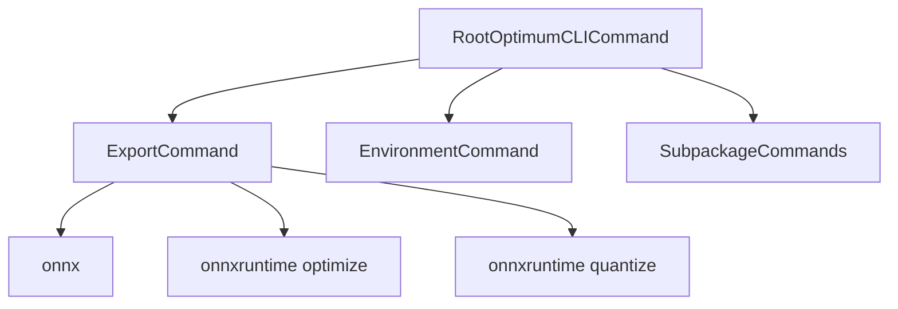
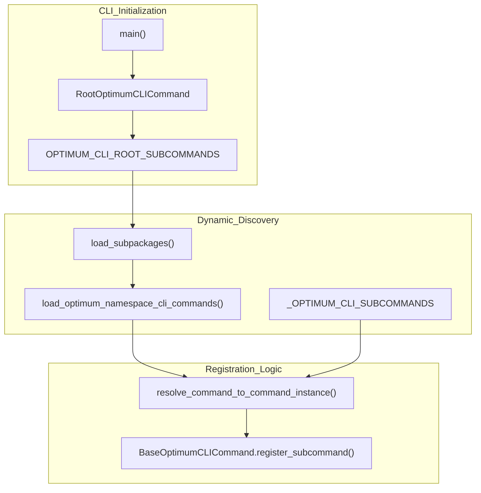

<!-- source: DeepWiki mcp.deepwiki.com · repo huggingface/optimum · page 9 Command-Line Interface · fetched 2026-10-26 -->

# Command-Line Interface

<details>
<summary>Relevant source files</summary>

The following files were used as context for generating this wiki page:

- [docs/source/exporters/overview.mdx](docs/source/exporters/overview.mdx)
- [optimum/commands/base.py](optimum/commands/base.py)
- [optimum/commands/env.py](optimum/commands/env.py)
- [optimum/commands/export/base.py](optimum/commands/export/base.py)
- [optimum/commands/optimum_cli.py](optimum/commands/optimum_cli.py)
- [optimum/commands/register/README.md](optimum/commands/register/README.md)
- [tests/cli/cli_with_custom_command.py](tests/cli/cli_with_custom_command.py)
- [tests/cli/test_cli.py](tests/cli/test_cli.py)

</details>


## Purpose and Scope

This document describes the `optimum-cli` command-line interface tool, which provides a unified entry point for model export, optimization, quantization, and environment inspection across different hardware accelerators. The CLI employs an extensible architecture that allows subpackages (e.g., `optimum-intel`, `optimum-habana`, `optimum-neuron`) to dynamically register their own commands without modifying the core package.

For detailed information about the CLI's architecture and extension mechanisms, see [CLI Architecture and Command Registration](#9.1). For specific usage of export commands, see [Built-in Commands](#9.2). For the underlying export system that CLI commands invoke, see [Model Export System](#2).

Sources: [optimum/commands/optimum_cli.py:1-223](), [optimum/commands/register/README.md:1-24]()

## Command Structure Overview

The `optimum-cli` tool is organized as a hierarchical command structure with a root command that dispatches to subcommands. The core package provides two built-in commands, while additional commands are dynamically loaded from installed subpackages.

### Root Command and Built-in Commands

| Command | Purpose | Example Usage |
|---------|---------|---------------|
| `optimum-cli` | Root command and dispatcher | `optimum-cli --help` |
| `optimum-cli export` | Export models to various formats | `optimum-cli export onnx --model bert-base-uncased output/` |
| `optimum-cli env` | Display environment information | `optimum-cli env` |

The built-in commands are defined in `OPTIMUM_CLI_ROOT_SUBCOMMANDS` [optimum/commands/optimum_cli.py:30]() and include:
- **`ExportCommand`**: Container for export-related subcommands (ONNX, etc.) [optimum/commands/export/base.py:20-24]()
- **`EnvironmentCommand`**: Prints version information for debugging [optimum/commands/env.py:19-55]()

Sources: [optimum/commands/optimum_cli.py:30-30](), [optimum/commands/export/base.py:20-24](), [optimum/commands/env.py:19-55]()

### Command Hierarchy



**Diagram: CLI Command Hierarchy** - Associates CLI command concepts with their corresponding code classes like `RootOptimumCLICommand`, `ExportCommand`, and `EnvironmentCommand`.

Sources: [optimum/commands/optimum_cli.py:188-210](), [tests/cli/test_cli.py:36-49]()

## Dynamic Command Registration System

The CLI employs a registration system that allows subpackages to contribute commands. This is achieved through two mechanisms:

1. **Decorator-based registration** via `@optimum_cli_subcommand()` [optimum/commands/optimum_cli.py:36-64]()
2. **Namespace package registration** via `optimum.commands.register` [optimum/commands/optimum_cli.py:102-160]()

### Registration Flow



**Diagram: Dynamic Command Registration Flow** - Illustrates how code functions like `load_optimum_namespace_cli_commands` and `resolve_command_to_command_instance` coordinate command loading and registration.

Sources: [optimum/commands/optimum_cli.py:188-219](), [optimum/commands/optimum_cli.py:102-160](), [optimum/commands/base.py:132-135]()

### Namespace Package Discovery

The `load_optimum_namespace_cli_commands()` function scans for Python files in the `optimum.commands.register` namespace. Each file should define a `REGISTER_COMMANDS` list containing command classes or tuples of `(command, parent)` [optimum/commands/optimum_cli.py:102-160]().

Sources: [optimum/commands/optimum_cli.py:102-160](), [optimum/commands/register/README.md:1-24]()

## Child Pages

### [CLI Architecture and Command Registration](#9.1)
Detailed explanation of the `BaseOptimumCLICommand` and `RootOptimumCLICommand` classes. Covers the initialization process, how `ArgumentParser` is managed, and the internal logic of `resolve_command_to_command_instance`.
For details, see [CLI Architecture and Command Registration](#9.1).

### [Built-in Commands](#9.2)
Documentation for the core commands provided by `optimum`. Includes the `env` command for environment diagnostics and the `export` base command used by exporters like ONNX.
For details, see [Built-in Commands](#9.2).

### [Extending the CLI](#9.3)
A guide for developers to add new commands via subpackages. Explains how to use the `REGISTER_COMMANDS` list in the `optimum.commands.register` namespace to attach new functionality to the root CLI or existing subcommands like `export`.
For details, see [Extending the CLI](#9.3).

Sources: [optimum/commands/optimum_cli.py:1-223](), [optimum/commands/base.py:1-147]()

## Command Implementation Pattern

All CLI commands inherit from `BaseOptimumCLICommand` [optimum/commands/base.py:43]() and must implement:

1. A `COMMAND` class attribute of type `CommandInfo` [optimum/commands/base.py:44]()
2. A `run()` method that executes the command logic [optimum/commands/base.py:137-138]()
3. Optionally, argument registration via `parse_args()` [optimum/commands/base.py:128-130]()

### Example: EnvironmentCommand

The `EnvironmentCommand` demonstrates the minimal command structure:

```python
class EnvironmentCommand(BaseOptimumCLICommand):
    COMMAND = CommandInfo(name="env", help="Get information about the environment used.")
    
    def run(self):
        # Gather and print environment information
        # ...
        return info
```

Sources: [optimum/commands/env.py:19-55]()

## Performance Considerations

The CLI initialization is optimized to minimize startup time:

1. **Lazy imports**: Command modules are encouraged to keep heavy imports inside the `run()` method to avoid loading dependencies at CLI startup [optimum/commands/optimum_cli.py:140-142]().
2. **Namespace scanning**: The registration system uses `importlib.util.find_spec` to check for the existence of registration namespaces without fully loading subpackages [optimum/commands/optimum_cli.py:117]().

Sources: [optimum/commands/optimum_cli.py:117-142]()

## Summary

The `optimum-cli` tool provides:
- A unified command-line interface for model optimization across hardware backends.
- Extensible architecture via decorators and namespace packages.
- Built-in commands for export (`ExportCommand`) and environment inspection (`EnvironmentCommand`).
- Dynamic discovery and registration of subpackage commands.

Sources: [optimum/commands/optimum_cli.py:1-223](), [optimum/commands/base.py](), [optimum/commands/register/README.md:1-24]()

---

