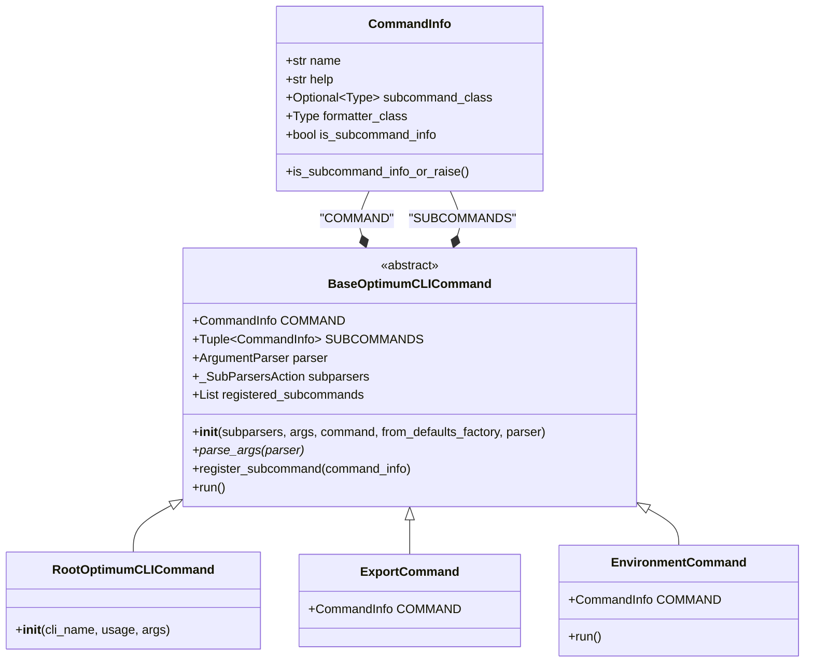
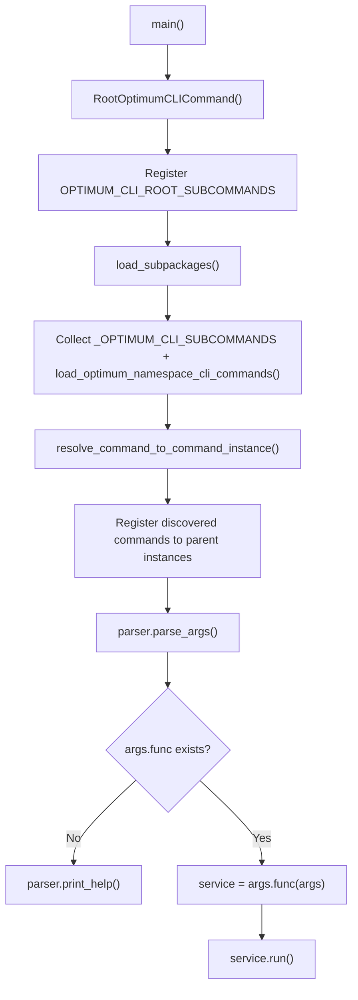
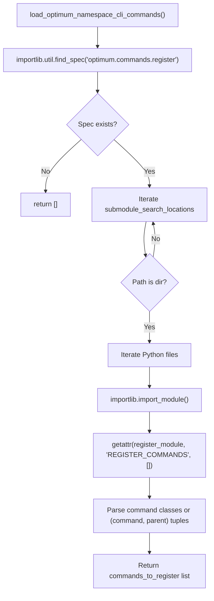
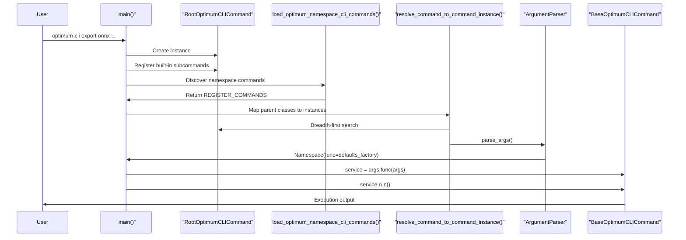

<!-- source: DeepWiki mcp.deepwiki.com · repo huggingface/optimum · page 9.1 CLI Architecture and Command Registration · fetched 2026-10-26 -->

# CLI Architecture and Command Registration

<details>
<summary>Relevant source files</summary>

The following files were used as context for generating this wiki page:

- [optimum/commands/base.py](optimum/commands/base.py)
- [optimum/commands/optimum_cli.py](optimum/commands/optimum_cli.py)
- [tests/cli/cli_with_custom_command.py](tests/cli/cli_with_custom_command.py)
- [tests/cli/test_cli.py](tests/cli/test_cli.py)

</details>


This document explains the architecture of the `optimum-cli` command-line interface, detailing its base classes (`BaseOptimumCLICommand`, `RootOptimumCLICommand`), metadata encapsulation (`CommandInfo`), and the multi-tier command registration and extension systems (`optimum_cli_subcommand`, `load_optimum_namespace_cli_commands`).

Sources: [optimum/commands/base.py:15-147](), [optimum/commands/optimum_cli.py:1-160]()

## Core Architecture Components

The CLI is built upon foundational classes defined in `optimum/commands/base.py` that establish the command inheritance hierarchy and argument parsing infrastructure.

### CommandInfo Dataclass

`CommandInfo` is a frozen dataclass encapsulating command metadata used across the parser hierarchy:

```python
@dataclass(frozen=True)
class CommandInfo:
    name: str
    help: str
    subcommand_class: Optional[Type["BaseOptimumCLICommand"]] = None
    formatter_class: Type = RawTextHelpFormatter
```

The `subcommand_class` attribute links a metadata definition to its concrete execution class (`BaseOptimumCLICommand`). The `is_subcommand_info` property checks whether `subcommand_class` is populated.

Sources: [optimum/commands/base.py:27-41]()

### BaseOptimumCLICommand

`BaseOptimumCLICommand` is the abstract base class for all CLI commands. Subclasses must define `COMMAND` and implement execution logic:

```python
class BaseOptimumCLICommand(ABC):
    COMMAND: CommandInfo
    SUBCOMMANDS: Tuple[CommandInfo, ...] = ()
```

The constructor handles parser instantiation, argument configuration via `parse_args()`, and subparser registration. The `register_subcommand()` method appends new `CommandInfo` entries and instantiates subcommands.

Sources: [optimum/commands/base.py:43-139]()

### RootOptimumCLICommand

`RootOptimumCLICommand` inherits from `BaseOptimumCLICommand` and acts as the top-level entry point holding the root `ArgumentParser`:

```python
class RootOptimumCLICommand(BaseOptimumCLICommand):
    COMMAND = CommandInfo(name="root", help="optimum-cli root command")
```

Sources: [optimum/commands/base.py:141-147]()

## Command Class Hierarchy

The following diagram maps the logical command architecture to concrete code entities.

### Command Structure Diagram


Sources: [optimum/commands/base.py:27-147](), [optimum/commands/export/base.py:20-24](), [optimum/commands/env.py:19-55]()

## Command Registration Mechanisms

The CLI supports three registration pathways:

1. **Built-in Registration**: Core commands are declared in `OPTIMUM_CLI_ROOT_SUBCOMMANDS` within `optimum/commands/optimum_cli.py`.
2. **Decorator-Based Registration**: The `@optimum_cli_subcommand()` decorator registers subcommands programmatically by appending tuples to `_OPTIMUM_CLI_SUBCOMMANDS`.
3. **Namespace-Based Registration**: PEP 420 namespace packages contribute files to `optimum.commands.register`, exposing a `REGISTER_COMMANDS` list.

Sources: [optimum/commands/optimum_cli.py:30-64](), [optimum/commands/optimum_cli.py:102-160]()

## CLI Initialization and Execution Flow

The CLI initialization routine orchestrates root setup, subpackage loading, namespace command discovery, and argument parsing.

### Initialization Sequence


Sources: [optimum/commands/optimum_cli.py:188-223]()

### Command Resolution Process

The `resolve_command_to_command_instance()` function executes a breadth-first search over the command tree starting from `RootOptimumCLICommand`, mapping command classes to active instances.

Sources: [optimum/commands/optimum_cli.py:67-99]()

## Namespace Command Discovery Flow

Namespace loading scans installed distribution files under `optimum.commands.register` to discover external commands without importing heavy subpackage dependencies at startup.

### Namespace Discovery Flow


Sources: [optimum/commands/optimum_cli.py:102-160]()

## Full Execution Sequence

The sequence below details the interplay between `main()`, `RootOptimumCLICommand`, and registration functions during invocation.



Sources: [optimum/commands/optimum_cli.py:188-223](), [optimum/commands/base.py:43-139]()

## Test Infrastructure

The CLI command registration mechanisms are validated in `tests/cli/test_cli.py`.

| Test Name | Target Functionality | File Path |
|-----------|----------------------|-----------|
| `test_env_commands` | Verifies environment diagnostics command execution | [tests/cli/test_cli.py:33-35]() |
| `test_export_commands` | Tests ONNX export and optimization subcommand pipelines | [tests/cli/test_cli.py:36-50]() |
| `test_register_command` | Validates dynamic namespace command registration and execution | [tests/cli/test_cli.py:60-87]() |

Sources: [tests/cli/test_cli.py:1-90]()

---

