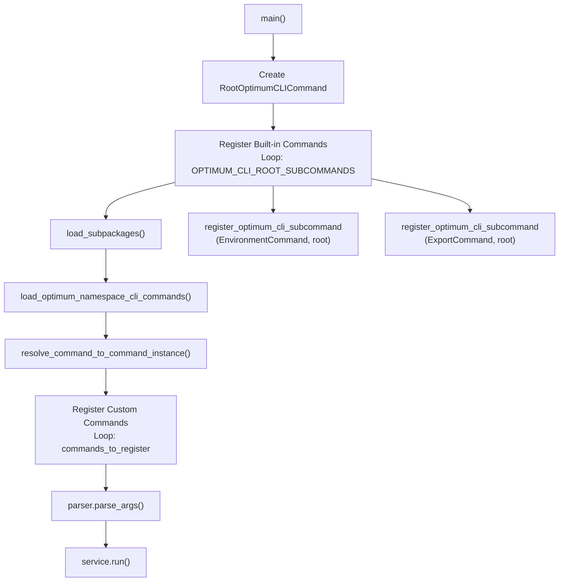
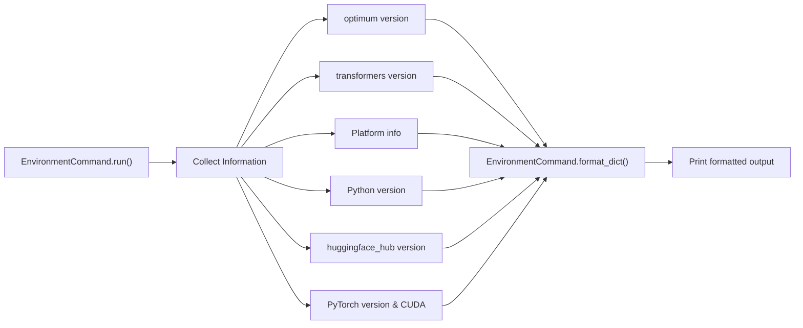
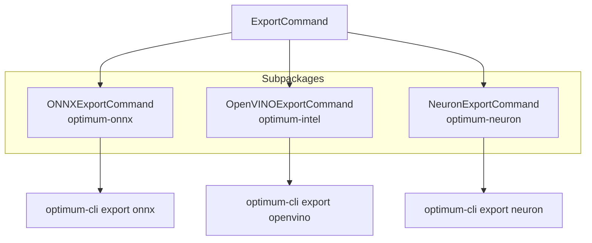
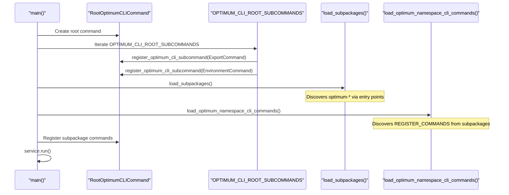

<!-- source: DeepWiki mcp.deepwiki.com · repo huggingface/optimum · page 9.2 Built-in Commands · fetched 2026-10-26 -->

# Built-In Commands

<details>
<summary>Relevant source files</summary>

The following files were used as context for generating this wiki page:

- [docs/source/exporters/overview.mdx](docs/source/exporters/overview.mdx)
- [optimum/commands/env.py](optimum/commands/env.py)
- [optimum/commands/export/base.py](optimum/commands/export/base.py)
- [optimum/commands/register/README.md](optimum/commands/register/README.md)

</details>


This document describes the built-in commands provided by the core Optimum package through the `optimum-cli` interface. These commands are defined in `OPTIMUM_CLI_ROOT_SUBCOMMANDS` and automatically registered when the CLI starts. Built-in commands include `env` for environment diagnostics and `export` as a base command for model export operations.

For information about the overall CLI architecture and command registration system, see [CLI Architecture and Command Registration](#9.1). For guidance on adding custom commands from subpackages, see [Extending the CLI](#9.3).

## Built-In Command Registry

The core Optimum package defines two built-in commands in `optimum/commands/optimum_cli.py`:

```python
OPTIMUM_CLI_ROOT_SUBCOMMANDS = [ExportCommand, EnvironmentCommand]
```

These commands are registered as root-level subcommands during CLI initialization in the `main()` function. The registration occurs before subpackage discovery and custom command loading, ensuring that built-in commands are always available.

### Registration Flow

The following diagram illustrates how built-in commands are prioritized during the CLI startup sequence, associating system concepts with code entities like `RootOptimumCLICommand`, `EnvironmentCommand`, and `ExportCommand`.

**CLI Initialization and Command Registration Flow**


**Sources:** `optimum/commands/optimum_cli.py`, `optimum/subpackages.py` [optimum/subpackages.py:72-78]()

## Environment Command

The `env` command provides diagnostic information about the execution environment, including library versions and hardware availability. It is primarily used for debugging and issue reporting.

### Command Definition

The `EnvironmentCommand` class is defined in `optimum/commands/env.py` [optimum/commands/env.py:19-55]().

| Property | Value |
|----------|-------|
| Command Name | `env` |
| Help Text | "Get information about the environment used." |
| Base Class | `BaseOptimumCLICommand` |
| Arguments | None (no additional CLI arguments) |

### Collected Information

When executed, the `env` command gathers and displays environment information through `EnvironmentCommand.run()` [optimum/commands/env.py:26-55]().

**Environment Data Collection Flow**


**Sources:** `optimum/commands/env.py` [optimum/commands/env.py:19-55]()

### Usage Example

```bash
optimum-cli env
```

Output format (from `optimum/commands/env.py` [optimum/commands/env.py:43-55]()):
```
Copy-and-paste the text below in your GitHub issue:

- `optimum` version: <version>
- `transformers` version: <version>
- Platform: <platform_info>
- Python version: <python_version>
- Huggingface_hub version: <hub_version>
- PyTorch version (GPU?): <torch_version> (cuda available: <True/False>)
```

**Sources:** `optimum/commands/env.py` [optimum/commands/env.py:19-55]()

## Export Command

The `ExportCommand` serves as a parent command for model export operations. While the core package provides the base class, specific export formats (like ONNX, OpenVINO, or Neuron) are contributed by subpackages [docs/source/exporters/overview.mdx:15]().

### Command Definition

The `ExportCommand` class is defined in `optimum/commands/export/base.py` [optimum/commands/export/base.py:20-24]().

```python
class ExportCommand(BaseOptimumCLICommand):
    COMMAND = CommandInfo(
        name="export",
        help="Export PyTorch models to several format.",
    )
```

| Property | Value |
|----------|-------|
| Command Name | `export` |
| Help Text | "Export PyTorch models to several format." |
| Base Class | `BaseOptimumCLICommand` |
| Subcommands | Registered dynamically by subpackages |

### Subcommand Registration

The `ExportCommand` acts as a namespace. Subpackages register their implementations as subcommands of `ExportCommand` using the `REGISTER_COMMANDS` list [optimum/commands/register/README.md:14-21]().

**Export Subcommand Hierarchy**


**Sources:** `optimum/commands/export/base.py` [optimum/commands/export/base.py:20-24](), `optimum/commands/register/README.md` [optimum/commands/register/README.md:1-24](), `docs/source/exporters/overview.mdx` [docs/source/exporters/overview.mdx:13-15]()

## Built-In vs. Subpackage Commands

The distinction between built-in commands and subpackage commands is important for understanding the CLI architecture:

| Aspect | Built-in Commands | Subpackage Commands |
|--------|-------------------|---------------------|
| **Definition Location** | `OPTIMUM_CLI_ROOT_SUBCOMMANDS` in `optimum/commands/optimum_cli.py` | `REGISTER_COMMANDS` in subpackage registration files |
| **Registration Time** | During CLI initialization, before subpackage loading | After `load_subpackages()` |
| **Dependencies** | Core Optimum dependencies only | Requires subpackage (e.g., `optimum-onnx`, `optimum-intel`) |
| **Examples** | `env`, `export` (base) | `export onnx`, `export openvino` |

### Command Discovery Order

The discovery process ensures that built-in commands can be extended by external subpackages without modifying the core library.



**Sources:** `optimum/commands/optimum_cli.py`, `optimum/subpackages.py` [optimum/subpackages.py:72-78]()

---

