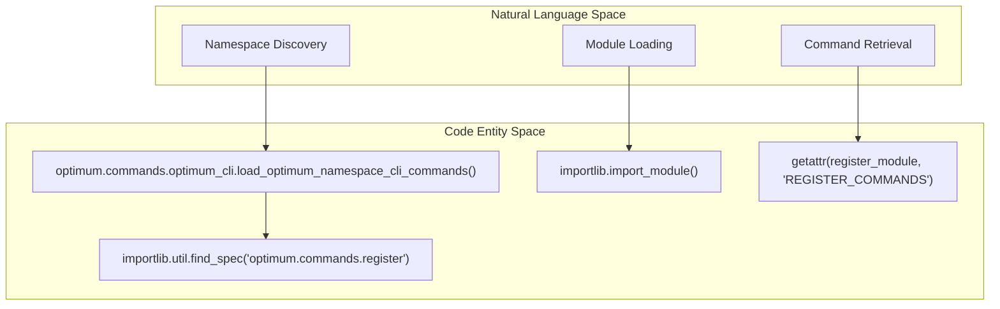
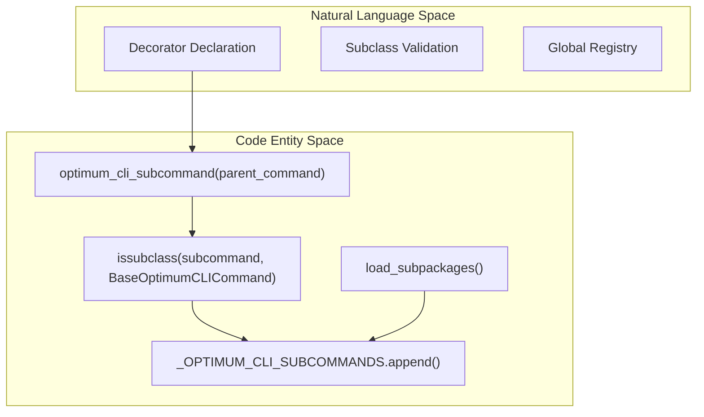
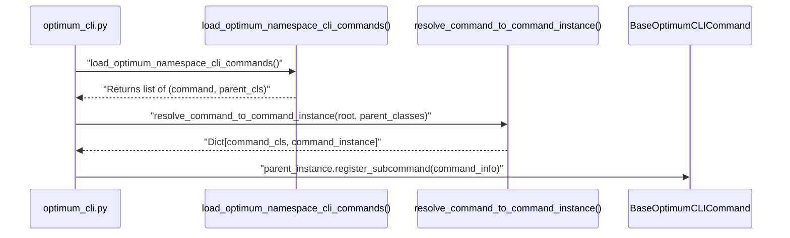

<!-- source: DeepWiki mcp.deepwiki.com · repo huggingface/optimum · page 9.3 Extending the CLI · fetched 2026-10-26 -->

# Extending the CLI

Relevant source files

The following files were used as context for generating this wiki page:

- [.github/workflows/test_cli.yml](.github/workflows/test_cli.yml)
- [optimum/commands/base.py](optimum/commands/base.py)
- [optimum/commands/optimum_cli.py](optimum/commands/optimum_cli.py)
- [optimum/subpackages.py](optimum/subpackages.py)
- [tests/cli/cli_with_custom_command.py](tests/cli/cli_with_custom_command.py)
- [tests/cli/test_cli.py](tests/cli/test_cli.py)

## Purpose and Scope

This page provides a comprehensive guide for Optimum subpackages to extend the `optimum-cli` command-line interface. It details the architecture and implementation of the two supported command extension mechanisms: the lazy `optimum.commands.register` namespace using `REGISTER_COMMANDS`, and the decorator pattern via `optimum_cli_subcommand`. For details on core CLI base classes, see [CLI Architecture and Command Registration](#9.1) and [Built-in Commands](#9.2).

Sources: [optimum/commands/optimum_cli.py:36-160](), [optimum/commands/base.py:43-147]()

## Extension Mechanisms Overview

Optimum provides two primary mechanisms for registering custom commands into the CLI:

| Mechanism | Code Entity / Module | Registration Timing | Use Case |
|-----------|----------------------|---------------------|----------|
| **Register Namespace** | `optimum.commands.register.*` (`REGISTER_COMMANDS`) | Lazy load at CLI startup via `load_optimum_namespace_cli_commands()` | Recommended for all subpackages to prevent startup overhead |
| **Decorator Pattern** | `optimum_cli_subcommand()` in `optimum/commands/optimum_cli.py` | Eager load when whitelisted subpackages load via `load_subpackages()` | Used by specific modules/whitelisted packages |

Sources: [optimum/commands/optimum_cli.py:36-160](), [optimum/subpackages.py:72-78]()

## Method 1: Using the Register Namespace (Recommended)

### Overview and Namespace Architecture

The register namespace mechanism leverages Python namespace packages (`optimum.commands.register`) to discover and load subcommands without forcing eager imports of entire subpackage dependency trees during CLI invocation.

Sources: [optimum/commands/optimum_cli.py:102-160]()

### File Location and Structure

Subpackages contribution via the register namespace must follow this structure:
1. Create a namespace subfolder `optimum/commands/register/` without an `__init__.py` file (adhering to PEP 420).
2. Define `REGISTER_COMMANDS` inside the registration module.

Sources: [optimum/commands/optimum_cli.py:132-144](), [tests/cli/cli_with_custom_command.py:32-38]()

### REGISTER_COMMANDS Format

`REGISTER_COMMANDS` can be defined as:
- A list of `BaseOptimumCLICommand` subclasses for root-level commands [optimum/commands/optimum_cli.py:145-149]()
- A list of tuples `(CommandClass, ParentCommandClass)` for subcommands [optimum/commands/optimum_cli.py:146-149]()
- A list of `CommandInfo` instances [optimum/commands/base.py:27-41]()

Sources: [optimum/commands/optimum_cli.py:144-150](), [tests/cli/cli_with_custom_command.py:32-38]()

## Method 2: Using the Decorator Pattern

### Overview and Decorator Implementation

The `@optimum_cli_subcommand` decorator registers a command class by appending it to the global `_OPTIMUM_CLI_SUBCOMMANDS` list [optimum/commands/optimum_cli.py:33-64]().

Sources: [optimum/commands/optimum_cli.py:36-64](), [optimum/subpackages.py:72-78]()

## Registration Process

### Command Resolution and Tree Integration

Once discovered, commands are resolved against the CLI hierarchy using `resolve_command_to_command_instance()` and registered via `BaseOptimumCLICommand.register_subcommand()` [optimum/commands/optimum_cli.py:67-99](), [optimum/commands/base.py:132-136]().

Sources: [optimum/commands/optimum_cli.py:67-99](), [optimum/commands/optimum_cli.py:102-160](), [optimum/commands/base.py:132-136]()

## Creating Custom Commands

### Command Class Structure

All custom commands inherit from `BaseOptimumCLICommand` and must implement:
- `COMMAND`: A `CommandInfo` metadata instance [optimum/commands/base.py:44]()
- `parse_args(parser)`: Argument configuration method [optimum/commands/base.py:128-130]()
- `run(self)`: Execution routine [optimum/commands/base.py:137-138]()

Sources: [optimum/commands/base.py:43-139](), [tests/cli/cli_with_custom_command.py:22-27]()

## Testing Custom Commands

### Test Execution Flow

The test suite located in `tests/cli/test_cli.py` validates custom command registration by temporarily populating `optimum/commands/register/` and invoking `optimum-cli` via `subprocess.run()` [tests/cli/test_cli.py:27-86]().

Sources: [tests/cli/test_cli.py:27-86]()

---

