# Page: Overview

# Overview

<details>
<summary>Relevant source files</summary>

The following files were used as context for generating this wiki page:

- [README.md](README.md)
- [docs/source/index.mdx](docs/source/index.mdx)
- [docs/source/installation.mdx](docs/source/installation.mdx)
- [notebooks/README.md](notebooks/README.md)
- [optimum/version.py](optimum/version.py)

</details>


**🤗 Optimum** is an extension of Hugging Face's Transformers, Diffusers, TIMM, and Sentence-Transformers libraries that provides optimization tools for training and running models on specialized hardware platforms [README.md:17-29](). The library acts as a unified interface layer between popular model libraries and hardware-specific acceleration backends, enabling developers to optimize models for ONNX Runtime, Intel OpenVINO, AWS Inferentia, Intel Gaudi, AMD GPUs/NPUs, and other platforms while maintaining API compatibility with the base libraries [README.md:17-29]().

Sources: [README.md:1-29](), [docs/source/index.mdx:13-18]()

---

## 1.1. Installation and Setup

Optimum can be installed as a lightweight core package with optional dependencies using Python's package installation extras [README.md:31-65](). Hardware-specific extensions are managed through the `EXTRAS_REQUIRE` system, allowing developers to target specific accelerators such as ONNX Runtime, OpenVINO, or AWS Neuron without installing unnecessary toolchains [README.md:31-52]().

For detailed installation guides, environment setup, and verification instructions, see [Installation and Setup](#1.1).

Sources: [README.md:31-65](), [docs/source/installation.mdx:1-45]()

---

## 1.2. Package Architecture and Subpackages

Optimum implements a modular namespace package architecture where the core package (`optimum`) defines foundational abstractions like `OptimizedModel` [optimum/modeling_base.py]() and `TasksManager` [optimum/exporters/tasks.py](), while hardware-specific integrations reside in dedicated `optimum-*` subpackages [setup.py:94](). These subpackages integrate seamlessly through entry points and shared utility interfaces.

For a deep dive into the namespace package design, package interdependencies, and the extension architecture, see [Package Architecture and Subpackages](#1.2).

Sources: [setup.py:45-99](), [README.md:69-152]()

---

## Core System Architecture

Title: "Core System Architecture and Code Entity Relationships"
```mermaid
graph TB
    subgraph ["User Entry Points"]
        CLI["optimum.commands.optimum_cli"]
        PipelineFactory["optimum.pipelines.pipeline"]
    end
    
    subgraph ["Model Registry and Configuration"]
        TasksManager["TasksManager"]
        ExporterConfigBase["ExporterConfig"]
        NormalizedConfig["NormalizedConfig"]
    end
    
    subgraph ["Input Generation"]
        DummyInputGen["DummyInputGenerator"]
    end
    
    subgraph ["Model Abstraction"]
        OptimizedModel["OptimizedModel"]
    end
    
    subgraph ["Optimization"]
        GPTQQuant["GPTQQuantizer"]
        FXTransform["Transformation"]
    end
    
    subgraph ["Infrastructure"]
        ImportUtils["import_utils"]
        BaseConfig["BaseConfig"]
    end
    
    CLI --> TasksManager
    PipelineFactory --> TasksManager
    PipelineFactory --> OptimizedModel
    
    TasksManager --> ExporterConfigBase
    TasksManager --> NormalizedConfig
    ExporterConfigBase --> DummyInputGen
    
    OptimizedModel --> BaseConfig
    
    GPTQQuant --> ImportUtils
    FXTransform --> ImportUtils
    
    TasksManager --> ImportUtils
```
Sources: [setup.py:1-99](), [docs/source/_toctree.yml:1-63]()

---

## Model Lifecycle Workflow

Title: "Model Loading, Export, and Inference Sequence"
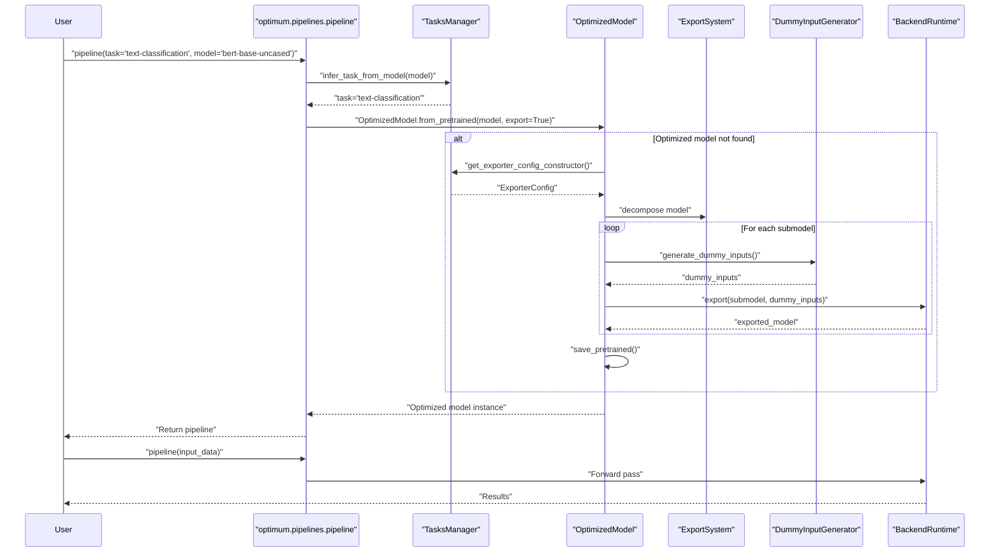
Sources: [README.md:69-152](), [docs/source/_toctree.yml:26-30]()

---

## Version Information

The current core library version is defined in `optimum/version.py` as `__version__ = "2.4.0.dev0"` [optimum/version.py:15]().

Sources: [optimum/version.py:1-15](), [setup.py:6-12]()

---

# Page: Installation and Setup

# Installation and Setup

<details>
<summary>Relevant source files</summary>

The following files were used as context for generating this wiki page:

- [Makefile](Makefile)
- [README.md](README.md)
- [docs/README.md](docs/README.md)
- [docs/source/installation.mdx](docs/source/installation.mdx)
- [notebooks/README.md](notebooks/README.md)
- [optimum/utils/import_utils.py](optimum/utils/import_utils.py)
- [pyproject.toml](pyproject.toml)
- [setup.py](setup.py)

</details>


This page provides technical documentation on installing and configuring the `optimum` core package and its hardware-specific extensions. It details the setup configuration, the `EXTRAS_REQUIRE` dependency mapping system, source installation mechanics, and runtime environment verification utilities.

## Purpose and Scope

The installation system is engineered around a modular architecture, isolating the core Hugging Face Transformers integration from hardware-accelerated backends (`optimum-onnx`, `optimum-intel`, `optimum-habana`, etc.). This scope covers setup definitions, package requirements resolution, and environment verification functions.

Sources: [setup.py:65-94](), [README.md:27-29]()

## Base Installation and Core Requirements

The core `optimum` package requires specific base dependencies to interface with Hugging Face ecosystem libraries. These requirements are declared in `setup.py` under `REQUIRED_PKGS`.

| Dependency | Minimum Version Requirement | Code Identifier / Citation |
|------------|---------------------------|----------------------------|
| `transformers` | `>=4.29` | `[setup.py:16-16]()` |
| `torch` | `>=1.11` | `[setup.py:17-17]()` |
| `packaging` | Any | `[setup.py:18-18]()` |
| `numpy` | Any | `[setup.py:19-19]()` |
| `huggingface_hub` | `>=1.31.0` | `[setup.py:20-20]()` |

To install the core library without any hardware accelerator extensions:

```bash
python -m pip install optimum
```

Sources: [setup.py:15-21]()

## Accelerator-Specific Installation and the EXTRAS_REQUIRE System

Hardware-specific features and backend runtimes are mapped through the `EXTRAS_REQUIRE` dictionary in `setup.py`. This mechanism allows users to install specific subpackages by appending extra specifiers.

| Extra Name | Target Package or Requirement | Citation |
|------------|-----------------------------|----------|
| `amd` | `optimum-amd` | `[setup.py:45-45]()` |
| `furiosa` | `optimum-furiosa` | `[setup.py:46-46]()` |
| `graphcore` | `optimum-graphcore` | `[setup.py:47-47]()` |
| `habana` | `optimum-habana>=1.17.0` | `[setup.py:48-48]()` |
| `intel` | `optimum-intel>=1.23.0` | `[setup.py:49-49]()` |
| `nncf` | `optimum-intel[nncf]>=1.23.0` | `[setup.py:50-50]()` |
| `neural-compressor` | `optimum-intel[neural-compressor]>=1.23.0` | `[setup.py:51-51]()` |
| `onnx` | `optimum-onnx` | `[setup.py:52-52]()` |
| `onnxruntime` | `optimum-onnx[onnxruntime]` | `[setup.py:53-53]()` |
| `onnxruntime-gpu` | `optimum-onnx[onnxruntime-gpu]` | `[setup.py:54-54]()` |
| `openvino` | `optimum-intel[openvino]>=1.23.0` | `[setup.py:55-55]()` |
| `quanto` | `optimum-quanto>=0.2.4` | `[setup.py:56-56]()` |

Installation command pattern utilizing the upgrade strategy:

```bash
python -m pip install --upgrade --upgrade-strategy eager optimum[accelerator_name]
```

Sources: [setup.py:44-56](), [README.md:41-54]()

## Installation from Source

For development or bleeding-edge integrations, packages can be installed directly from Git repositories using `pip` URL specifiers:

```bash
python -m pip install git+https://github.com/huggingface/optimum.git
```

For hardware extensions from source:

```bash
python -m pip install optimum[onnxruntime]@git+https://github.com/huggingface/optimum.git
```

Sources: [README.md:55-65](), [docs/source/installation.mdx:35-45]()

### Dependency Mapping and Resolution Flow

Diagram Title: "Dependency Mapping and Resolution Flow"

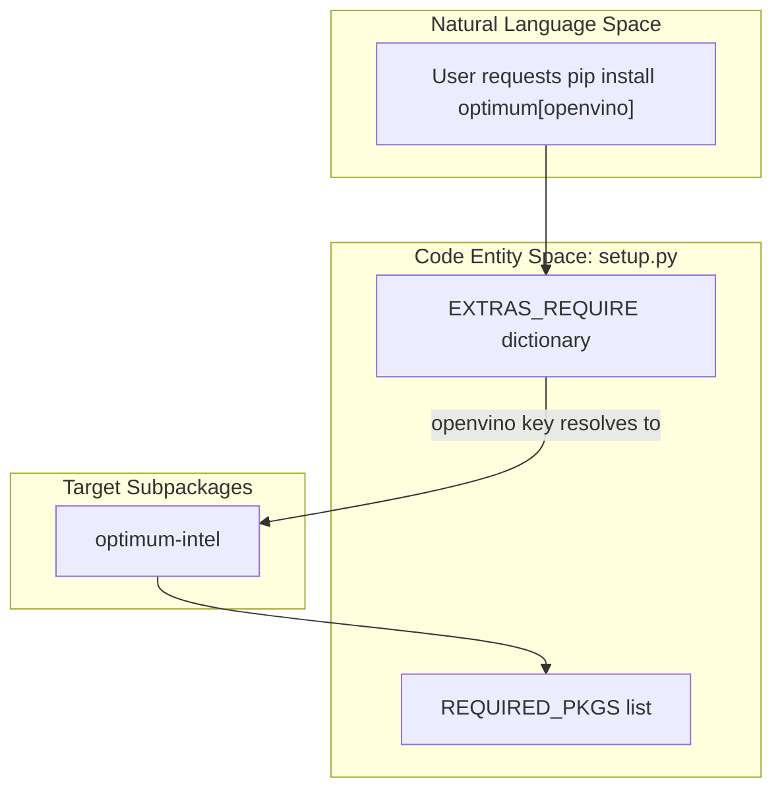

Sources: [setup.py:15-21](), [setup.py:44-56]()

## Runtime Import Validation and Version Management

Optimum utilizes `optimum/utils/import_utils.py` to check for optional package availability and enforce version compatibility at runtime. The function `_is_package_available` queries `importlib.metadata` and `importlib.util` to verify installed package distributions.

```python
from optimum.utils.import_utils import _is_package_available, is_torch_version

# Checks if a package distribution is present in the environment
has_openvino = _is_package_available("openvino")
```

Minimum version constants defined in the import utility module include:
- `TORCH_MINIMUM_VERSION`: `2.1.0` (`[optimum/utils/import_utils.py:29-29]()`)
- `TRANSFORMERS_MINIMUM_VERSION`: `4.36.0` (`[optimum/utils/import_utils.py:30-30]()`)
- `DIFFUSERS_MINIMUM_VERSION`: `0.22.0` (`[optimum/utils/import_utils.py:31-31]()`)
- `GPTQMODEL_MINIMUM_VERSION`: `7.0.0` (`[optimum/utils/import_utils.py:32-32]()`)

Sources: [optimum/utils/import_utils.py:16-79](), [optimum/utils/import_utils.py:29-33]()

## Developer, Quality, and Build Tools

Development environments are provisioned via dedicated development extras inside `EXTRAS_REQUIRE`:
- `dev`: Combines `TESTS_REQUIRE` and `QUALITY_REQUIRE` (`[setup.py:58-58]()`).
- `tests`: Includes `pytest`, `accelerate`, `parameterized`, `pytest-xdist`, and testing assets (`[setup.py:23-38]()`).
- `quality`: Includes `black~=23.1` and `ruff==0.1.5` (`[setup.py:40-40]()`).
- `benchmark`: Includes `optuna`, `tqdm`, `evaluate`, etc. (`[setup.py:42-42]()`).

Repository automation tasks are standardized via the `Makefile`:
| Makefile Command | Target Action | Implementation |
|------------------|---------------|----------------|
| `make style` | Code formatting & linting | `black .` and `ruff check . --fix` (`[Makefile:22-24]()`) |
| `make test` | Execution of unit test suite | `python -m pytest tests` (`[Makefile:27-28]()`) |
| `make doc` | Documentation compilation | `doc-builder build optimum docs/source/` (`[Makefile:46-51]()`) |

Sources: [setup.py:23-63](), [Makefile:18-51]()

## Installation Verification and Data Flow

Diagram Title: "Runtime Environment Verification Data Flow"

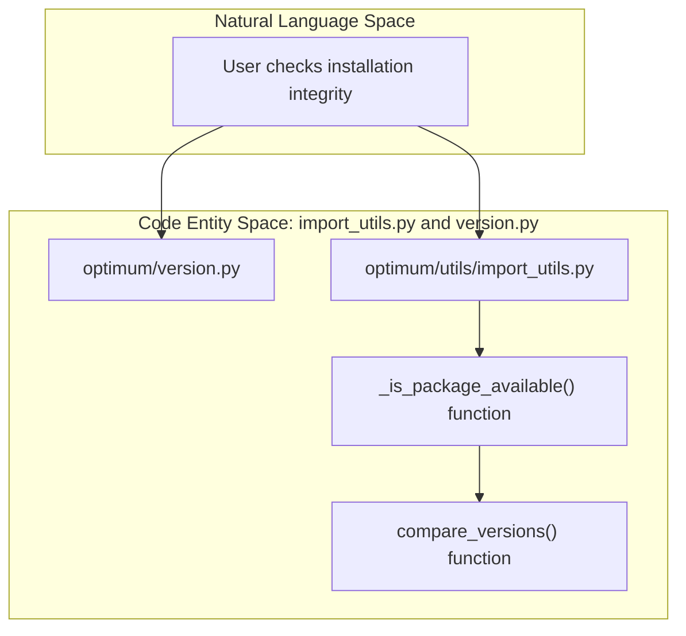

Sources: [setup.py:7-10](), [optimum/utils/import_utils.py:39-78](), [optimum/utils/import_utils.py:121-138]()

---

# Page: Package Architecture and Subpackages

# Package Architecture and Subpackages

<details>
<summary>Relevant source files</summary>

The following files were used as context for generating this wiki page:

- [docs/source/index.mdx](docs/source/index.mdx)
- [optimum/subpackages.py](optimum/subpackages.py)
- [optimum/utils/import_utils.py](optimum/utils/import_utils.py)
- [setup.py](setup.py)

</details>


## Overview and Scope

This document details the package architecture of the 🤗 Optimum library, focusing on its namespace package design, how hardware-specific `optimum-*` subpackages integrate with the core library, and the dynamic extension architecture that enables modular backend loading without hard-coded dependencies.

Sources: [setup.py:65-70](), [optimum/subpackages.py:1-78]()

## Namespace Package Structure

Optimum uses Python's namespace package capability to allow multiple independent distributions to contribute to the `optimum` namespace. The `setup.py` file uses `find_namespace_packages(include=["optimum*"])` to manage this hierarchy [setup.py:92-92]().

### Integration via EXTRAS_REQUIRE

The core `optimum` package acts as a central hub. It defines an `EXTRAS_REQUIRE` dictionary in `setup.py` that maps hardware backends to their respective subpackages [setup.py:44-63](). This system allows users to install only the necessary dependencies for their target hardware.

| Extra Name | Subpackage / Dependency | Hardware Target |
| :--- | :--- | :--- |
| `amd` | `optimum-amd` | AMD Instinct GPUs & Ryzen AI |
| `furiosa` | `optimum-furiosa` | FuriosaAI WARBOY |
| `graphcore` | `optimum-graphcore` | Graphcore IPU |
| `habana` | `optimum-habana>=1.17.0` | Intel Gaudi (HPU) |
| `intel` | `optimum-intel>=1.23.0` | Intel CPU/GPU (OpenVINO, IPEX) |
| `onnxruntime` | `optimum-onnx[onnxruntime]` | Cross-platform ONNX Runtime |
| `quanto` | `optimum-quanto>=0.2.4` | Quantization backend |

Sources: [setup.py:44-63](), [README.md:27-54]()

## Modular Extension Architecture

The integration between the core and subpackages is facilitated by a dynamic loading system defined in `optimum/subpackages.py`. This architecture allows subpackages to register their own CLI commands and backend-specific logic without being hard-coded into the core repository.

### Subpackage Loading Mechanism

The function `load_subpackages()` triggers the discovery of installed extensions by looking for a `subpackage` module within any installed distribution starting with `optimum-` [optimum/subpackages.py:72-78]().

Title: "Subpackage Loading Sequence"
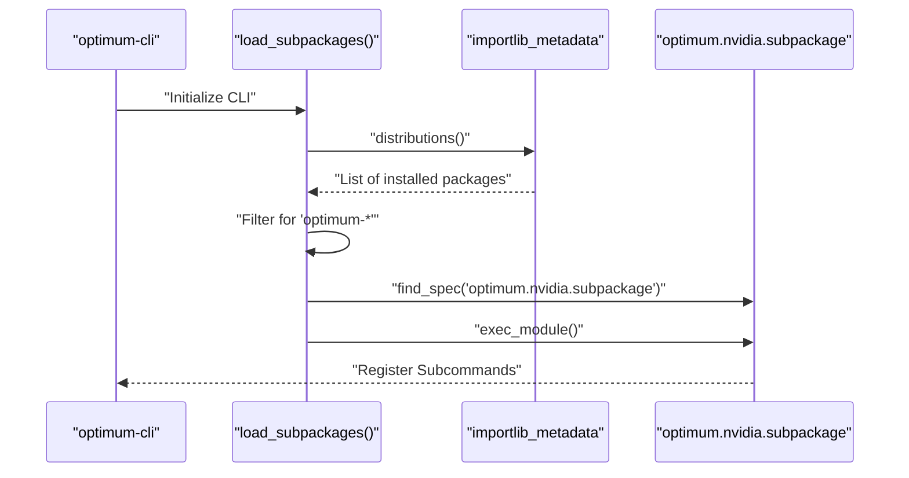

Sources: [optimum/subpackages.py:16-78]()

Key functions in this process include:
- `load_namespace_modules(namespace, module)`: Iterates through installed distributions via `importlib_metadata.distributions()`. If a distribution matches the namespace prefix (e.g., `optimum-`), it attempts to load the specified module (e.g., `subpackage`) [optimum/subpackages.py:30-70]().
- `load_subpackages()`: High-level entry point that invokes `load_namespace_modules("optimum", "subpackage")` [optimum/subpackages.py:72-78]().

Sources: [optimum/subpackages.py:30-78]()

## Code Entity Relationship

The following diagram bridges the natural language concept of "Subpackages" to the specific code entities that implement the integration.

Title: "Code Entity Relationship for Namespace Extension"
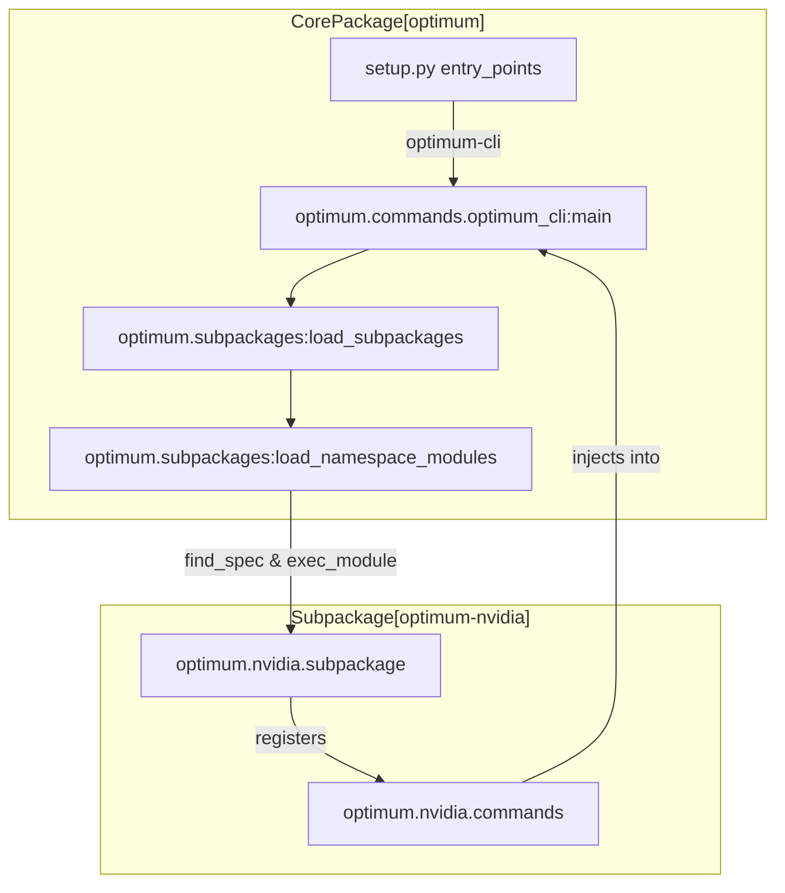

Sources: [setup.py:98-98](), [optimum/subpackages.py:30-78]()

## Data Flow: From Installation to Execution

When a user interacts with Optimum, the data flow for backend selection follows a modular path:

1.  **Installation**: User runs `pip install optimum[intel]`. This triggers the installation of `optimum-intel` as defined in `EXTRAS_REQUIRE` [setup.py:49-49]().
2.  **CLI Discovery**: When `optimum-cli` is executed, it invokes `load_subpackages()`, which queries installed distributions and executes any matching `subpackage.py` modules [optimum/subpackages.py:72-78]().
3.  **Command Registration**: The subpackage uses entry points and registration utilities to inject hardware-specific commands into the root CLI.
4.  **Backend Routing**: High-level APIs and helper modules check package availability via `_is_package_available()` in `import_utils.py` to route execution to the appropriate backend implementation [optimum/utils/import_utils.py:39-78]().

Sources: [setup.py:44-63](), [optimum/subpackages.py:30-78](), [optimum/utils/import_utils.py:39-118]()

---

# Page: Model Export System

# Model Export System

<details>
<summary>Relevant source files</summary>

The following files were used as context for generating this wiki page:

- [optimum/exporters/base.py](optimum/exporters/base.py)
- [optimum/exporters/tasks.py](optimum/exporters/tasks.py)
- [optimum/exporters/utils.py](optimum/exporters/utils.py)
- [optimum/utils/normalized_config.py](optimum/utils/normalized_config.py)

</details>


## Purpose and Scope

The Model Export System is the core infrastructure in Optimum responsible for converting models from various libraries (`transformers`, `diffusers`, `timm`, `sentence_transformers`) into optimized formats suitable for hardware accelerators. This system handles model discovery, configuration normalization, dummy input generation, and the orchestration of the export process to formats like ONNX, TFLite, and CoreML.

This document covers the high-level architecture of the export pipeline. Detailed implementation details for specific subsystems are covered in the child pages.

Sources: [optimum/exporters/tasks.py:1-46](), [optimum/exporters/base.py:1-35]()

---

## System Architecture Overview

The Model Export System consists of several major subsystems that work together to enable model conversion:

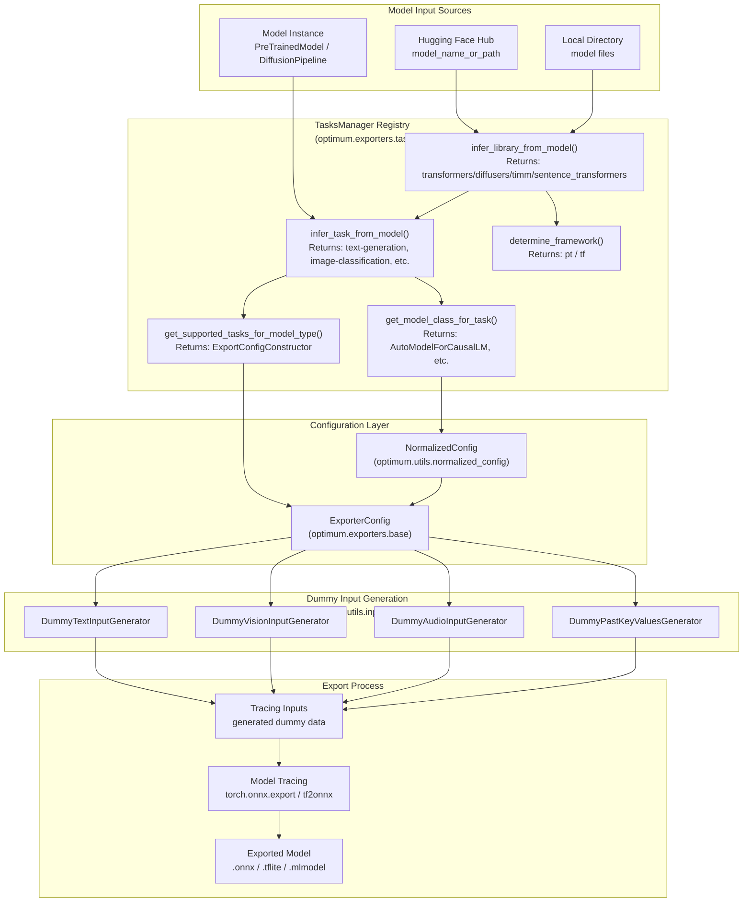

**Diagram: Model Export System Architecture and Data Flow**

Sources: [optimum/exporters/tasks.py:118-121](), [optimum/exporters/base.py:77-106](), [optimum/utils/normalized_config.py:25-32]()

---

## Core Subsystems

### [TasksManager Core](#2.1)
The `TasksManager` [optimum/exporters/tasks.py:118]() is the central registry and inference engine. It maintains mappings between tasks, model types, and export configurations. It is responsible for determining libraries, tasks, and frameworks from model inputs [optimum/exporters/tasks.py:62-115]().

For details, see [TasksManager Core](#2.1).

Sources: [optimum/exporters/tasks.py:62-121]()

### [NormalizedConfig System](#2.2)
`NormalizedConfig` [optimum/utils/normalized_config.py:25]() provides a unified interface to access model configuration parameters. It abstracts away naming inconsistencies across different model architectures.

For details, see [NormalizedConfig System](#2.2).

Sources: [optimum/utils/normalized_config.py:25-47]()

### [ExporterConfig Framework](#2.3)
`ExporterConfig` [optimum/exporters/base.py:77]() is the abstract base class defining how a specific model architecture should be exported for a given backend, including input/output tensors and validation tolerances [optimum/exporters/base.py:77-110]().

For details, see [ExporterConfig Framework](#2.3).

Sources: [optimum/exporters/base.py:77-110]()

### [Dummy Input Generation](#2.4)
The `DummyInputGenerator` system creates representative synthetic data needed for model tracing across text, vision, audio, and multimodal architectures [optimum/exporters/base.py:85-86]().

For details, see [Dummy Input Generation](#2.4).

Sources: [optimum/exporters/base.py:85-86]()

### [Model Decomposition and Export Process](#2.5)
Complex models are decomposed into submodels during export. For example, encoder-decoder models and diffusion pipelines are split into separate component models [optimum/exporters/utils.py:88-189]().

For details, see [Model Decomposition and Export Process](#2.5).

Sources: [optimum/exporters/utils.py:88-189]()

---

## Code Entity Mappings

The following diagrams bridge natural language concepts to the specific code entities that implement them within the codebase.

### Diagram: Conceptual to Code Mapping for Discovery and Configuration

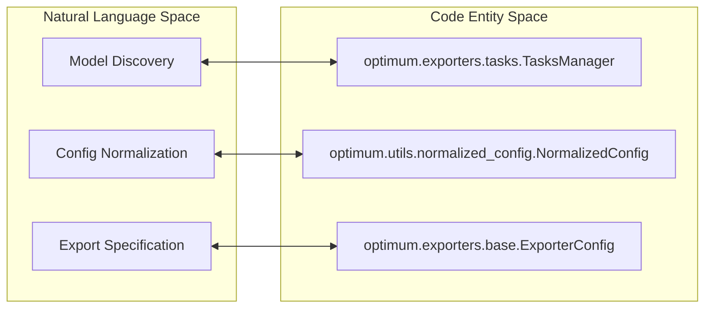

**Diagram: Conceptual to Code Mapping for Discovery and Configuration**

Sources: [optimum/exporters/tasks.py:118](), [optimum/utils/normalized_config.py:25](), [optimum/exporters/base.py:77]()

### Diagram: Conceptual to Code Mapping for Inputs and Decomposition

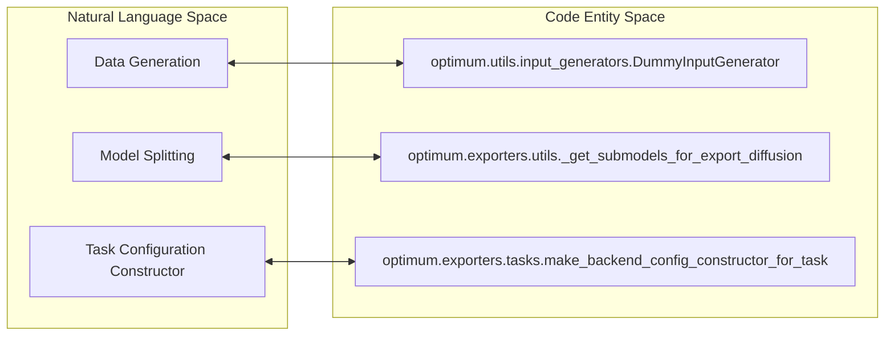

**Diagram: Conceptual to Code Mapping for Inputs and Decomposition**

Sources: [optimum/exporters/utils.py:88](), [optimum/exporters/tasks.py:52]()

---

# Page: TasksManager Core

# TasksManager Core

<details>
<summary>Relevant source files</summary>

The following files were used as context for generating this wiki page:

- [docs/source/exporters/task_manager.mdx](docs/source/exporters/task_manager.mdx)
- [optimum/exporters/tasks.py](optimum/exporters/tasks.py)
- [optimum/utils/normalized_config.py](optimum/utils/normalized_config.py)
- [tests/exporters/common/test_tasks_manager.py](tests/exporters/common/test_tasks_manager.py)

</details>


## Purpose and Scope

The `TasksManager` class ([optimum/exporters/tasks.py:118-1313]()) is the central registry system in Optimum that manages the relationships between model types, tasks, and export configurations. It serves three primary functions:

1. **Registry Management**: Maintains mappings between model architectures, tasks they support, and backend-specific export configurations.
2. **Automatic Inference**: Determines the task and library for a given model from various sources (HuggingFace Hub, local files, model instances).
3. **Model and Config Construction**: Loads models and constructs appropriate export configurations for different backends.

For information about the ExporterConfig classes that TasksManager constructs, see [ExporterConfig Framework](#2.3). For details on the NormalizedConfig system used alongside TasksManager, see [NormalizedConfig System](#2.2).

Sources: [optimum/exporters/tasks.py:1-1313]()

---

## Registry Architecture

### Core Registries

TasksManager maintains multiple class-level registry dictionaries that map between tasks, model types, and backend-specific configurations:

**Library and Task Registry Structure**
```mermaid
graph TB
    subgraph "Library-Level Registries"
        TM["TasksManager Class"]
        TTML["_TRANSFORMERS_TASKS_TO_MODEL_LOADERS<br/>{task -> AutoModel class name}"]
        DTML["_DIFFUSERS_TASKS_TO_MODEL_LOADERS<br/>{task -> AutoPipeline class name}"]
        STML["_SENTENCE_TRANSFORMERS_TASKS_TO_MODEL_LOADERS<br/>{task -> SentenceTransformer}"]
        TIMMML["_TIMM_TASKS_TO_MODEL_LOADERS<br/>{task -> create_model}"]
        LibMap["_LIBRARY_TO_TASKS_TO_MODEL_LOADER_MAP<br/>{library -> tasks_to_loaders}"]
    end
    
    subgraph "Model Type Registries"
        TTMM["_TRANSFORMERS_TASKS_TO_MODEL_MAPPINGS<br/>{task -> {model_type -> model_class}}"]
        DTMM["_DIFFUSERS_TASKS_TO_MODEL_MAPPINGS<br/>{task -> {model_type -> model_class}}"]
        SMT["_SUPPORTED_MODEL_TYPE<br/>{model_type -> {backend -> {task -> ExportConfig}}}"]
        DSMT["_DIFFUSERS_SUPPORTED_MODEL_TYPE"]
        TSMT["_TIMM_SUPPORTED_MODEL_TYPE"]
        SSMT["_SENTENCE_TRANSFORMERS_SUPPORTED_MODEL_TYPE"]
        LibTypes["_LIBRARY_TO_SUPPORTED_MODEL_TYPES"]
    end
    
    subgraph "Special Mappings"
        SYN["_SYNONYM_TASK_MAP<br/>{synonym -> canonical_task}"]
        CUSTOM["_CUSTOM_CLASSES<br/>{(framework, model_type, task) -> (library, class_name)}"]
        ENCODER["_ENCODER_DECODER_TASKS<br/>tuple of encoder-decoder tasks"]
    end
    
    TM --> TTML
    TM --> DTML
    TM --> STML
    TM --> TIMMML
    TM --> LibMap
    
    TM --> TTMM
    TM --> DTMM
    TM --> SMT
    TM --> DSMT
    TM --> TSMT
    TM --> SSMT
    TM --> LibTypes
    
    TM --> SYN
    TM --> CUSTOM
    TM --> ENCODER
    
    LibMap --> TTML
    LibMap --> DTML
    LibMap --> STML
    LibMap --> TIMMML
    
    LibTypes --> SMT
    LibTypes --> DSMT
    LibTypes --> TSMT
    LibTypes --> SSMT
```
Sources: [optimum/exporters/tasks.py:123-286]()

**Registry Types:**

| Registry | Purpose | Example Entry |
|----------|---------|---------------|
| `_TRANSFORMERS_TASKS_TO_MODEL_LOADERS` | Maps task to AutoModel class name | `"text-generation": "AutoModelForCausalLM"` |
| `_SUPPORTED_MODEL_TYPE` | Maps model type to backend configs | `"bert": {"onnx": {"text-classification": BertOnnxConfig}}` |
| `_SYNONYM_TASK_MAP` | Normalizes task name variants | `"causal-lm": "text-generation"` |
| `_CUSTOM_CLASSES` | Special model-task combinations | `("pt", "pix2struct", "image-to-text"): ("transformers", "Pix2StructForConditionalGeneration")` |

Sources: [optimum/exporters/tasks.py:123-286]()

### Task-to-Model Loader Mappings

The `_TRANSFORMERS_TASKS_TO_MODEL_LOADERS` dictionary ([optimum/exporters/tasks.py:139-173]()) defines which AutoModel class handles each task:

```python
_TRANSFORMERS_TASKS_TO_MODEL_LOADERS = {
    "text-generation": "AutoModelForCausalLM",
    "text2text-generation": "AutoModelForSeq2SeqLM",
    "automatic-speech-recognition": ("AutoModelForSpeechSeq2Seq", "AutoModelForCTC"),
    # ... more mappings
}
```

Note that some tasks map to tuples of AutoModel classes ([optimum/exporters/tasks.py:143]()). For example, `"automatic-speech-recognition"` can use either `AutoModelForSpeechSeq2Seq` or `AutoModelForCTC`, allowing the system to handle different ASR architectures.

Sources: [optimum/exporters/tasks.py:139-195]()

### Model Type Registration System

The `_SUPPORTED_MODEL_TYPE` registry ([optimum/exporters/tasks.py:256]()) follows a nested structure:
`{model_type: {backend: {task: ExportConfigConstructor}}}`.

Backends register support for specific model types and tasks using the `create_register` method ([optimum/exporters/tasks.py:287-340]()):

**Model Registration Flow**
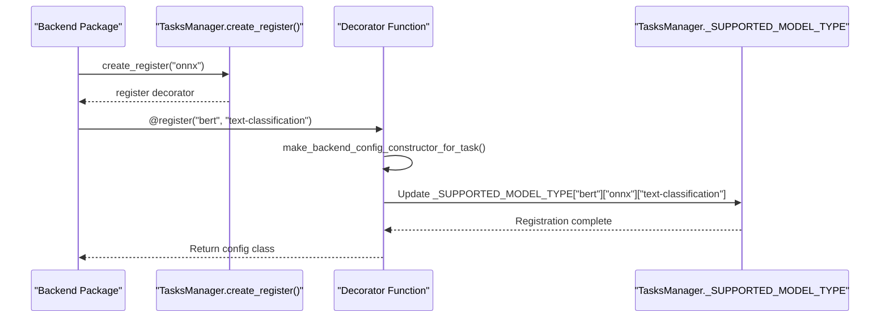
Sources: [optimum/exporters/tasks.py:287-340](), [optimum/exporters/tasks.py:52-59](), [tests/exporters/common/test_tasks_manager.py:79-112]()

---

## Task Inference System

### Inference Flow

TasksManager provides the `infer_task_from_model()` method ([optimum/exporters/tasks.py:797-851]()) that automatically determines a model's task from multiple sources:

**Task Inference Logic**
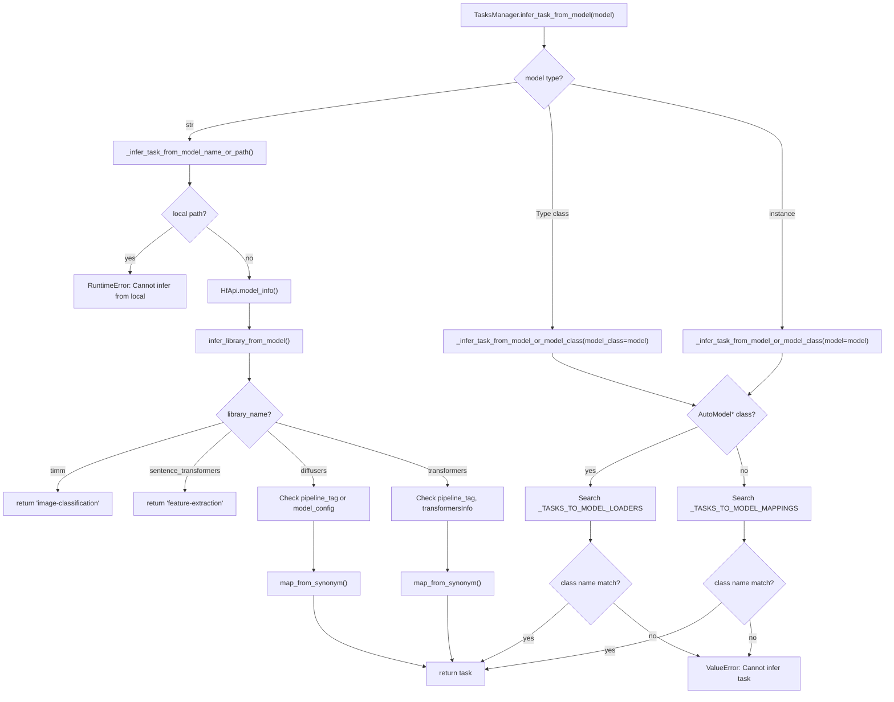
Sources: [optimum/exporters/tasks.py:797-851](), [optimum/exporters/tasks.py:709-795](), [optimum/exporters/tasks.py:661-707]()

### From Model Name or Path

For string inputs, `_infer_task_from_model_name_or_path()` ([optimum/exporters/tasks.py:709-795]()) queries the HuggingFace Hub API:

**For Transformers models:**
1. Check `model_info.pipeline_tag` ([optimum/exporters/tasks.py:770-773]())
2. Check `model_info.transformersInfo["pipeline_tag"]` ([optimum/exporters/tasks.py:777-779]())
3. Check `model_info.transformersInfo["auto_model"]` and match against `_TRANSFORMERS_TASKS_TO_MODEL_LOADERS` ([optimum/exporters/tasks.py:780-790]())

**For Diffusers models:**
1. Check `model_info.pipeline_tag` ([optimum/exporters/tasks.py:753-756]())
2. Parse `model_config["diffusers"]["_class_name"]` and match against `_DIFFUSERS_TASKS_TO_MODEL_MAPPINGS` ([optimum/exporters/tasks.py:757-766]())

Sources: [optimum/exporters/tasks.py:709-795]()

### From Model Instance or Class

For model instances or classes, `_infer_task_from_model_or_model_class()` ([optimum/exporters/tasks.py:661-707]()) uses two strategies:

**Strategy 1: Match AutoModel class name** ([optimum/exporters/tasks.py:675-689]())
```python
if target_class_name.startswith("AutoModel"):
    for task_name, model_loaders in _TRANSFORMERS_TASKS_TO_MODEL_LOADERS.items():
        # ... check if class name matches any loader
```

**Strategy 2: Match against model mappings** ([optimum/exporters/tasks.py:691-703]())
```python
if target_class_module.startswith("transformers"):
    for task_name, model_mapping in _TRANSFORMERS_TASKS_TO_MODEL_MAPPINGS.items():
        # ... check if class name matches any model in mapping
```

Sources: [optimum/exporters/tasks.py:661-707]()

### Task Synonym Normalization

The `map_from_synonym()` method ([optimum/exporters/tasks.py:428-432]()) normalizes task name variations:

| Synonym | Canonical Task |
|---------|----------------|
| `"causal-lm"` | `"text-generation"` |
| `"seq2seq-lm"` | `"text2text-generation"` |
| `"sentence-similarity"` | `"feature-extraction"` |
| `"stable-diffusion"` | `"text-to-image"` |

Sources: [optimum/exporters/tasks.py:203-229](), [optimum/exporters/tasks.py:428-432]()

---

## Library Inference System

### Library Detection Flow

The `infer_library_from_model()` method ([optimum/exporters/tasks.py:956-1000]()) determines which library (transformers, diffusers, timm, sentence_transformers) a model belongs to:

**Library Identification Flow**
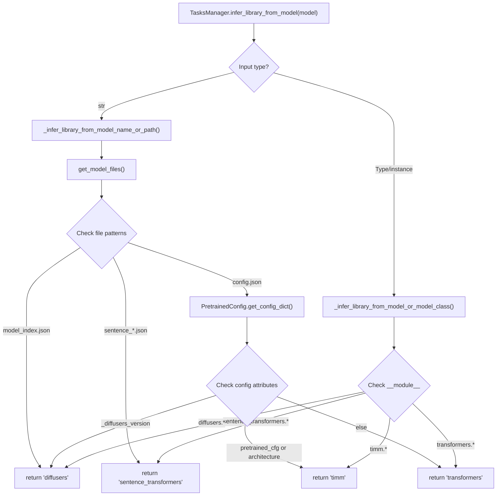
Sources: [optimum/exporters/tasks.py:956-1000](), [optimum/exporters/tasks.py:883-954](), [optimum/exporters/tasks.py:853-881]()

### File-Based Detection

The `_infer_library_from_model_name_or_path()` method ([optimum/exporters/tasks.py:883-954]()) examines repository files:

| File Pattern | Inferred Library | Line Reference |
|--------------|------------------|----------------|
| `model_index.json` | `diffusers` | [optimum/exporters/tasks.py:924-925]() |
| `sentence_*.json` or `config_sentence_transformers.json` | `sentence_transformers` | [optimum/exporters/tasks.py:926-930]() |
| `config.json` with `pretrained_cfg` attribute | `timm` | [optimum/exporters/tasks.py:942-943]() |
| `config.json` with `_diffusers_version` attribute | `diffusers` | [optimum/exporters/tasks.py:944-945]() |
| `config.json` (default) | `transformers` | [optimum/exporters/tasks.py:947-947]() |

Sources: [optimum/exporters/tasks.py:883-954]()

---

## Model Loading and Construction

### get_model_from_task Method

The `get_model_from_task()` static method ([optimum/exporters/tasks.py:1073-1224]()) is the primary entry point for loading models:

**Model Loading Pipeline**
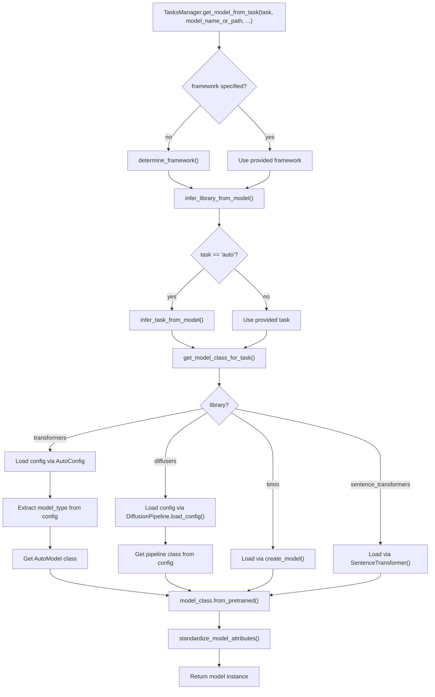
Sources: [optimum/exporters/tasks.py:1073-1224]()

**Key Parameters:**

| Parameter | Purpose | Line Reference |
|-----------|---------|----------------|
| `task` | Task to load model for (or `"auto"` to infer) | [optimum/exporters/tasks.py:1091-1091]() |
| `model_name_or_path` | HF Hub ID or local path | [optimum/exporters/tasks.py:1076-1076]() |
| `framework` | `"pt"` (only supported) | [optimum/exporters/tasks.py:1081-1081]() |
| `library_name` | Library to use (or auto-detect) | [optimum/exporters/tasks.py:1084-1084]() |
| `torch_dtype` | Model precision | [optimum/exporters/tasks.py:1082-1082]() |
| `device` | Device to load on | [optimum/exporters/tasks.py:1083-1083]() |

Sources: [optimum/exporters/tasks.py:1073-1224]()

### Model Class Resolution

The `get_model_class_for_task()` method ([optimum/exporters/tasks.py:445-528]()) resolves which class to instantiate:

**Custom Classes Override** ([optimum/exporters/tasks.py:479-483]())
```python
if (framework, model_type, task) in TasksManager._CUSTOM_CLASSES:
    library, class_name = TasksManager._CUSTOM_CLASSES[(framework, model_type, task)]
    loaded_library = importlib.import_module(library)
    return getattr(loaded_library, class_name)
```

**Standard Auto Classes** ([optimum/exporters/tasks.py:485-528]())
- For transformers: Use `_TRANSFORMERS_TASKS_TO_MODEL_LOADERS`.
- Handle multiple loaders by checking model type against `_model_mapping` ([optimum/exporters/tasks.py:512-516]()).

Sources: [optimum/exporters/tasks.py:445-528](), [optimum/exporters/tasks.py:231-241]()

### Model Standardization

After loading, `standardize_model_attributes()` ([optimum/exporters/tasks.py:1002-1052]()) normalizes model attributes across libraries:

**For Diffusers models** ([optimum/exporters/tasks.py:1021-1033]())
- Infers `model_type` from class name by searching `_DIFFUSERS_TASKS_TO_MODEL_MAPPINGS`.
- Sets `model.config.export_model_type` to enable uniform access.

**For Timm models** ([optimum/exporters/tasks.py:1035-1039]())
- Creates `model.config` from `model.pretrained_cfg`.
- Sets `model.config.export_model_type = model.pretrained_cfg["architecture"]`.

**For Sentence Transformers** ([optimum/exporters/tasks.py:1041-1051]())
- Extracts underlying transformer or CLIP model config.
- Sets `model.config.export_model_type` appropriately.

Sources: [optimum/exporters/tasks.py:1002-1052]()

---

## Export Configuration Construction

### get_exporter_config_constructor Method

The `get_exporter_config_constructor()` method ([optimum/exporters/tasks.py:1226-1312]()) creates the appropriate `ExportConfigConstructor` for a model and backend:

**Exporter Configuration Selection**
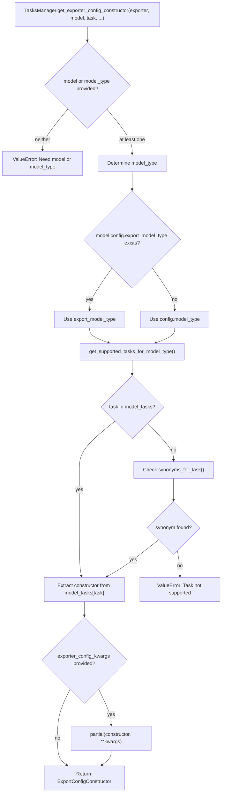
Sources: [optimum/exporters/tasks.py:1226-1312](), [optimum/exporters/tasks.py:49-49]()

The method returns an `ExportConfigConstructor` ([optimum/exporters/tasks.py:49-49]()), which is a callable that takes a `PretrainedConfig` and returns an `ExporterConfig` instance.

Sources: [optimum/exporters/tasks.py:1226-1312](), [optimum/exporters/tasks.py:49-49]()

### get_supported_tasks_for_model_type

This method ([optimum/exporters/tasks.py:342-401]()) retrieves the task-to-config mapping for a specific model type and backend:

**Registry Lookup Logic**
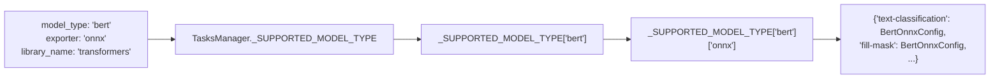
Sources: [optimum/exporters/tasks.py:342-401](), [optimum/exporters/tasks.py:252-254]()

**Error Cases:**
- Model type not in registry → raises `KeyError` with supported types ([optimum/exporters/tasks.py:389-393]()).
- Backend not supported for model type → raises `KeyError` with supported backends ([optimum/exporters/tasks.py:394-399]()).
- Uses default model type if available ([optimum/exporters/tasks.py:381-387]()).

Sources: [optimum/exporters/tasks.py:342-401](), [optimum/exporters/tasks.py:252-254]()

### Configuration Constructor Creation

The `make_backend_config_constructor_for_task()` function ([optimum/exporters/tasks.py:52-59]()) wraps config classes:

```python
def make_backend_config_constructor_for_task(config_cls: Type, task: str) -> ExportConfigConstructor:
    if "-with-past" in task:
        if not getattr(config_cls, "SUPPORTS_PAST", False):
            raise ValueError(f"{config_cls} does not support tasks with past.")
        constructor = partial(config_cls, use_past=True, task=task.replace("-with-past", ""))
    else:
        constructor = partial(config_cls, task=task)
    return constructor
```

This handles the special case of KV cache support for generative models (tasks ending in `"-with-past"`).

Sources: [optimum/exporters/tasks.py:52-59]()

---

## Helper Utilities

### Framework Detection

The `determine_framework()` method ([optimum/exporters/tasks.py:579-659]()) inspects model files to determine if it's PyTorch:

**Detection Logic:**
1. List all files via `get_model_files()` ([optimum/exporters/tasks.py:531-577]()).
2. Check for PyTorch weight files ([optimum/exporters/tasks.py:620-628]()):
   - `pytorch_model.bin` or `pytorch_model-*.bin`
   - `model.safetensors` or `model-*.safetensors`
3. For diffusers, check for `model_index.json` + weight files ([optimum/exporters/tasks.py:632-636]()).
4. For sentence transformers, check for `config_sentence_transformers.json` ([optimum/exporters/tasks.py:637-639]()).

Sources: [optimum/exporters/tasks.py:579-659](), [optimum/exporters/tasks.py:531-577]()

### Task Retrieval

| Method | Purpose | Line Reference |
|--------|---------|----------------|
| `get_all_tasks()` | Returns list of all supported tasks across all libraries | [optimum/exporters/tasks.py:1053-1071]() |
| `synonyms_for_task()` | Returns all synonym variations of a task | [optimum/exporters/tasks.py:417-426]() |
| `map_from_synonym()` | Normalizes synonym to canonical task name | [optimum/exporters/tasks.py:428-432]() |
| `get_supported_model_type_for_task()` | Returns model types supporting a task (transformers-specific) | [optimum/exporters/tasks.py:403-415]() |

Sources: [optimum/exporters/tasks.py:403-432](), [optimum/exporters/tasks.py:1053-1071]()

---

## Integration with Export Pipeline

The TasksManager serves as the orchestrator in the export pipeline:

**Export Orchestration Sequence**
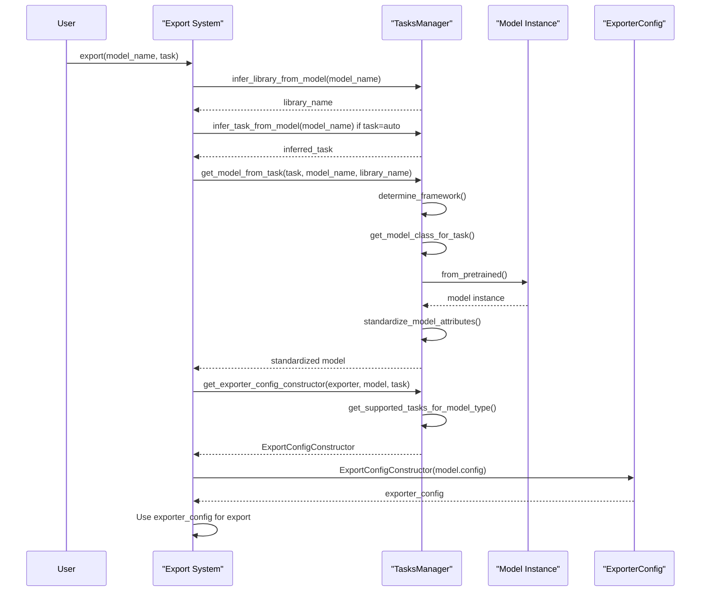
Sources: [optimum/exporters/tasks.py:118-1313]()

---

## Special Model Types

### Encoder-Decoder Models

The `_ENCODER_DECODER_TASKS` tuple ([optimum/exporters/tasks.py:243-250]()) identifies tasks requiring encoder-decoder decomposition:

```python
_ENCODER_DECODER_TASKS = (
    "automatic-speech-recognition",
    "document-question-answering",
    "feature-extraction-with-past",
    "image-to-text",
    "text2text-generation",
    "visual-question-answering",
)
```

These tasks require special handling in the export process (see [Model Decomposition and Export Process](#2.5)).

Sources: [optimum/exporters/tasks.py:243-250]()

### Custom Model Classes

The `_CUSTOM_CLASSES` dictionary ([optimum/exporters/tasks.py:231-241]()) maps specific `(framework, model_type, task)` tuples to custom class implementations:

```python
_CUSTOM_CLASSES = {
    ("pt", "pix2struct", "image-to-text"): ("transformers", "Pix2StructForConditionalGeneration"),
    ("pt", "vision-encoder-decoder", "document-question-answering"): ("transformers", "VisionEncoderDecoderModel"),
    # ... more custom mappings
}
```

These override the standard AutoModel loading for special cases where the auto classes don't include certain architectures.

Sources: [optimum/exporters/tasks.py:231-241]()

---

## CLI and Model Type Support

### Supported Model Types

The `_SUPPORTED_CLI_MODEL_TYPE` set ([optimum/exporters/tasks.py:280-285]()) defines which model types can be exported via CLI:

```python
_SUPPORTED_CLI_MODEL_TYPE = (
    set(_SUPPORTED_MODEL_TYPE.keys())
    | set(_DIFFUSERS_SUPPORTED_MODEL_TYPE.keys())
    | set(_TIMM_SUPPORTED_MODEL_TYPE.keys())
    | set(_SENTENCE_TRANSFORMERS_SUPPORTED_MODEL_TYPE.keys())
) - _UNSUPPORTED_CLI_MODEL_TYPE
```

The `_UNSUPPORTED_CLI_MODEL_TYPE` set ([optimum/exporters/tasks.py:267-279]()) excludes diffusers subcomponents (e.g., `"unet-2d-condition"`, `"vae-decoder"`) that shouldn't be exported directly.

Sources: [optimum/exporters/tasks.py:267-285]()

---

# Page: NormalizedConfig System

# NormalizedConfig System

<details>
<summary>Relevant source files</summary>

The following files were used as context for generating this wiki page:

- [docs/source/utils/dummy_input_generators.mdx](docs/source/utils/dummy_input_generators.mdx)
- [docs/source/utils/normalized_config.mdx](docs/source/utils/normalized_config.mdx)
- [optimum/exporters/tasks.py](optimum/exporters/tasks.py)
- [optimum/utils/normalized_config.py](optimum/utils/normalized_config.py)

</details>


## Purpose and Scope

The `NormalizedConfig` system provides unified access to model configuration attributes across different architectures in the Optimum library. Different model architectures use varying naming conventions for similar concepts (e.g., `n_head` vs `num_attention_heads` for the number of attention heads). This system normalizes these differences, enabling export and optimization code to work consistently across all supported models without architecture-specific branching.

This document covers the configuration normalization layer implemented in `optimum/utils/normalized_config.py`. For information about how the export system uses these normalized configs, see [ExporterConfig Framework](#2.3). For the registry that manages model types and their configurations, see [TasksManager Core](#2.1).

## System Architecture

The `NormalizedConfig` system consists of three main components: configuration sources, the normalization class hierarchy, and the `NormalizedConfigManager` registry.

Diagram: NormalizedConfig System Architecture
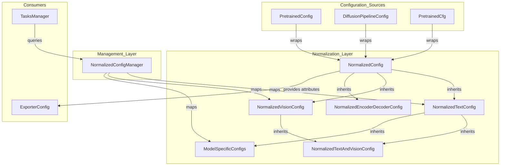

Sources: [optimum/utils/normalized_config.py:1-332](), [optimum/exporters/tasks.py:118-134]()

## Core Components

### NormalizedConfig Base Class

The `NormalizedConfig` class is the foundation of the normalization system. It wraps a `PretrainedConfig` object and provides attribute access translation through Python's `__getattr__` mechanism.

Diagram: Attribute Resolution Data Flow
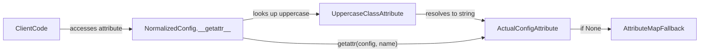

**Key Methods and Attributes**:

| Method/Attribute | Purpose |
|-----------------|---------|
| `__init__(config, allow_new, **kwargs)` | Wraps a config object and optionally sets custom normalized attributes [optimum/utils/normalized_config.py:34-42]() |
| `__getattr__(attr_name)` | Intercepts attribute access, performs normalization lookup [optimum/utils/normalized_config.py:48-72]() |
| `with_args(**kwargs)` | Class method that returns a partial constructor with preset arguments [optimum/utils/normalized_config.py:44-46]() |
| `has_attribute(attr_name)` | Checks if a normalized attribute exists without raising an exception [optimum/utils/normalized_config.py:74-79]() |

**Attribute Resolution Process**:

1. Convert requested attribute name to uppercase (e.g., `hidden_size` → `HIDDEN_SIZE`) [optimum/utils/normalized_config.py:53]()
2. Look up the class attribute to get the actual config attribute name [optimum/utils/normalized_config.py:53]()
3. Handle dot notation for nested attributes (e.g., `"text_config.hidden_size"`) [optimum/utils/normalized_config.py:57-61]()
4. Attempt to retrieve from the wrapped config [optimum/utils/normalized_config.py:63]()
5. If not found, check `config.attribute_map` as fallback [optimum/utils/normalized_config.py:66-68]()
6. Raise `AttributeError` if attribute cannot be resolved [optimum/utils/normalized_config.py:71]()

Sources: [optimum/utils/normalized_config.py:25-80]()

### Normalized Config Hierarchy

The system defines a hierarchy of normalized config classes for different model categories:

- **`NormalizedTextConfig`**: Defines standard text attributes (`VOCAB_SIZE`, `HIDDEN_SIZE`, `NUM_LAYERS`, `NUM_ATTENTION_HEADS`, `EOS_TOKEN_ID`) [optimum/utils/normalized_config.py:87-93]()
- **`NormalizedTextConfigWithGQA`**: Extends text config with `NUM_KEY_VALUE_HEADS` [optimum/utils/normalized_config.py:95-97]()
- **`NormalizedVisionConfig`**: Defines vision attributes (`IMAGE_SIZE`, `NUM_CHANNELS`, `INPUT_SIZE`) [optimum/utils/normalized_config.py:106-110]()
- **`NormalizedSeq2SeqConfig`**: Maps encoder and decoder specific layer and attention head counts [optimum/utils/normalized_config.py:99-104]()
- **`NormalizedTextAndVisionConfig`**: Routes attribute access to either text or vision config based on the attribute type [optimum/utils/normalized_config.py:125-135]()
- **`NormalizedEncoderDecoderConfig`**: Delegates to encoder or decoder normalized config classes [optimum/utils/normalized_config.py:142-157]()
- **`NormalizedSegformerConfig`**: Returns `0` for list-valued attributes to allow optimizer inference [optimum/utils/normalized_config.py:112-123]()
- **`NormalizedTimeSeriesForecastingConfig`**: Defines time-series attributes (`NUM_INPUT_CHANNELS`, `CONTEXT_LENGTH`) [optimum/utils/normalized_config.py:82-85]()

Sources: [optimum/utils/normalized_config.py:82-157]()

### Model-Specific Configuration Factories

The system supports model-specific attribute mappings using the `with_args()` factory pattern [optimum/utils/normalized_config.py:44-46]().

**Common Model-Specific Configs**:

| Config Name | Used By | Attribute Mappings |
|-------------|---------|-------------------|
| `BartLikeNormalizedTextConfig` | BART, Pegasus, Marian, M-BART | `num_attention_heads` → `encoder_attention_heads`, `hidden_size` → `d_model` [optimum/utils/normalized_config.py:160-163]() |
| `GPT2LikeNormalizedTextConfig` | GPT-2, GPT-J, CodeGen, ImageGPT | `num_attention_heads` → `n_head`, `hidden_size` → `n_embd` [optimum/utils/normalized_config.py:164-167]() |
| `T5LikeNormalizedTextConfig` | T5, mT5, LongT5 | `num_attention_heads` → `num_heads`, `hidden_size` → `d_model` [optimum/utils/normalized_config.py:168-171]() |
| `MPTNormalizedTextConfig` | MPT | `num_attention_heads` → `n_heads`, `hidden_size` → `d_model`, `num_layers` → `n_layers` [optimum/utils/normalized_config.py:172-176]() |
| `WhisperLikeNormalizedTextConfig` | Whisper | `hidden_size` → `d_model` [optimum/utils/normalized_config.py:182-184]() |

Sources: [optimum/utils/normalized_config.py:160-207]()

## NormalizedConfigManager

The `NormalizedConfigManager` class maintains the registry mapping model types to their appropriate normalized config classes [optimum/utils/normalized_config.py:209-332]().

**API Methods**:

| Method | Purpose | Returns |
|--------|---------|---------|
| `check_supported_model(model_type: str)` | Validates that a model type has a normalized config [optimum/utils/normalized_config.py:321-324]() | Raises `KeyError` if unsupported |
| `get_normalized_config_class(model_type: str)` | Retrieves the normalized config class for a model type [optimum/utils/normalized_config.py:326-332]() | `Type[NormalizedConfig]` |

Sources: [optimum/utils/normalized_config.py:209-332]()

## Integration with Export System

The `NormalizedConfig` system is primarily used by the export pipeline and `TasksManager` to access model configurations uniformly.

Diagram: Integration with TasksManager and ExporterConfig
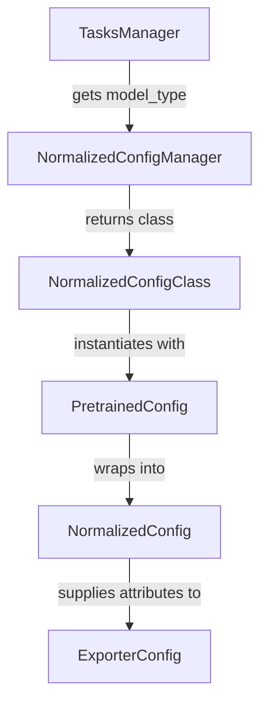

Sources: [optimum/exporters/tasks.py:118-134](), [optimum/utils/normalized_config.py:1-332]()

## Configuration Extension and Customization

The system allows adding custom attributes via the `allow_new=True` parameter in `NormalizedConfig.__init__` [optimum/utils/normalized_config.py:34-42](), enabling specialized configurations without modifying core classes.

Sources: [optimum/utils/normalized_config.py:34-46]()

---

# Page: ExporterConfig Framework

# ExporterConfig Framework

<details>
<summary>Relevant source files</summary>

The following files were used as context for generating this wiki page:

- [optimum/exporters/base.py](optimum/exporters/base.py)
- [optimum/exporters/error_utils.py](optimum/exporters/error_utils.py)

</details>


## Purpose and Scope

The ExporterConfig Framework defines the metadata and behavior required to export models to different backend formats. Each `ExporterConfig` subclass specifies how a particular model type should be exported, including input/output tensor specifications, dummy input generation strategies, and validation parameters.

For information about the TasksManager that uses ExporterConfig to coordinate exports, see [TasksManager Core](#2.1). For details on the NormalizedConfig system that ExporterConfig depends on, see [NormalizedConfig System](#2.2). For the dummy input generation that ExporterConfig orchestrates, see [Dummy Input Generation](#2.4).

Sources: [optimum/exporters/base.py:77-106]()

## ExporterConfig Base Class

The abstract `ExporterConfig` class serves as the contract that all backend-specific export configurations must implement. It is defined in [optimum/exporters/base.py:77-241]().

```mermaid
graph TB
    subgraph "Abstract Base"
        EC["ExporterConfig<br/>(ABC)"]
    end
    
    subgraph "Required Attributes"
        NORM["NORMALIZED_CONFIG_CLASS"]
        DUMMY["DUMMY_INPUT_GENERATOR_CLASSES"]
        ATOL["ATOL_FOR_VALIDATION"]
    end
    
    subgraph "Version Requirements"
        TORCH_VER["MIN_TORCH_VERSION"]
        TRANS_VER["MIN_TRANSFORMERS_VERSION"]
    end
    
    subgraph "Abstract Methods"
        INPUTS["inputs<br/>@property @abstractmethod"]
    end
    
    subgraph "Concrete Methods"
        OUTPUTS["outputs<br/>@property"]
        GEN_DUMMY["generate_dummy_inputs()"]
        VAL_OVERRIDE["values_override<br/>@property"]
    end
    
    EC --> NORM
    EC --> DUMMY
    EC --> ATOL
    EC --> TORCH_VER
    EC --> TRANS_VER
    EC --> INPUTS
    EC --> OUTPUTS
    EC --> GEN_DUMMY
    EC --> VAL_OVERRIDE
```

**Diagram: ExporterConfig Structure**

The base class is initialized with:

| Parameter | Type | Description |
|-----------|------|-------------|
| `config` | `PretrainedConfig` | The model's Transformers configuration |
| `task` | `str` | The task name (e.g., "text-generation", "feature-extraction") |
| `int_dtype` | `str` | Integer tensor dtype: "int64", "int32", or "int8" |
| `float_dtype` | `str` | Float tensor dtype: "fp32", "fp16", or "bf16" |

Sources: [optimum/exporters/base.py:77-153]()

## Required Class Attributes

Each `ExporterConfig` subclass must define several class attributes that control the export process:

### NORMALIZED_CONFIG_CLASS

A reference to a `NormalizedConfig` subclass that provides unified access to model configuration attributes. This allows the exporter to access properties like `num_attention_heads` or `hidden_size` regardless of how the source model names these attributes.

```mermaid
graph LR
    EC["ExporterConfig subclass"]
    NC["NORMALIZED_CONFIG_CLASS"]
    NCI["NormalizedConfig instance"]
    
    EC -->|"class attribute"| NC
    EC -->|"_normalized_config<br/>instantiated in __init__"| NCI
    NC -.->|"type reference"| NCI
```

**Diagram: NormalizedConfig Integration**

Sources: [optimum/exporters/base.py:108](), [optimum/exporters/base.py:151]()

### DUMMY_INPUT_GENERATOR_CLASSES

A tuple of `DummyInputGenerator` subclasses that know how to create representative inputs for the model. The framework instantiates these generators and uses them to populate the input dictionary.

```mermaid
graph TB
    DIGC["DUMMY_INPUT_GENERATOR_CLASSES<br/>(tuple of types)"]
    DIG1["DummyTextInputGenerator"]
    DIG2["DummyVisionInputGenerator"]
    DIG3["DummyPastKeyValuesGenerator"]
    
    CREATE["_create_dummy_input_generator_classes()"]
    INSTANCES["List of generator instances"]
    
    DIGC --> DIG1
    DIGC --> DIG2
    DIGC --> DIG3
    
    DIGC --> CREATE
    CREATE --> INSTANCES
```

**Diagram: Dummy Input Generator Classes**

Sources: [optimum/exporters/base.py:109](), [optimum/exporters/base.py:155-162]()

### ATOL_FOR_VALIDATION

The absolute tolerance for output validation during export. Can be a float (applies to all tasks) or a dictionary mapping task names to specific tolerance values. If validation fails to meet this threshold, an `AtolError` may be raised by the exporter utilities.

Sources: [optimum/exporters/base.py:110](), [optimum/exporters/error_utils.py:22-23]()

### MIN_TORCH_VERSION and MIN_TRANSFORMERS_VERSION

Version constraints that must be satisfied for the export to proceed. The base class provides `is_torch_support_available` and `is_transformers_support_available` properties that check these versions. If requirements are not met, a `MinimumVersionError` is raised.

Sources: [optimum/exporters/base.py:111-112](), [optimum/exporters/base.py:200-221](), [optimum/exporters/error_utils.py:38-39]()

## Abstract Property: inputs

The most critical method each subclass must implement is the `inputs` property, which defines the input tensor axis specifications:

```python
@property
@abstractmethod
def inputs(self) -> Dict[str, Dict[int, str]]:
    """
    Returns: A mapping of input names to axis definitions.
    Example: {
        "input_ids": {0: "batch", 1: "sequence"},
        "attention_mask": {0: "batch", 1: "sequence"}
    }
    """
```

This specification is used by backend exporters to:
- Understand the shape semantics of each input
- Configure dynamic axes for formats like ONNX
- Generate appropriate dummy inputs

Sources: [optimum/exporters/base.py:164-173]()

## Concrete Methods and Properties

### outputs Property

Returns the expected output tensor names for the given task. The base implementation uses `_TASK_TO_COMMON_OUTPUTS` mapping:

| Task | Common Outputs |
|------|----------------|
| text-generation | ["logits"] |
| feature-extraction | ["last_hidden_state"] |
| question-answering | ["start_logits", "end_logits"] |
| object-detection | ["logits", "pred_boxes"] |

Sources: [optimum/exporters/base.py:176-184](), [optimum/exporters/base.py:113-140]()

### values_override Property

Provides configuration overrides to apply before export. The default implementation disables `use_cache` if the model config has this attribute, which is necessary for certain export formats:

```python
@property
def values_override(self) -> Optional[Dict[str, Any]]:
    if hasattr(self._config, "use_cache"):
        return {"use_cache": False}
    return None
```

Sources: [optimum/exporters/base.py:187-197]()

### generate_dummy_inputs Method

The method that orchestrates dummy input generation:

```mermaid
sequenceDiagram
    participant Caller
    participant EC as ExporterConfig
    participant Create as _create_dummy_input_generator_classes
    participant Gens as DummyInputGenerator instances
    
    Caller->>EC: generate_dummy_inputs(framework="pt", **kwargs)
    EC->>Create: _create_dummy_input_generator_classes(**kwargs)
    Create->>Gens: Instantiate each DUMMY_INPUT_GENERATOR_CLASSES
    Gens-->>EC: List of generators
    
    loop For each input name in self.inputs
        EC->>Gens: Find generator that supports_input(input_name)
        Gens->>EC: generate(input_name, framework, int_dtype, float_dtype)
    end
    
    EC-->>Caller: Dict of dummy inputs
```

**Diagram: Dummy Input Generation Flow**

The method iterates through all input names defined in `self.inputs`, finds an appropriate generator from the instantiated list, and generates a dummy tensor for each input.

Sources: [optimum/exporters/base.py:223-241]()

## Integration with TasksManager

The `TasksManager` class uses a registration system to map model types and tasks to `ExporterConfig` constructors. The relationship is:

```mermaid
graph TB
    TM["TasksManager"]
    REG["create_register()"]
    DECORATOR["@register_for_backend decorator"]
    
    SUPPORTED["_SUPPORTED_MODEL_TYPE<br/>{model_type: {backend: {task: constructor}}}"]
    
    GET_SUPP["get_supported_tasks_for_model_type()"]
    GET_CONST["get_exporter_config_constructor()"]
    
    MAKE_CONST["make_backend_config_constructor_for_task()"]
    PARTIAL["partial(config_cls, task=task)"]
    
    TM --> REG
    REG --> DECORATOR
    DECORATOR -->|"populates"| SUPPORTED
    
    TM --> GET_SUPP
    TM --> GET_CONST
    
    GET_SUPP --> SUPPORTED
    GET_CONST --> SUPPORTED
    GET_CONST --> MAKE_CONST
    MAKE_CONST --> PARTIAL
    PARTIAL -->|"returns"| CONST["ExportConfigConstructor<br/>(Callable)"]
```

**Diagram: TasksManager Integration**

Sources: [optimum/exporters/tasks.py:288-340](), [optimum/exporters/tasks.py:52-59](), [optimum/exporters/tasks.py:1227-1312]()

## ExportConfigConstructor Type

The `ExportConfigConstructor` is a callable type that constructs an `ExporterConfig` instance from a `PretrainedConfig`:

```python
ExportConfigConstructor = Callable[["PretrainedConfig"], "ExporterConfig"]
```

When a task includes "-with-past" suffix, the constructor is wrapped with `use_past=True`:

```mermaid
graph LR
    TASK["task string"]
    CHECK{"contains<br/>'-with-past'?"}
    
    PARTIAL1["partial(config_cls,<br/>use_past=True,<br/>task=task.replace('-with-past', ''))"]
    PARTIAL2["partial(config_cls,<br/>task=task)"]
    
    CONSTRUCTOR["ExportConfigConstructor"]
    
    TASK --> CHECK
    CHECK -->|"yes"| PARTIAL1
    CHECK -->|"no"| PARTIAL2
    PARTIAL1 --> CONSTRUCTOR
    PARTIAL2 --> CONSTRUCTOR
```

**Diagram: Constructor Creation with Past Key Values Support**

Sources: [optimum/exporters/tasks.py:49](), [optimum/exporters/tasks.py:52-59]()

## Registration Pattern

Backend implementations register their `ExporterConfig` subclasses using the pattern:

```python
# Example registration (pseudo-code from backend implementations)
register_for_backend = TasksManager.create_register("onnx")

@register_for_backend("bert", "feature-extraction", "text-classification", "token-classification")
class BertOnnxConfig(ExporterConfig):
    NORMALIZED_CONFIG_CLASS = NormalizedTextConfig
    DUMMY_INPUT_GENERATOR_CLASSES = (DummyTextInputGenerator,)
    
    @property
    def inputs(self):
        return {
            "input_ids": {0: "batch", 1: "sequence"},
            "attention_mask": {0: "batch", 1: "sequence"},
            "token_type_ids": {0: "batch", 1: "sequence"},
        }
```

The `create_register` method returns a decorator factory that:
1. Validates the task names against known tasks
2. Creates a constructor using `make_backend_config_constructor_for_task`
3. Stores the constructor in the appropriate nested dictionary structure

Sources: [optimum/exporters/tasks.py:288-340]()

## Model Type to Configuration Mapping

The `get_exporter_config_constructor` method retrieves the appropriate constructor through this lookup process:

```mermaid
graph TB
    START["get_exporter_config_constructor(exporter, model, task)"]
    
    GET_TYPE["Extract model_type from model.config"]
    GET_NAME["Extract model name"]
    
    GET_TASKS["get_supported_tasks_for_model_type(model_type, exporter)"]
    TASKS_DICT["Dict[task, ExportConfigConstructor]"]
    
    CHECK_TASK{"task in<br/>model_tasks?"}
    CHECK_SYN["Check task synonyms"]
    
    LOOKUP["supported_model_type_for_library[model_type][exporter][task]"]
    WRAP["Optionally wrap with partial(**exporter_config_kwargs)"]
    
    RETURN["Return ExportConfigConstructor"]
    
    START --> GET_TYPE
    GET_TYPE --> GET_NAME
    GET_NAME --> GET_TASKS
    GET_TASKS --> TASKS_DICT
    TASKS_DICT --> CHECK_TASK
    CHECK_TASK -->|"no"| CHECK_SYN
    CHECK_SYN --> CHECK_TASK
    CHECK_TASK -->|"yes"| LOOKUP
    LOOKUP --> WRAP
    WRAP --> RETURN
```

**Diagram: Constructor Retrieval Process**

The method supports:
- Automatic model type extraction from `model.config.export_model_type` or `model.config.model_type`
- Task synonym resolution (e.g., "causal-lm" → "text-generation")
- Default model types for libraries like timm
- Optional constructor parameter injection via `exporter_config_kwargs`

Sources: [optimum/exporters/tasks.py:1227-1312]()

## Library-Specific Registries

The framework maintains separate registries for different libraries:

| Registry Variable | Library | Description |
|-------------------|---------|-------------|
| `_SUPPORTED_MODEL_TYPE` | transformers | Main registry for Transformers models |
| `_DIFFUSERS_SUPPORTED_MODEL_TYPE` | diffusers | Diffusion pipeline models |
| `_TIMM_SUPPORTED_MODEL_TYPE` | timm | TIMM vision models |
| `_SENTENCE_TRANSFORMERS_SUPPORTED_MODEL_TYPE` | sentence_transformers | Sentence embedding models |

These are unified through `_LIBRARY_TO_SUPPORTED_MODEL_TYPES`:

```python
_LIBRARY_TO_SUPPORTED_MODEL_TYPES = {
    "diffusers": _DIFFUSERS_SUPPORTED_MODEL_TYPE,
    "sentence_transformers": _SENTENCE_TRANSFORMERS_SUPPORTED_MODEL_TYPE,
    "timm": _TIMM_SUPPORTED_MODEL_TYPE,
    "transformers": _SUPPORTED_MODEL_TYPE,
}
```

Sources: [optimum/exporters/tasks.py:256-266]()

## Task to Common Outputs Mapping

The `_TASK_TO_COMMON_OUTPUTS` class attribute defines standard output names for each task:

```mermaid
graph LR
    subgraph "Classification Tasks"
        IMG_CLS["image-classification → logits"]
        TXT_CLS["text-classification → logits"]
        AUD_CLS["audio-classification → logits"]
    end
    
    subgraph "Generation Tasks"
        TXT_GEN["text-generation → logits"]
        T2T["text2text-generation → logits"]
        IMG2TXT["image-to-text → logits"]
    end
    
    subgraph "Question Answering"
        QA["question-answering →<br/>start_logits, end_logits"]
        VQA["visual-question-answering → logits"]
    end
    
    subgraph "Detection Tasks"
        OD["object-detection →<br/>logits, pred_boxes"]
        ZSOD["zero-shot-object-detection →<br/>logits, pred_boxes, text_embeds, image_embeds"]
    end
```

**Diagram: Task Output Specifications**

This mapping ensures consistent output naming across different model types performing the same task.

Sources: [optimum/exporters/base.py:113-140]()

## Diffusion and Multi-component Exports

For complex models like Stable Diffusion, the export process involves decomposing the pipeline into submodels (text encoder, UNet/Transformer, VAE). The `_get_submodels_for_export_diffusion` function identifies these components and sets their `export_model_type` config attribute based on the `_DIFFUSERS_CLASS_NAME_TO_SUBMODEL_TYPE` mapping.

```python
_DIFFUSERS_CLASS_NAME_TO_SUBMODEL_TYPE = {
    "CLIPTextModel": "clip-text",
    "CLIPTextModelWithProjection": "clip-text-with-projection",
    "FluxTransformer2DModel": "flux-transformer-2d",
    "SD3Transformer2DModel": "sd3-transformer-2d",
    "UNet2DConditionModel": "unet-2d-condition",
    "T5EncoderModel": "t5-encoder",
}
```

Sources: [optimum/exporters/utils.py:74-81](), [optimum/exporters/utils.py:88-165]()

## Configuration Override Mechanism

The `values_override` property allows temporary modification of model configuration during export. Common use cases include:

1. **Disabling KV Cache**: Setting `use_cache=False` for models that support it, required for static graph export
2. **Forcing Specific Modes**: Some backends require specific attention implementations or operations

Subclasses can override this property to provide backend-specific or model-specific overrides:

```python
@property
def values_override(self) -> Optional[Dict[str, Any]]:
    overrides = super().values_override or {}
    # Add backend-specific overrides
    overrides.update({
        "torchscript": True,
        "use_merged_linear": False,
    })
    return overrides
```

Sources: [optimum/exporters/base.py:187-197]()

## Deprecation Note

The original `ExportConfig` class has been deprecated in favor of `ExporterConfig`. The `__init_subclass__` hook emits a warning when subclasses are created:

```python
class ExportConfig(ABC):
    def __init_subclass__(cls, **kwargs):
        super().__init_subclass__(**kwargs)
        logger.warning(
            "The `ExportConfig` class is deprecated and will be removed in a future version. "
            "Please use `ExporterConfig` instead."
        )
```

Sources: [optimum/exporters/base.py:68-74]()

---

# Page: Dummy Input Generation

# Dummy Input Generation

<details>
<summary>Relevant source files</summary>

The following files were used as context for generating this wiki page:

- [docs/source/utils/dummy_input_generators.mdx](docs/source/utils/dummy_input_generators.mdx)
- [docs/source/utils/normalized_config.mdx](docs/source/utils/normalized_config.mdx)
- [optimum/utils/__init__.py](optimum/utils/__init__.py)
- [optimum/utils/input_generators.py](optimum/utils/input_generators.py)
- [tests/utils/test_dummpy_input_generators.py](tests/utils/test_dummpy_input_generators.py)

</details>


## Purpose and Scope

The Dummy Input Generation system provides a framework for creating representative tensor inputs required for model tracing and export within the Optimum library [optimum/utils/input_generators.py:15](). During model export, execution backends like ONNX Runtime or OpenVINO require concrete input examples to trace the computational graph. The `DummyInputGenerator` hierarchy generates appropriate dummy inputs based on the underlying model configuration, task type, and input modality (text, vision, audio, or multimodal) [optimum/utils/input_generators.py:93-133]().

This page covers the `DummyInputGenerator` class hierarchy and its concrete implementations defined in `optimum.utils.input_generators`. For details on the export pipeline consuming these inputs, see [Model Decomposition and Export Process](#2.5). For model metadata provisioning, see [NormalizedConfig System](#2.2).

Sources: `optimum/utils/input_generators.py:15-133]()`

---

## Architecture Overview

The dummy input generation system is built around an abstract base class pattern where modality-specific and architecture-specific subclasses implement tensor generation strategies for different tensor signatures [optimum/utils/input_generators.py:93-133]().

**Diagram 1: Dummy Input Generator Class Hierarchy (Natural Language to Code Entity Space)**
```mermaid
graph TB
    subgraph "BaseCodeSpace"
        Base["DummyInputGenerator<br/>optimum.utils.input_generators.py:93<br/>supports_input()<br/>generate()"]
    end
    
    subgraph "ModalityCodeSpace"
        Text["DummyTextInputGenerator<br/>optimum.utils.input_generators.py:363<br/>input_ids, attention_mask"]
        Vision["DummyVisionInputGenerator<br/>optimum.utils.input_generators.py:795<br/>pixel_values, pixel_mask"]
        Audio["DummyAudioInputGenerator<br/>optimum.utils.input_generators.py:883<br/>input_features, input_values"]
        Timestep["DummyTimestepInputGenerator<br/>optimum.utils.input_generators.py:926<br/>timestep, text_embeds"]
    end
    
    subgraph "DecoderCodeSpace"
        DecoderText["DummyDecoderTextInputGenerator<br/>optimum.utils.input_generators.py:519<br/>decoder_input_ids"]
        Seq2SeqDecoder["DummySeq2SeqDecoderTextInputGenerator<br/>optimum.utils.input_generators.py:567<br/>encoder_outputs"]
        PastKV["DummyPastKeyValuesGenerator<br/>optimum.utils.input_generators.py:620<br/>past_key_values"]
        Seq2SeqPastKV["DummySeq2SeqPastKeyValuesGenerator<br/>optimum.utils.input_generators.py:667<br/>cross-attention KV"]
    end
    
    subgraph "ModelSpecificCodeSpace"
        GPTBigCode["GPTBigCodeDummyPastKeyValuesGenerator<br/>optimum.utils.input_generators.py:1108"]
        Bloom["BloomDummyPastKeyValuesGenerator<br/>optimum.utils.input_generators.py:1167"]
        Falcon["FalconDummyPastKeyValuesGenerator<br/>optimum.utils.input_generators.py:1275"]
        Mistral["MistralDummyPastKeyValuesGenerator<br/>optimum.utils.input_generators.py:1318"]
        DeepSeekV3["DeepSeekV3DummyPastKeyValuesGenerator<br/>optimum.utils.input_generators.py:1191"]
    end
    
    Base --> Text
    Base --> Vision
    Base --> Audio
    Base --> Timestep
    Base --> DecoderText
    Base --> PastKV
    
    Text --> Seq2SeqDecoder
    DecoderText --> Seq2SeqDecoder
    
    PastKV --> Seq2SeqPastKV
    PastKV --> GPTBigCode
    PastKV --> Bloom
    PastKV --> Falcon
    PastKV --> Mistral
    PastKV --> DeepSeekV3
```

Sources: `optimum/utils/input_generators.py:93-1392]`, `optimum/utils/__init__.py:58-104()`

---

## Base `DummyInputGenerator` Class

### Core Interface

The abstract base class `DummyInputGenerator` defines the primary contract required for all input generators [optimum/utils/input_generators.py:93-133]():

| Method | Purpose | Parameters | Code Reference |
|--------|---------|------------|----------------|
| `supports_input(input_name)` | Check if generator supports an input prefix | `input_name`: Name of input | [optimum/utils/input_generators.py:100-112]() |
| `generate(input_name, framework, int_dtype, float_dtype)` | Abstract method to create dummy tensor | `input_name`, `framework`, `int_dtype`, `float_dtype` | [optimum/utils/input_generators.py:114-133]() |

Subclasses define `SUPPORTED_INPUT_NAMES` tuples, and `supports_input()` performs prefix matching [optimum/utils/input_generators.py:98-112]().

### Framework and Dtype Support

Generators dispatch tensor creation to PyTorch (`pt`) or NumPy (`np`) based on the requested framework [optimum/utils/input_generators.py:134-165]().

**Diagram 2: Framework Dispatch and Dtype Mapping System**
```mermaid
graph LR
    Gen["DummyInputGenerator.generate()<br/>optimum.utils.input_generators.py:114"]
    Check{{"framework parameter"}}
    PT["torch.randint() / torch.randn()<br/>optimum.utils.input_generators.py:157"]
    NP["np.random.randint() / np.random.uniform()<br/>optimum.utils.input_generators.py:162"]
    DM["DTYPE_MAPPER<br/>optimum.utils.input_generators.py:62"]
    
    Gen --> Check
    Check -->|"pt"| PT
    Check -->|"np"| NP
    Gen --> DM
    DM -->|"pt()"| PT
    DM -->|"np()"| NP
```

The `DTYPE_MAPPER` utility class [optimum/utils/input_generators.py:62-91]() maps string specifiers (`"fp32"`, `"fp16"`, `"bf16"`, `"int64"`, etc.) to framework-native data types.

Sources: `optimum/utils/input_generators.py:32-133]()`, `optimum/utils/input_generators.py:134-165()`

---

## Static Tensor Generation Methods

The base class provides several static helper methods to construct standardized random tensors:

- **`random_int_tensor()`**: Generates random integer tensors within `[min_value, max_value)` [optimum/utils/input_generators.py:134-165]().
- **`random_mask_tensor()`**: Creates left- or right-padded binary attention masks [optimum/utils/input_generators.py:166-212]().
- **`random_float_tensor()`**: Generates continuous uniform floating-point tensors [optimum/utils/input_generators.py:213-244]().
- **Utility Methods**: `constant_tensor()` [optimum/utils/input_generators.py:245-274](), `concat_inputs()` [optimum/utils/input_generators.py:292-316](), and `pad_input_on_dim()` [optimum/utils/input_generators.py:317-361]().

Sources: `optimum/utils/input_generators.py:134-361()`

---

## Text Input Generators

### `DummyTextInputGenerator`

`DummyTextInputGenerator` generates encoder-side text inputs (`input_ids`, `attention_mask`, `token_type_ids`, `position_ids`) using dimension attributes extracted from `NormalizedConfig` [optimum/utils/input_generators.py:363-434](). When `task == "multiple-choice"`, it automatically inserts a `num_choices` dimension [optimum/utils/input_generators.py:425-428]().

### Model-Specific Text Variants

- **`LongformerDummyTextInputGenerator`**: Generates `global_attention_mask` tensors initialized to zero [optimum/utils/input_generators.py:436-465]().
- **`DummyXPathSeqInputGenerator`**: Constructs 3D XPath sequences for document understanding models (`[batch_size, sequence_length, max_depth]`) [optimum/utils/input_generators.py:467-517]().
- **`BartDummyTextInputGenerator`**: Inserts EOS tokens into `input_ids` at random positions for specific classification tasks [optimum/utils/input_generators.py:1804-1842]().

Sources: `optimum/utils/input_generators.py:363-517]()`, `optimum/utils/input_generators.py:1804-1842()`

---

## Decoder and Seq2Seq Generators

- **`DummyDecoderTextInputGenerator`**: Generates decoder inputs such as `decoder_input_ids` and `decoder_attention_mask` [optimum/utils/input_generators.py:519-528]().
- **`DummySeq2SeqDecoderTextInputGenerator`**: Extends decoder generation by incorporating `encoder_outputs` or `encoder_hidden_states` with shapes derived from `NormalizedEncoderDecoderConfig` [optimum/utils/input_generators.py:567-618]().

Sources: `optimum/utils/input_generators.py:519-618()`

---

## Past Key Values Generators

Autoregressive caching requires past key values (`past_key_values`):
- **`DummyPastKeyValuesGenerator`**: Builds a list of length `num_layers`, where each element is a tuple `(past_key, past_value)` with shape `[batch, num_attention_heads, seq_len, head_dim]` [optimum/utils/input_generators.py:620-665]().
- **`DummySeq2SeqPastKeyValuesGenerator`**: Builds 4-element tuples per layer accounting for decoder self-attention and encoder-decoder cross-attention [optimum/utils/input_generators.py:667-752]().

Sources: `optimum/utils/input_generators.py:620-752()`

---

## Architecture-Specific Past Key Values

Different model families override KV cache tensor shapes to support specialized attention mechanisms:

- **Multi-Query Attention (MQA)**: `GPTBigCodeDummyPastKeyValuesGenerator` [optimum/utils/input_generators.py:1108-1165]() and `FalconDummyPastKeyValuesGenerator` [optimum/utils/input_generators.py:1275-1316]() adjust head counts and key-value tensor structures.
- **Grouped-Query Attention (GQA)**: `MistralDummyPastKeyValuesGenerator` [optimum/utils/input_generators.py:1318-1354]() and `GemmaDummyPastKeyValuesGenerator` [optimum/utils/input_generators.py:1356-1392]() utilize `num_key_value_heads`.
- **Custom Structures**: `BloomDummyPastKeyValuesGenerator` flattens batch and head dimensions for older transformers [optimum/utils/input_generators.py:1167-1189](), while `DeepSeekV3DummyPastKeyValuesGenerator` separates rope and nope head dimensions [optimum/utils/input_generators.py:1191-1236]().

Sources: `optimum/utils/input_generators.py:1108-1392()`

---

## Vision, Audio, and Diffusion Generators

- **Vision (`DummyVisionInputGenerator`)**: Generates `pixel_values`, `pixel_mask`, and visual embedding inputs by resolving dimensions from `NormalizedVisionConfig` or preprocessor configurations [optimum/utils/input_generators.py:795-881]().
- **Audio (`DummyAudioInputGenerator`)**: Generates `input_features` (mel spectrograms) and `input_values` (raw waveforms) [optimum/utils/input_generators.py:883-924]().
- **Diffusion (`DummyTimestepInputGenerator`)**: Produces `timestep`, `text_embeds`, and `time_ids` for diffusion pipelines [optimum/utils/input_generators.py:926-979](). Specialized classes like `DummyFluxTransformerVisionInputGenerator` handle complex multi-modal diffusion token layouts [optimum/utils/input_generators.py:1630-1649]().

Sources: `optimum/utils/input_generators.py:795-979]()`, `optimum/utils/input_generators.py:1630-1649()`

---

## Integration with Export Pipeline

**Diagram 3: Integration Flow from ExporterConfig to Dummy Generators (Code Entity Space)**
```mermaid
sequenceDiagram
    participant EC as ExporterConfig
    participant DIG as DummyInputGenerator
    participant Trace as Graph Tracer

    EC->>EC: __init__() instantiates modality generators<br/>optimum.exporters.base.py
    Trace->>EC: generate_dummy_inputs(framework='pt')
    loop For each required input_name
        EC->>DIG: supports_input(input_name)<br/>optimum.utils.input_generators.py:100
        DIG-->>EC: Returns bool
        EC->>DIG: generate(input_name, framework, dtypes)<br/>optimum.utils.input_generators.py:114
        DIG-->>EC: Returns Tensor / Array
    end
    EC-->>Trace: Returns Dict[str, Tensor]
```

Sources: `optimum/utils/input_generators.py:93-133]()`, `tests/utils/test_dummpy_input_generators.py:56-120()`

---

# Page: Model Decomposition and Export Process

# Model Decomposition and Framework Export Pipeline

<details>
<summary>Relevant source files</summary>

The following files were used as context for generating this wiki page:

- [optimum/exporters/utils.py](optimum/exporters/utils.py)
- [optimum/utils/modeling_utils.py](optimum/utils/modeling_utils.py)
- [optimum/utils/save_utils.py](optimum/utils/save_utils.py)

</details>


## Purpose and Scope

This page details how complex models (encoder-decoder, diffusion pipelines, and special architectures) are decomposed into exportable submodels and the complete export execution flow. Model decomposition is the systematic process of splitting multi-component architectures into separate neural network modules that can be traced, exported, and executed independently or in coordinated sequences.

The export execution flow encompasses:
- **Decomposition decision logic** based on model architecture and task.
- **Submodel extraction** and configuration creation for each component.
- **Dummy input generation** per submodel for tracing.
- **Backend-specific export** of each component to target formats.

For task inference that determines decomposition strategy, see page 2.1 (TasksManager Core). For configuration management of individual submodels, see page 2.2 (NormalizedConfig System) and page 2.3 (ExporterConfig Framework). For input generation during export, see page 2.4 (Dummy Input Generation).

---

## Export Workflow Overview

The export process follows a consistent pattern regardless of the target format (ONNX, TFLite, CoreML). The workflow coordinates between `TasksManager`, `ExporterConfig`, and model decomposition utilities to prepare models for tracing and conversion.

**High-Level Export Flow with Function Calls**

```mermaid
graph TB
    ModelInput["Model Input:<br/>PreTrainedModel or<br/>DiffusionPipeline"]
    TaskInfer["TasksManager.<br/>infer_task_from_model()"]
    ConfigConstruct["TasksManager.<br/>get_exporter_config_constructor()"]
    ExportConfig["ExporterConfig instance<br/>int_dtype, float_dtype, task"]
    
    MainDecomp["_get_submodels_and_export_configs()<br/>optimum/exporters/utils.py"]
    
    DecideDecomp{"library_name?<br/>task?<br/>monolith?"}
    
    SingleModel["No decomposition:<br/>{'model': (model, config)}"]
    
    DecompEncoderDecoder["get_encoder_decoder_models_for_export()<br/>optimum/exporters/utils.py<br/>Returns encoder_model,<br/>decoder_model,<br/>decoder_with_past_model"]
    DecompDecoder["get_decoder_models_for_export()<br/>optimum/exporters/utils.py<br/>Returns model with<br/>use_past config"]
    DecompDiffusion["_get_submodels_for_export_diffusion()<br/>optimum/exporters/utils.py<br/>Returns text_encoder(s),<br/>unet/transformer,<br/>vae_encoder, vae_decoder"]
    
    SubmodelDict["Dict[str, Tuple[Model, ExporterConfig]]<br/>Keys: 'encoder_model', 'decoder_model', etc."]
    
    ExportLoop["For each (name, (model, config)):<br/>1. config.generate_dummy_inputs()<br/>2. Backend export (ONNX/TFLite)<br/>3. Save to {name}.{ext}"]
    
    OutputFiles["Exported files:<br/>encoder_model.onnx,<br/>decoder_model.onnx, etc."]
    
    ModelInput --> TaskInfer
    TaskInfer --> ConfigConstruct
    ConfigConstruct --> ExportConfig
    ExportConfig --> MainDecomp
    
    MainDecomp --> DecideDecomp
    
    DecideDecomp -->|"Simple or<br/>monolith=True"| SingleModel
    DecideDecomp -->|"library='transformers'<br/>is_encoder_decoder<br/>!monolith"| DecompEncoderDecoder
    DecideDecomp -->|"task='text-generation'<br/>!monolith"| DecompDecoder
    DecideDecomp -->|"library='diffusers'"| DecompDiffusion
    
    SingleModel --> SubmodelDict
    DecompEncoderDecoder --> SubmodelDict
    DecompDecoder --> SubmodelDict
    DecompDiffusion --> SubmodelDict
    
    SubmodelDict --> ExportLoop
    ExportLoop --> OutputFiles
```

Sources: [optimum/exporters/utils.py:1-179]()

---

## Model Decomposition Strategies

Model decomposition is necessary for architectures that are too complex to export as a single monolithic model, or where separate components enable optimization strategies like KV caching. The decomposition strategy is determined by the model architecture and task.

### Decomposition Decision Logic

The decomposition strategy is determined in `_get_submodels_and_export_configs()`. The decision flow examines the model's library, architecture flags, task type, and the `monolith` parameter.

```mermaid
graph TB
    Start["_get_submodels_and_export_configs()<br/>optimum/exporters/utils.py"]
    
    CheckLibrary{"library_name"}
    
    Diffusers["library_name<br/>== 'diffusers'"]
    DiffusionCall["Call _get_submodels_for_export_diffusion()<br/>optimum/exporters/utils.py"]
    
    TransformersLib["library_name in<br/>['transformers', 'timm',<br/>'sentence_transformers']"]
    
    CheckEncoderDecoder{"task.startswith(<br/>_ENCODER_DECODER_TASKS)<br/>AND model.config.<br/>is_encoder_decoder<br/>AND !monolith"}
    
    EncoderDecoderCall["Call get_encoder_decoder_<br/>models_for_export()<br/>optimum/exporters/utils.py"]
    
    CheckTextGen{"task.startswith(<br/>'text-generation')<br/>AND !monolith"}
    
    DecoderCall["Call get_decoder_<br/>models_for_export()<br/>optimum/exporters/utils.py"]
    
    NoDecomp["No decomposition:<br/>{'model': (model, config)}"]
    
    Output["Returns:<br/>Dict[str, Tuple[Model, ExporterConfig]]"]
    
    Start --> CheckLibrary
    
    CheckLibrary --> Diffusers
    CheckLibrary --> TransformersLib
    
    Diffusers --> DiffusionCall
    DiffusionCall --> Output
    
    TransformersLib --> CheckEncoderDecoder
    CheckEncoderDecoder -->|"True"| EncoderDecoderCall
    CheckEncoderDecoder -->|"False"| CheckTextGen
    
    CheckTextGen -->|"True"| DecoderCall
    CheckTextGen -->|"False"| NoDecomp
    
    EncoderDecoderCall --> Output
    DecoderCall --> Output
    NoDecomp --> Output
```

Sources: [optimum/exporters/utils.py:68-179]()

---

### Encoder-Decoder Decomposition

Encoder-decoder models are split into separate encoder and decoder components. When KV caching is enabled (`use_past=True`), an additional decoder variant is created that accepts past key-values as input.

**Decomposition Functions:** 
- `_get_submodels_for_export_encoder_decoder()` at [optimum/exporters/utils.py:175-179]()
- `_get_submodels_for_export_decoder()` at [optimum/exporters/utils.py:168-173]()

**Component Breakdown**

| Component Name | Model Part | Behavior | KV Cache |
|----------------|-----------|----------|----------|
| `encoder_model` | `model.get_encoder()` | Encoder behavior | N/A |
| `decoder_model` | Full model | Decoder behavior | `use_past=True`, `use_past_in_inputs=False` |
| `decoder_with_past_model` | Full model | Decoder behavior | `use_past=True`, `use_past_in_inputs=True` |

Sources: [optimum/exporters/utils.py:168-179]()

---

### Diffusion Pipeline Decomposition

Diffusion models are decomposed into multiple neural network components via `_get_submodels_for_export_diffusion()`. Each component serves a distinct purpose in the generation pipeline.

**Component Mapping:**

| Component Name | Diffusers Attribute / Class | Export Model Type Key |
|----------------|----------------------------|------------------------|
| `text_encoder` | `pipeline.text_encoder` | `_DIFFUSERS_CLASS_NAME_TO_SUBMODEL_TYPE` |
| `unet` | `pipeline.unet` | `unet-2d-condition` |
| `transformer` | `pipeline.transformer` | `flux-transformer-2d` / `sd3-transformer-2d` |
| `vae_encoder` | `pipeline.vae` (patched forward) | N/A |
| `vae_decoder` | `pipeline.vae` (patched forward) | N/A |

**VAE Forward Method Patching**

The VAE is split into separate encoder and decoder components by patching the `forward` method on deep-copied instances:
1. `vae_encoder.forward = lambda sample: {"latent_parameters": vae_encoder.encode(x=sample)["latent_dist"].parameters}` [optimum/exporters/utils.py:156-156]()
2. `vae_decoder.forward = lambda latent_sample: vae_decoder.decode(z=latent_sample)` [optimum/exporters/utils.py:162-162]()

Sources: [optimum/exporters/utils.py:74-165]()

---

## Constants and Naming Conventions

The export system uses consistent naming conventions for submodel files, defined as module-level constants:

| Constant | Value | Purpose |
|----------|-------|---------|
| `ENCODER_NAME` | `"encoder_model"` | Encoder component filename |
| `DECODER_NAME` | `"decoder_model"` | Decoder component filename (first pass) |
| `DECODER_WITH_PAST_NAME` | `"decoder_with_past_model"` | Decoder with KV cache filename |
| `DECODER_MERGED_NAME` | `"decoder_model_merged"` | Merged decoder model filename |

Sources: [optimum/exporters/utils.py:68-71]()

---

## Summary

The model decomposition and export pipeline operates by:
1. Identifying model architecture and tasks through `TasksManager`.
2. Invoking specific decomposition utilities (`_get_submodels_for_export_diffusion`, `_get_submodels_for_export_encoder_decoder`, etc.).
3. Configuring distinct input/output behaviors for submodels (such as KV-cache configurations and VAE function patching).
4. Exporting each discrete submodel artifact independently to target backends.

Sources: [optimum/exporters/utils.py:1-179]()

---

# Page: Optimized Model Management

# Optimized Model Management

<details>
<summary>Relevant source files</summary>

The following files were used as context for generating this wiki page:

- [optimum/modeling_base.py](optimum/modeling_base.py)
- [optimum/utils/file_utils.py](optimum/utils/file_utils.py)

</details>


## Purpose and Scope

This document explains the `OptimizedModel` abstraction, which provides a unified interface for loading, saving, and using models that have been optimized for specific hardware backends. The `OptimizedModel` class serves as the base abstraction that all backend-specific optimized models inherit from (e.g., `ORTModel` for ONNX Runtime, `OVModel` for OpenVINO).

This page covers the high-level architecture and patterns for optimized model management. For implementation details of specific topics, see:
- **OptimizedModel base class internals**: For details, see [OptimizedModel Base Class](#3.1)
- **Loading and saving mechanisms**: For details, see [from_pretrained and save_pretrained](#3.2)
- **Hugging Face Hub integration**: For details, see [Hub Integration and File Utilities](#3.3)

For information about how models are exported to optimized formats before being wrapped in `OptimizedModel`, see [Model Export System](#2).

---

## Architecture Overview

The `OptimizedModel` class (defined in `optimum/modeling_base.py`) serves as the central abstraction for all optimized models in the Optimum ecosystem. It provides a consistent interface that mirrors Transformers' `PreTrainedModel` API while enabling backend-specific optimizations.

### System-to-Code Mapping

```mermaid
graph TB
    subgraph "User Interface Space"
        User["UserCode"]
        Pipeline["pipeline() API"]
    end
    
    subgraph "Core Abstraction Space optimum/modeling_base.py"
        OptimizedModel["OptimizedModel"]
        PreTrainedModel["PreTrainedModel"]
        PretrainedConfig["PretrainedConfig"]
    end
    
    subgraph "Backend Implementation Space"
        ORTModel["ORTModel<br/>optimum.onnxruntime"]
        OVModel["OVModel<br/>optimum.intel"]
    end
    
    subgraph "Utility Space optimum/utils/file_utils.py"
        ValidateFile["validate_file_exists()"]
        FindFiles["find_files_matching_pattern()"]
    end
    
    User --> Pipeline
    User --> OptimizedModel
    Pipeline --> OptimizedModel
    
    OptimizedModel --> PretrainedConfig
    PreTrainedModel <|-- OptimizedModel
    
    ORTModel -.->|"inherits"| OptimizedModel
    OVModel -.->|"inherits"| OptimizedModel
    
    OptimizedModel --> ValidateFile
    OptimizedModel --> FindFiles
    
    style OptimizedModel stroke-width:3px
```

**Sources**: [optimum/modeling_base.py:89-107](), [optimum/utils/file_utils.py:26-93]()

### Key Design Principles

The `OptimizedModel` architecture follows these principles:

| Principle | Implementation | Benefit |
|-----------|---------------|---------|
| **Abstraction** | Backend-agnostic base class with abstract methods | Consistent API across all hardware backends |
| **Factory Pattern** | `from_pretrained()` class method | Unified loading mechanism with export-on-demand |
| **Composition** | Wraps underlying model + config + preprocessors | Separates concerns while maintaining context |
| **Hub Integration** | Built-in `push_to_hub()` and Hub-aware loading | Seamless model sharing and distribution |
| **Compatibility** | Inherits from `PreTrainedModel` workaround | Works with Transformers pipelines |

**Sources**: [optimum/modeling_base.py:88-107]()

---

## Core Class Structure

The `OptimizedModel` class defines the contract that all backend implementations must fulfill. It combines three key components and exposes both abstract methods (for backend implementation) and concrete methods (for shared functionality). For comprehensive documentation of the class hierarchy and abstract methods, see [OptimizedModel Base Class](#3.1).

### Class Hierarchy and Components

```mermaid
classDiagram
    class ABC {
        <<abstract>>
    }
    
    class PreTrainedModel {
        <<workaround class>>
    }
    
    class OptimizedModel {
        <<abstract>>
        +config_class AutoConfig
        +base_model_prefix str
        +config_name str
        +model PreTrainedModel
        +config PretrainedConfig
        +preprocessors List
        +__init__(model, config, preprocessors)
        +__call__(*args, **kwargs)
        +forward(*args, **kwargs)* 
        +_save_pretrained(save_directory)*
        +save_pretrained(save_directory, push_to_hub)
    }
    
    ABC <|-- PreTrainedModel
    PreTrainedModel <|-- OptimizedModel
    
    OptimizedModel "1" *-- "1" PretrainedConfig : config
    OptimizedModel "1" o-- "1" PreTrainedModel : model
```

**Sources**: [optimum/modeling_base.py:89-162]()

---

## Model Lifecycle

The `OptimizedModel` supports a complete lifecycle from loading through inference to saving and distribution. 

### Loading and Saving Workflows

For detailed information on `from_pretrained` parameter parsing, configuration handling, export-on-demand logic, and serialization, see [from_pretrained and save_pretrained](#3.2). 

The `save_pretrained` method delegates weight persistence to the backend-specific `_save_pretrained` implementation while saving configurations and preprocessors at the base level [optimum/modeling_base.py:118-152]().

**Sources**: [optimum/modeling_base.py:118-162](), [optimum/modeling_base.py:308-419]()

---

## File Organization and Hub Integration

The `OptimizedModel` system uses specific file organization patterns and utility functions to locate and validate model files across local storage and the Hugging Face Hub. For complete details on `push_to_hub` functionality and file utilities, see [Hub Integration and File Utilities](#3.3).

**Sources**: [optimum/modeling_base.py:171-203](), [optimum/utils/file_utils.py:15-93]()

---

## Summary

The `OptimizedModel` class provides the foundational abstraction for all optimized models in Optimum:

- **Unified interface**: Consistent API across all hardware backends.
- **Flexible loading**: Support for both pre-optimized artifacts and export-on-demand.
- **Hub integration**: Seamless push/pull with Hugging Face Hub.
- **Extensibility**: Clear abstract methods for backend implementation.

**Related pages**:
- For detailed class API documentation: see [OptimizedModel Base Class](#3.1)
- For loading/saving implementation details: see [from_pretrained and save_pretrained](#3.2)
- For Hub and file utilities: see [Hub Integration and File Utilities](#3.3)

**Sources**: [optimum/modeling_base.py:88-163](), [optimum/utils/file_utils.py:15-93]()

---

# Page: OptimizedModel Base Class

# OptimizedModel Base Class

<details>
<summary>Relevant source files</summary>

The following files were used as context for generating this wiki page:

- [optimum/modeling_base.py](optimum/modeling_base.py)
- [optimum/quantization_base.py](optimum/quantization_base.py)
- [optimum/utils/file_utils.py](optimum/utils/file_utils.py)

</details>


## Purpose and Scope

The `OptimizedModel` class is the foundational abstract base class for all optimized model implementations in Optimum. It provides a unified interface for loading, saving, and executing models that have been optimized for specific hardware backends (ONNX Runtime, OpenVINO, etc.). This class establishes the contract that all backend-specific implementations must follow while providing common functionality for Hub integration, configuration management, and model lifecycle operations.

This page documents the base class structure, abstract methods, and common functionality. For details on specific loading/saving mechanisms, see [from_pretrained and save_pretrained](#3.2). For Hub integration, see [Hub Integration and File Utilities](#3.3). For backend-specific implementations (`ORTModel`, `OVModel`), refer to documentation for those subpackages.

Sources: `[optimum/modeling_base.py:15-43]()`

---

## Class Hierarchy and Core Architecture

The `OptimizedModel` class serves as the abstract base for all backend-specific optimized model implementations. It inherits from a minimal `PreTrainedModel` abstraction to enable compatibility with Transformers pipelines.

### Class Hierarchy Diagram

```mermaid
classDiagram
    class PreTrainedModel {
        <<abstract>>
        +ABC interface
    }
    
    class OptimizedModel {
        <<abstract>>
        +config_class: AutoConfig
        +base_model_prefix: str
        +config_name: str
        +model: PreTrainedModel
        +config: PretrainedConfig
        +preprocessors: List
        +__init__(model, config, preprocessors)
        +__call__(*args, **kwargs)
        +forward(*args, **kwargs)*
        +save_pretrained(save_directory, push_to_hub)
        +_save_pretrained(save_directory)*
        +_save_config(save_directory)
        +push_to_hub(save_directory, repository_id)
        +from_pretrained(model_id, export)$
        +_from_pretrained(model_id)*
        +_export(model_id, config)*
        +_load_config(config_name_or_path)$
    }
    
    class ORTModel {
        ONNX Runtime implementation
        +forward() override
        +_save_pretrained() override
        +_from_pretrained() override
        +_export() override
    }
    
    class OVModel {
        OpenVINO implementation
        +forward() override
        +_save_pretrained() override
        +_from_pretrained() override
        +_export() override
    }
    
    class OtherBackends {
        AMD, Habana, Neuron, etc.
        +forward() override
        +_save_pretrained() override
        +_from_pretrained() override
        +_export() override
    }
    
    PreTrainedModel <|-- OptimizedModel
    OptimizedModel <|-- ORTModel
    OptimizedModel <|-- OVModel
    OptimizedModel <|-- OtherBackends
```

Sources: `[optimum/modeling_base.py:89-96]()`, `[optimum/modeling_base.py:93-107]()`

---

## Core Attributes and Initialization

The `OptimizedModel` class maintains three core attributes that are initialized during construction:

| Attribute | Type | Description |
|-----------|------|-------------|
| `model` | `PreTrainedModel` | The underlying model instance (backend-specific format) |
| `config` | `PretrainedConfig` | The model's configuration object |
| `preprocessors` | `List[PreprocessorT]` | Associated tokenizers, feature extractors, or processors |

### Class-Level Configuration

| Attribute | Value | Description |
|-----------|-------|-------------|
| `config_class` | `AutoConfig` | Configuration class used for loading |
| `base_model_prefix` | `"optimized_model"` | Prefix for model attribute naming |
| `config_name` | `CONFIG_NAME` | Name of configuration file (typically `"config.json"`) |

### Initialization Method

```python
def __init__(
    self,
    model: "PreTrainedModel",
    config: "PretrainedConfig",
    preprocessors: Optional[List["PreprocessorT"]] = None,
):
    self.model = model
    self.config = config
    self.preprocessors = preprocessors or []
```

The `__call__` method delegates to `forward()`, enabling models to be invoked directly as callables.

Sources: `[optimum/modeling_base.py:94-96]()`, `[optimum/modeling_base.py:98-109]()`

---

## Abstract Methods: Backend Implementation Contract

Subclasses must implement four abstract methods that define backend-specific behavior. These methods establish the contract between the base class and concrete implementations.

### Abstract Method Specifications

#### 1. `forward(*args, **kwargs)`

**Purpose:** Execute the model's forward pass with backend-specific inference logic.

**Implementation Requirements:**
- Accept arbitrary positional and keyword arguments (backend-dependent)
- Return model outputs in the appropriate format
- Handle backend-specific tensor formats and execution

Location: `[optimum/modeling_base.py:111-116]()`

---

#### 2. `_save_pretrained(save_directory)`

**Purpose:** Serialize model weights and backend-specific artifacts to disk.

**Implementation Requirements:**
- Save all model files (weights, graph definitions, etc.) to `save_directory`
- Follow backend-specific serialization formats (e.g., `.onnx`, `.xml/.bin`)
- Ensure saved artifacts can be reloaded via `_from_pretrained()`

Location: `[optimum/modeling_base.py:156-162]()`

---

#### 3. `_from_pretrained(model_id, ...)`

**Purpose:** Load a previously exported/optimized model from disk or Hub.

**Implementation Requirements:**
- Load model from local directory or Hugging Face Hub
- Handle backend-specific file formats
- Instantiate the optimized model with loaded artifacts
- Support standard Hub arguments (subfolder, revision, cache_dir, etc.)

Location: `[optimum/modeling_base.py:269-284]()` (referencing class method pattern)

---

#### 4. `_export(model_id, config, ...)`

**Purpose:** Export a vanilla Transformers model to the optimized backend format.

**Implementation Requirements:**
- Load source model from Transformers/Diffusers
- Perform export to backend format (e.g., ONNX tracing, OpenVINO compilation)
- Apply optional optimizations (quantization, graph transformations)
- Return an instantiated `OptimizedModel` with the exported model

Location: `[optimum/modeling_base.py:286-304]()` (referencing export pattern)

---

### Abstract Methods Interaction Diagram

```mermaid
graph TB
    subgraph "Abstract Methods Contract"
        forward["forward(*args, **kwargs)"]
        save["_save_pretrained(save_directory)"]
        load["_from_pretrained(model_id, ...)"]
        export["_export(model_id, config, ...)"]
    end
    
    subgraph "Backend Implementation"
        ort_forward["ORTModel.forward()"]
        ort_save["ORTModel._save_pretrained()"]
        ort_load["ORTModel._from_pretrained()"]
        ort_export["ORTModel._export()"]
    end
    
    subgraph "Concrete Base Methods"
        save_pretrained["save_pretrained()"]
        from_pretrained["from_pretrained()"]
        call["__call__()"]
    end
    
    call --> forward
    save_pretrained --> save
    from_pretrained --> load
    from_pretrained --> export
    
    forward -.->|"implements"| ort_forward
    save -.->|"implements"| ort_save
    load -.->|"implements"| ort_load
    export -.->|"implements"| ort_export
```

Sources: `[optimum/modeling_base.py:111-116]()`, `[optimum/modeling_base.py:156-162]()`, `[optimum/modeling_base.py:269-304]()`

---

## Concrete Methods: Provided Functionality

The `OptimizedModel` base class implements several concrete methods that provide common functionality across all backends.

### Configuration Management

#### `_save_config(save_directory)`

Persists the model's configuration to `config.json` by delegating to the config's `save_pretrained()` method.

Location: `[optimum/modeling_base.py:164-169]()` (referenced via `save_pretrained`)

---

#### `_load_config(config_name_or_path, ...)`

Class method that loads a `PretrainedConfig` from local path or Hub. Implements fallback logic:
1. Attempt to load from specified subfolder
2. If not found, retry at top level and log informational message

**Key Features:**
- Handles `subfolder` with automatic fallback
- Supports all Hub loading options (revision, cache_dir, token, etc.)
- Uses `AutoConfig.from_pretrained()` for automatic config type detection

Location: `[optimum/modeling_base.py:228-267]()`

---

### Model Persistence

#### `save_pretrained(save_directory, push_to_hub=False, **kwargs)`

Public method for saving a model. Orchestrates the saving process:

1. Validates `save_directory` is a directory (not a file)
2. Creates directory if it doesn't exist
3. Calls `_save_config()` to save configuration
4. Iterates over `self.preprocessors`, saving each
5. Calls abstract `_save_pretrained()` for backend-specific serialization
6. Optionally calls `push_to_hub()` if requested

Location: `[optimum/modeling_base.py:118-154]()`

---

### Hub Integration

#### `push_to_hub(save_directory, repository_id, private=None, token=None)`

Uploads model artifacts to Hugging Face Hub:

1. Creates or validates repository existence via `HfApi.create_repo()`
2. Walks through `save_directory` recursively
3. Uploads each file to the Hub repository
4. Handles exceptions from `HfApi.upload_file()` gracefully

Location: `[optimum/modeling_base.py:171-203]()`

---

#### `git_config_username_and_email(git_user=None, git_email=None)`

Helper method for configuring git credentials globally. Used when pushing to Hub repositories.

Location: `[optimum/modeling_base.py:204-226]()`

Sources: `[optimum/modeling_base.py:118-267]()`

---

## The `from_pretrained` Workflow

The `from_pretrained()` class method is the primary entry point for loading models. It implements sophisticated logic for configuration loading, file discovery, and routing to the appropriate loading method.

### from_pretrained Method Signature

```python
@classmethod
@add_start_docstrings(FROM_PRETRAINED_START_DOCSTRING)
def from_pretrained(
    cls,
    model_id: Union[str, Path],
    config: Optional[PretrainedConfig] = None,
    export: bool = False,
    # hub options
    subfolder: str = "",
    revision: str = "main",
    force_download: bool = False,
    local_files_only: bool = False,
    trust_remote_code: bool = False,
    cache_dir: str = HUGGINGFACE_HUB_CACHE,
    token: Optional[Union[bool, str]] = None,
    **kwargs,
) -> "OptimizedModel":
```

Location: `[optimum/modeling_base.py:307-322]()`

---

### from_pretrained Execution Flow

```mermaid
flowchart TD
    start["from_pretrained(model_id, export, ...)"]
    
    normalize["Normalize model_id<br/>(Path → str, handle @revision syntax)"]
    
    get_files["TasksManager.get_model_files(model_id)<br/>Discover available files"]
    
    check_config{"config_name<br/>in files?"}
    
    update_subfolder["Update config_folder to ''<br/>(use top-level config)"]
    
    infer_lib["TasksManager.infer_library_from_model()<br/>Detect source library (transformers/diffusers/timm)"]
    
    load_config_branch{"config<br/>provided?"}
    
    is_timm{"library ==<br/>timm?"}
    
    timm_config["PretrainedConfig.from_pretrained()"]
    
    is_local{"model_id<br/>is local dir?"}
    
    local_load["AutoConfig.from_pretrained(local_path)"]
    
    hub_load["cls._load_config(model_id)<br/>(with fallback logic)"]
    
    check_export{"export ==<br/>True?"}
    
    check_legacy{"cls has<br/>_from_transformers?"}
    
    use_export["from_pretrained_method = cls._export"]
    
    use_legacy["from_pretrained_method = cls._from_transformers"]
    
    use_load["from_pretrained_method = cls._from_pretrained"]
    
    call_method["from_pretrained_method(model_id, config, ...)"]
    
    return["Return OptimizedModel instance"]
    
    start --> normalize
    normalize --> get_files
    get_files --> check_config
    
    check_config -->|No| update_subfolder
    check_config -->|Yes| infer_lib
    update_subfolder --> infer_lib
    
    infer_lib --> load_config_branch
    
    load_config_branch -->|No| is_timm
    load_config_branch -->|Yes, path| hub_load
    load_config_branch -->|Yes, object| check_export
    
    is_timm -->|Yes| timm_config
    is_timm -->|No| is_local
    
    timm_config --> check_export
    
    is_local -->|Yes| local_load
    is_local -->|No| hub_load
    
    local_load --> check_export
    hub_load --> check_export
    
    check_export -->|Yes| check_legacy
    check_export -->|No| use_load
    
    check_legacy -->|Yes| use_legacy
    check_legacy -->|No| use_export
    
    use_legacy --> call_method
    use_export --> call_method
    use_load --> call_method
    
    call_method --> return
```

Sources: `[optimum/modeling_base.py:307-419]()`

---

### Key from_pretrained Behaviors

#### Revision Syntax Handling

The method supports legacy `model_id@revision` syntax but warns users to use the `revision` parameter instead.

Location: `[optimum/modeling_base.py:331-339]()`

---

#### File Discovery and Subfolder Resolution

Uses `TasksManager.get_model_files()` to discover available files, then adjusts the `config_folder` based on whether `config_name` is found in the specified subfolder.

Location: `[optimum/modeling_base.py:341-354]()`

---

#### Library Inference

Calls `TasksManager.infer_library_from_model()` to detect whether the model is from `transformers`, `diffusers`, or `timm`.

Location: `[optimum/modeling_base.py:356-363]()`

---

#### Export vs. Load Decision

The `export` parameter determines the code path:
- **`export=False` (default):** Calls `_from_pretrained()` to load an existing optimized model
- **`export=True`:** Calls `_export()` (or legacy `_from_transformers()`) to export from source

Location: `[optimum/modeling_base.py:394-418]()`

Sources: `[optimum/modeling_base.py:307-419]()`

---

## Configuration Loading Strategy

The `OptimizedModel` class implements a sophisticated configuration loading strategy with multiple fallback mechanisms to handle various model repository structures.

### Configuration Loading Decision Tree

```mermaid
graph TD
    start["Load Configuration"]
    
    provided{"config parameter<br/>provided?"}
    
    is_path{"config is<br/>str/PathLike?"}
    
    use_provided["Use provided config object"]
    
    load_from_path["_load_config(config_path)"]
    
    check_timm{"library ==<br/>'timm'?"}
    
    timm_load["PretrainedConfig.from_pretrained()"]
    
    check_local{"model_id is local<br/>AND config.json exists?"}
    
    local_load["AutoConfig.from_pretrained(local_path)"]
    
    remote_load["_load_config(model_id, subfolder)"]
    
    subfolder_try["Try: AutoConfig.from_pretrained(subfolder)"]
    
    catch_error{"OSError?"}
    
    toplevel_try["Try: AutoConfig.from_pretrained(top-level)"]
    
    log_fallback["Log: Using top-level config"]
    
    reraise["Raise OSError"]
    
    success["Configuration loaded"]
    
    start --> provided
    
    provided -->|Yes| is_path
    provided -->|No| check_timm
    
    is_path -->|Yes| load_from_path
    is_path -->|No| use_provided
    
    load_from_path --> success
    use_provided --> success
    
    check_timm -->|Yes| timm_load
    check_timm -->|No| check_local
    
    timm_load --> success
    
    check_local -->|Yes| local_load
    check_local -->|No| remote_load
    
    local_load --> success
    
    remote_load --> subfolder_try
    
    subfolder_try --> catch_error
    
    catch_error -->|Yes| toplevel_try
    catch_error -->|No| success
    
    toplevel_try --> log_fallback
    log_fallback --> success
    
    toplevel_try -.->|"Still fails"| reraise
    reraise -.-> start
```

Sources: `[optimum/modeling_base.py:228-267]()`, `[optimum/modeling_base.py:360-392]()`

---

### Subfolder Fallback Mechanism

The `_load_config()` method implements automatic fallback when configuration is not found in the specified subfolder:

1. **Primary attempt:** Load from `subfolder` path
2. **Catch `OSError`:** If config not found in subfolder
3. **Secondary attempt:** Retry at repository root (empty subfolder)
4. **Log message:** Inform user that top-level config is being used

Location: `[optimum/modeling_base.py:251-266]()`

Sources: `[optimum/modeling_base.py:228-267]()`

---

## File Utilities Integration

The `OptimizedModel` class integrates with file utility functions for validation and discovery operations during loading.

### File Validation

The `validate_file_exists()` function (from `optimum.utils.file_utils`) checks for file existence in both local directories and Hub repositories:

```python
def validate_file_exists(
    model_name_or_path: Union[str, Path],
    filename: str,
    subfolder: str = "",
    revision: Optional[str] = None,
    token: Optional[Union[bool, str]] = None,
) -> bool:
```

**Behavior:**
- **Local:** Uses `os.path.isfile()` to check filesystem
- **Remote:** Uses `HfApi.file_exists()` to query Hub

Location: `[optimum/utils/file_utils.py:26-45]()`

---

### Pattern Matching

The `find_files_matching_pattern()` function enables discovery of model artifacts matching specific patterns:

```python
def find_files_matching_pattern(
    model_name_or_path: Union[str, Path],
    pattern: str,
    glob_pattern: str = "**/*",
    subfolder: str = "",
    token: Optional[Union[bool, str]] = None,
    revision: Optional[str] = None,
) -> List[Path]:
```

Location: `[optimum/utils/file_utils.py:48-93]()`

Sources: `[optimum/utils/file_utils.py:26-93]()`

---

## Summary: OptimizedModel Responsibilities

The `OptimizedModel` base class provides a clear separation of concerns:

### Abstract (Backend-Specific)
- Model inference execution (`forward`)
- Format-specific serialization (`_save_pretrained`)
- Optimized model loading (`_from_pretrained`)
- Model export from source (`_export`)

### Concrete (Common Across Backends)
- Configuration management (`_save_config`, `_load_config`)
- Preprocessor handling (tokenizers, feature extractors)
- Hub integration (`push_to_hub`, git configuration)
- Loading orchestration (`from_pretrained` routing logic)
- Save orchestration (`save_pretrained` workflow)

### Design Philosophy

The class follows the Template Method pattern: concrete methods in the base class orchestrate high-level workflows while delegating backend-specific operations to abstract methods implemented by subclasses.

Sources: `[optimum/modeling_base.py:93-419]()`

---

# Page: from_pretrained and save_pretrained

# from_pretrained and save_pretrained

<details>
<summary>Relevant source files</summary>

The following files were used as context for generating this wiki page:

- [optimum/modeling_base.py](optimum/modeling_base.py)
- [optimum/utils/file_utils.py](optimum/utils/file_utils.py)
- [optimum/utils/save_utils.py](optimum/utils/save_utils.py)

</details>


## Purpose and Scope

This document explains the loading and saving mechanisms for optimized models in the Optimum library. It covers the `from_pretrained` and `save_pretrained` methods defined in the `OptimizedModel` base class, including their dual loading paths (loading pre-optimized models vs. export-on-demand), configuration handling with fallback logic, and the abstract methods that backend implementations must provide.

For information about the `OptimizedModel` base class structure and hierarchy, see [OptimizedModel Base Class](#3.1). For Hub integration and file utilities including `push_to_hub`, see [Hub Integration and File Utilities](#3.3).

Sources: [optimum/modeling_base.py:93-163]()

---

## Overview of Loading and Saving

The `OptimizedModel` class provides standardized methods for loading and saving optimized models that work across all backend implementations (ONNX Runtime, OpenVINO, etc.). These methods handle:

- **Model discovery**: Finding model files locally or on the Hugging Face Hub using `TasksManager.get_model_files` [optimum/modeling_base.py:29-29]().
- **Configuration management**: Loading model configs with automatic fallback logic via `_load_config` [optimum/modeling_base.py:93-163]().
- **Dual loading paths**: Loading pre-optimized artifacts vs. exporting from standard models [optimum/modeling_base.py:93-163]().
- **Serialization**: Saving models with configs and preprocessors [optimum/modeling_base.py:118-154]().
- **Hub integration**: Optional push-to-hub functionality [optimum/modeling_base.py:118-154]().

The design follows a template pattern where the base class orchestrates the workflow while subclasses implement backend-specific logic through abstract methods.

Sources: [optimum/modeling_base.py:93-163](), [optimum/utils/save_utils.py:27-92]()

---

## Loading Models with from_pretrained

### Method Signature and Parameters

The `from_pretrained` classmethod is the primary entry point for loading optimized models, documented via `FROM_PRETRAINED_START_DOCSTRING`:

```python
@classmethod
def from_pretrained(
    cls,
    model_id: Union[str, Path],
    config: Optional[PretrainedConfig] = None,
    export: bool = False,
    # hub options
    subfolder: str = "",
    revision: str = "main",
    force_download: bool = False,
    local_files_only: bool = False,
    trust_remote_code: bool = False,
    cache_dir: str = HUGGINGFACE_HUB_CACHE,
    token: Optional[Union[bool, str]] = None,
    **kwargs,
) -> "OptimizedModel"
```
[optimum/modeling_base.py:47-84]()

**Key Parameters:**

| Parameter | Type | Description |
|-----------|------|-------------|
| `model_id` | `Union[str, Path]` | Model identifier or local directory path [optimum/modeling_base.py:51-57]() |
| `export` | `bool` | If `True`, export from standard model; if `False`, load optimized model [optimum/modeling_base.py:58-59]() |
| `config` | `Optional[PretrainedConfig]` | Pre-loaded configuration (optional) [optimum/modeling_base.py:72-73]() |
| `subfolder` | `str` | Subfolder within model repo containing model files [optimum/modeling_base.py:69-71]() |
| `revision` | `str` | Git revision (branch, tag, or commit) [optimum/modeling_base.py:80-83]() |
| `cache_dir` | `str` | Directory for caching downloaded files [optimum/modeling_base.py:66-68]() |
| `token` | `Optional[Union[bool, str]]` | Authentication token for private repos [optimum/modeling_base.py:63-65]() |

Sources: [optimum/modeling_base.py:47-84]()

### Dual Loading Paths

The method supports two distinct loading modes based on the `export` parameter:

Title: from_pretrained Dual Loading Path Decision Flow
```mermaid
flowchart TD
    Start["OptimizedModel.from_pretrained(model_id, export=?)"]
    CheckExport["export == True?"]
    
    LoadPreOptimized["Load Pre-Optimized Model<br/>_from_pretrained()"]
    ExportOnDemand["Export on Demand<br/>_export() or _from_transformers()"]
    
    LoadConfig["Load Configuration<br/>_load_config()"]
    GetFiles["Get Model Files<br/>TasksManager.get_model_files()"]
    InferLib["Infer Library<br/>TasksManager.infer_library_from_model()"]
    
    DetermineMethod["Determine Loading Method"]
    CallMethod["Call Backend-Specific Method"]
    ReturnModel["Return OptimizedModel Instance"]
    
    Start --> GetFiles
    GetFiles --> InferLib
    InferLib --> LoadConfig
    LoadConfig --> CheckExport
    
    CheckExport -->|Yes| ExportOnDemand
    CheckExport -->|No| LoadPreOptimized
    
    ExportOnDemand --> DetermineMethod
    LoadPreOptimized --> DetermineMethod
    
    DetermineMethod --> CallMethod
    CallMethod --> ReturnModel
```

**Path 1: Loading Pre-Optimized Models** (`export=False`)
- Calls the abstract `_from_pretrained` method.
- Expects optimized model artifacts already exist.
- Backend subclasses load their specific format (e.g., `.onnx`, `.xml`).

**Path 2: Export-on-Demand** (`export=True`)
- First checks for `_from_transformers` method (legacy support).
- Otherwise calls `_export` method.
- Loads standard PyTorch/TensorFlow model and exports to optimized format.

Sources: [optimum/modeling_base.py:29-31]()

---

### Configuration Loading with Fallback

The configuration loading process includes intelligent fallback logic to handle various repository structures:

Title: Configuration Loading Fallback Mechanism
```mermaid
flowchart TD
    Start["_load_config(config_name_or_path, subfolder)"]
    
    TrySubfolder["Try AutoConfig.from_pretrained<br/>with subfolder"]
    CheckError["OSError?"]
    CheckSubfolder["subfolder != ''?"]
    
    TryTopLevel["Try AutoConfig.from_pretrained<br/>without subfolder"]
    LogInfo["Log: Using top level config.json"]
    
    RaiseError["Raise OSError"]
    ReturnConfig["Return PretrainedConfig"]
    
    Start --> TrySubfolder
    TrySubfolder --> CheckError
    
    CheckError -->|No Error| ReturnConfig
    CheckError -->|Error| CheckSubfolder
    
    CheckSubfolder -->|True| TryTopLevel
    CheckSubfolder -->|False| RaiseError
    
    TryTopLevel --> LogInfo
    LogInfo --> ReturnConfig
```

This two-tier fallback allows models to work correctly when:
1. Configuration is stored in a subfolder (common for multi-model repos).
2. Configuration is at the repository root level (standard structure).

Sources: [optimum/modeling_base.py:17-31]()

---

## Saving Models with save_pretrained

### Method Signature and Workflow

```python
def save_pretrained(
    self,
    save_directory: Union[str, os.PathLike],
    push_to_hub: bool = False,
    **kwargs,
):
```
[optimum/modeling_base.py:118-123]()

The saving process orchestrates multiple steps:

Title: save_pretrained Execution Flow
```mermaid
flowchart LR
    Start["OptimizedModel.save_pretrained(save_directory)"]
    ValidateDir["Is file?"]
    CreateDir["os.makedirs(save_directory)"]
    
    SaveConfig["_save_config(save_directory)<br/>config.save_pretrained()"]
    SavePreprocessors["for preprocessor in preprocessors:<br/>preprocessor.save_pretrained()"]
    SaveModel["_save_pretrained(save_directory)<br/>(abstract, backend-specific)"]
    
    CheckHub["push_to_hub?"]
    CallPushHub["push_to_hub(save_directory)"]
    ReturnUrl["Return Hub URL"]
    ReturnNone["Return None"]
    
    Start --> ValidateDir
    ValidateDir -->|Yes| LogError["Log Error & Return"]
    ValidateDir -->|No| CreateDir
    
    CreateDir --> SaveConfig
    SaveConfig --> SavePreprocessors
    SavePreprocessors --> SaveModel
    
    SaveModel --> CheckHub
    CheckHub -->|True| CallPushHub
    CheckHub -->|False| ReturnNone
    CallPushHub --> ReturnUrl
```

Sources: [optimum/modeling_base.py:118-154]()

---

### Components Saved

The method saves three categories of artifacts:

1. **Model Configuration** (`_save_config`): Saves `config.json` with model architecture details using `PretrainedConfig.save_pretrained` [optimum/modeling_base.py:93-163]().
2. **Preprocessors**: Saves tokenizers, feature extractors, image processors, or other preprocessing components found via `maybe_save_preprocessors` [optimum/utils/save_utils.py:65-92]().
3. **Model Weights** (`_save_pretrained`): Abstract method implemented by backend subclasses to save backend-specific artifacts [optimum/modeling_base.py:156-162]().

Sources: [optimum/modeling_base.py:118-163](), [optimum/utils/save_utils.py:65-92]()

---

## Abstract Methods for Backend Implementation

Backend implementations must provide core loading and saving hooks:

- **`_from_pretrained`**: Loads pre-optimized model artifacts from disk or Hub [optimum/modeling_base.py:93-163]().
- **`_export`** (or `_from_transformers`): Loads a standard Transformers model and exports it to the target backend format [optimum/modeling_base.py:93-163]().
- **`_save_pretrained`**: Saves backend-specific model weights and auxiliary files into `save_directory` [optimum/modeling_base.py:156-162]().

Sources: [optimum/modeling_base.py:93-163]()

---

## Backend-Subclass Implementation Pattern

Title: OptimizedModel Abstract Methods and Backend Implementations
```mermaid
classDiagram
    class OptimizedModel {
        <<abstract>>
        +from_pretrained(model_id, export) OptimizedModel
        +save_pretrained(save_directory)
        #_load_config(config_path) PretrainedConfig
        #_from_pretrained(model_id)* OptimizedModel
        #_export(model_id, config)* OptimizedModel
        #_save_pretrained(save_directory)*
        #_save_config(save_directory)
    }
    
    class ORTModel {
        +_from_pretrained(model_id) ORTModel
        +_export(model_id, config) ORTModel
        +_save_pretrained(save_directory)
    }
    
    class OVModel {
        +_from_pretrained(model_id) OVModel
        +_export(model_id, config) OVModel
        +_save_pretrained(save_directory)
    }
    
    class IPEXModel {
        +_from_pretrained(model_id) IPEXModel
        +_export(model_id, config) IPEXModel
        +_save_pretrained(save_directory)
    }
    
    OptimizedModel <|-- ORTModel : implements
    OptimizedModel <|-- OVModel : implements
    OptimizedModel <|-- IPEXModel : implements
```

Each backend extends `OptimizedModel` and provides concrete implementations of the abstract methods while leveraging the base class for configuration management, file discovery, and preprocessor handling [optimum/utils/save_utils.py:65-92]().

Sources: [optimum/modeling_base.py:93-163](), [optimum/utils/save_utils.py:65-92]()

---

## File Validation Utilities

### validate_file_exists

```python
def validate_file_exists(
    model_name_or_path: Union[str, Path],
    filename: str,
    subfolder: str = "",
    revision: Optional[str] = None,
    token: Optional[Union[bool, str]] = None,
) -> bool:
```
[optimum/utils/file_utils.py:26-32]()

Checks if a specific file exists either locally or on the Hub, utilizing `HfApi` for remote repositories [optimum/utils/file_utils.py:37-45]().

Sources: [optimum/utils/file_utils.py:26-45]()

### find_files_matching_pattern

```python
def find_files_matching_pattern(
    model_name_or_path: Union[str, Path],
    pattern: str,
    glob_pattern: str = "**/*",
    subfolder: str = "",
    token: Optional[Union[bool, str]] = None,
    revision: Optional[str] = None,
) -> List[Path]:
```
[optimum/utils/file_utils.py:48-55]()

Scans for files matching a regex pattern locally or on the Hub [optimum/utils/file_utils.py:82-93]().

Sources: [optimum/utils/file_utils.py:48-93]()

---

## Usage Examples

### Loading a Pre-Optimized Model

```python
from optimum.onnxruntime import ORTModelForSequenceClassification

# Load from Hub
model = ORTModelForSequenceClassification.from_pretrained(
    "optimum/bert-base-uncased-onnx",
    export=False
)
```

### Export-on-Demand

```python
# Export standard model to ONNX on-the-fly
model = ORTModelForSequenceClassification.from_pretrained(
    "bert-base-uncased",
    export=True
)

# Save exported model for reuse
model.save_pretrained("./exported_model")
```

Sources: [optimum/modeling_base.py:47-163]()

---

# Page: Hub Integration and File Utilities

# Hub Integration and File Utilities

<details>
<summary>Relevant source files</summary>

The following files were used as context for generating this wiki page:

- [optimum/modeling_base.py](optimum/modeling_base.py)
- [optimum/utils/constant.py](optimum/utils/constant.py)
- [optimum/utils/file_utils.py](optimum/utils/file_utils.py)

</details>


This document covers the Hugging Face Hub integration capabilities of `OptimizedModel` and the file utility functions for working with both local and remote model repositories. This includes the `push_to_hub()` method for uploading models to the Hub and utilities for validating and discovering files across local directories and remote repositories.

---

## Overview

The Hub integration system provides two primary capabilities:

1. **Model Upload**: The `push_to_hub()` method enables uploading optimized models to the Hugging Face Hub after saving them locally.
2. **File Utilities**: Helper functions for validating file existence and discovering files matching patterns, supporting both local directories and remote Hub repositories.

These capabilities enable optimized models to participate in the same Hub-based workflows as standard Transformers models, including sharing, versioning, and discovery.

---

## Hub Upload Functionality

### push_to_hub Method

The `push_to_hub()` method is implemented in the `OptimizedModel` base class and handles uploading a locally saved model to the Hugging Face Hub. It is typically invoked automatically when `save_pretrained()` is called with `push_to_hub=True`.

**Method Signature and Parameters**

[optimum/modeling_base.py:171-177]()

| Parameter | Type | Description |
|-----------|------|-------------|
| `save_directory` | `str` | Local directory containing the saved model files |
| `repository_id` | `str` | Target repository ID on the Hub (format: `username/repo-name`) |
| `private` | `Optional[bool]` | Whether to create a private repository (None uses Hub default) |
| `token` | `Optional[Union[bool, str]]` | Authentication token for Hub access |

**Return Value**: Repository URL as a string.

### Hub Upload Workflow

The following diagram illustrates the complete upload process from local save to Hub repository:

Title: OptimizedModel Hub Upload Data Flow
```mermaid
flowchart TD
    User["User calls<br/>save_pretrained(push_to_hub=True)"]
    SaveLocal["save_pretrained() creates<br/>local directory"]
    CallPush["Invokes push_to_hub()"]
    InitAPI["Initialize HfApi<br/>with user_agent and token"]
    CreateRepo["create_repo()<br/>repo_id, private, exist_ok=True"]
    WalkDir["os.walk(save_directory)<br/>Iterate all files"]
    CheckFile["For each file:<br/>Get relative path"]
    Upload["upload_file()<br/>token, repo_id, path_or_fileobj, path_in_repo"]
    HandleError["Exception handling:<br/>KeyError, NameError"]
    Complete["Upload complete"]
    
    User --> SaveLocal
    SaveLocal --> CallPush
    CallPush --> InitAPI
    InitAPI --> CreateRepo
    CreateRepo --> WalkDir
    WalkDir --> CheckFile
    CheckFile --> Upload
    Upload --> HandleError
    HandleError --> CheckFile
    CheckFile --> Complete
```

**Hub Upload Process Details**

Sources: [optimum/modeling_base.py:171-203]()

1. **API Initialization** [optimum/modeling_base.py:178]()
   - Creates an `HfApi` instance with appropriate user agent headers using `http_user_agent()`.
   - Uses the provided token for authentication.

2. **Repository Creation** [optimum/modeling_base.py:180-185]()
   - Calls `create_repo()` with `exist_ok=True` to ensure repository exists.
   - Respects the `private` parameter for repository visibility.

3. **File Upload Loop** [optimum/modeling_base.py:187-202]()
   - Walks the entire save directory tree using `os.walk()`.
   - For each file, constructs the local path and Hub path.
   - Uploads each file individually using `upload_file()`.
   - Handles exceptions (`KeyError`, `NameError`) that may occur during upload with a silent pass.

### Integration with save_pretrained

The `push_to_hub()` method is designed to work seamlessly with `save_pretrained()`:

[optimum/modeling_base.py:118-154]()

When `save_pretrained()` is called with `push_to_hub=True`:
1. The model is first saved to the local `save_directory`.
2. Configuration is saved via `_save_config()` [optimum/modeling_base.py:148]().
3. Preprocessors (tokenizers, feature extractors) are saved [optimum/modeling_base.py:149-150]().
4. Backend-specific model files are saved via the abstract `_save_pretrained()` [optimum/modeling_base.py:151]().
5. Finally, `push_to_hub()` is invoked to upload everything [optimum/modeling_base.py:153-154]().

**Important Considerations**:
- The `save_directory` must be a valid directory path, not a file [optimum/modeling_base.py:142-144]().
- The directory is created if it doesn't exist [optimum/modeling_base.py:146]().

Sources: [optimum/modeling_base.py:118-154](), [optimum/modeling_base.py:171-203]()

---

## Git Configuration Utility

The `OptimizedModel` class includes a utility method for configuring Git credentials, which may be useful when working with Hub repositories that require Git operations.

### git_config_username_and_email Method

[optimum/modeling_base.py:204-226]()

This method sets global Git configuration for username and email:

**Parameters**:
- `git_user` (`str`, optional): Git username to configure.
- `git_email` (`str`, optional): Git email to configure.

**Behavior**:
- Uses `subprocess` to execute `git config --global` commands [optimum/modeling_base.py:218-226]().
- Sets `user.name` if `git_user` is provided.
- Sets `user.email` if `git_email` is provided.
- Raises `EnvironmentError` if Git commands fail.

Sources: [optimum/modeling_base.py:204-226]()

---

## File Validation and Discovery Utilities

The `optimum.utils.file_utils` module provides two key functions for working with files across local and remote repositories:

### validate_file_exists Function

[optimum/utils/file_utils.py:26-45]()

Checks whether a specific file exists in either a local directory or a Hub repository.

**Behavior**:
- For local paths: Uses `os.path.isfile()` to check file existence [optimum/utils/file_utils.py:37-38]().
- For Hub repos: Uses `HfApi(user_agent=http_user_agent(), token=token).file_exists()` to query the Hub [optimum/utils/file_utils.py:40-45]().

### find_files_matching_pattern Function

[optimum/utils/file_utils.py:48-93]()

Scans a local directory or Hub repository to find all files matching a specified pattern.

**Behavior**:
- Compiles the pattern with subfolder prefix using `re.compile(subfolder + pattern)` [optimum/utils/file_utils.py:83]().
- For local paths:
  - Uses `Path(model_path).glob(glob_pattern)` [optimum/utils/file_utils.py:85]().
  - Filters results using `re.search(pattern, str(p))` [optimum/utils/file_utils.py:86]().
- For Hub repos:
  - Uses `HfApi(...).list_repo_files(model_path, ...)` to get all files [optimum/utils/file_utils.py:88-90]().
  - Filters using `re.match(pattern, p)` [optimum/utils/file_utils.py:91]().

Sources: [optimum/utils/file_utils.py:26-93]()

---

## File Utility Architecture

The following diagram shows how file utilities abstract away the differences between local and remote file operations:

Title: File Utility Abstraction Layer
```mermaid
graph TB
    subgraph "optimum.utils.file_utils"
        ValidateFile["validate_file_exists()"]
        FindFiles["find_files_matching_pattern()"]
    end
    
    subgraph "Input Logic"
        PathCheck{"os.path.isdir()<br/>model_name_or_path"}
    end
    
    subgraph "Local Filesystem"
        LocalFileCheck["os.path.isfile()<br/>os.path.join()"]
        LocalGlob["Path.glob()<br/>re.search()"]
    end
    
    subgraph "Remote Hub - HfApi"
        HfApiInit["HfApi(user_agent, token)"]
        FileExists["file_exists()<br/>repo_id, filename, revision"]
        ListRepoFiles["list_repo_files()<br/>repo_id, revision"]
        FilterRemote["re.match()"]
    end
    
    ValidateFile --> PathCheck
    FindFiles --> PathCheck
    
    PathCheck -->|"True"| LocalFileCheck
    PathCheck -->|"True"| LocalGlob
    PathCheck -->|"False"| HfApiInit
    
    HfApiInit --> FileExists
    HfApiInit --> ListRepoFiles
    
    FileExists --> ValidateFile
    LocalFileCheck --> ValidateFile
    
    ListRepoFiles --> FilterRemote
    FilterRemote --> FindFiles
    LocalGlob --> FindFiles
```

Sources: [optimum/utils/file_utils.py:26-93]()

---

## Code Entity Reference

The following table maps key functionality to specific code entities:

| Functionality | Code Entity | Location |
|---------------|-------------|----------|
| Hub upload orchestration | `OptimizedModel.push_to_hub()` | [optimum/modeling_base.py:171-203]() |
| Save with upload | `OptimizedModel.save_pretrained()` | [optimum/modeling_base.py:118-154]() |
| Git configuration | `OptimizedModel.git_config_username_and_email()` | [optimum/modeling_base.py:204-226]() |
| File existence check | `validate_file_exists()` | [optimum/utils/file_utils.py:26-45]() |
| Pattern-based file discovery | `find_files_matching_pattern()` | [optimum/utils/file_utils.py:48-93]() |
| Hub API client | `huggingface_hub.HfApi` | [optimum/modeling_base.py:24]() |
| User agent generation | `transformers.utils.http_user_agent()` | [optimum/modeling_base.py:27]() |

---

## Summary

The Hub integration and file utilities provide essential infrastructure for:

1. **Model Sharing**: Uploading optimized models to the Hugging Face Hub via `push_to_hub()`.
2. **Unified File Access**: Transparent file operations across local directories and remote repositories using `validate_file_exists()` and `find_files_matching_pattern()`.
3. **Model Discovery**: Finding and validating model artifacts during loading and export.

Sources: [optimum/modeling_base.py:1-226](), [optimum/utils/file_utils.py:1-93]()

---

# Page: Pipeline System and Inference

# Pipeline System and Inference

<details>
<summary>Relevant source files</summary>

The following files were used as context for generating this wiki page:

- [docs/source/_redirects.yml](docs/source/_redirects.yml)
- [docs/source/quicktour.mdx](docs/source/quicktour.mdx)
- [optimum/pipelines/__init__.py](optimum/pipelines/__init__.py)
- [tests/pipelines/test_pipelines.py](tests/pipelines/test_pipelines.py)

</details>


## Purpose and Scope

This document describes the high-level `pipeline()` API provided by Optimum for accelerated inference with automatic backend selection. The pipeline system provides a unified interface for running inference with hardware-accelerated models across different execution backends (ONNX Runtime, OpenVINO, Intel Extension for PyTorch).

For information about model export and optimization prior to inference, see [Model Export System](#2). For details about the `OptimizedModel` abstraction that pipelines use internally, see [Optimized Model Management](#3).

For deep technical details on backend routing, see [Pipeline Factory and Backend Routing](#4.1). For details on supported hardware, see [Supported Backend Accelerators](#4.2). For diffusion pipeline particulars, see [Diffusion Pipeline Support](#4.3).

**Sources:** [optimum/pipelines/__init__.py:1-125]()

## Overview

The Optimum pipeline system extends the familiar `transformers.pipeline()` API with automatic hardware acceleration. The key features are:

| Feature | Description |
|---------|-------------|
| **Unified API** | Single `pipeline()` function works across all backends |
| **Automatic Backend Selection** | Detects available accelerators and selects the best one |
| **Export-on-Demand** | Automatically exports PyTorch models to backend formats |
| **Drop-in Replacement** | Compatible with standard Transformers pipelines |

The pipeline system acts as a thin routing layer that delegates to backend-specific implementations while maintaining API compatibility with `transformers.pipeline()`.

**Sources:** [optimum/pipelines/__init__.py:47-69](), [docs/source/quicktour.mdx:15-91]()

## Pipeline Factory Function

### Function Signature

The `pipeline()` function is defined in [optimum/pipelines/__init__.py:48-68]() with parameters designed to mirror the Transformers API while adding an `accelerator` and other configuration fields.

```python
def pipeline(
    task: Optional[str] = None,
    model: Optional[Union[str, "PreTrainedModel"]] = None,
    config: Optional[Union[str, "PretrainedConfig"]] = None,
    tokenizer: Optional[Union[str, "PreTrainedTokenizer", "PreTrainedTokenizerFast"]] = None,
    feature_extractor: Optional[Union[str, "FeatureExtractionMixin "]] = None,
    image_processor: Optional[Union[str, "BaseImageProcessor"]] = None,
    processor: Optional[Union[str, "ProcessorMixin"]] = None,
    framework: Optional[str] = None,
    revision: Optional[str] = None,
    use_fast: bool = True,
    token: Optional[Union[str, bool]] = None,
    device: Optional[Union[int, str, "torch.device"]] = None,
    device_map: Optional[Union[str, dict[str, Union[int, str]]]] = None,
    torch_dtype: Optional[Union[str, "torch.dtype"]] = "auto",
    trust_remote_code: Optional[bool] = None,
    model_kwargs: Optional[dict[str, Any]] = None,
    pipeline_class: Optional[Any] = None,
    accelerator: Optional[str] = None,
    **kwargs: Any,
) -> "Pipeline"
```

### Core Parameters

| Parameter | Type | Description |
|-----------|------|-------------|
| `task` | `str` | Pipeline task (e.g., `"text-classification"`, `"summarization"`) [optimum/pipelines/__init__.py:82-114]() |
| `model` | `str` or model instance | Model identifier or instance of `ORTModel` or `OVModel` [optimum/pipelines/__init__.py:115-118]() |
| `accelerator` | `str` | Backend selection: `"ort"`, `"ov"`, or `"ipex"` [optimum/pipelines/__init__.py:66]() |
| `device` | `int`, `str`, or `torch.device` | Target device for execution [optimum/pipelines/__init__.py:60]() |

### Architecture Flow: User Request to Code Entities

Title: Pipeline Factory Code Entity Resolution

```mermaid
graph TD
    UserCode["UserCode"] -->|"Calls pipeline(task, model, accelerator)"| PipelineFunc["optimum.pipelines.pipeline()"]
    PipelineFunc --> CheckImports["optimum.utils.import_utils"]
    CheckImports -->|"is_onnxruntime_available()"| RouteORT["optimum.onnxruntime.pipeline()"]
    CheckImports -->|"is_openvino_available()"| RouteOV["optimum.intel.pipeline()"]
    RouteORT --> ORTPipelineClass["transformers.pipelines.Pipeline"]
    RouteOV --> OVPipelineClass["transformers.pipelines.Pipeline"]
    ORTPipelineClass --> ReturnObj["Pipeline Instance"]
    OVPipelineClass --> ReturnObj
```

**Sources:** [optimum/pipelines/__init__.py:21-69](), [tests/pipelines/test_pipelines.py:52-63]()

## Backend Detection and Routing

### Automatic Backend Selection

When `accelerator=None`, the pipeline function implements priority-based detection utilizing functions from `optimum.utils.import_utils`. For details on how the routing logic works, see [Pipeline Factory and Backend Routing](#4.1).

Title: Backend Selection and Dispatch Flow

```mermaid
graph TD
    Start["optimum.pipelines.pipeline(accelerator=None)"] --> CheckOV["is_openvino_available() & is_optimum_intel_available()"]
    CheckOV -->|"True"| SetOV["accelerator = 'ov'"]
    CheckOV -->|"False"| CheckORT["is_onnxruntime_available() & is_optimum_onnx_available()"]
    CheckORT -->|"True"| SetORT["accelerator = 'ort'"]
    CheckORT -->|"False"| CheckIPEX["is_ipex_available() & is_optimum_intel_available()"]
    CheckIPEX -->|"True"| SetIPEX["accelerator = 'ipex'"]
    CheckIPEX -->|"False"| RaiseErr["ImportError"]
    SetOV --> Dispatch["Dispatch to backend pipeline()"]
    SetORT --> Dispatch
    SetIPEX --> Dispatch
```

**Sources:** [optimum/pipelines/__init__.py:21-26](), [optimum/pipelines/__init__.py:216-238]()

### Backend Routing Implementation

Once the accelerator is determined, the pipeline function routes to backend-specific implementations. For an overview of these backends, see [Supported Backend Accelerators](#4.2).

| Accelerator | Module Import | Target Function |
|-------------|---------------|-----------------|
| `"ort"` | `from optimum.onnxruntime import pipeline` | `ort_pipeline()` |
| `"ov"` | `from optimum.intel import pipeline` | `intel_pipeline(accelerator="ov")` |
| `"ipex"` | `from optimum.intel import pipeline` | `intel_pipeline(accelerator="ipex")` |

**Sources:** [optimum/pipelines/__init__.py:240-280]()

## Supported Tasks

The pipeline system supports a wide range of tasks by delegating to specialized model wrapper classes like `ORTModelForXxx` or `OVModelForXxx`. For details, see [Supported Backend Accelerators](#4.2).

### Common Tasks

| Task | Description |
|------|-------------|
| `text-classification` | Sentiment analysis, topic classification [tests/pipelines/test_pipelines.py:52-63]() |
| `token-classification` | NER, POS tagging [tests/pipelines/test_pipelines.py:64-76]() |
| `question-answering` | Extractive QA [tests/pipelines/test_pipelines.py:77-90]() |
| `text-generation` | Autoregressive generation [tests/pipelines/test_pipelines.py:114-125]() |
| `image-classification` | Image categorization [tests/pipelines/test_pipelines.py:172-180]() |
| `automatic-speech-recognition` | Speech-to-text transcription [optimum/pipelines/__init__.py:85]() |

**Sources:** [optimum/pipelines/__init__.py:83-115](), [tests/pipelines/test_pipelines.py:52-180]()

## Diffusion Pipeline Support

Diffusion models require specialized handling because they consist of multiple submodels (UNet, VAE, Text Encoders). For detailed component naming and decomposition logic, see [Diffusion Pipeline Support](#4.3).

**Sources:** [optimum/exporters/utils.py:74-81]()

## Usage Patterns

### Accelerated Pipeline with Automatic Export

```python
from optimum.pipelines import pipeline

# Load a PyTorch model and automatically convert to OpenVINO
classifier = pipeline(
    "text-classification", 
    model="distilbert-base-uncased-finetuned-sst-2-english", 
    accelerator="ov"
)
```

**Sources:** [docs/source/quicktour.mdx:21-38]()

### ONNX Runtime Pipeline with Quantization

```python
from optimum.pipelines import pipeline
from optimum.onnxruntime import ORTModelForSequenceClassification

# Load a pre-quantized ONNX model
model = ORTModelForSequenceClassification.from_pretrained(
    "tmp/onnx/", 
    file_name="model_quantized.onnx"
)
classifier = pipeline("text-classification", model=model, accelerator="ort")
```

**Sources:** [docs/source/quicktour.mdx:82-89]()

## Testing Infrastructure

The pipeline system is verified across backends using a dedicated test suite located in `tests/pipelines/test_pipelines.py`.

**Sources:** [tests/pipelines/test_pipelines.py:34-50]()

---

# Page: Pipeline Factory and Backend Routing

# Pipeline Factory and Backend Routing

<details>
<summary>Relevant source files</summary>

The following files were used as context for generating this wiki page:

- [.github/workflows/test_pipelines.yml](.github/workflows/test_pipelines.yml)
- [docs/source/_redirects.yml](docs/source/_redirects.yml)
- [docs/source/quicktour.mdx](docs/source/quicktour.mdx)
- [optimum/pipelines/__init__.py](optimum/pipelines/__init__.py)
- [tests/pipelines/test_pipelines.py](tests/pipelines/test_pipelines.py)

</details>


## Purpose and Scope

The pipeline factory system provides a unified, high-level API for accelerated model inference in Optimum. It automatically detects available hardware accelerators and routes inference requests to the appropriate backend implementation (ONNX Runtime, OpenVINO, or IPEX). This page documents the `pipeline()` function in `optimum.pipelines` and its backend routing logic.

For information about backend-specific model classes and their implementations, see [Optimized Model Management](#3). For details about export and model optimization, see [Model Export System](#2).

## Architecture Overview

The pipeline factory implements a detection-selection-delegation pattern:

```mermaid
graph TD
    User["User Code<br/>pipeline(task, model, accelerator)"]
    Factory["optimum.pipelines.pipeline()"]
    Detection{"Accelerator<br/>specified?"}
    
    AutoDetect["Automatic Detection:<br/>1. Check is_openvino_available()<br/>2. Check is_onnxruntime_available()<br/>3. Check is_ipex_available()"]
    
    ManualSelect["Use Specified<br/>Accelerator"]
    
    Validate{"Valid<br/>accelerator?"}
    
    OrtRoute["Import from optimum.onnxruntime<br/>ort_pipeline()"]
    IntelRoute["Import from optimum.intel<br/>intel_pipeline()"]
    
    OrtBackend["ONNX Runtime<br/>Pipeline"]
    OvBackend["OpenVINO<br/>Pipeline"]
    IpexBackend["IPEX<br/>Pipeline"]
    
    Error["Raise ValueError<br/>or ImportError"]
    
    User --> Factory
    Factory --> Detection
    
    Detection -->|No| AutoDetect
    Detection -->|Yes| ManualSelect
    
    AutoDetect --> Validate
    ManualSelect --> Validate
    
    Validate -->|"accelerator='ort'"| OrtRoute
    Validate -->|"accelerator='ov'"| IntelRoute
    Validate -->|"accelerator='ipex'"| IntelRoute
    Validate -->|Invalid| Error
    
    OrtRoute --> OrtBackend
    IntelRoute -->|"accelerator='ov'"| OvBackend
    IntelRoute -->|"accelerator='ipex'"| IpexBackend
```

**Sources:** [optimum/pipelines/__init__.py:48-280](), [optimum/utils/import_utils.py:89-91]()

## The pipeline() Function

The `pipeline()` function serves as the entry point for creating accelerated inference pipelines. It has a similar signature to `transformers.pipeline()` but adds backend routing capabilities via the `accelerator` parameter.

### Function Signature

```python
def pipeline(
    task: Optional[str] = None,
    model: Optional[Union[str, "PreTrainedModel"]] = None,
    config: Optional[Union[str, "PretrainedConfig"]] = None,
    tokenizer: Optional[Union[str, "PreTrainedTokenizer", "PreTrainedTokenizerFast"]] = None,
    feature_extractor: Optional[Union[str, "FeatureExtractionMixin "]] = None,
    image_processor: Optional[Union[str, "BaseImageProcessor"]] = None,
    processor: Optional[Union[str, "ProcessorMixin"]] = None,
    framework: Optional[str] = None,
    revision: Optional[str] = None,
    use_fast: bool = True,
    token: Optional[Union[str, bool]] = None,
    device: Optional[Union[int, str, "torch.device"]] = None,
    device_map: Optional[Union[str, dict[str, Union[int, str]]]] = None,
    torch_dtype: Optional[Union[str, "torch.dtype"]] = "auto",
    trust_remote_code: Optional[bool] = None,
    model_kwargs: Optional[dict[str, Any]] = None,
    pipeline_class: Optional[Any] = None,
    accelerator: Optional[str] = None,
    **kwargs: Any,
) -> "Pipeline"
```

### Key Parameters

| Parameter | Type | Description |
|-----------|------|-------------|
| `task` | `Optional[str]` | Task identifier (e.g., "text-classification", "image-classification") |
| `model` | `Optional[Union[str, PreTrainedModel]]` | Model identifier or instance of `ORTModel` or `OVModel` |
| `accelerator` | `Optional[str]` | Backend accelerator: `"ort"`, `"ov"`, or `"ipex"`. If `None`, auto-detects. |
| `device` | `Optional[Union[int, str, torch.device]]` | Device placement (e.g., "cpu", "cuda:0") |
| `**kwargs` | `Any` | Additional arguments passed to backend pipeline implementations |

**Sources:** [optimum/pipelines/__init__.py:48-69](), [optimum/pipelines/__init__.py:82-197]()

## Backend Detection Logic

When `accelerator=None`, the system automatically detects available backends in a specific priority order using availability checks.

```mermaid
flowchart TD
    Start["accelerator is None"]
    
    CheckOV{"is_optimum_intel_available()<br/>AND<br/>is_openvino_available()"}
    
    CheckOrt{"is_optimum_onnx_available()<br/>AND<br/>is_onnxruntime_available()"}
    
    CheckIpex{"is_optimum_intel_available()<br/>AND<br/>is_ipex_available()"}
    
    UseOV["accelerator = 'ov'<br/>Log: Using OpenVINO"]
    UseOrt["accelerator = 'ort'<br/>Log: Using ONNX Runtime"]
    UseIpex["accelerator = 'ipex'<br/>Log: Using IPEX"]
    
    RaiseError["Raise ImportError:<br/>No compatible backend found"]
    
    Start --> CheckOV
    CheckOV -->|True| UseOV
    CheckOV -->|False| CheckOrt
    
    CheckOrt -->|True| UseOrt
    CheckOrt -->|False| CheckIpex
    
    CheckIpex -->|True| UseIpex
    CheckIpex -->|False| RaiseError
```

### Import Utility Functions

The detection relies on constants and utility functions from `optimum.utils.import_utils` that use `importlib` to check environment state.

| Function | Purpose | Implementation Detail |
|----------|---------|------------------------|
| `is_optimum_intel_available()` | Checks if `optimum.intel` is installed | [optimum/utils/import_utils.py:90]() |
| `is_openvino_available()` | Checks if OpenVINO runtime is available | [optimum/utils/import_utils.py:86]() |
| `is_optimum_onnx_available()` | Checks if `optimum.onnx` is installed | [optimum/utils/import_utils.py:89]() |
| `is_onnxruntime_available()` | Checks if ONNX Runtime is installed | [optimum/utils/import_utils.py:96-117]() |
| `is_ipex_available()` | Checks if `intel_extension_for_pytorch` is installed | [optimum/utils/import_utils.py:91]() |

**Sources:** [optimum/pipelines/__init__.py:216-238](), [optimum/utils/import_utils.py:81-118]()

## Backend Routing Mechanism

Once the accelerator is determined, the factory routes to the appropriate subpackage implementation.

### ONNX Runtime Routing

If `"ort"` is selected, the factory imports the pipeline factory from `optimum.onnxruntime`.

```python
if accelerator == "ort":
    from optimum.onnxruntime import pipeline as ort_pipeline
    
    return ort_pipeline(
        task=task,
        model=model,
        # ... all other parameters passed through
        **kwargs,
    )
```

**Sources:** [optimum/pipelines/__init__.py:240-262]()

### Intel Backend Routing (OpenVINO and IPEX)

For Intel-specific hardware acceleration, the factory delegates to `optimum.intel`.

```python
elif accelerator in ["ov", "ipex"]:
    from optimum.intel import pipeline as intel_pipeline
    
    return intel_pipeline(
        task=task,
        model=model,
        # ... all other parameters passed through
        accelerator=accelerator,
        **kwargs,
    )
```

Note that the `accelerator` parameter is passed into `intel_pipeline()`, which internally distinguishes between the OpenVINO Intermediate Representation (IR) and IPEX graph optimizations.

**Sources:** [optimum/pipelines/__init__.py:263-280]()

## Parameter Passthrough

The factory serves as a transparent wrapper for most arguments, ensuring that task-specific configurations (like `max_new_tokens` for generation) reach the underlying `transformers.Pipeline`.

```mermaid
graph LR
    subgraph "Input Parameters"
        TaskParam["task"]
        ModelParam["model"]
        ConfigParam["config"]
        TokenizerParam["tokenizer"]
        DeviceParam["device"]
        KwargsParam["**kwargs"]
    end
    
    subgraph "optimum.pipelines.pipeline()"
        Factory["Pipeline Factory"]
    end
    
    subgraph "Backend Implementation"
        OrtPipeline["optimum.onnxruntime.pipeline()"]
        IntelPipeline["optimum.intel.pipeline()"]
    end
    
    TaskParam --> Factory
    ModelParam --> Factory
    ConfigParam --> Factory
    TokenizerParam --> Factory
    DeviceParam --> Factory
    KwargsParam --> Factory
    
    Factory -->|"accelerator='ort'"| OrtPipeline
    Factory -->|"accelerator='ov' or 'ipex'"| IntelPipeline
    
    OrtPipeline --> TaskParam
    OrtPipeline --> ModelParam
    OrtPipeline --> ConfigParam
    OrtPipeline --> TokenizerParam
    OrtPipeline --> DeviceParam
    OrtPipeline --> KwargsParam
    
    IntelPipeline --> TaskParam
    IntelPipeline --> ModelParam
    IntelPipeline --> ConfigParam
    IntelPipeline --> TokenizerParam
    IntelPipeline --> DeviceParam
    IntelPipeline --> KwargsParam
```

**Sources:** [optimum/pipelines/__init__.py:243-262](), [optimum/pipelines/__init__.py:266-280]()

## Error Handling

The factory implements two specific error paths:

1.  **Invalid Accelerator Error**: Raised when the user provides an `accelerator` string not in `['ort', 'ov', 'ipex']`. [optimum/pipelines/__init__.py:280]()
2.  **Missing Dependencies Error**: Raised when `accelerator=None` and no supported backends are found in the environment. [optimum/pipelines/__init__.py:234-238]()

## Usage Examples

### Explicit Backend Selection

```python
from optimum.pipelines import pipeline

# Force ONNX Runtime backend
ort_classifier = pipeline(
    "text-classification",
    model="distilbert-base-uncased-finetuned-sst-2-english",
    accelerator="ort"
)

# Force OpenVINO backend
ov_classifier = pipeline(
    "image-classification",
    accelerator="ov"
)
```

**Sources:** [tests/pipelines/test_pipelines.py:54-55](), [docs/source/quicktour.mdx:36-37]()

### Using Pre-loaded Models

Users can pass an already instantiated `ORTModel` or `OVModel` directly to the factory.

```python
from optimum.pipelines import pipeline
from optimum.onnxruntime import ORTModelForSequenceClassification

model = ORTModelForSequenceClassification.from_pretrained(
    "distilbert-base-uncased-finetuned-sst-2-english",
    export=True
)
pipe = pipeline("text-classification", model=model, accelerator="ort")
```

**Sources:** [tests/pipelines/test_pipelines.py:252-260](), [docs/source/quicktour.mdx:85-87]()

## Supported Tasks

The factory maps the `task` string to the appropriate pipeline class. Supported categories include:

| Category | Task Names |
|----------|------------|
| **Audio** | `audio-classification`, `automatic-speech-recognition`, `zero-shot-audio-classification` |
| **Vision** | `image-classification`, `image-segmentation`, `object-detection`, `depth-estimation` |
| **Text** | `text-classification`, `token-classification`, `question-answering`, `text-generation`, `summarization` |
| **Multimodal** | `visual-question-answering`, `document-question-answering`, `image-to-text` |

**Sources:** [optimum/pipelines/__init__.py:84-115]()

## Integration with Transformers

The resulting object is a standard `transformers.Pipeline` instance. This ensures compatibility with existing post-processing logic and utility functions in the Transformers library.

```mermaid
graph TB
    OptimumPipeline["optimum.pipelines.pipeline()"]
    
    BackendPipeline["Backend-Specific<br/>pipeline() Implementation"]
    
    TransformersPipeline["transformers.pipeline()"]
    
    PipelineObject["transformers.Pipeline<br/>Instance"]
    
    OptimumModel["Optimized Model<br/>(ORTModel/OVModel/IPEXModel)"]
    
    OptimumPipeline --> BackendPipeline
    BackendPipeline --> TransformersPipeline
    OptimumModel --> TransformersPipeline
    TransformersPipeline --> PipelineObject
```

**Sources:** [docs/source/quicktour.mdx:22-38](), [docs/source/quicktour.mdx:47-63](), [tests/pipelines/test_pipelines.py:55]()

---

# Page: Supported Backend Accelerators

# Supported Data and Backend Accelerators

<details>
<summary>Relevant source files</summary>

The following files were used as context for generating this wiki page:

- [README.md](README.md)
- [docs/source/index.mdx](docs/source/index.mdx)
- [docs/source/installation.mdx](docs/source/installation.mdx)
- [notebooks/README.md](notebooks/README.md)
- [optimum/subpackages.py](optimum/subpackages.py)

</details>


## Purpose and Scope

Optimum provides a unified interface to integrate third-party libraries from hardware partners and interface with their specific functionality. This is achieved through a modular namespace package architecture where the core `optimum` package provides base abstractions, while hardware-specific optimizations and runtime bindings are delivered via `optimum-*` subpackages (such as `optimum-onnx`, `optimum-intel`, `optimum-habana`, `optimum-neuron`, `optimum-nvidia`, `optimum-amd`, and `optimum-furiosa`) [README.md:41-51](), [docs/source/index.mdx:20-54](), [optimum/subpackages.py:41-78](). This page details the integration of major backends, the technical implementation of the `OptimizedModel` hierarchy, and the automated subpackage namespace module loading system [optimum/subpackages.py:30-78]().

---

## Supported Backend Accelerators Overview

Optimum supports a wide range of hardware acceleration backends. These are installed using the package extras system or corresponding subpackages [README.md:41-51](), [docs/source/installation.mdx:23-32]().

| Backend | Installation Extra | Primary Hardware | Subpackage / Integration |
| :--- | :--- | :--- | :--- |
| **ONNX Runtime** | `onnxruntime` / `onnx` | CPU, NVIDIA GPU | `optimum-onnx` [README.md:43-45](), [README.md:82]() |
| **OpenVINO** | `openvino` | Intel CPU/GPU/NPU | `optimum-intel` [README.md:46](), [docs/source/index.mdx:41-44]() |
| **Intel IPEX** | `ipex` | Intel CPU/GPU | `optimum-intel` [README.md:50]() |
| **Habana Gaudi** | `habana` | Gaudi HPU | `optimum-habana` [README.md:50](), [docs/source/index.mdx:45-48]() |
| **AWS Neuron** | `neuronx` | Trainium/Inferentia | `optimum-neuron` [README.md:49](), [docs/source/index.mdx:33-36]() |
| **NVIDIA TRT-LLM** | N/A (Docker) | NVIDIA GPU | `optimum-nvidia` [README.md:47](), [docs/source/index.mdx:29-32]() |
| **AMD ROCm** | `amd` | AMD GPU | `optimum-amd` [README.md:48]() |
| **FuriosaAI** | `furiosa` | Furiosa NPU | `optimum-furiosa` [README.md:51](), [docs/source/index.mdx:49-52]() |

Sources: [README.md:41-51](), [docs/source/index.mdx:23-54](), [docs/source/installation.mdx:23-32]()

---

## Subpackage Namespace Integration Architecture

The core `optimum` package uses a dynamic namespace loading utility to discover and load backend subpackages without incurring heavy startup penalties for unrelated modules [optimum/subpackages.py:30-78]().

### Natural Language to Code Entity Mapping: Subpackage Loading

```mermaid
graph TD
    subgraph "Natural Language Space"
        direction TB
        NamespacePkg["Namespace Packages"]
        SubLoad["Subpackage Loader System"]
    end

    subgraph "Code Entity Space"
        direction TB
        LoadNS["optimum.subpackages.load_namespace_modules"]
        LoadSub["optimum.subpackages.load_subpackages"]
        MetaDist["importlib_metadata.distributions"]
        FindSpec["importlib.util.find_spec"]
    end

    NamespacePkg -.-> LoadNS
    SubLoad -.-> LoadSub

    LoadSub --> LoadNS
    LoadNS --> MetaDist
    MetaDist --> FindSpec
```

Sources: [optimum/subpackages.py:30-78]()

---

## OptimizedModel Class Hierarchy

The `OptimizedModel` class serves as the primary abstraction for all backend-specific model implementations, inheriting from `transformers.PreTrainedModel` to maintain full ecosystem compatibility while adding backend execution methods.

### Natural Language to Code Entity Mapping: Optimized Model Hierarchy

```mermaid
graph TD
    subgraph "Natural Language Space"
        direction TB
        ONNXBackend["ONNX Runtime Models"]
        OpenVINOBackend["OpenVINO Models"]
        IPEXBackend["Intel IPEX Models"]
    end

    subgraph "Code Entity Space"
        direction TB
        BaseModel["optimum.modeling_base.OptimizedModel"]
        ORTModel["optimum.onnxruntime.modeling_ort.ORTModel"]
        OVModel["optimum.intel.openvino.modeling_ov.OVModel"]
        IPEXModel["optimum.intel.ipex.modeling_ipex.IPEXModel"]
    end

    ONNXBackend -.-> ORTModel
    OpenVINOBackend -.-> OVModel
    IPEXBackend -.-> IPEXModel

    BaseModel --- ORTModel
    BaseModel --- OVModel
    BaseModel --- IPEXModel
```

Sources: [README.md:80-108](), [docs/source/index.mdx:62-67]()

---

## Backend-Specific Implementations

### ONNX Runtime (ORT)
Managed through `optimum-onnx` [README.md:82](), the ONNX Runtime integration provides format exporting, graph optimizations, and execution via `ORTModel` classes across execution providers such as CPU and CUDA [README.md:80-98]().

### Intel OpenVINO and IPEX
Consolidated under `optimum-intel` [README.md:100-108](), [docs/source/index.mdx:41-48]():
- **OpenVINO**: Focuses on static/dynamic graph optimization and quantization using NNCF [notebooks/README.md:23-31]().
- **IPEX**: Provides direct PyTorch integration for Intel architecture acceleration features [README.md:50]().

### Specialized Hardware Backends
- **Habana Gaudi**: Integrated via `optimum-habana` for high-throughput multi-node training and inference [README.md:50](), [notebooks/README.md:17-22]().
- **AWS Neuron**: Provided via `optimum-neuron` for AWS Trainium and Inferentia instances [README.md:49]().
- **NVIDIA TensorRT-LLM**: Integrated via `optimum-nvidia` container distributions [README.md:47]().

Sources: [README.md:41-112](), [docs/source/index.mdx:23-54](), [notebooks/README.md:15-36](), [optimum/subpackages.py:41-78]()

---

# Page: Diffusion Pipeline Support

# Diffusion Pipeline Support

<details>
<summary>Relevant source files</summary>

The following files were used as context for generating this wiki page:

- [optimum/exporters/utils.py](optimum/exporters/utils.py)
- [optimum/utils/constant.py](optimum/utils/constant.py)

</details>


## Overview

Diffusion models (Stable Diffusion, SDXL, Stable Diffusion 3, Flux, etc.) in Optimum use a standardized set of constants and naming conventions to organize their multi-component architecture. Unlike single-model transformers, diffusion pipelines consist of multiple independent components (text encoders, UNets/transformers, VAE encoders/decoders) that are stored in separate subfolders with specific naming conventions.

This page documents the constants, submodel extraction utilities, and class mappings that enable consistent handling of diffusion model components across different backends and export workflows.

Sources: [optimum/utils/constant.py:1-27](), [optimum/exporters/utils.py:74-165]()

## Diffusion Model Subfolder and File Constants

Optimum defines standard subfolder names and file identifiers for each component of a diffusion pipeline. These constants ensure consistent directory structure across all backends and operations, such as ONNX export or OpenVINO conversion.

**Standard Subfolder Constants**

| Constant Name | Value | Purpose |
|--------------|-------|---------|
| `DIFFUSION_MODEL_TEXT_ENCODER_SUBFOLDER` | `"text_encoder"` | Primary text encoder (CLIP for SD v1/v2) |
| `DIFFUSION_MODEL_TEXT_ENCODER_2_SUBFOLDER` | `"text_encoder_2"` | Secondary text encoder (CLIP with projection for SDXL) |
| `DIFFUSION_MODEL_TEXT_ENCODER_3_SUBFOLDER` | `"text_encoder_3"` | Tertiary text encoder (T5 for SD3) |
| `DIFFUSION_MODEL_UNET_SUBFOLDER` | `"unet"` | UNet denoising model (SD v1/v2/XL) |
| `DIFFUSION_MODEL_TRANSFORMER_SUBFOLDER` | `"transformer"` | Transformer denoising model (Flux, SD3) |
| `DIFFUSION_MODEL_VAE_ENCODER_SUBFOLDER` | `"vae_encoder"` | VAE encoder component |
| `DIFFUSION_MODEL_VAE_DECODER_SUBFOLDER` | `"vae_decoder"` | VAE decoder component |
| `DIFFUSION_PIPELINE_CONFIG_FILE_NAME` | `"model_index.json"` | Pipeline-level configuration file |
| `DIFFUSION_MODEL_CONFIG_FILE_NAME` | `"config.json"` | Component-level configuration file |

Sources: [optimum/utils/constant.py:16-27]()

### Directory Structure Example

When a diffusion model is saved or exported using Optimum, it follows a standardized layout governed by `optimum.utils.constant`:

```
model_directory/
├── model_index.json              # DIFFUSION_PIPELINE_CONFIG_FILE_NAME
├── text_encoder/                 # DIFFUSION_MODEL_TEXT_ENCODER_SUBFOLDER
│   ├── config.json               # DIFFUSION_MODEL_CONFIG_FILE_NAME
│   └── model.onnx 
├── text_encoder_2/               # DIFFUSION_MODEL_TEXT_ENCODER_2_SUBFOLDER
│   ├── config.json
│   └── model.onnx
├── unet/                         # DIFFUSION_MODEL_UNET_SUBFOLDER
│   ├── config.json
│   └── model.onnx
├── vae_encoder/                  # DIFFUSION_MODEL_VAE_ENCODER_SUBFOLDER
│   ├── config.json
│   └── model.onnx
└── vae_decoder/                  # DIFFUSION_MODEL_VAE_DECODER_SUBFOLDER
    ├── config.json
    └── model.onnx
```

Sources: [optimum/utils/constant.py:16-27]()

## Submodel Extraction and Export Utilities

To export complex diffusion pipelines, Optimum decomposes a `DiffusionPipeline` into its constituent parts via `_get_submodels_for_export_diffusion` [optimum/exporters/utils.py:88-165](). This utility function inspects the pipeline instance, configures hidden state outputs for text encoders (especially for SDXL and SD3), configures UNet/Transformer aesthetics/time projection parameters, and splits the VAE into isolated encoder and decoder components with customized forward passes.

### Submodel Type Mapping

The mapping from diffusers class names to internal export model types is defined in `_DIFFUSERS_CLASS_NAME_TO_SUBMODEL_TYPE` [optimum/exporters/utils.py:74-81]():

```python
_DIFFUSERS_CLASS_NAME_TO_SUBMODEL_TYPE = {
    "CLIPTextModel": "clip-text",
    "CLIPTextModelWithProjection": "clip-text-with-projection",
    "FluxTransformer2DModel": "flux-transformer-2d",
    "SD3Transformer2DModel": "sd3-transformer-2d",
    "UNet2DConditionModel": "unet-2d-condition",
    "T5EncoderModel": "t5-encoder",
}
```

Sources: [optimum/exporters/utils.py:74-81]()

### Data Flow for Diffusion Submodel Extraction

The following diagram illustrates how `_get_submodels_for_export_diffusion` processes a `DiffusionPipeline` object into exportable submodels and associates them with subfolder constants.

**Diffusion Pipeline Component Decomposition**

```mermaid
graph TD
    subgraph "Code Entity Space"
        DP["DiffusionPipeline"]
        GSF["_get_submodels_for_export_diffusion()"]
        GSM["_get_diffusers_submodel_type()"]
        MAP["_DIFFUSERS_CLASS_NAME_TO_SUBMODEL_TYPE"]
    end

    subgraph "Extracted Components"
        TE["text_encoder"]
        TE2["text_encoder_2"]
        TE3["text_encoder_3"]
        UNET["unet"]
        TRANS["transformer"]
        VAE_ENC["vae_encoder"]
        VAE_DEC["vae_decoder"]
    end

    subgraph "Storage Constants"
        C_TE["DIFFUSION_MODEL_TEXT_ENCODER_SUBFOLDER"]
        C_TE2["DIFFUSION_MODEL_TEXT_ENCODER_2_SUBFOLDER"]
        C_TE3["DIFFUSION_MODEL_TEXT_ENCODER_3_SUBFOLDER"]
        C_UNET["DIFFUSION_MODEL_UNET_SUBFOLDER"]
        C_TRANS["DIFFUSION_MODEL_TRANSFORMER_SUBFOLDER"]
        C_VAEENC["DIFFUSION_MODEL_VAE_ENCODER_SUBFOLDER"]
        C_VAEDEC["DIFFUSION_MODEL_VAE_DECODER_SUBFOLDER"]
    end

    DP --> GSF
    GSF --> GSM
    GSM --> MAP
    
    GSF --> TE --> C_TE
    GSF --> TE2 --> C_TE2
    GSF --> TE3 --> C_TE3
    GSF --> UNET --> C_UNET
    GSF --> TRANS --> C_TRANS
    GSF --> VAE_ENC --> C_VAEENC
    GSF --> VAE_DEC --> C_VAEDEC
```

Sources: [optimum/exporters/utils.py:74-165](), [optimum/utils/constant.py:16-27]()

## VAE Decomposition Details

The VAE model inside a diffusion pipeline is handled specially within `_get_submodels_for_export_diffusion`. Because the VAE encoder and decoder have distinct graph signatures, the utility clones `pipeline.vae` into separate objects and overrides their `.forward()` methods:

1.  **VAE Encoder (`vae_encoder`)**:
    ```python
    vae_encoder = copy.deepcopy(pipeline.vae)
    vae_encoder.forward = lambda sample: {"latent_parameters": vae_encoder.encode(x=sample)["latent_dist"].parameters}
    ```
    Sources: [optimum/exporters/utils.py:153-157]()

2.  **VAE Decoder (`vae_decoder`)**:
    ```python
    vae_decoder = copy.deepcopy(pipeline.vae)
    vae_decoder.forward = lambda latent_sample: vae_decoder.decode(z=latent_sample)
    ```
    Sources: [optimum/exporters/utils.py:160-162]()

## Summary

Diffusion pipeline support in Optimum provides:
-   **Standardized Constants**: Fixed strings for file and folder naming (`model_index.json`, `unet`, `transformer`, `vae_encoder`, `vae_decoder`, `text_encoder`, etc.) [optimum/utils/constant.py:16-27]().
-   **Automated Component Extraction**: The `_get_submodels_for_export_diffusion` function for dissecting `DiffusionPipeline` instances into discrete exportable submodels [optimum/exporters/utils.py:88-165]().
-   **Model Type Resolution**: Mapping tables (`_DIFFUSERS_CLASS_NAME_TO_SUBMODEL_TYPE`) linking diffusers classes to configuration types [optimum/exporters/utils.py:74-81]().

---

# Page: Quantization

# Quantization

<details>
<summary>Relevant source files</summary>

The following files were used as context for generating this wiki page:

- [docs/source/concept_guides/quantization.mdx](docs/source/concept_guides/quantization.mdx)
- [docs/source/llm_quantization/usage_guides/quantization.mdx](docs/source/llm_quantization/usage_guides/quantization.mdx)
- [optimum/gptq/constants.py](optimum/gptq/constants.py)
- [optimum/gptq/quantizer.py](optimum/gptq/quantizer.py)
- [optimum/gptq/utils.py](optimum/gptq/utils.py)
- [tests/gptq/test_quantization.py](tests/gptq/test_quantization.py)

</details>


## Purpose and Scope

This page provides a high-level overview of quantization support in the Optimum library, focusing primarily on **GPTQ (Generative Pre-trained Transformer Quantization)** for large language models. Quantization reduces model size and accelerates inference by representing weights and activations in lower-precision data types (e.g., 4-bit integers instead of 32-bit floats) [docs/source/concept_guides/quantization.mdx:3-5]().

As a parent page, this section outlines the core sub-topics of Optimum's quantization architecture. For deep technical dives, refer to the following child pages:
- For the comprehensive guide on 4-bit quantization and multi-backend support, see [GPTQ Quantization System](#5.1).
- For details on the calibration process, dataset loading, and per-block workflow, see [Calibration and Dataset Preparation](#5.2).
- For version compatibility and backend checks, see [Import and Dependency Management](#5.3).

**Sources:** [docs/source/concept_guides/quantization.mdx:3-5](), [optimum/gptq/quantizer.py:64-91]()

---

## Overview of GPTQ Quantization

Optimum integrates with backends like `gptqmodel` to deliver a streamlined API for post-training GPTQ quantization [docs/source/llm_quantization/usage_guides/quantization.mdx:3-6](). The central orchestrator for this process is the `GPTQQuantizer` class defined in `optimum/gptq/quantizer.py` [optimum/gptq/quantizer.py:64-67](). It manages bit-precision configurations (2, 3, 4, or 8 bits), group sizes, dampening percentages, and activation reordering (`desc_act`) [optimum/gptq/quantizer.py:94-107]().

### Component Association Diagram

```mermaid
graph TD
    subgraph "Public API Namespace"
        A["GPTQQuantizer\n(optimum/gptq/quantizer.py)"]
        B["load_quantized_model\n(optimum/gptq/__init__.py)"]
    end

    subgraph "Introspection Utilities"
        C["get_block_name_with_pattern\n(optimum/gptq/utils.py)"]
        D["get_layers\n(optimum/gptq/utils.py)"]
        E["get_seqlen\n(optimum/gptq/utils.py)"]
    end

    subgraph "Constants"
        F["BLOCK_PATTERNS\n(optimum/gptq/constants.py)"]
    end

    A --> C
    A --> D
    A --> E
    C --> F

    style A stroke-width:2px
    style C stroke-width:2px
```

For detailed implementation specifics regarding `GPTQQuantizer`, model packing, and serialization round-trips, see [GPTQ Quantization System](#5.1).

**Sources:** [optimum/gptq/quantizer.py:64-137](), [optimum/gptq/utils.py:33-123](), [optimum/gptq/constants.py:16-26]()

---

## Calibration and Dataset Processing

To accurately quantize activation ranges and minimize degradation, GPTQ requires passing calibration data through the model [docs/source/concept_guides/quantization.mdx:133-137](). Optimum handles this via helper functions in `optimum/gptq/data.py` and configuration parameters inside `GPTQQuantizer` [optimum/gptq/quantizer.py:31-31](). Users can supply custom tokenized datasets or reference standard benchmarks like `wikitext2` or `c4` [optimum/gptq/quantizer.py:96-99]().

### Execution Flow Diagram

```mermaid
sequenceDiagram
    participant User as "User Code"
    participant Quantizer as "GPTQQuantizer\n(optimum/gptq/quantizer.py)"
    participant Data as "Dataset Pipeline\n(optimum/gptq/data.py)"
    participant Utils as "Model Utils\n(optimum/gptq/utils.py)"

    User->>Quantizer: __init__(dataset, bits, ...)
    Quantizer->>Utils: get_block_name_with_pattern(model)
    Utils-->>Quantizer: block_name
    Quantizer->>Data: get_dataset(dataset, tokenizer)
    Data-->>Quantizer: calibration samples
    Note over Quantizer: Iterative block-wise calibration & Hessian calculation
```

For a comprehensive explanation of dataset preparation, batching, tokenization, and caching block outputs, see [Calibration and Dataset Preparation](#5.2).

**Sources:** [optimum/gptq/quantizer.py:31-31](), [optimum/gptq/utils.py:70-85](), [docs/source/concept_guides/quantization.mdx:133-137]()

---

## Import and Dependency Management

Because quantization backends like `gptqmodel` or accelerator libraries like `accelerate` are optional or version-sensitive, Optimum implements a robust utility system to check backend availability at runtime [optimum/gptq/quantizer.py:27-56](). 

### Backend Checking Architecture

```mermaid
graph TD
    subgraph "Import Utilities"
        A["is_gptqmodel_available()\n(optimum/utils/import_utils.py)"]
        B["is_accelerate_available()\n(optimum/utils/import_utils.py)"]
    end

    subgraph "Quantizer Integration"
        C["GPTQQuantizer.__init__\n(optimum/gptq/quantizer.py)"]
    end

    A --> C
    B --> C

    style A stroke-width:2px
    style C stroke-width:2px
```

For details on how import checks are structured, how version compatibility is enforced, and how conditional imports are managed across backends, see [Import and Dependency Management](#5.3).

**Sources:** [optimum/gptq/quantizer.py:27-56](), [tests/gptq/test_quantization.py:29-30]()

---

# Page: GPTQ Quantization System

# GPTQ Quantization System

<details>
<summary>Relevant source files</summary>

The following files were used as context for generating this wiki page:

- [docs/source/concept_guides/quantization.mdx](docs/source/concept_guides/quantization.mdx)
- [docs/source/llm_quantization/usage_guides/quantization.mdx](docs/source/llm_quantization/usage_guides/quantization.mdx)
- [optimum/gptq/__init__.py](optimum/gptq/__init__.py)
- [optimum/gptq/constants.py](optimum/gptq/constants.py)
- [optimum/gptq/quantizer.py](optimum/gptq/quantizer.py)
- [optimum/gptq/utils.py](optimum/gptq/utils.py)
- [tests/gptq/test_quantization.py](tests/gptq/test_quantization.py)

</details>


## Purpose and Scope

This document describes the GPTQ (Gradient-based Post-Training Quantization) quantization system in Optimum, which enables 4-bit (and 2/3/8-bit) quantization of large language models with minimal accuracy loss. The system provides a unified API through the `GPTQQuantizer` class that supports multiple backend implementations.

This page covers the `GPTQQuantizer` API, backend selection, quantization workflow, and model conversion. For details about calibration datasets and the calibration process, see [Calibration and Dataset Preparation](#5.2). For backend availability checks and version management, see [Import and Dependency Management](#5.3).

Sources: [optimum/gptq/quantizer.py:64-141](), [docs/source/llm_quantization/usage_guides/quantization.mdx:1-55]()

## Overview

GPTQ is a post-training quantization technique that compresses model weights to low-bit representations (typically 4-bit) while maintaining model quality. The algorithm works by minimizing quantization error using second-order information (Hessian) computed from calibration data. Unlike dynamic quantization, GPTQ performs quantization once during a calibration phase, resulting in a smaller model with faster inference.

The Optimum implementation supports backend libraries such as `gptqmodel` [optimum/gptq/quantizer.py:49-55]().

**Key Features:**
- 2/3/4/8-bit quantization [optimum/gptq/quantizer.py:94-95]().
- Group-wise quantization with configurable group size [optimum/gptq/quantizer.py:100-101]().
- Act-order (`desc_act`) for improved accuracy [optimum/gptq/quantizer.py:103-107]().
- Symmetric and asymmetric quantization [optimum/gptq/quantizer.py:111-112]().
- Multiple kernel backends [optimum/gptq/quantizer.py:139-141]().
- CPU and GPU support [optimum/gptq/quantizer.py:60-61]().

Sources: [optimum/gptq/quantizer.py:49-61](), [optimum/gptq/quantizer.py:94-141](), [docs/source/concept_guides/quantization.mdx:1-137]()

## GPTQQuantizer Class Architecture

```mermaid
graph TB
    subgraph "User_API"
        User["UserCode"]
        GPTQQuantizer["GPTQQuantizer"]
    end
    
    subgraph "Backend_Selection"
        SelectBackend["hf_select_quant_linear_v2"]
        GPTQModel["gptqmodel_backend"]
    end
    
    subgraph "GPTQ_Algorithm"
        GPTQ_Class["GPTQ"]
        Quantizer["configure"]
        AddBatch["add_batch"]
        Fasterquant["fasterquant"]
    end
    
    subgraph "Quantized_Layer"
        QuantLinear["QuantLinear"]
        PackedWeights["PackedWeights"]
        GIdx["g_idx"]
    end
    
    subgraph "Configuration"
        Config["to_dict"]
        MetaData["meta_dict"]
        GPTQ_CONFIG["GPTQ_CONFIG"]
    end
    
    User --> GPTQQuantizer
    GPTQQuantizer --> SelectBackend
    SelectBackend --> GPTQModel
    
    GPTQQuantizer --> GPTQ_Class
    GPTQ_Class --> Quantizer
    GPTQ_Class --> AddBatch
    AddBatch --> Fasterquant
    
    Fasterquant --> QuantLinear
    QuantLinear --> PackedWeights
    QuantLinear --> GIdx
    
    GPTQQuantizer --> Config
    Config --> MetaData
    Config --> GPTQ_CONFIG
```

Sources: [optimum/gptq/quantizer.py:64-141](), [optimum/gptq/constants.py:28]()

## Configuration and Initialization

The `GPTQQuantizer` class is initialized with quantization hyperparameters:

| Parameter | Type | Default | Description |
|-----------|------|---------|-------------|
| `bits` | int | required | Quantization bits: 2, 3, 4, or 8 [optimum/gptq/quantizer.py:94-95]() |
| `dataset` | str/list | None | Calibration dataset or data [optimum/gptq/quantizer.py:96-99]() |
| `group_size` | int | 128 | Group size for quantization (-1 for per-column) [optimum/gptq/quantizer.py:100-101]() |
| `damp_percent` | float | 0.1 | Hessian dampening percentage [optimum/gptq/quantizer.py:102-103]() |
| `desc_act` | bool | False | Act-order quantization (reorder by activation size) [optimum/gptq/quantizer.py:103-107]() |
| `sym` | bool | True | Symmetric quantization [optimum/gptq/quantizer.py:111-112]() |
| `true_sequential` | bool | True | Sequential layer-wise quantization [optimum/gptq/quantizer.py:113-116]() |
| `format` | str | "gptq" | Weight format: "gptq" (v1) or "gptq_v2" [optimum/gptq/quantizer.py:134-135]() |
| `backend` | str | None | Backend selection [optimum/gptq/quantizer.py:139-141]() |
| `cache_block_outputs` | bool | True | Cache block outputs during quantization [optimum/gptq/quantizer.py:127-129]() |

**Initialization and Validation:**

```python
quantizer = GPTQQuantizer(
    bits=4,
    dataset=cls.dataset,
    group_size=128,
    sym=True,
    desc_act=False,
    act_group_aware=True,
    cache_block_outputs=True,
)
```

The constructor validates that `bits` is in `(2, 3, 4, 8)` and sets internal state for the chosen quantization method [optimum/gptq/quantizer.py:69-141]().

Sources: [optimum/gptq/quantizer.py:69-141](), [tests/gptq/test_quantization.py:83-92]()

## Backend Selection and QuantLinear Implementations

```mermaid
graph LR
    subgraph "Backend_Detection"
        CheckGPTQModel["is_gptqmodel_available"]
        BothAvailable["CheckAvailableBackends"]
    end
    
    subgraph "Selection_Logic"
        PreferGPTQModel["UseGptqmodel"]
        Error["RaiseImportError"]
    end
    
    subgraph "QuantLinear_Selection"
        GPTQModelQuant["hf_select_quant_linear_v2"]
    end
    
    subgraph "QuantLinear_Variants"
        CUDA["CUDAKernel"]
        Exllama["ExllamaV1"]
        ExllamaV2["ExllamaV2"]
    end
    
    CheckGPTQModel --> BothAvailable
    BothAvailable -->|gptqmodel available| PreferGPTQModel
    BothAvailable -->|Neither| Error
    
    PreferGPTQModel --> GPTQModelQuant
    GPTQModelQuant --> CUDA
    GPTQModelQuant --> Exllama
    GPTQModelQuant --> ExllamaV2
```

**Backend-Specific Behavior:**

- **gptqmodel**: Supports asymmetric quantization (`sym=False`), `gptq_v2` format, and various accelerated kernels [optimum/gptq/quantizer.py:49-55]().
- **Format conversion**: `gptqmodel` provides utilities like `hf_convert_gptq_v1_to_v2_format` and `hf_convert_gptq_v2_to_v1_format` for format compatibility [optimum/gptq/quantizer.py:53]().

Sources: [optimum/gptq/quantizer.py:49-55](), [tests/gptq/test_quantization.py:121-131]()

## Quantization Workflow

```mermaid
sequenceDiagram
    participant User
    participant GPTQQuantizer
    participant Model
    participant Blocks as TransformerBlocks
    participant GPTQ as GPTQAlgorithm
    participant QuantLinear
    
    User->>GPTQQuantizer: quantize_model(model, tokenizer)
    Note over GPTQQuantizer: Step 1: Prepare Dataset
    GPTQQuantizer->>GPTQQuantizer: Load/tokenize dataset
    Note over GPTQQuantizer: Step 2: Get Block Inputs
    GPTQQuantizer->>Model: Forward pass with hook
    Model->>Blocks: capture inputs
    Blocks-->>GPTQQuantizer: layer_inputs
    loop For each block
        GPTQQuantizer->>Blocks: Get layers in block
        loop For each layer
            GPTQQuantizer->>GPTQ: Create GPTQ instance
            loop For each calibration sample
                GPTQQuantizer->>Blocks: Forward pass
                Blocks->>GPTQ: add_batch(input, output)
            end
            GPTQ->>GPTQ: fasterquant()
        end
        alt cache_block_outputs=True
            GPTQQuantizer->>Blocks: Forward with quantized layers
            Blocks-->>GPTQQuantizer: Update inputs for next block
        end
    end
    Note over GPTQQuantizer: Step 3: Pack Model
    GPTQQuantizer->>QuantLinear: Replace layers & Pack weights
    GPTQQuantizer->>Model: gptq_post_init()
    GPTQQuantizer-->>User: Quantized model
```

**Detailed Steps:**

1. **Dataset Preparation**: Uses `get_dataset` and `prepare_dataset` to handle calibration data [optimum/gptq/quantizer.py:31]().
2. **Block Inputs**: Captures the inputs to the first transformer block using hooks, identified via `get_block_name_with_pattern` [optimum/gptq/utils.py:70-85]().
3. **Per-Block Quantization**: Iterates through blocks. For each linear layer, it accumulates the Hessian matrix using `add_batch` and computes optimal quantization parameters via `fasterquant` [optimum/gptq/quantizer.py:50-51]().
4. **Packing**: Replaces standard `nn.Linear` layers with `QuantLinear` and packs weights into low-bit integers [optimum/gptq/quantizer.py:15-16]().
5. **Post-Initialization**: Executes `gptq_post_init` to prepare the model for inference [optimum/gptq/quantizer.py:54]().

Sources: [optimum/gptq/quantizer.py:31-55](), [optimum/gptq/utils.py:70-85](), [tests/gptq/test_quantization.py:93]()

## Serialization and Compatibility

The `GPTQQuantizer` handles the serialization of the quantized model and its configuration.

**Serialization Keys:**
The configuration dictionary includes keys such as `bits`, `group_size`, `desc_act`, `sym`, `true_sequential`, and `quant_method` [optimum/gptq/quantizer.py:246-267]().

**Metadata:**
It stores version information for both `optimum` and the chosen GPTQ backend in the `meta` field to ensure reproducibility [optimum/gptq/quantizer.py:136-138]().

**Compatibility:**
The system ensures compatibility with `transformers` and `gptqmodel`. A model quantized via `GPTQQuantizer` can be loaded using `AutoModelForCausalLM.from_pretrained` or `GPTQModel.load` [tests/gptq/test_quantization.py:167-168]().

Sources: [optimum/gptq/quantizer.py:136-138](), [optimum/gptq/constants.py:28](), [tests/gptq/test_quantization.py:147-168]()

## Utility Functions

The GPTQ system relies on several utility functions for model introspection:

- `get_layers`: Finds all linear layers (or other specified types) within a module [optimum/gptq/utils.py:33-67]().
- `get_seqlen`: Determines the maximum sequence length from the model configuration [optimum/gptq/utils.py:113-124]().
- `get_preceding_modules`: Identifies modules that occur before the first transformer block [optimum/gptq/utils.py:88-104]().
- `recurse_getattr`: Utility to get attributes from nested modules [optimum/utils/modeling_utils.py:28]().

Sources: [optimum/gptq/utils.py:33-124](), [optimum/gptq/quantizer.py:28-39]()

---

# Page: Calibration and Dataset Preparation

# Calibration and Dataset Preparation

<details>
<summary>Relevant source files</summary>

The following files were used as context for generating this wiki page:

- [docs/source/llm_quantization/usage_guides/quantization.mdx](docs/source/llm_quantization/usage_guides/quantization.mdx)
- [optimum/gptq/data.py](optimum/gptq/data.py)
- [optimum/gptq/eval.py](optimum/gptq/eval.py)
- [optimum/gptq/quantizer.py](optimum/gptq/quantizer.py)
- [tests/gptq/test_quantization.py](tests/gptq/test_quantization.py)

</details>


## Purpose and Scope

This document explains the calibration process used in GPTQ quantization via [`optimum.gptq.GPTQQuantizer`] [optimum/gptq/quantizer.py:64](), focusing on how calibration datasets are loaded, prepared, and used to compute quantization parameters. Calibration is a critical step in post-training static quantization where representative data is passed through the model to determine optimal quantization ranges and Hessian matrices.

For the overall GPTQ quantization system architecture, see [GPTQ Quantization System](#5.1). For import utilities that check dataset library availability, see [Import and Dependency Management](#5.3).

Sources: [optimum/gptq/quantizer.py:64-137](), [optimum/gptq/data.py:34-117]()

---

## What is Calibration in GPTQ

Calibration in GPTQ is the process of using a small representative dataset to compute the optimal quantization parameters for each layer. Unlike dynamic quantization (which computes ranges at runtime), or simple range-based quantization (which uses min/max values), GPTQ uses calibration data to compute a Hessian matrix that captures the sensitivity of each weight to quantization error.

### The GPTQ Calibration Process

Title: "GPTQ Calibration Workflow and Code Entities"

```mermaid
graph TD
    CalData["CalibrationDataset<br/>(List[str] or List[Dict])"]
    PreProc["prepare_dataset()<br/>optimum/gptq/data.py:34"]
    FirstBlock["TransformerBlock[0]<br/>model.layers[0]"]
    CaptureInput["store_input_hook()<br/>optimum/gptq/quantizer.py:536"]
    
    subgraph "PerBlockQuantizationLoop"
        BlockInput["BlockInputs<br/>(cached/passed)"]
        AddBatch["add_batch()<br/>optimum/gptq/quantizer.py:612"]
        Hessian["ComputeHessianMatrix<br/>H = 2 * X^T * X"]
        FastQuant["fasterquant()<br/>GPTQ Algorithm Solver"]
        UpdateWeights["UpdateLayerWeights<br/>Quantized Tensors"]
    end
    
    NextBlock["NextTransformerBlock<br/>Repeat for all blocks"]
    
    CalData --> PreProc
    PreProc --> FirstBlock
    FirstBlock --> CaptureInput
    CaptureInput --> BlockInput
    BlockInput --> AddBatch
    AddBatch --> Hessian
    Hessian --> FastQuant
    FastQuant --> UpdateWeights
    UpdateWeights --> NextBlock
```

**GPTQ Calibration Flow**: Calibration data passes through each block sequentially. For each block, activations are collected via forward hooks in `GPTQQuantizer` [optimum/gptq/quantizer.py:64]() to compute the Hessian matrix, which is then used to determine optimal quantized weights that minimize reconstruction error.

Sources: [optimum/gptq/quantizer.py:506-671](), [optimum/gptq/data.py:34-64]()

The key insight of GPTQ is that by computing the Hessian of the loss with respect to weights, we can find quantized weights that minimize the impact on the model's output. The Hessian captures second-order information about how sensitive each weight is to quantization.

---

## Supported Calibration Datasets

The GPTQ implementation provides three pre-configured calibration datasets that are commonly used in quantization research, accessed via dataset utilities in [optimum/gptq/data.py]():

| Dataset Name | Source | Description | Usage |
|-------------|---------|-------------|-------|
| `wikitext2` | Wikitext-2 dataset [optimum/gptq/data.py:120]() | Wikipedia articles, clean text | General-purpose calibration |
| `c4` | C4 (Colossal Clean Crawled Corpus) [optimum/gptq/data.py:142]() | Web-crawled text | Diverse text calibration |
| `c4-new` | C4 (alternative sampling) [optimum/gptq/data.py:170]() | Same as c4, different sampling | Alternative to c4 |

These datasets are accessed through the `get_dataset()` function, which handles downloading via `load_dataset` [optimum/gptq/data.py:26]() and tokenization automatically.

Sources: [optimum/gptq/data.py:206-245](), [optimum/gptq/data.py:120-196]()

### Dataset Loading Functions

Title: "Dataset Loading Architecture and Code Entities"

```mermaid
graph LR
    UserCall["get_dataset()<br/>optimum/gptq/data.py:206"]
    
    subgraph "DatasetImplementations"
        Wiki["get_wikitext2()<br/>optimum/gptq/data.py:120"]
        C4["get_c4()<br/>optimum/gptq/data.py:142"]
        C4New["get_c4_new()<br/>optimum/gptq/data.py:170"]
    end
    
    Tokenize["TokenizerCall<br/>Random seqlen chunks"]
    Format["FormatDict<br/>{input_ids, attention_mask}"]
    Return["ReturnListDict<br/>nsamples entries"]
    
    UserCall --> Wiki
    UserCall --> C4
    UserCall --> C4New
    Wiki --> Tokenize
    C4 --> Tokenize
    C4New --> Tokenize
    Tokenize --> Format
    Format --> Return
```

**Dataset Loading Architecture**: The `get_dataset()` function routes to specific dataset loaders (`get_wikitext2`, `get_c4`, `get_c4_new`) [optimum/gptq/data.py:120-170](), which download, tokenize, and format calibration data into a standardized dictionary format.

Sources: [optimum/gptq/data.py:206-245]()

### get_dataset Function Signature

The main entry point for loading calibration datasets:

```python
def get_dataset(
    dataset_name: str,        # 'wikitext2', 'c4', or 'c4-new'
    tokenizer: Any,           # Model tokenizer
    nsamples: int = 128,      # Number of calibration samples
    seqlen: int = 2048,       # Sequence length for each sample
    seed: int = 0,            # Random seed for reproducibility
    split: str = "train"      # 'train' or 'validation'
) -> List[Dict[str, torch.LongTensor]]
```

Each dataset loader returns a list of dictionaries with `input_ids` and `attention_mask` tensors of shape `[1, seqlen]`.

Sources: [optimum/gptq/data.py:206-245]()

---

## Dataset Preparation Pipeline

Once raw calibration data is loaded, it must be prepared for efficient use during quantization via `prepare_dataset()` [optimum/gptq/data.py:34]() and `collate_data()` [optimum/gptq/data.py:67](). This involves batching, padding, and converting to the appropriate tensor format.

### Dataset Preparation Flow

Title: "Dataset Preparation and Collation Workflow"

```mermaid
graph TD
    RawData["RawDataset<br/>List[Dict[str, torch.LongTensor]]"]
    
    PrepareDataset["prepare_dataset()<br/>optimum/gptq/data.py:34"]
    
    CheckBatch{"batch_size > 1?"}
    CheckPad{"pad_token_id<br/>provided?"}
    Error["Raise ValueError:<br/>Need pad_token_id"]
    
    BatchLoop["BatchLoop<br/>Slice by batch_size"]
    CollateData["collate_data()<br/>optimum/gptq/data.py:67"]
    
    subgraph "CollationProcess"
        FindMax["FindMaxLen<br/>across batch samples"]
        PadSamples["PadInputIds<br/>with pad_token_id"]
        PadMask["PadAttentionMask<br/>with zeros"]
        Concat["ConcatTensors<br/>into single batch tensor"]
    end
    
    Batched["BatchedDataset<br/>List[Dict[str, torch.LongTensor]]"]
    
    RawData --> PrepareDataset
    PrepareDataset --> CheckBatch
    CheckBatch -->|Yes| CheckPad
    CheckBatch -->|No| BatchLoop
    CheckPad -->|No| Error
    CheckPad -->|Yes| BatchLoop
    
    BatchLoop --> CollateData
    CollateData --> FindMax
    FindMax --> PadSamples
    PadSamples --> PadMask
    PadMask --> Concat
    Concat --> Batched
```

**Dataset Preparation Pipeline**: Raw tokenized samples are batched via `prepare_dataset()` and padded to uniform length using `collate_data()` [optimum/gptq/data.py:34-117]() for efficient processing during calibration.

Sources: [optimum/gptq/data.py:34-64](), [optimum/gptq/data.py:67-117]()

### Key Functions

#### prepare_dataset

Transforms a list of tokenized examples into batched format suitable for quantization [optimum/gptq/data.py:34]():

```python
def prepare_dataset(
    examples: List[Dict[str, torch.LongTensor]],
    batch_size: int = 1,
    pad_token_id: Optional[int] = None
) -> List[Dict[str, torch.LongTensor]]
```

**Key behavior:**
- Converts lists to `torch.LongTensor` if needed [optimum/gptq/data.py:53-55]()
- Requires `pad_token_id` when `batch_size > 1` for padding [optimum/gptq/data.py:56-59]()
- Uses `collate_data()` to batch samples together [optimum/gptq/data.py:60-63]()
- Returns list where each element is one batch [optimum/gptq/data.py:64]()

Sources: [optimum/gptq/data.py:34-64]()

#### collate_data

Handles the actual batching and padding of multiple samples [optimum/gptq/data.py:67]():

```python
def collate_data(
    blocks: List[Dict[str, torch.LongTensor]],
    contain_labels: bool = False,
    pad_token_id: Optional[int] = None
) -> Dict[str, torch.LongTensor]
```

**Implementation details:**
- Finds maximum sequence length across all samples in batch [optimum/gptq/data.py:96]()
- Pads `input_ids` by prepending `pad_token_id` values [optimum/gptq/data.py:102]()
- Pads `attention_mask` by prepending zeros [optimum/gptq/data.py:103]()
- Optionally handles labels (padded with -100) [optimum/gptq/data.py:108]()
- Concatenates all samples along batch dimension [optimum/gptq/data.py:111-115]()

Sources: [optimum/gptq/data.py:67-117]()

---

## Calibration Workflow During Quantization

The calibration data is used during the main quantization process to compute optimal quantization parameters. This happens in the `quantize_model()` method of [`optimum.gptq.GPTQQuantizer`] [optimum/gptq/quantizer.py:64]().

### Per-Block Quantization with Calibration

Title: "Per-Block Quantization Sequence and Hook Execution"

```mermaid
sequenceDiagram
    participant QM as GPTQQuantizer.quantize_model()
    participant Dataset as Calibration Dataset
    participant Block as Transformer Block
    participant Hook as Forward Hook
    participant GPTQ as GPTQ Object
    participant Layer as Linear Layer
    
    Note over QM: Step 1: Load & Prepare Dataset
    QM->>Dataset: get_dataset()
    QM->>Dataset: prepare_dataset()
    
    Note over QM: Step 2: Capture First Block Inputs
    QM->>Block: register_forward_pre_hook()
    loop For each calibration sample
        QM->>Block: model(**data)
        Block->>Hook: Trigger pre-hook
        Hook-->>QM: Store input & kwargs
    end
    
    Note over QM: Step 3: Quantize Each Block
    loop For each block in model
        QM->>Layer: For each layer in block
        QM->>GPTQ: Create GPTQ(layer)
        QM->>Layer: register_forward_hook(add_batch)
        
        Note over QM: Pass calibration data through block
        loop For each calibration sample
            QM->>Block: block(*inputs, **kwargs)
            Block->>Layer: Forward pass
            Layer->>Hook: Trigger forward hook
            Hook->>GPTQ: add_batch(input, output)
        end
        
        Note over GPTQ: Compute optimal quantization
        QM->>GPTQ: fasterquant()
        GPTQ-->>QM: Return (scale, zero, g_idx)
        
        QM->>Layer: Replace with quantized weights
    end
```

**Per-Block Calibration Sequence**: For each transformer block, calibration data passes through to collect activations via forward hooks. These activations are used to compute the Hessian matrix, which determines optimal quantized weights.

Sources: [optimum/gptq/quantizer.py:506-671]()

### Detailed Calibration Steps

#### Step 1: Prepare Calibration Data

The quantization process begins by loading and preparing calibration data within `GPTQQuantizer` [optimum/gptq/quantizer.py:64]():

```python
# If dataset is already tokenized (list of dicts with input_ids)
if isinstance(self.dataset, list) and not isinstance(self.dataset[0], str):
    dataset = self.dataset
else:
    # Load from dataset name (e.g., "c4", "wikitext2")
    if isinstance(self.dataset, str):
        dataset = get_dataset(self.dataset, tokenizer, seqlen=self.model_seqlen, split="train")
    # Or tokenize list of strings
    elif isinstance(self.dataset, list):
        dataset = [tokenizer(data, return_tensors="pt") for data in self.dataset]

# Prepare with batching
dataset = prepare_dataset(dataset, pad_token_id=self.pad_token_id, batch_size=self.batch_size)
```

Sources: [optimum/gptq/quantizer.py:479-504]()

#### Step 2: Capture Block Inputs

Before quantizing each block, the inputs to that block must be captured using the calibration data:

```python
def store_input_hook(_, input, *args):
    kwargs = args[0]
    if input is None:
        if "hidden_states" in kwargs:
            input = (nested_move_to(kwargs["hidden_states"], cur_layer_device),)
    layer_inputs.append(input)
    # ... capture other kwargs ...
    raise ValueError  # Stop forward pass after capturing

handle = blocks[0].register_forward_pre_hook(store_input_hook, with_kwargs=True)
for data in dataset:
    try:
        model(**data)  # Will stop at first block due to exception
    except ValueError:
        pass
handle.remove()
```

The hook captures the input tensors and keyword arguments (like attention masks, position IDs) that will be passed to the block. The `raise ValueError` stops the forward pass after capturing inputs.

Sources: [optimum/gptq/quantizer.py:536-560]()

#### Step 3: Per-Layer Hessian Computation

For each layer within a block, a forward hook collects activations to build the Hessian:

```python
for name in subset_layers:
    gptq[name] = GPTQ(subset_layers[name])
    # ...
    def add_batch(name):
        def tmp(_, input, output):
            gptq[name].add_batch(input[0].data, output.data)
        return tmp
    
    handles.append(subset_layers[name].register_forward_hook(add_batch(name)))

# Pass calibration data through block to collect activations
for j in range(len(dataset)):
    block(*layer_inputs[j], **layer_input_kwargs[j])
```

Each call to `add_batch()` updates the Hessian matrix using the layer's input activations. The GPTQ algorithm uses this Hessian to solve for optimal quantized weights.

Sources: [optimum/gptq/quantizer.py:609-637]()

---

## Evaluation and Perplexity

After quantization, it is common to evaluate the model's quality using perplexity via `evaluate_perplexity()` [optimum/gptq/eval.py:7]():

```python
from optimum.gptq.eval import evaluate_perplexity

ppl = evaluate_perplexity(model, tokenizer)
```

The `evaluate_perplexity` function uses the `wikitext-2-raw-v1` test split, calculating negative log-likelihood over 512-token sequences to derive the final perplexity score [optimum/gptq/eval.py:7-41]().

Sources: [optimum/gptq/eval.py:7-41]()

---

## Practical Considerations

### Number of Calibration Samples

The default number of calibration samples is 128, which provides a good balance between calibration quality and speed.

| Parameter | Type | Default | Description |
|-----------|------|---------|-------------|
| `dataset` | `Union[List[str], str, List[Dict]]` | `None` | Calibration dataset (required) [optimum/gptq/quantizer.py:72]() |
| `model_seqlen` | `Optional[int]` | Auto-detected | Sequence length for calibration samples [optimum/gptq/quantizer.py:79]() |
| `batch_size` | `int` | `1` | Number of samples per batch [optimum/gptq/quantizer.py:82]() |
| `pad_token_id` | `Optional[int]` | `None` | Required if `batch_size > 1` [optimum/gptq/quantizer.py:83]() |

Sources: [optimum/gptq/quantizer.py:72-89](), [optimum/gptq/data.py:206-245]()

---

# Page: Import and Dependency Management

# Import and Dependency Management

<details>
<summary>Relevant source files</summary>

The following files were used as context for generating this wiki page:

- [optimum/utils/import_utils.py](optimum/utils/import_utils.py)
- [setup.py](setup.py)

</details>


This document describes the import and dependency management system in Optimum, which handles optional dependencies, version compatibility checking, and graceful degradation when backends are unavailable. This system enables Optimum's modular architecture where different hardware backends can be installed independently.

## Overview and Purpose

Optimum supports numerous optional backends (ONNX Runtime, OpenVINO, auto-gptq, gptqmodel, etc.) that users may or may not have installed. The import utilities system provides:

1.  **Runtime availability checking** for optional packages.
2.  **Version compatibility validation** to ensure minimum requirements.
3.  **Helpful error messages** when dependencies are missing.
4.  **Lazy error generation** for uninstalled backends.
5.  **Multi-backend fallback logic** for quantization libraries.

All import management utilities are centralized in [optimum/utils/import_utils.py]().

Sources: [optimum/utils/import_utils.py:1-318]()

## Core Import Checking System

### Package Availability Detection

The `_is_package_available` function checks if a package is installed and is a proper distribution (not just an importable module) [optimum/utils/import_utils.py:39-43]().

**Function Signature:**
```python
def _is_package_available(
    pkg_name: str,
    return_version: bool = False,
    pkg_distributions: Optional[List[str]] = None,
) -> Union[Tuple[bool, str], bool]:
```

**Key Features:**
*   Uses `importlib.util.find_spec()` to check if the module exists [optimum/utils/import_utils.py:57]().
*   Uses `importlib.metadata.version()` to verify it is a real package and retrieve its version [optimum/utils/import_utils.py:68]().
*   Supports multiple package distribution names (e.g., `onnxruntime-gpu`, `onnxruntime-rocm`) via the `pkg_distributions` argument [optimum/utils/import_utils.py:66-73]().

Sources: [optimum/utils/import_utils.py:39-79]()

### Cached Availability Checks

At module import time, Optimum checks the availability of optional dependencies and caches the results as module-level variables.

| Variable | Package Checked | File Reference |
| :--- | :--- | :--- |
| `_torch_available` | torch | [optimum/utils/import_utils.py:94]() |
| `_transformers_available` | transformers | [optimum/utils/import_utils.py:93]() |
| `_diffusers_available` | diffusers | [optimum/utils/import_utils.py:92]() |
| `_onnx_available` | onnx | [optimum/utils/import_utils.py:82]() |
| `_onnxruntime_available` | onnxruntime (+ 15 variants) | [optimum/utils/import_utils.py:95-116]() |
| `_gptqmodel_available` | gptqmodel | [optimum/utils/import_utils.py:87]() |
| `_openvino_available` | openvino | [optimum/utils/import_utils.py:86]() |
| `_accelerate_available` | accelerate | [optimum/utils/import_utils.py:88]() |

The ONNX Runtime check is particularly robust, checking distributions ranging from `onnxruntime-gpu` to specialized versions like `onnxruntime-qnn` and `ort-migraphx-nightly` [optimum/utils/import_utils.py:95-116]().

Sources: [optimum/utils/import_utils.py:81-119]()

## Version Comparison System

### Minimum Version Requirements

Optimum defines minimum version constants for critical dependencies to ensure stability.

| Dependency | Minimum Version | Constant | File Reference |
| :--- | :--- | :--- | :--- |
| PyTorch | 2.1.0 | `TORCH_MINIMUM_VERSION` | [optimum/utils/import_utils.py:29]() |
| Transformers | 4.36.0 | `TRANSFORMERS_MINIMUM_VERSION` | [optimum/utils/import_utils.py:30]() |
| Diffusers | 0.22.0 | `DIFFUSERS_MINIMUM_VERSION` | [optimum/utils/import_utils.py:31]() |
| GPTQModel | 7.0.0 | `GPTQMODEL_MINIMUM_VERSION` | [optimum/utils/import_utils.py:32]() |

Sources: [optimum/utils/import_utils.py:29-34]()

### Version Comparison Functionality

The `compare_versions` function provides a flexible way to compare library versions using string operators mapped to standard `operator` functions [optimum/utils/import_utils.py:121-139]().

**Operation Mapping:**
```python
STR_OPERATION_TO_FUNC = {">": op.gt, ">=": op.ge, "==": op.eq, "!=": op.ne, "<=": op.le, "<": op.lt}
```
Sources: [optimum/utils/import_utils.py:36](), [optimum/utils/import_utils.py:121-139]()

### Library-Specific Version Checks

Convenience functions wrap these comparisons for major libraries:
*   `is_transformers_version(operation, reference_version)` [optimum/utils/import_utils.py:141-148]()
*   `is_diffusers_version(operation, reference_version)` [optimum/utils/import_utils.py:150-157]()
*   `is_torch_version(operation, reference_version)` [optimum/utils/import_utils.py:159-167]()

These functions return `False` if the library is not available, preventing crashes during feature detection [optimum/utils/import_utils.py:145-146]().

Sources: [optimum/utils/import_utils.py:121-176]()

## Import Flow and Error Handling

The diagram below illustrates the flow from package detection to runtime availability checks, bridging natural language requirements to code entities.

Title: "Import Validation Flow"
```mermaid
flowchart TD
    subgraph "InitializationSpace"
        Init["import_optimum_utils_import_utils"] --> Detect["_is_package_available"]
        Detect --> Metadata["importlib_metadata_version"]
        Metadata --> Cache["_pkg_available"]
    end

    subgraph "CodeEntitySpace"
        Cache --> IsAvailFunc["is_pkg_available"]
        IsAvailFunc --> ReqBackends["requires_backends"]
        ReqBackends --> Map["BACKENDS_MAPPING"]
    end

    subgraph "RuntimeSpace"
        UserCall["AccessComponent"] --> DummyCheck{"IsDummyObject"}
        DummyCheck -->|Yes| ReqBackends
        ReqBackends -->|Missing| RaiseErr["raise_ImportError"]
        ReqBackends -->|Found| Exec["ExecuteLogic"]
    end
```
Sources: [optimum/utils/import_utils.py:39-79]()

### Backend Mapping and Error Messages

The backend mapping structure defines available backends with their check functions and error messages [optimum/utils/import_utils.py:279-311]().

Error message templates use `{0}` as a placeholder for the class or function name requesting the backend [optimum/utils/import_utils.py:246-249]().

Sources: [optimum/utils/import_utils.py:245-318]()

### DummyObject Metaclass

The `DummyObject` metaclass provides a mechanism for creating placeholder classes that raise helpful errors when accessed [optimum/utils/import_utils.py:318]().

```python
class DummyObject(type):
    def __getattr__(cls, key):
        if key.startswith("_"):
            return super().__getattr__(cls, key)
        requires_backends(cls, cls._backends)
```

Any class inheriting from this metaclass must define a `_backends` attribute. If the backends are missing, any attribute access on the class triggers an `ImportError` via `requires_backends` [optimum/utils/import_utils.py:318]().

Sources: [optimum/utils/import_utils.py:318]()

## Usage Patterns in the Codebase

### Multi-Backend Logic in Quantization

The GPTQ quantization system uses these utilities to choose between `gptqmodel` and `auto_gptq` backends.

Title: "GPTQ Backend Resolution Flow"
```mermaid
flowchart TD
    subgraph "NaturalLanguageSpace"
        Task["QuantizeModelUsingGPTQ"]
    end

    subgraph "CodeEntitySpace"
        Task --> QuantFunc["GPTQQuantizer_quantize_model"]
        QuantFunc --> Check1["is_gptqmodel_available"]
        QuantFunc --> Check2["is_auto_gptq_available"]
        
        Check1 -- "True" --> Prefer["UseGPTQModel"]
        Check1 -- "False" --> Check2
        Check2 -- "True" --> UseAuto["UseAutoGPTQ"]
        Check2 -- "False" --> Fail["RaiseRuntimeError"]
    end
```
Sources: [optimum/gptq/quantizer.py:409-436]()

### Feature Availability Checks

Utilities are also used to detect specific features within a backend, such as CPU support for GPTQ:

```python
gptq_supports_cpu = (
    is_auto_gptq_available() and version.parse(importlib.metadata.version("auto-gptq")) > version.parse("0.4.2")
) or is_gptqmodel_available()
```
Sources: [optimum/gptq/quantizer.py:418-421]()

## Summary

The `import_utils` system ensures that Optimum remains lightweight by not forcing the installation of every supported hardware backend. By centralizing these checks, the library provides a consistent user experience with clear installation instructions when a required dependency is missing.

Sources: [optimum/utils/import_utils.py:1-318]()

---

# Page: Graph Optimization

# Graph Optimization

<details>
<summary>Relevant source files</summary>

The following files were used as context for generating this wiki page:

- [docs/source/torch_fx/concept_guides/symbolic_tracer.mdx](docs/source/torch_fx/concept_guides/symbolic_tracer.mdx)
- [docs/source/torch_fx/overview.mdx](docs/source/torch_fx/overview.mdx)
- [docs/source/torch_fx/package_reference/optimization.mdx](docs/source/torch_fx/package_reference/optimization.mdx)
- [optimum/configuration_utils.py](optimum/configuration_utils.py)
- [optimum/fx/__init__.py](optimum/fx/__init__.py)
- [optimum/fx/optimization/__init__.py](optimum/fx/optimization/__init__.py)
- [optimum/fx/optimization/transformations.py](optimum/fx/optimization/transformations.py)
- [optimum/fx/utils.py](optimum/fx/utils.py)
- [tests/fx/optimization/test_transformations.py](tests/fx/optimization/test_transformations.py)

</details>


## Purpose and Scope

Graph optimization in Optimum provides a framework for performing graph-level transformations on PyTorch models to improve inference and training performance. This is achieved through the `optimum.fx` module, which leverages PyTorch's `torch.fx` symbolic tracing and `torch.compile` capabilities to analyze and modify model computation graphs.

This document covers the graph optimization infrastructure, including the transformation system, transformation composition, and the automatic model parallelism subsystem.

Graph optimizations work by:
1. Symbolically tracing a PyTorch model into a graph representation or intercepting the graph during `torch.compile`.
2. Applying transformations that modify the graph structure (e.g., fusing layers, merging operations).
3. Preserving numerical equivalence (for most transformations) while improving efficiency.
4. Partitioning the graph for distributed execution across multiple devices.

For details on the core transformation logic, see [Torch.fx Transformation System](#6.1). For information on chaining these optimizations, see [Transformation Composition](#6.2). For details on distributed execution, see [Automatic Model Parallelism](#6.3).

Sources: [optimum/fx/optimization/transformations.py:85-126]()

## Architecture Overview

The graph optimization system bridges high-level optimization concepts with concrete Python classes and functions in the codebase.

### Natural Language to Code Entity Mapping

```mermaid
graph TD
    subgraph "Natural Language Space"
        NL_GraphTransform["Graph Transformations"]
        NL_Compose["Transformation Chaining"]
        NL_Parallelism["Automatic Model Parallelism"]
    end

    subgraph "Code Entity Space"
        CE_Transform["Transformation"]
        CE_Reversible["ReversibleTransformation"]
        CE_Compose["compose"]
        CE_ParallelAPI["parallelize_model"]
        CE_ParallelCtx["ParallelExecutionCtx"]
    end

    NL_GraphTransform --> CE_Transform
    NL_GraphTransform --> CE_Reversible
    NL_Compose --> CE_Compose
    NL_Parallelism --> CE_ParallelAPI
    NL_Parallelism --> CE_ParallelCtx
```

Sources: [optimum/fx/optimization/transformations.py:85-182](), [optimum/fx/optimization/transformations.py:741-821]()

### Optimization and Parallelization Flow

```mermaid
graph TD
    subgraph "Input Space"
        HFModel["Hugging Face Model"]
        ModelID["Model ID or Local Path"]
    end

    subgraph "Graph Transformation (optimum.fx.optimization)"
        Transformation["Transformation"]
        Compose["compose"]
        GraphModule["GraphModule"]
    end

    subgraph "Parallelization (optimum.fx.parallelization)"
        ParallelizeAPI["parallelize_model"]
        PassPipeline["build_parallel_pass_pipeline"]
        ParallelCtx["ParallelExecutionCtx"]
    end

    subgraph "Execution"
        TorchCompile["torch.compile"]
        DistributedModel["Distributed Parallel Model"]
    end

    HFModel --> GraphModule
    GraphModule --> Transformation
    Transformation --> Compose
    
    ModelID --> ParallelizeAPI
    ParallelizeAPI --> ParallelCtx
    ParallelizeAPI --> PassPipeline
    PassPipeline --> TorchCompile
    TorchCompile --> DistributedModel
```

Sources: [optimum/fx/optimization/transformations.py:85-126]()

## Torch.fx Transformation System

The `Transformation` abstract base class defines the interface for all graph transformations [optimum/fx/optimization/transformations.py:85-106](). These transformations can be used to fuse operations or merge layers to reduce kernel launches and memory overhead.

| Class | Description |
|-------|-------------|
| `Transformation` | Base class for graph modifications. Implements `transform()` and `__call__()`. [optimum/fx/optimization/transformations.py:85-125]() |
| `ReversibleTransformation` | A transformation that can be undone using a `reverse()` method. [optimum/fx/optimization/transformations.py:176-195]() |

Transformations track their impact on the graph using a signature system, allowing users to query which nodes were modified by specific passes via `get_transformed_nodes()` [optimum/fx/optimization/transformations.py:128-173]().

For details, see [Torch.fx Transformation System](#6.1).

Sources: [optimum/fx/optimization/transformations.py:85-195]()

## Transformation Composition

To simplify complex optimization workflows, Optimum provides a `compose()` utility. This function chains multiple `Transformation` objects into a single callable transformation pipeline.

The composition system automatically manages reversibility: if all constituent transformations are reversible, the entire pipeline can be reversed.

For details, see [Transformation Composition](#6.2).

Sources: [optimum/fx/optimization/transformations.py:741-821]()

## Automatic Model Parallelism

The `optimum.fx.parallelization` subpackage provides an API for automatic tensor parallelism. It uses `torch.fx` to partition a model's computation graph across multiple devices, handling the insertion of collective communication operations automatically.

### Parallelization Components

```mermaid
graph LR
    API["parallelize_model"]
    Ctx["ParallelExecutionCtx"]
    Passes["build_parallel_pass_pipeline"]
    Layers["Parallel Layers"]

    API --> Ctx
    API --> Passes
    Passes --> Layers
```

Key entities in this subsystem include:
- `parallelize_model`: The high-level entry point that takes a model and a parallel execution context.
- `ParallelExecutionCtx`: Manages distributed state, process groups, and device assignments.
- `build_parallel_pass_pipeline`: Constructs the sequence of FX passes required to transform a standard model into a distributed one.

For details, see [Automatic Model Parallelism](#6.3).

Sources: [optimum/fx/optimization/transformations.py:85-126]()

## Configuration Management

Graph optimizations and parallelization are governed by configuration classes that inherit from `BaseConfig`. This ensures that optimization settings can be saved, loaded, and shared via the Hugging Face Hub [optimum/configuration_utils.py:36-40]().

| Entity | Role |
|--------|------|
| `BaseConfig` | Provides `save_pretrained` and `from_pretrained` for configuration settings. [optimum/configuration_utils.py:36-54]() |

Sources: [optimum/configuration_utils.py:36-126]()

---

# Page: Torch.fx Transformation System

# Torch.fx Transformation System

<details>
<summary>Relevant source files</summary>

The following files were used as context for generating this wiki page:

- [docs/source/torch_fx/usage_guides/optimization.mdx](docs/source/torch_fx/usage_guides/optimization.mdx)
- [optimum/configuration_utils.py](optimum/configuration_utils.py)
- [optimum/fx/__init__.py](optimum/fx/__init__.py)
- [optimum/fx/optimization/__init__.py](optimum/fx/optimization/__init__.py)
- [optimum/fx/optimization/transformations.py](optimum/fx/optimization/transformations.py)
- [optimum/fx/utils.py](optimum/fx/utils.py)
- [tests/fx/optimization/test_transformations.py](tests/fx/optimization/test_transformations.py)

</details>


## Purpose and Scope

The Torch.fx Transformation System provides a framework for applying graph-level optimizations to PyTorch models that have been traced using `torch.fx`. This system enables structural modifications to computational graphs while maintaining or improving model performance. Transformations can merge layers, fuse operations, change mathematical operations, and perform other graph rewrites.

This page documents the transformation framework itself—the base classes, lifecycle, composition mechanisms, and concrete implementations found in the `optimum.fx.optimization` module.

Sources: [optimum/fx/optimization/transformations.py:1-822](), [docs/source/torch_fx/usage_guides/optimization.mdx:1-38]()

## Architecture Overview

The transformation system is built on two abstract base classes that define the transformation interface, with concrete implementations providing specific optimization strategies.

### Class Hierarchy

The following diagram maps the conceptual optimization tasks (Natural Language Space) to their corresponding Python classes and methods in the codebase (Code Entity Space).

```mermaid
classDiagram
    class Transformation {
        <<abstract>>
        +bool preserves_computation
        +transform(graph_module) GraphModule*
        +__call__(graph_module, lint_and_recompile) GraphModule
        +mark_as_transformed(node)
        +transformed(node) bool
        +get_transformed_nodes(graph_module) List~Node~
        +property signature
    }
    
    class ReversibleTransformation {
        <<abstract>>
        +reverse(graph_module) GraphModule*
        +__call__(graph_module, lint_and_recompile, reverse) GraphModule
        +mark_as_restored(node)
    }
    
    class MergeLinears {
        +bool preserves_computation = True
        +transform(graph_module) GraphModule
        +reverse(graph_module) GraphModule
    }
    
    class FuseBiasInLinear {
        +bool preserves_computation = True
        +transform(graph_module) GraphModule
        +reverse(graph_module) GraphModule
    }
    
    class ChangeTrueDivToMulByInverse {
        +bool preserves_computation = True
        +transform(graph_module) GraphModule
        +reverse(graph_module) GraphModule
    }
    
    class FuseBatchNorm2dInConv2d {
        +bool preserves_computation = True
        +transform(graph_module) GraphModule
    }
    
    class FuseBatchNorm1dInLinear {
        +bool preserves_computation = True
        +transform(graph_module) GraphModule
    }
    
    Transformation <|-- ReversibleTransformation
    ReversibleTransformation <|-- MergeLinears
    ReversibleTransformation <|-- FuseBiasInLinear
    ReversibleTransformation <|-- ChangeTrueDivToMulByInverse
    Transformation <|-- FuseBatchNorm2dInConv2d
    Transformation <|-- FuseBatchNorm1dInLinear
```

Sources: [optimum/fx/optimization/transformations.py:84-220](), [optimum/fx/optimization/transformations.py:237-802]()

### System Components

| Component | File Location | Purpose |
|-----------|---------------|---------|
| `Transformation` base class | [optimum/fx/optimization/transformations.py:84-173]() | Abstract interface for all transformations |
| `ReversibleTransformation` base class | [optimum/fx/optimization/transformations.py:175-234]() | Interface for transformations that can be undone |
| Concrete transformations | [optimum/fx/optimization/transformations.py:236-683]() | Specific optimization implementations |
| `compose()` function | [optimum/fx/optimization/transformations.py:721-801]() | Chains multiple transformations together |
| Version checking utilities | [optimum/fx/utils.py:21-43]() | Ensures transformers version compatibility |

Sources: [optimum/fx/optimization/__init__.py:1-24](), [optimum/fx/__init__.py:1-15]()

## Base Transformation Classes

### Transformation

The `Transformation` abstract base class defines the core interface for all graph transformations. Every transformation must implement the `transform()` method and can be invoked as a callable.

**Key attributes:**
- `preserves_computation` (bool): Whether the transformation maintains semantic equivalence. When `True`, the original and transformed graphs should produce identical outputs. [optimum/fx/optimization/transformations.py:93]()

**Key methods:**

| Method | Parameters | Returns | Description |
|--------|------------|---------|-------------|
| `transform()` | `graph_module: GraphModule` | `GraphModule` | Abstract method that performs the transformation [optimum/fx/optimization/transformations.py:96-106]() |
| `__call__()` | `graph_module: GraphModule`<br>`lint_and_recompile: bool = True` | `GraphModule` | Applies transformation and optionally lints/recompiles [optimum/fx/optimization/transformations.py:108-125]() |
| `mark_as_transformed()` | `node: Node` | `None` | Marks a node as transformed by this transformation [optimum/fx/optimization/transformations.py:137-147]() |
| `transformed()` | `node: Node` | `bool` | Checks if a node was transformed by this transformation [optimum/fx/optimization/transformations.py:149-159]() |
| `get_transformed_nodes()` | `graph_module: GraphModule` | `List[Node]` | Returns all nodes transformed by this transformation [optimum/fx/optimization/transformations.py:161-172]() |
| `signature` | property | `int` | Hash identifying this transformation instance [optimum/fx/optimization/transformations.py:127-135]() |

Sources: [optimum/fx/optimization/transformations.py:84-173]()

### ReversibleTransformation

The `ReversibleTransformation` class extends `Transformation` to support bidirectional transformations. This enables debugging, ablation studies, and transformation experimentation.

**Additional methods:**

| Method | Parameters | Returns | Description |
|--------|------------|---------|-------------|
| `reverse()` | `graph_module: GraphModule` | `GraphModule` | Abstract method that reverses the transformation [optimum/fx/optimization/transformations.py:184-195]() |
| `__call__()` | `graph_module: GraphModule`<br>`lint_and_recompile: bool = True`<br>`reverse: bool = False` | `GraphModule` | Applies forward or reverse transformation [optimum/fx/optimization/transformations.py:197-220]() |
| `mark_as_restored()` | `node: Node` | `None` | Marks a node as restored to original state [optimum/fx/optimization/transformations.py:222-233]() |

Sources: [optimum/fx/optimization/transformations.py:175-234]()

## Transformation Lifecycle

The following diagram illustrates the complete execution flow and data flow when applying a transformation to a traced PyTorch model using code-level execution steps:

```mermaid
sequenceDiagram
    participant User as "UserCode"
    participant Transformation as "Transformation.__call__"
    participant GraphModule as "torch.fx.GraphModule"
    participant Graph as "torch.fx.Graph"
    participant Modules as "torch.nn.Module"
    
    User->>Transformation: "__call__(graph_module)"
    Transformation->>Transformation: "transform(graph_module)"
    
    loop For each node in graph
        Transformation->>Graph: "nodes"
        Graph-->>Transformation: "Node"
        Transformation->>Transformation: "Pattern matching"
        
        alt Node matches pattern
            Transformation->>Modules: "get_submodule(node.target)"
            Modules-->>Transformation: "Module instance"
            Transformation->>Modules: "Modify parameters/structure"
            Transformation->>Graph: "Insert/modify/delete nodes"
            Transformation->>Transformation: "mark_as_transformed(node)"
        end
    end
    
    Transformation->>GraphModule: "graph.lint()"
    Transformation->>GraphModule: "recompile()"
    Transformation-->>User: "Transformed GraphModule"
    
    opt Reverse transformation (if reversible)
        User->>Transformation: "__call__(graph_module, reverse=True)"
        Transformation->>Transformation: "reverse(graph_module)"
        Transformation->>Modules: "Restore original modules"
        Transformation->>Graph: "Restore original graph structure"
        Transformation->>Transformation: "mark_as_restored(node)"
        Transformation-->>User: "Restored GraphModule"
    end
```

Sources: [optimum/fx/optimization/transformations.py:108-125](), [optimum/fx/optimization/transformations.py:197-220]()

### Transformation Application Steps

1. **Invocation**: User calls the transformation instance with a `GraphModule` and optional parameters.
2. **Graph traversal**: The `transform()` method iterates through graph nodes.
3. **Pattern matching**: Each node is checked against transformation criteria.
4. **Module modification**: Matching modules are retrieved and their parameters/structure modified.
5. **Graph rewriting**: Nodes are inserted, modified, or deleted to reflect the transformation.
6. **Node marking**: Transformed nodes are marked with the transformation's signature using `mark_as_transformed`. [optimum/fx/optimization/transformations.py:137-147]()
7. **Validation**: The graph is linted using `graph.lint()` to ensure structural validity. [optimum/fx/optimization/transformations.py:123]()
8. **Recompilation**: The `GraphModule` is recompiled to generate new Python code. [optimum/fx/optimization/transformations.py:124]()
9. **Return**: The transformed `GraphModule` is returned.

Sources: [optimum/fx/optimization/transformations.py:108-125]()

## Concrete Transformations

### MergeLinears

The `MergeLinears` transformation identifies multiple `torch.nn.Linear` layers that receive the same input tensor and merges them into a single larger linear layer. This reduces memory traffic and can improve performance.

**Operation:**
```
Input
  ├─> Linear_1(out_features=64)  ──> Output_1
  ├─> Linear_2(out_features=128) ──> Output_2
  └─> Linear_3(out_features=256) ──> Output_3

Transforms to:

Input ──> MergedLinear(out_features=448) ──> Split
                                              ├─> Output_1 [0:64]
                                              ├─> Output_2 [64:192]
                                              └─> Output_3 [192:448]
```

**Implementation details:**
- Concatenates weights along the output dimension: [optimum/fx/optimization/transformations.py:288-295]()
- Handles bias terms by padding with zeros for layers without bias: [optimum/fx/optimization/transformations.py:245-248]()
- Replaces multiple `call_module` nodes with a single merged module and `getitem` operations: [optimum/fx/optimization/transformations.py:308-320]()
- Reverse transformation splits the merged linear back into separate layers: [optimum/fx/optimization/transformations.py:322-365]()

**Common usage:** Merging query, key, and value projections in attention layers (e.g., `BertSelfAttention`). [tests/fx/optimization/test_transformations.py:261-278]()

Sources: [optimum/fx/optimization/transformations.py:237-389]()

### FuseBiasInLinear

The `FuseBiasInLinear` transformation fuses the bias term of linear layers into the weight matrix by appending a column to the weight and concatenating a `1` to the input.

**Mathematical equivalence:**
```
Original: y = Wx + b
Fused:    y = [W | b] @ [x; 1]
```

**Implementation:**
- Inserts a concatenation operation before the linear layer: [optimum/fx/optimization/transformations.py:403-422]()
- Concatenates bias as an additional column in the weight matrix: [optimum/fx/optimization/transformations.py:424-426]()
- Sets `module.bias = None` after fusion: [optimum/fx/optimization/transformations.py:426]()
- Tracks inserted nodes for reversal: [optimum/fx/optimization/transformations.py:414-421]()

Sources: [optimum/fx/optimization/transformations.py:393-443](), [tests/fx/optimization/test_transformations.py:280-294]()

### ChangeTrueDivToMulByInverse

The `ChangeTrueDivToMulByInverse` transformation converts division operations to multiplication by the inverse when the denominator is static.

**Operation:**
```python
# Before: x / 2.0 (operator.truediv)
# After:  x * 0.5 (operator.mul)
```

**Implementation:**
- Scans for `call_function` nodes with target `operator.truediv`: [optimum/fx/optimization/transformations.py:458]()
- Only transforms when denominator is not a `torch.fx.Node` (i.e., is constant): [optimum/fx/optimization/transformations.py:460]()
- Replaces target and computes inverse: [optimum/fx/optimization/transformations.py:461-463]()

Sources: [optimum/fx/optimization/transformations.py:447-474](), [tests/fx/optimization/test_transformations.py:296-317]()

### FuseBatchNorm2dInConv2d

The `FuseBatchNorm2dInConv2d` transformation fuses `torch.nn.BatchNorm2d` layers that directly follow `torch.nn.Conv2d` layers into a single convolution.

**Implementation:**
- Checks for `BatchNorm2d` following `Conv2d` with no other users: [optimum/fx/optimization/transformations.py:516-522]()
- Computes fused weights and bias: [optimum/fx/optimization/transformations.py:549-555]()
- Replaces the convolution module in-place and removes batch norm: [optimum/fx/optimization/transformations.py:529-540]()

Sources: [optimum/fx/optimization/transformations.py:478-557](), [tests/fx/optimization/test_transformations.py:319-332]()

### FuseBatchNorm1dInLinear

The `FuseBatchNorm1dInLinear` transformation fuses `torch.nn.BatchNorm1d` layers that are adjacent to `torch.nn.Linear` layers.

**Cases handled:**
1. `Linear -> BatchNorm1d`: Fuses when linear output features equals batch norm num features. [optimum/fx/optimization/transformations.py:600-608]()
2. `BatchNorm1d -> Linear`: Fuses when batch norm num features equals linear input features. [optimum/fx/optimization/transformations.py:633-640]()

Sources: [optimum/fx/optimization/transformations.py:561-682](), [tests/fx/optimization/test_transformations.py:334-350]()

## Transformation Composition

The `compose()` function enables chaining multiple transformations together into a single composite transformation.

```mermaid
graph LR
    subgraph "compose()"
        Input["GraphModule"] --> T1["Transformation1"]
        T1 --> T2["Transformation2"]
        T2 --> T3["Transformation3"]
        T3 --> Output["GraphModule"]
    end
    
    subgraph "reverse()"
        RInput["GraphModule"] --> RT3["Transformation3.reverse"]
        RT3 --> RT2["Transformation2.reverse"]
        RT2 --> RT1["Transformation1.reverse"]
        RT1 --> ROutput["GraphModule"]
    end
```

Sources: [optimum/fx/optimization/transformations.py:721-801]()

### Composition Behavior

The `compose()` function analyzes the input transformations and creates an appropriate composite transformation:

| Condition | Result |
|-----------|--------|
| All transformations are `ReversibleTransformation` | Returns `ComposeTransformation(ReversibleTransformation)` with `reverse()` method [optimum/fx/optimization/transformations.py:776-799]() |
| At least one non-reversible transformation | Returns `ComposeTransformation(Transformation)` without `reverse()` method [optimum/fx/optimization/transformations.py:752-772]() |
| `inplace=False` | Automatically prepends `DeepCopy()` to avoid modifying original [optimum/fx/optimization/transformations.py:734-735]() |

Sources: [optimum/fx/optimization/transformations.py:752-800]()

## Node Tracking and Signatures

The transformation system includes a mechanism for tracking which transformations have been applied to which nodes.

### Signature System

Each transformation instance has a unique signature computed from its class and attributes: [optimum/fx/optimization/transformations.py:127-135]()

```mermaid
graph TD
    Node["torch.fx.Node"]
    TransformationSet["node.transformations"]
    T1["Transformation_1"]
    T2["Transformation_2"]
    
    Node -->|has attribute| TransformationSet
    T1 -->|mark_as_transformed| TransformationSet
    T2 -->|mark_as_transformed| TransformationSet
    T1 -->|transformed(node)| Node
    T1 -.->|returns True if signature in set| TransformationSet
```

Sources: [optimum/fx/optimization/transformations.py:127-172](), [optimum/fx/optimization/transformations.py:222-233]()

**API methods:**

| Method | Purpose | Implementation |
|--------|---------|----------------|
| `mark_as_transformed(node)` | Adds transformation signature to node | [optimum/fx/optimization/transformations.py:137-147]() |
| `transformed(node)` | Checks if node was transformed | [optimum/fx/optimization/transformations.py:149-159]() |
| `get_transformed_nodes(graph_module)` | Returns all transformed nodes | [optimum/fx/optimization/transformations.py:161-172]() |
| `mark_as_restored(node)` | Removes transformation signature (reversible only) | [optimum/fx/optimization/transformations.py:222-233]() |

Sources: [optimum/fx/optimization/transformations.py:137-172](), [optimum/fx/optimization/transformations.py:222-233]()

## Version Compatibility

The torch.fx transformation system requires specific versions of the `transformers` library to function correctly.

**Minimum version required:** `transformers>=4.20.0.dev0` [optimum/fx/utils.py:21]()

**Version checking:**
The function `are_fx_features_available()` returns `True` if the installed `transformers` version meets the requirements. [optimum/fx/utils.py:30-31]()

Sources: [optimum/fx/utils.py:21-43]()

---

# Page: Transformation Composition

# Transformation Composition

<details>
<summary>Relevant source files</summary>

The following files were used as context for generating this wiki page:

- [.github/workflows/test_fx_optimization.yml](.github/workflows/test_fx_optimization.yml)
- [optimum/configuration_utils.py](optimum/configuration_utils.py)
- [optimum/fx/__init__.py](optimum/fx/__init__.py)
- [optimum/fx/optimization/__init__.py](optimum/fx/optimization/__init__.py)
- [optimum/fx/optimization/transformations.py](optimum/fx/optimization/transformations.py)
- [optimum/fx/utils.py](optimum/fx/utils.py)
- [tests/fx/optimization/test_transformations.py](tests/fx/optimization/test_transformations.py)

</details>


## Purpose and Scope

This page documents the `compose()` function and the transformation composition system, which enables chaining multiple `torch.fx` graph transformations together into a single transformation operation. For details about individual transformation classes like `MergeLinears` and `FuseBiasInLinear`, see [Torch.fx Transformation System](6.1).

The composition system handles:
- Sequential application of multiple transformations.
- Preservation of reversibility when all component transformations are reversible.
- Computation preservation tracking across the chain.
- Optional deep copying to avoid modifying the original graph module.
- Automatic linting and recompilation management.

Sources: [optimum/fx/optimization/transformations.py:1-197]()

---

## The compose() Function

The `compose()` function is the primary API for combining transformations. It takes a variable number of `Transformation` objects and returns a new composed transformation that applies them sequentially.

**Function Signature:**
```python
def compose(*args: Transformation, inplace: bool = True) -> Transformation
```

**Parameters:**
| Parameter | Type | Default | Description |
|-----------|------|---------|-------------|
| `*args` | `Transformation` | Required | Variable number of transformations to compose |
| `inplace` | `bool` | `True` | Whether to modify the graph module in place or create a deep copy |

**Returns:** A new `ComposeTransformation` object (dynamically created class).

Sources: [optimum/fx/optimization/transformations.py:1-197]()

---

## Composition Execution Flow

The composition applies transformations in the order specified. Note that transformations are internally reversed before processing, so they execute in the expected order when reduced.

### Natural Language to Code Entity Space: Composition Flow

```mermaid
flowchart TD
    Input["Input GraphModule"]
    CallCompose["optimum.fx.optimization.compose(T1, T2, T3)"]
    Reverse["Reverse list to [T3, T2, T1]"]
    CheckProps["Check preserves_computation and ReversibleTransformation status"]
    DeepCopy{"inplace=False?"}
    AddCopy["Append DeepCopy() to transformations list"]
    CreateClass["Dynamic ComposeTransformation class creation"]
    Apply["Apply transformations in order: T1 → T2 → T3"]
    Output["Transformed GraphModule"]
    
    Input --> CallCompose
    CallCompose --> Reverse
    Reverse --> CheckProps
    CheckProps --> DeepCopy
    DeepCopy -->|Yes| AddCopy
    DeepCopy -->|No| CreateClass
    AddCopy --> CreateClass
    CreateClass --> Apply
    Apply --> Output
```

Sources: [optimum/fx/optimization/transformations.py:1-197](), [tests/fx/optimization/test_transformations.py:1-374]()

---

## Reversible vs Non-Reversible Composition

The `compose()` function automatically detects whether all input transformations are reversible and creates an appropriate composition class.

### Composition Behavior Matrix

| All Reversible? | Result Class | Can Reverse? | Preserves Computation |
|-----------------|--------------|--------------|----------------------|
| Yes | `ComposeTransformation(ReversibleTransformation)` | Yes | If all preserve |
| No | `ComposeTransformation(Transformation)` | No | If all preserve |

### Non-Reversible Composition

When any transformation is not reversible, the composition creates a standard `Transformation` subclass:

```mermaid
graph LR
    subgraph Non-Reversible Execution
        Input["GraphModule"]
        T1["T1.transform()"]
        T2["T2.transform()"]
        T3["T3.transform()"]
        Output["Result"]
        
        Input --> T1
        T1 --> T2
        T2 --> T3
        T3 --> Output
    end
```

Sources: [optimum/fx/optimization/transformations.py:1-197]()

### Reversible Composition

When all transformations implement `ReversibleTransformation`, the composition creates both forward and reverse execution paths:

```mermaid
graph TB
    subgraph Forward Direction
        InputF["GraphModule"]
        T1F["T1.transform()"]
        T2F["T2.transform()"]
        T3F["T3.transform()"]
        OutputF["Transformed"]
        
        InputF --> T1F
        T1F --> T2F
        T2F --> T3F
        T3F --> OutputF
    end
    
    subgraph Reverse Direction
        InputR["Transformed"]
        T3R["T3.reverse()"]
        T2R["T2.reverse()"]
        T1R["T1.reverse()"]
        OutputR["Original"]
        
        InputR --> T3R
        T3R --> T2R
        T2R --> T1R
        T1R --> OutputR
    end
```

Sources: [optimum/fx/optimization/transformations.py:1-197]()

---

## Implementation Details

### Dynamic Class Creation

The `compose()` function dynamically creates a new class at runtime rather than instantiating a pre-existing class. This allows it to capture the specific transformations and their execution order in the class definition.

**For Non-Reversible Composition:**
The generated class inherits from `Transformation`.

**For Reversible Composition:**
The generated class inherits from `ReversibleTransformation`.

### Reduce Function Pattern

The composition uses `functools.reduce()` to build the execution chain. The reduce function wraps each transformation pair:

```python
def reduce_fn(f, g):
    def composition(graph_module, lint_and_recompile=False):
        return f(g(graph_module, lint_and_recompile=lint_and_recompile))
    return composition
```

This creates nested function calls: `T1(T2(T3(graph_module)))`, which executes as `T3 → T2 → T1`. Since the transformations list is reversed internally, the final execution order matches the input order.

Sources: [optimum/fx/optimization/transformations.py:1-197]()

---

## Deep Copy Behavior

The `inplace` parameter controls whether the composition modifies the original graph module or works on a copy.

### Deep Copy Composition (inplace=False)

When `inplace=False`, the `DeepCopy` transformation is automatically prepended to the transformation list. The `DeepCopy` transformation performs a deep copy of the graph module and preserves transformation metadata on nodes.

```mermaid
graph LR
    Input["Original GraphModule"]
    Compose["compose(..., inplace=False)"]
    DeepCopy["optimum.fx.optimization.DeepCopy"]
    Copy["Copied GraphModule"]
    T1["Apply T1"]
    Output["Modified Copy"]
    
    Input --> Compose
    Compose --> DeepCopy
    DeepCopy --> Copy
    Copy --> T1
    T1 --> Output
    
    Input -.->|Original unchanged| Input
```

Sources: [optimum/fx/optimization/transformations.py:1-197]()

---

## Computation Preservation

The composition automatically tracks whether the entire chain preserves computation by verifying `preserves_computation` across all input transformations. The resulting `ComposeTransformation` class sets its `preserves_computation` flag accordingly.

Sources: [optimum/fx/optimization/transformations.py:1-197]()

---

## Usage Examples

### Basic Composition

```python
from optimum.fx.optimization import (
    ChangeTrueDivToMulByInverse,
    MergeLinears,
    compose
)

# Compose two reversible transformations
composition = compose(ChangeTrueDivToMulByInverse(), MergeLinears())

# Apply to traced model
transformed = composition(traced_model)
```

### Applying Reverse Transformation

```python
# Since both transformations are reversible, composition is reversible
restored = composition(transformed, reverse=True)
```

Sources: [tests/fx/optimization/test_transformations.py:1-374]()

---

## Linting and Recompilation

The composition system intelligently manages linting and recompilation to avoid redundant operations:

1. When calling individual transformations in the chain, `lint_and_recompile=False` is passed to intermediate steps.
2. Only the final transformation in the chain performs linting and recompilation (unless explicitly disabled).
3. This optimization reduces overhead when chaining many transformations.

The `Transformation.__call__()` method handles this logic by checking the `lint_and_recompile` flag.

Sources: [optimum/fx/optimization/transformations.py:1-197]()

---

## Testing and Validation

The composition system is validated by comparing the output of composed transformations against manual sequential application.

### Composition Equivalence Test

The test suite validates that manually chaining transformations produces the same result as using `compose()`:

```python
# Manual chaining
transformed = MergeLinears()(ChangeTrueDivToMulByInverse()(traced))

# Using compose
composition = compose(ChangeTrueDivToMulByInverse(), MergeLinears())
transformed_with_composition = composition(traced)

# Should produce identical code
assert transformed.code == transformed_with_composition.code
```

Sources: [tests/fx/optimization/test_transformations.py:1-374]()

---

## Related Transformations

### DeepCopy Transformation

The `DeepCopy` transformation is a special `ReversibleTransformation` that creates a deep copy of the graph module. It is automatically used when `inplace=False` is passed to `compose()`.

**Key implementation detail:** The deep copy operation must manually copy the `transformations` attribute on nodes, as `copy.deepcopy()` doesn't handle custom attributes.

Sources: [optimum/fx/optimization/transformations.py:1-197]()

### LintAndRecompile Transformation

The `LintAndRecompile` transformation explicitly performs linting and recompilation. It is used as a utility when building custom transformation chains outside of `compose()`.

Sources: [optimum/fx/optimization/transformations.py:1-197]()

---

# Page: Automatic Model Parallelism

# Automatic Model Parallelism

<details>
<summary>Relevant source files</summary>

The following files were used as context for generating this wiki page:

- [optimum/fx/parallelization/__init__.py](optimum/fx/parallelization/__init__.py)
- [optimum/fx/parallelization/api.py](optimum/fx/parallelization/api.py)
- [optimum/fx/parallelization/core.py](optimum/fx/parallelization/core.py)
- [optimum/fx/parallelization/decomp.py](optimum/fx/parallelization/decomp.py)
- [optimum/fx/parallelization/distributed/__init__.py](optimum/fx/parallelization/distributed/__init__.py)
- [optimum/fx/parallelization/distributed/dist_ops.py](optimum/fx/parallelization/distributed/dist_ops.py)
- [optimum/fx/parallelization/op_registry/op_handlers.py](optimum/fx/parallelization/op_registry/op_handlers.py)
- [optimum/fx/parallelization/parallel_layers/__init__.py](optimum/fx/parallelization/parallel_layers/__init__.py)
- [optimum/fx/parallelization/parallel_layers/embedding.py](optimum/fx/parallelization/parallel_layers/embedding.py)
- [optimum/fx/parallelization/parallel_layers/linear.py](optimum/fx/parallelization/parallel_layers/linear.py)
- [optimum/fx/parallelization/parallel_layers/loss.py](optimum/fx/parallelization/parallel_layers/loss.py)
- [optimum/fx/parallelization/passes.py](optimum/fx/parallelization/passes.py)
- [optimum/fx/parallelization/utils.py](optimum/fx/parallelization/utils.py)
- [tests/fx/parallelization/test_tensor_parallel.py](tests/fx/parallelization/test_tensor_parallel.py)

</details>


## Purpose and Scope
This document details the `fx/parallelization` subsystem within Optimum, which provides automated Tensor Parallelism (TP) for Transformer models using PyTorch FX (`torch.fx`) and `torch.compile`. The subsystem analyzes model computational graphs, decomposes high-level operations, solves for parallel execution axes, replaces standard layers with distributed equivalents, and inserts differentiable communication primitives.

---

## 1. Overview and API

The primary user-facing entry point for the subsystem is `parallelize_model`, which loads a model, initializes its metadata on a meta device, moves it to the target hardware device, and compiles it with a custom parallelization backend.

### Key Components

| Component | Code Entity | Description |
| :--- | :--- | :--- |
| Entry Point | `parallelize_model` | Loads model configuration/weights, sets up parameter metadata, and registers the compilation backend. [optimum/fx/parallelization/api.py:46-125]() |
| Execution Context | `ParallelExecutionCtx` | Tracks the tensor parallel process group (`tp_group`), device, compilation times, and caching structures for layers and parameters. [optimum/fx/parallelization/core.py:107-153]() |
| Static Configuration | `Config` | Holds static parameters such as linting/recompilation flags and sequence parallelism toggles. [optimum/fx/parallelization/core.py:155-178]() |
| Compilation Backend | `parallelize_backend` | Custom `torch.compile` backend function that invokes the pass pipeline on traced graphs. [optimum/fx/parallelization/api.py:35-43]() |

### Natural Language to Code Entity Mapping
```mermaid
graph TD
    subgraph "NaturalLanguageSpace"
        ModelInput["ModelIdentifierOrPath"]
        ParallelStrategy["TensorParallelismStrategy"]
    end

    subgraph "CodeEntitySpace"
        API["parallelize_model"]
        Ctx["ParallelExecutionCtx"]
        Cfg["Config"]
        Backend["parallelize_backend"]
        Pipeline["build_parallel_pass_pipeline"]
    end

    ModelInput --> API
    ParallelStrategy --> Ctx
    ParallelStrategy --> Cfg
    API --> Ctx
    API --> Backend
    Backend --> Pipeline
```
Sources:
- `optimum/fx/parallelization/api.py:35-125` ()
- `optimum/fx/parallelization/core.py:107-180` ()

---

## 2. The Pass Pipeline

Graph transformations are organized into a pipeline of passes inheriting from `PassBase`. Each pass processes a `GraphModule` using the dynamic execution context (`ParallelExecutionCtx`) and static configuration (`Config`).

### Pipeline Stages
1. **Decomposition and Functionalization:** High-level PyTorch operators are lowered into core ATen operators via `DecompositionInterpreter`. Inplace operations are functionalized to streamline subsequent analysis. [optimum/fx/parallelization/decomp.py:78-144]()
2. **Parallel Axis Propagation:** The `ParallelAxisSolverPass` analyzes operator nodes in the graph using propagation handlers registered in `REGISTRY`. It performs a backtracking search to determine valid parallel axes across the computational graph. [optimum/fx/parallelization/passes.py:84-168](), [optimum/fx/parallelization/op_registry/op_handlers.py:25-50]()
3. **Layer Replacement:** Standard modules (`nn.Linear`, `nn.Embedding`, `nn.CrossEntropyLoss`) are swapped for their distributed counterparts.

Sources:
- `optimum/fx/parallelization/passes.py:45-168` ()
- `optimum/fx/parallelization/decomp.py:78-144` ()
- `optimum/fx/parallelization/op_registry/op_handlers.py:25-50` ()

---

## 3. Parallel Layers and Parameter Metadata

Parallel layers manage sharded weight slices and track parameter requirements using `ParameterMeta` and `ParameterSlice`.

### Parameter Metadata Structures
- `ParameterMeta`: Tracks whether a parameter is sharded (`is_parallel`), its sharding dimension (`dim`), whether it needs manual initialization (`need_initialize`), and its slice mapping (`mapping`). [optimum/fx/parallelization/core.py:70-105]()
- `ParameterSlice`: Defines the slice indices along the parallel axis corresponding to entries in the weight map. [optimum/fx/parallelization/core.py:47-68]()

### Concrete Parallel Layers
- `ColumnParallelLinear`: Splits weight matrices along `out_features` (dimension 0). Optionally gathers outputs via all-gather. [optimum/fx/parallelization/parallel_layers/linear.py:33-102]()
- `RowParallelLinear`: Splits weight matrices along `in_features` (dimension 1). Requires an input-parallel state and applies an all-reduce operation. [optimum/fx/parallelization/parallel_layers/linear.py:104-169]()
- `VocabParallelEmbedding`: Shards the vocabulary embedding table along dimension 0 across ranks, masking out-of-bounds indices and reducing results. [optimum/fx/parallelization/parallel_layers/embedding.py:25-86]()
- `VocabParallelCrossEntropyLoss`: Implements sharded cross-entropy loss computation (`_ShardedCrossEntropy`) across tensor parallel ranks without gathering full logits. [optimum/fx/parallelization/parallel_layers/loss.py:26-163]()

Sources:
- `optimum/fx/parallelization/core.py:47-105` ()
- `optimum/fx/parallelization/parallel_layers/linear.py:33-169` ()
- `optimum/fx/parallelization/parallel_layers/embedding.py:25-86` ()
- `optimum/fx/parallelization/parallel_layers/loss.py:26-163` ()

---

## 4. Distributed Operations and Data Flow

To ensure mathematical equivalence and support autograd backward passes, distributed primitives are implemented as custom `torch.autograd.Function` subclasses.

### Differentiable Distributed Primitives

| Operation Concept | Code Entity | Description |
| :--- | :--- | :--- |
| All-Reduce Sum | `differentiable_all_reduce_sum` | Performs `all_reduce` in forward pass and identity in backward pass. [optimum/fx/parallelization/distributed/dist_ops.py:98-107](), [optimum/fx/parallelization/distributed/dist_ops.py:133-134]() |
| All-Gather | `differentiable_all_gather` | Concatenates sharded tensors across ranks in forward, splits gradients in backward. [optimum/fx/parallelization/distributed/dist_ops.py:121-131](), [optimum/fx/parallelization/distributed/dist_ops.py:141-142]() |
| Scatter / Split | `differentiable_scatter` | Splits tensors across ranks in forward, all-gathers gradients in backward. [optimum/fx/parallelization/distributed/dist_ops.py:109-119](), [optimum/fx/parallelization/distributed/dist_ops.py:145-146]() |

### Concept-to-Code Mapping for Distributed Operations
```mermaid
graph TD
    subgraph "NaturalLanguageSpace"
        ConceptSum["DistributedSumReduction"]
        ConceptGather["TensorConcatenationAcrossDevices"]
        ConceptLossShard["ParallelCrossEntropyComputation"]
    end

    subgraph "CodeEntitySpace"
        CodeSum["differentiable_all_reduce_sum"]
        CodeGather["differentiable_all_gather"]
        CodeLossShard["_ShardedCrossEntropy"]
    end

    ConceptSum --> CodeSum
    ConceptGather --> CodeGather
    ConceptLossShard --> CodeLossShard
```
Sources:
- `optimum/fx/parallelization/distributed/dist_ops.py:86-147` ()
- `optimum/fx/parallelization/parallel_layers/loss.py:26-106` ()

---

## 5. Recompilation Handling and Caching

When `torch.compile` triggers recompilations due to dynamic input shapes, newly instantiated parameters or replacement modules could inadvertently re-initialize weights. The `ParallelExecutionCtx` mitigates this by maintaining internal caches:

- `parallel_layer_cache`: Maps original layer identifiers to instantiated parallel module instances (`nn.Linear`, `nn.Embedding`). [optimum/fx/parallelization/core.py:121-127]()
- `param_cache`: Records newly created parameters to ensure weight persistence across recompilations. [optimum/fx/parallelization/core.py:128-132]()
- `compile_times`: Counter incremented on each compilation cycle. [optimum/fx/parallelization/api.py:41]()

Sources:
- `optimum/fx/parallelization/core.py:107-153` ()
- `optimum/fx/parallelization/api.py:35-43` ()
- `tests/fx/parallelization/test_tensor_parallel.py:98-131` ()

---

# Page: Configuration and Utilities

# Configuration and Utilities

<details>
<summary>Relevant source files</summary>

The following files were used as context for generating this wiki page:

- [optimum/configuration_utils.py](optimum/configuration_utils.py)
- [optimum/fx/__init__.py](optimum/fx/__init__.py)
- [optimum/fx/optimization/__init__.py](optimum/fx/optimization/__init__.py)
- [optimum/fx/optimization/transformations.py](optimum/fx/optimization/transformations.py)
- [optimum/fx/utils.py](optimum/fx/utils.py)
- [optimum/utils/logging.py](optimum/utils/logging.py)
- [tests/fx/optimization/test_transformations.py](tests/fx/optimization/test_transformations.py)
- [tests/utils/prepare_for_doc_test.py](tests/utils/prepare_for_doc_test.py)

</details>


This page documents the configuration management system and shared utility structures used throughout the Optimum library. The configuration system provides infrastructure for loading, saving, and version-aware resolution of custom configuration files via `BaseConfig`, while the constants module defines standardized names for configuration files, model subfolders, and supported tasks.

As a parent page, this section provides a high-level summary of configuration and utility mechanisms. For deep technical details, see the child pages:
- For configuration loading, saving, and version-aware resolution, see [BaseConfig and Configuration Management](#7.1)
- For shared constants, model subfolders, and task definitions, see [Constants and Naming Conventions](#7.2)

---

## Configuration Management Overview

The configuration system in Optimum builds upon the Hugging Face `PretrainedConfig` class to support custom configuration file naming conventions and version-aware resolution. The primary entry point for optimized model configurations is `BaseConfig`, located in `optimum/configuration_utils.py`.

```mermaid
graph TB
    subgraph "NaturalLanguageSpace"
        A["PretrainedConfig Foundation"]
        B["Version-Aware File Resolution"]
        C["Configuration Persistence"]
    end

    subgraph "CodeEntitySpace"
        D["transformers.PretrainedConfig"]
        E["optimum.configuration_utils.BaseConfig"]
        F["optimum.configuration_utils.BaseConfig.get_configuration_file()"]
        G["optimum.configuration_utils.BaseConfig.save_pretrained()"]
        H["optimum.configuration_utils.BaseConfig.get_config_dict()"]
    end

    A --> D
    A --> E
    B --> F
    B --> H
    C --> G

    classDef default stroke:#333,stroke-width:2px;
```
**Configuration System Entity Mapping**

Sources: [optimum/configuration_utils.py:24-44](), [optimum/configuration_utils.py:50-158]()

`BaseConfig` enables loading configurations that may adapt across different library releases by inspecting metadata within model repositories. For details on how configuration dictionaries are parsed, cached, and saved, see [BaseConfig and Configuration Management](#7.1).

---

## Shared Constants and Naming Conventions

Optimum relies on centralized constants for file naming, directory structures, and task identifiers across multiple hardware backends and export pipelines. These constants prevent hardcoded strings and ensure consistency when managing artifacts for ONNX, OpenVINO, diffusion pipelines, and other accelerated runtimes.

```mermaid
graph TB
    subgraph "NaturalLanguageSpace"
        A["Standard Configuration Names"]
        B["Diffusion Subfolder Constants"]
        C["Supported Task Registry"]
    end

    subgraph "CodeEntitySpace"
        D["optimum.utils.constant.CONFIG_NAME"]
        E["optimum.utils.constant.ONNX_WEIGHTS_NAME"]
        F["optimum.utils.constant.DIFFUSION_MODEL_UNET_SUBFOLDER"]
        G["optimum.utils.constant.DIFFUSION_PIPELINE_CONFIG_FILE_NAME"]
        H["optimum.utils.constant.ALL_TASKS"]
    end

    A --> D
    A --> E
    B --> F
    B --> G
    C --> H

    classDef default stroke:#333,stroke-width:2px;
```
**Constants and Naming Conventions Entity Mapping**

Sources: [optimum/utils/constant.py:16-64]()

For a complete breakdown of configuration filenames, diffusion subfolder mappings (`unet`, `transformer`, `vae_decoder`, `text_encoder`), and task enumerations, see [Constants and Naming Conventions](#7.2).

---

# Page: BaseConfig and Configuration Management

# BaseConfig and Configuration Management

<details>
<summary>Relevant source files</summary>

The following files were used as context for generating this wiki page:

- [optimum/configuration_utils.py](optimum/configuration_utils.py)
- [optimum/fx/__init__.py](optimum/fx/__init__.py)
- [optimum/fx/optimization/__init__.py](optimum/fx/optimization/__init__.py)
- [optimum/fx/optimization/transformations.py](optimum/fx/optimization/transformations.py)
- [optimum/fx/utils.py](optimum/fx/utils.py)
- [tests/common/test_configuration_utils.py](tests/common/test_configuration_utils.py)
- [tests/fx/optimization/test_transformations.py](tests/fx/optimization/test_transformations.py)

</details>


## Purpose and Scope

The `BaseConfig` system provides a unified configuration management layer for Optimum that extends Transformers' `PretrainedConfig` while enabling custom configuration file names and version-aware file resolution. This system serves as the foundation for all configuration-related operations in Optimum, including loading from the Hub, saving to disk, and managing configuration compatibility across Optimum versions [optimum/configuration_utils.py:36-40]().

For model-specific configuration normalization, see [NormalizedConfig System](#2.2). For export-specific configuration, see [ExporterConfig Framework](#2.3). For backend-specific optimized model configurations, see [OptimizedModel Base Class](#3.1).

Sources: [optimum/configuration_utils.py:36-40]()

## BaseConfig Class Architecture

The `BaseConfig` class [optimum/configuration_utils.py:36-321]() provides the core configuration abstraction for Optimum. It inherits from `transformers.PretrainedConfig` to maintain API compatibility with the Transformers library while adding Optimum-specific functionality.

### Class Definition and Key Attributes

```mermaid
classDiagram
    class PretrainedConfig {
        <<transformers>>
        +save_pretrained()
        +from_pretrained()
        +to_dict()
        +from_dict()
    }
    
    class BaseConfig {
        +CONFIG_NAME: str = "config.json"
        +FULL_CONFIGURATION_FILE: str = "config.json"
        +_re_configuration_file() classmethod
        +save_pretrained(save_directory, push_to_hub)
        +get_configuration_file(configuration_files) classmethod
        +get_config_dict(pretrained_model_name_or_path) classmethod
        +_get_config_dict(pretrained_model_name_or_path) classmethod
        +from_dict(config_dict) classmethod
        +to_dict() dict
    }
    
    class FakeConfig {
        <<example subclass>>
        +CONFIG_NAME = "fake_config.json"
        +FULL_CONFIGURATION_FILE = "fake_config.json"
    }
    
    PretrainedConfig <|-- BaseConfig
    BaseConfig <|-- FakeConfig
```

The class defines two critical constants:
- `CONFIG_NAME`: The primary configuration file name (default: `"config.json"`) [optimum/configuration_utils.py:42]().
- `FULL_CONFIGURATION_FILE`: The full configuration file name used in versioning (default: `"config.json"`) [optimum/configuration_utils.py:43]().

Subclasses override `CONFIG_NAME` to use different file names, such as `fake_config.json` used in testing [tests/common/test_configuration_utils.py:24-31]().

Sources: [optimum/configuration_utils.py:36-43](), [tests/common/test_configuration_utils.py:24-31]()

## Configuration File Resolution and Versioning

One of `BaseConfig`'s key features is **version-aware configuration file resolution**. This allows the same model repository to contain multiple configuration file versions, with the system automatically selecting the appropriate one based on the installed Optimum version.

### Version-Aware File Selection Flow

```mermaid
flowchart TD
    Start["get_configuration_file(configuration_files)"] --> BuildMap["Build configuration_files_map using _re_configuration_file() regex"]
    BuildMap --> ParseVersions["Extract versions from filenames: config.json, config_v1.0.0.json, config_v1.2.0.json"]
    ParseVersions --> SortVersions["Sort available versions"]
    SortVersions --> DefaultFile["Set configuration_file = CONFIG_NAME"]
    DefaultFile --> LoopStart{"For each version v in sorted list"}
    LoopStart -->|has more| CheckVersion{"version.parse(v) <= optimum_version?"}
    CheckVersion -->|Yes| UpdateFile["configuration_file = configuration_files_map[v]"]
    UpdateFile --> LoopStart
    CheckVersion -->|No| BreakLoop["Break loop"]
    LoopStart -->|done| ReturnFile["Return configuration_file"]
    BreakLoop --> ReturnFile
```

### Version Regex Pattern

The method `_re_configuration_file()` [optimum/configuration_utils.py:45-47]() constructs a regex pattern that matches versioned configuration files:

| Method | Pattern Example | Matches |
|--------|----------------|---------|
| `_re_configuration_file()` | `r"config(.*)\.json"` | `config.json`, `config_v1.0.0.json`, `config_v1.2.3.json` |

The regex extracts the version suffix from the filename by splitting `FULL_CONFIGURATION_FILE` and capturing any string between the base name and the `.json` extension [optimum/configuration_utils.py:47]().

### Version Selection Algorithm

The `get_configuration_file()` method [optimum/configuration_utils.py:96-126]() implements the following algorithm:

1. **Parse all configuration files** in the provided list using the regex pattern.
2. **Extract version strings** from matched filenames.
3. **Sort versions** in ascending order [optimum/configuration_utils.py:114]().
4. **Initialize** with the base `CONFIG_NAME`.
5. **Iterate through sorted versions**:
   - If `version.parse(v) <= version.parse(__version__)`, update to use that versioned file [optimum/configuration_utils.py:120-121]().
   - If `version.parse(v) > version.parse(__version__)`, break the loop [optimum/configuration_utils.py:125]().
6. **Return** the highest compatible version.

This ensures backward compatibility while allowing new Optimum versions to use updated configuration formats [optimum/configuration_utils.py:118-126]().

Sources: [optimum/configuration_utils.py:45-47](), [optimum/configuration_utils.py:96-126]()

## Loading Mechanisms

`BaseConfig` provides a two-stage configuration loading process that handles both local and remote (Hub) sources.

### Configuration Loading Flow

```mermaid
sequenceDiagram
    participant User
    participant get_config_dict as "get_config_dict()"
    participant _get_config_dict as "_get_config_dict()"
    participant cached_file as "transformers.cached_file()"
    participant from_dict as "from_dict()"
    
    User->>get_config_dict: from_pretrained(model_id)
    get_config_dict->>_get_config_dict: Load base config
    
    alt Local Path
        _get_config_dict->>_get_config_dict: Check os.path.isdir()
    else Remote/Hub
        _get_config_dict->>cached_file: Download and cache
        cached_file-->>_get_config_dict: resolved_config_file
    end
    
    _get_config_dict-->>get_config_dict: config_dict, kwargs
    
    alt Has configuration_files key
        get_config_dict->>get_config_dict: get_configuration_file()
        get_config_dict->>_get_config_dict: Load versioned config
        _get_config_dict-->>get_config_dict: versioned config_dict
    end
    
    get_config_dict-->>from_dict: config_dict, kwargs
    from_dict->>from_dict: Instantiate config object
    from_dict-->>User: BaseConfig instance
```

### Key Loading Methods

| Method | Purpose | Line Reference |
|--------|---------|----------------|
| `get_config_dict()` | Public entry point; handles version resolution | [optimum/configuration_utils.py:129-158]() |
| `_get_config_dict()` | Internal method; handles file downloading/caching | [optimum/configuration_utils.py:161-241]() |
| `from_dict()` | Instantiates config object from dictionary | [optimum/configuration_utils.py:244-296]() |

### Parameter Handling in _get_config_dict

The `_get_config_dict()` method [optimum/configuration_utils.py:161-241]() extracts and processes multiple parameters including `cache_dir`, `force_download`, `resume_download`, `proxies`, `token`, `local_files_only`, `revision`, and `subfolder` [optimum/configuration_utils.py:165-176](). These parameters are passed to `transformers.cached_file()` for Hub interaction [optimum/configuration_utils.py:200-213]().

### Configuration Dictionary to Object Conversion

The `from_dict()` method [optimum/configuration_utils.py:244-296]() performs the following operations:
1. **Instantiate config** using `cls(**config_dict)` [optimum/configuration_utils.py:263]().
2. **Handle special attributes**: Convert `pruned_heads` keys to integers [optimum/configuration_utils.py:265-266]().
3. **Apply kwargs overrides** to existing attributes [optimum/configuration_utils.py:277-285]().
4. **Log configuration** and optionally return unused kwargs [optimum/configuration_utils.py:287-296]().

Sources: [optimum/configuration_utils.py:129-296]()

## Saving Mechanisms

The `save_pretrained()` method [optimum/configuration_utils.py:50-93]() handles local saving and optional Hub pushing.

### Save Operation Flow

```mermaid
flowchart TD
    Start["save_pretrained(save_directory, push_to_hub)"] --> ValidateDir{"Is save_directory a file?"}
    ValidateDir -->|Yes| RaiseError["Raise AssertionError"]
    ValidateDir -->|No| MkdirCheck["os.makedirs(save_directory, exist_ok=True)"]
    
    MkdirCheck --> CheckHub{"push_to_hub == True?"}
    CheckHub -->|Yes| ExtractHub["Extract commit_message, repo_id, token"]
    ExtractHub --> CreateRepo["_create_repo(repo_id)"]
    CreateRepo --> Timestamps["_get_files_timestamps(save_directory)"]
    Timestamps --> CheckCustom
    
    CheckHub -->|No| CheckCustom{"Has _auto_class attribute?"}
    CheckCustom -->|Yes| SaveCustom["custom_object_save(self, save_directory)"]
    SaveCustom --> BuildPath
    CheckCustom -->|No| BuildPath["output_config_file = os.path.join(save_directory, CONFIG_NAME)"]
    
    BuildPath --> ToJSON["to_json_file(output_config_file, use_diff=True)"]
    ToJSON --> LogSave["logger.info('Configuration saved')"]
    LogSave --> CheckUpload{"push_to_hub == True?"}
    
    CheckUpload -->|Yes| UploadFiles["_upload_modified_files(save_directory, repo_id, files_timestamps)"]
    UploadFiles --> End["Return"]
    CheckUpload -->|No| End
```

### Serialization with to_dict

The `to_dict()` method [optimum/configuration_utils.py:299-321]() serializes the configuration object by creating a deep copy of `self.__dict__` and adding metadata such as `transformers_version` and `optimum_version` [optimum/configuration_utils.py:307-308](). It also removes internal attributes like `_auto_class` and `_commit_hash` [optimum/configuration_utils.py:311-312]().

Sources: [optimum/configuration_utils.py:50-93](), [optimum/configuration_utils.py:299-321]()

## Hub Integration

`BaseConfig` leverages Transformers' Hub utilities for seamless remote model repository interaction.

### Hub Interaction Architecture

```mermaid
graph TB
    subgraph "Loading from Hub"
        FromPretrained["from_pretrained(model_id)"]
        GetConfigDict["get_config_dict()"]
        CachedFile["transformers.cached_file()"]
        HubDownload["Hub Download & Cache"]
    end
    
    subgraph "Saving to Hub"
        SavePretrained["save_pretrained(push_to_hub=True)"]
        CreateRepo["_create_repo(repo_id)"]
        UploadModified["_upload_modified_files()"]
    end
    
    subgraph "Hub Backend"
        HFHub["Hugging Face Hub API"]
    end
    
    FromPretrained --> GetConfigDict
    GetConfigDict --> CachedFile
    CachedFile --> HubDownload
    HubDownload --> HFHub
    
    SavePretrained --> CreateRepo
    CreateRepo --> HFHub
    SavePretrained --> UploadModified
    UploadModified --> HFHub
```

### Commit Hash Tracking

The system tracks configuration provenance using commit hashes. `extract_commit_hash` is used to identify the version of the file being loaded [optimum/configuration_utils.py:214](). This hash is then stored in the `config_dict` to ensure loaded configurations maintain their Git commit metadata [optimum/configuration_utils.py:148-149]().

Sources: [optimum/configuration_utils.py:27](), [optimum/configuration_utils.py:70-93](), [optimum/configuration_utils.py:148-149](), [optimum/configuration_utils.py:200-214]()

## Relationship with Other Optimum Systems

`BaseConfig` serves as a foundational layer that other Optimum systems build upon.

### System Integration Map

```mermaid
graph TD
    BaseConfig["BaseConfig\n[optimum/configuration_utils.py]"]
    
    subgraph "Backend Configurations"
        ORTConfig["ORTConfig\n(Example)"]
        FakeConfig["FakeConfig\n(Testing)"]
    end
    
    subgraph "FX Transformations"
        Transformation["Transformation\n[optimum/fx/optimization/transformations.py]"]
    end
    
    subgraph "External Dependencies"
        PretrainedConfig["transformers.PretrainedConfig"]
    end
    
    PretrainedConfig --> BaseConfig
    BaseConfig --> ORTConfig
    BaseConfig --> FakeConfig
```

### Testing and Validation

The `ConfigTester` and `ConfigPushToHubTester` classes verify that configurations can be saved, loaded, and pushed to the Hugging Face Hub while preserving attributes [tests/common/test_configuration_utils.py:33-69](). These tests use a `FakeConfig` subclass to validate the `BaseConfig` lifecycle [tests/common/test_configuration_utils.py:24-31]().

Sources: [optimum/configuration_utils.py:36](), [tests/common/test_configuration_utils.py:24-69](), [optimum/fx/optimization/transformations.py:85]()

---

# Page: Constants and Naming Conventions

# Constants and Naming Conventions

<details>
<summary>Relevant source files</summary>

The following files were used as context for generating this wiki page:

- [optimum/gptq/data.py](optimum/gptq/data.py)
- [optimum/gptq/eval.py](optimum/gptq/eval.py)
- [optimum/utils/constant.py](optimum/utils/constant.py)
- [optimum/utils/logging.py](optimum/utils/logging.py)
- [tests/utils/prepare_for_doc_test.py](tests/utils/prepare_for_doc_test.py)

</details>


## Purpose and Scope

This document catalogs the shared constants defined in the Optimum library that establish naming conventions for configuration files, model subcomponents, and task identifiers. These constants ensure consistency across model export, saving, loading, and inference operations.

For configuration management classes that use these constants, see [BaseConfig and Configuration Management](#7.1). For how task identifiers integrate with the model registry, see [TasksManager Core](#2.1). For diffusion-specific pipeline integration, see [Diffusion Pipeline Support](#4.3).

## Overview of Constant Categories

The Optimum library defines constants in [optimum/utils/constant.py:1-64]() that fall into four main categories:

| Category | Purpose | Primary Use Cases |
|----------|---------|-------------------|
| Configuration Files | Standard filenames for model configs | Loading/saving configurations across all model types |
| Diffusion Model Subfolders | Directory structure for diffusion model components | Model decomposition, export, and loading of Stable Diffusion variants |
| Task Identifiers | Canonical task names | Pipeline routing, model inference configuration, export task specification |
| Weight Files | Exported model filenames | ONNX model storage and loading |

**Sources:** [optimum/utils/constant.py:1-64]()

## Configuration File Constants

### Standard Configuration Files

```python
CONFIG_NAME = "config.json"
```

The `CONFIG_NAME` constant defines the standard filename for model configuration files [optimum/utils/constant.py:16-16](). This name is used universally across:
- `BaseConfig.save_pretrained()` operations
- `OptimizedModel.from_pretrained()` loading logic
- Hub repository structure validation

### Diffusion Pipeline Configuration

```python
DIFFUSION_PIPELINE_CONFIG_FILE_NAME = "model_index.json"
DIFFUSION_MODEL_CONFIG_FILE_NAME = "config.json"
```

Diffusion pipelines use two configuration files [optimum/utils/constant.py:25-26]():
- `model_index.json` - The top-level pipeline configuration that defines which components are present and their types.
- `config.json` - Individual component configurations within each subfolder.

**Sources:** [optimum/utils/constant.py:16-16](), [optimum/utils/constant.py:25-26]()

## Diffusion Model Component Naming

### Component Subfolder Structure

Diffusion models are decomposed into multiple subcomponents, each stored in a dedicated subfolder. The constants define the standard directory structure [optimum/utils/constant.py:18-24]():

```mermaid
graph TD
    Root["stable-diffusion-v1-5/<br/>(repository root)"]
    
    Root --> Unet["unet/<br/>DIFFUSION_MODEL_UNET_SUBFOLDER"]
    Root --> Trans["transformer/<br/>DIFFUSION_MODEL_TRANSFORMER_SUBFOLDER"]
    Root --> VAEDec["vae_decoder/<br/>DIFFUSION_MODEL_VAE_DECODER_SUBFOLDER"]
    Root --> VAEEnc["vae_encoder/<br/>DIFFUSION_MODEL_VAE_ENCODER_SUBFOLDER"]
    Root --> TE1["text_encoder/<br/>DIFFUSION_MODEL_TEXT_ENCODER_SUBFOLDER"]
    Root --> TE2["text_encoder_2/<br/>DIFFUSION_MODEL_TEXT_ENCODER_2_SUBFOLDER"]
    Root --> TE3["text_encoder_3/<br/>DIFFUSION_MODEL_TEXT_ENCODER_3_SUBFOLDER"]
    
    Unet --> UnetConfig["config.json<br/>model.onnx"]
    VAEDec --> VAEConfig["config.json<br/>model.onnx"]
    TE1 --> TEConfig["config.json<br/>model.onnx"]
```

**Diffusion Model Component Subfolder Structure**: Each diffusion model component is exported to its own subfolder using these constant names. The diagram shows how a typical Stable Diffusion repository is organized.

**Sources:** [optimum/utils/constant.py:18-24]()

### Subfolder Constant Definitions

| Constant | Value | Component Purpose |
|----------|-------|-------------------|
| `DIFFUSION_MODEL_UNET_SUBFOLDER` | `"unet"` | Main denoising U-Net architecture (Stable Diffusion v1/v2) |
| `DIFFUSION_MODEL_TRANSFORMER_SUBFOLDER` | `"transformer"` | Diffusion transformer architecture (Stable Diffusion v3, Flux) |
| `DIFFUSION_MODEL_VAE_DECODER_SUBFOLDER` | `"vae_decoder"` | VAE decoder for latent-to-image conversion |
| `DIFFUSION_MODEL_VAE_ENCODER_SUBFOLDER` | `"vae_encoder"` | VAE encoder for image-to-latent conversion |
| `DIFFUSION_MODEL_TEXT_ENCODER_SUBFOLDER` | `"text_encoder"` | Primary text encoder (CLIP) |
| `DIFFUSION_MODEL_TEXT_ENCODER_2_SUBFOLDER` | `"text_encoder_2"` | Secondary text encoder (SDXL, SD3) |
| `DIFFUSION_MODEL_TEXT_ENCODER_3_SUBFOLDER` | `"text_encoder_3"` | Tertiary text encoder (SD3) |

**Sources:** [optimum/utils/constant.py:18-24]()

### Component Selection by Architecture

Different diffusion architectures use different subsets of components:

```mermaid
graph LR
    subgraph "Stable Diffusion v1/v2"
        SD1["Components"]
        SD1 --> SD1_unet["unet"]
        SD1 --> SD1_vae_enc["vae_encoder"]
        SD1 --> SD1_vae_dec["vae_decoder"]
        SD1 --> SD1_te["text_encoder"]
    end
    
    subgraph "Stable Diffusion XL"
        SDXL["Components"]
        SDXL --> SDXL_unet["unet"]
        SDXL --> SDXL_vae_enc["vae_encoder"]
        SDXL --> SDXL_vae_dec["vae_decoder"]
        SDXL --> SDXL_te1["text_encoder"]
        SDXL --> SDXL_te2["text_encoder_2"]
    end
    
    subgraph "Stable Diffusion 3"
        SD3["Components"]
        SD3 --> SD3_trans["transformer"]
        SD3 --> SD3_vae_enc["vae_encoder"]
        SD3 --> SD3_vae_dec["vae_decoder"]
        SD3 --> SD3_te1["text_encoder"]
        SD3 --> SD3_te2["text_encoder_2"]
        SD3 --> SD3_te3["text_encoder_3"]
    end
```

**Component Composition by Diffusion Architecture**: Different Stable Diffusion versions use different combinations of components. SD3 uses a transformer instead of U-Net and requires three text encoders.

**Sources:** [optimum/utils/constant.py:18-24]()

## Task Identifier Constants

### The ALL_TASKS List

The `ALL_TASKS` constant defines all supported task identifiers in the Optimum ecosystem [optimum/utils/constant.py:30-64](). This list serves as the canonical source of valid task names:

```python
ALL_TASKS = [
    "audio-classification",
    "audio-frame-classification",
    "audio-xvector",
    "automatic-speech-recognition",
    "depth-estimation",
    "document-question-answering",
    "feature-extraction",
    "fill-mask",
    "image-classification",
    "image-segmentation",
    "image-text-to-text",
    "image-to-image",
    "image-to-text",
    "inpainting",
    "keypoint-detection",
    "mask-generation",
    "masked-im",
    "multiple-choice",
    "object-detection",
    "question-answering",
    "reinforcement-learning",
    "semantic-segmentation",
    "sentence-similarity",
    "text-classification",
    "text-generation",
    "text-to-audio",
    "text-to-image",
    "text2text-generation",
    "time-series-forecasting",
    "token-classification",
    "visual-question-answering",
    "zero-shot-image-classification",
    "zero-shot-object-detection",
]
```

**Sources:** [optimum/utils/constant.py:30-64]()

### Task Identifier Integration with TasksManager

```mermaid
graph TB
    subgraph "User Input"
        UserTask["task='text-generation'<br/>(string from ALL_TASKS)"]
        UserModel["model='gpt2'"]
    end
    
    subgraph "optimum/utils/constant.py"
        AllTasks["ALL_TASKS list<br/>(64 task identifiers)"]
    end
    
    subgraph "TasksManager Validation"
        InferTask["TasksManager.infer_task_from_model()"]
        Validate["Validate task in<br/>_SUPPORTED_MODEL_TYPE"]
        GetLoader["_TASKS_TO_MODEL_LOADERS[task]"]
    end
    
    subgraph "Export Configuration"
        ExportConfig["get_exporter_config_constructor()<br/>(task-specific config)"]
        DummyGen["DummyInputGenerator<br/>(task-specific inputs)"]
    end
    
    subgraph "Pipeline Routing"
        PipelineFactory["pipeline(task, model)"]
        TaskMap["SUPPORTED_TASKS mapping"]
    end
    
    UserTask --> InferTask
    UserModel --> InferTask
    AllTasks -.->|"defines valid tasks"| InferTask
    
    InferTask --> Validate
    Validate --> GetLoader
    Validate --> ExportConfig
    ExportConfig --> DummyGen
    
    UserTask --> PipelineFactory
    AllTasks -.->|"validates task input"| PipelineFactory
    PipelineFactory --> TaskMap
```

**Task Identifier Integration**: The `ALL_TASKS` constant provides the canonical list of task names that flow through `TasksManager`, export configuration, and pipeline routing systems.

**Sources:** [optimum/utils/constant.py:30-64]()

### Example Task Usages

Task identifiers are used throughout the system:

1. **Pipeline Creation**: `pipeline("text-generation", model="gpt2", accelerator="onnx")`
2. **Export Specification**: `optimum-cli export onnx --task text-classification --model bert-base`
3. **Model Inference**: `TasksManager.infer_task_from_model("distilbert-base-uncased")` → `"fill-mask"`
4. **Configuration Loading**: `get_exporter_config_constructor(..., task="image-classification")`

## Weight File Naming

### ONNX Weight Filename

```python
ONNX_WEIGHTS_NAME = "model.onnx"  # TODO: remove and use the optimum-onnx one
```

This constant defines the default filename for exported ONNX models [optimum/utils/constant.py:28-28](). Note the TODO comment indicating this is planned for migration to the `optimum-onnx` package.

**Current Usage Pattern:**
- Single-file models: `model.onnx` in the model directory.
- Multi-component models: `<subfolder>/model.onnx` (e.g., `unet/model.onnx`).

**Sources:** [optimum/utils/constant.py:28-28]()

## Constant Usage Patterns

### Model Repository Structure

When a model is exported and saved, these constants determine the file layout:

```
model_repository/
├── config.json                    # CONFIG_NAME
├── model.onnx                     # ONNX_WEIGHTS_NAME (for simple models)
├── unet/                          # DIFFUSION_MODEL_UNET_SUBFOLDER
│   ├── config.json               # DIFFUSION_MODEL_CONFIG_FILE_NAME
│   └── model.onnx                # ONNX_WEIGHTS_NAME
├── vae_decoder/                   # DIFFUSION_MODEL_VAE_DECODER_SUBFOLDER
│   ├── config.json
│   └── model.onnx
├── text_encoder/                  # DIFFUSION_MODEL_TEXT_ENCODER_SUBFOLDER
│   ├── config.json
│   └── model.onnx
└── model_index.json               # DIFFUSION_PIPELINE_CONFIG_FILE_NAME
```

### Cross-System Constant References

```mermaid
graph TB
    Constants["optimum/utils/constant.py"]
    
    subgraph "Export System (2.x)"
        ExportConfig["ExporterConfig<br/>(uses task identifiers)"]
        Decompose["_get_submodels_and_export_configs()<br/>(uses DIFFUSION_* subfolders)"]
    end
    
    subgraph "Model Management (3.x)"
        OptModel["OptimizedModel.from_pretrained()<br/>(loads CONFIG_NAME)"]
        SavePretrained["save_pretrained()<br/>(writes to DIFFUSION_* subfolders)"]
    end
    
    subgraph "Pipeline System (4.x)"
        PipelineTask["pipeline(task=...)<br/>(validates against ALL_TASKS)"]
        DiffPipeline["Diffusion pipeline loading<br/>(uses model_index.json)"]
    end
    
    subgraph "Quantization (5.x)"
        GPTQ["GPTQQuantizer<br/>(saves quantize_config.json)"]
    end
    
    Constants --> ExportConfig
    Constants --> Decompose
    Constants --> OptModel
    Constants --> SavePretrained
    Constants --> PipelineTask
    Constants --> DiffPipeline
    Constants --> GPTQ
```

**Cross-System Constant Usage**: Constants from `constant.py` are referenced throughout the codebase to ensure consistent naming and structure across export, model management, pipeline, and quantization systems.

**Sources:** [optimum/utils/constant.py:1-64]()

## Summary Table of All Constants

| Constant Name | Value | Category | Referenced By |
|---------------|-------|----------|---------------|
| `CONFIG_NAME` | `"config.json"` | Configuration | `BaseConfig`, `OptimizedModel`, all model loaders |
| `DIFFUSION_PIPELINE_CONFIG_FILE_NAME` | `"model_index.json"` | Diffusion | Diffusion pipeline loaders |
| `DIFFUSION_MODEL_CONFIG_FILE_NAME` | `"config.json"` | Diffusion | Individual component configs |
| `DIFFUSION_MODEL_UNET_SUBFOLDER` | `"unet"` | Diffusion | Model decomposition, SD v1/v2/XL |
| `DIFFUSION_MODEL_TRANSFORMER_SUBFOLDER` | `"transformer"` | Diffusion | Model decomposition, SD v3, Flux |
| `DIFFUSION_MODEL_VAE_DECODER_SUBFOLDER` | `"vae_decoder"` | Diffusion | All SD variants |
| `DIFFUSION_MODEL_VAE_ENCODER_SUBFOLDER` | `"vae_encoder"` | Diffusion | All SD variants |
| `DIFFUSION_MODEL_TEXT_ENCODER_SUBFOLDER` | `"text_encoder"` | Diffusion | All SD variants (primary) |
| `DIFFUSION_MODEL_TEXT_ENCODER_2_SUBFOLDER` | `"text_encoder_2"` | Diffusion | SDXL, SD3 (secondary) |
| `DIFFUSION_MODEL_TEXT_ENCODER_3_SUBFOLDER` | `"text_encoder_3"` | Diffusion | SD3 only (tertiary) |
| `ONNX_WEIGHTS_NAME` | `"model.onnx"` | Weights | ONNX export and loading |
| `ALL_TASKS` | `[64 task strings]` | Tasks | `TasksManager`, pipeline factory, CLI |

**Sources:** [optimum/utils/constant.py:1-64]()

---

# Page: Benchmarking and Evaluation

# Benchmarking and Evaluation

<details>
<summary>Relevant source files</summary>

The following files were used as context for generating this wiki page:

- [optimum/runs_base.py](optimum/runs_base.py)
- [optimum/utils/doc.py](optimum/utils/doc.py)
- [optimum/utils/runs.py](optimum/utils/runs.py)

</details>


The Optimum Run orchestration system provides a comprehensive framework for evaluating and benchmarking models before and after optimization. This system enables systematic comparison of model performance across different quantization approaches, batch sizes, and input lengths, while measuring both inference speed and task-specific accuracy metrics.

The Run system supports four primary tasks:
- Text classification
- Token classification  
- Question answering
- Image classification

Sources:
- [optimum/runs_base.py:29-34]()
- [optimum/runs_base.py:52-129]()
- [optimum/utils/runs.py:31-59]()

## Run Orchestration System Architecture

**Run Orchestration System Overview**

```mermaid
graph TB
    subgraph "Configuration Layer"
        RunConfig["RunConfig<br/>optimum.utils.runs.RunConfig"]
        DatasetArgs["DatasetArgs<br/>optimum.utils.runs.DatasetArgs"]
        TaskArgs["TaskArgs<br/>optimum.utils.runs.TaskArgs"]
        BenchmarkTimeArgs["BenchmarkTimeArgs<br/>optimum.utils.runs.BenchmarkTimeArgs"]
        FrameworkArgs["FrameworkArgs<br/>optimum.utils.runs.FrameworkArgs"]
        Calibration["Calibration<br/>optimum.utils.runs.Calibration"]
    end

    subgraph "Core Run System"
        Run["Run<br/>optimum.runs_base.Run"]
        study["optuna.Study<br/>optimum.runs_base.Run.__init__"]
        return_body["return_body dict<br/>optimum.runs_base.Run.return_body"]
    end

    subgraph "Task Processing"
        TaskProcessor["TaskProcessor<br/>optimum.utils.preprocessing.base.TaskProcessor"]
        task_processing_map["task_processing_map<br/>optimum.runs_base.task_processing_map"]
        TextClassProc["TextClassificationProcessing"]
        TokenClassProc["TokenClassificationProcessing"]
        QAProc["QuestionAnsweringProcessing"]
        ImageClassProc["ImageClassificationProcessing"]
    end

    subgraph "Performance Measurement"
        TimeBenchmark["TimeBenchmark<br/>optimum.runs_base.TimeBenchmark"]
        latencies["latencies: List[float]<br/>optimum.runs_base.TimeBenchmark.latencies"]
        throughput["throughput: float<br/>optimum.runs_base.TimeBenchmark.throughput"]
    end

    subgraph "Calibration"
        Calibrator["Calibrator<br/>optimum.runs_base.Calibrator"]
        calibration_dataset["calibration_dataset: Dataset"]
    end

    RunConfig --> DatasetArgs
    RunConfig --> TaskArgs
    RunConfig --> BenchmarkTimeArgs
    RunConfig --> FrameworkArgs
    RunConfig --> Calibration
    
    RunConfig --> Run
    Run --> study
    Run --> return_body
    Run --> task_processing_map
    
    task_processing_map --> TextClassProc
    task_processing_map --> TokenClassProc
    task_processing_map --> QAProc
    task_processing_map --> ImageClassProc
    
    Run --> TimeBenchmark
    TimeBenchmark --> latencies
    TimeBenchmark --> throughput
    
    Run --> Calibrator
    Calibrator --> calibration_dataset
```

The Run system consists of four main layers:

1. **Configuration Layer**: Dataclasses that specify all parameters for the benchmark.
2. **Core Run System**: The `Run` class that orchestrates the entire evaluation process.
3. **Task Processing**: Task-specific processors that handle dataset loading and preprocessing.
4. **Performance Measurement**: The `TimeBenchmark` class for latency/throughput tracking.

For details on the primary orchestration classes and configuration schemas, see [Run Orchestration and Configuration](#8.1).

Sources:
- [optimum/runs_base.py:52-180]()
- [optimum/utils/runs.py:84-299]()

## RunConfig Configuration

The `RunConfig` dataclass ([optimum/utils/runs.py:283-299]()) specifies all parameters for a benchmark run. It is composed of several nested dataclasses:

**RunConfig Parameters**

| Parameter | Type | Description | Required |
|-----------|------|-------------|----------|
| `model_name_or_path` | `str` | Model identifier on Hugging Face Hub or local path | Yes |
| `task` | `str` | One of: `"text-classification"`, `"token-classification"`, `"question-answering"`, `"image-classification"` | Yes |
| `quantization_approach` | `QuantizationApproach` | Either `"static"` or `"dynamic"` | Yes |
| `framework` | `Frameworks` | Backend framework (e.g., `"onnxruntime"`) | Yes |
| `dataset` | `DatasetArgs` | Dataset configuration | Yes |
| `framework_args` | `FrameworkArgs` | Framework-specific settings | Yes |
| `metrics` | `List[str]` | Metrics to evaluate | Yes |
| `batch_sizes` | `List[int]` | Batch sizes for throughput testing | No (default: `[4, 8]`) |
| `input_lengths` | `List[int]` | Sequence lengths for throughput testing | No (default: `[128]`) |
| `calibration` | `Calibration` | Calibration parameters for static quantization | Required if `quantization_approach="static"` |
| `time_benchmark_args` | `BenchmarkTimeArgs` | Time benchmark configuration | No |

Sources:
- [optimum/utils/runs.py:180-299]()

### Nested Configuration Objects

- **DatasetArgs** ([optimum/utils/runs.py:135-152]()): Parameters related to the dataset path, splits, and column keys.
- **Calibration** ([optimum/utils/runs.py:86-112]()): Parameters for post-training calibration (e.g., `method`, `num_calibration_samples`).
- **BenchmarkTimeArgs** ([optimum/utils/runs.py:169-178]()): Controls benchmark `duration` and `warmup_runs`.
- **FrameworkArgs** ([optimum/utils/runs.py:116-131]()): Backend-specific settings like ONNX `opset` and `optimization_level`.

Sources:
- [optimum/utils/runs.py:86-178]()

## Run Class Workflow

The `Run` class ([optimum/runs_base.py:52-180]()) is the base class that orchestrates the entire benchmark process.

**Run Execution Flow**

```mermaid
graph TB
    Init["Run.__init__(run_config)<br/>optimum.runs_base.py:53"]
    Launch["Run.launch()<br/>optimum.runs_base.py:113"]
    LoadDatasets["load_datasets()<br/>optimum.runs_base.py:148"]
    StudyOptimize["study.optimize(_launch_time)<br/>optimum.runs_base.py:122"]
    LaunchTime["_launch_time(trial)<br/>optimum.runs_base.py:130"]
    LaunchEval["launch_eval()<br/>optimum.runs_base.py:140"]
    Finalize["finalize()<br/>optimum.runs_base.py:177"]
    ReturnBody["return return_body<br/>optimum.runs_base.py:128"]
    
    Init --> |"Creates optuna.Study"| Launch
    Launch --> LoadDatasets
    LoadDatasets --> StudyOptimize
    StudyOptimize --> |"Iterates over search space"| LaunchTime
    LaunchTime --> |"Populates time metrics"| LaunchEval
    LaunchEval --> |"Populates accuracy metrics"| Finalize
    Finalize --> |"Cleanup"| ReturnBody
```

### Execution Phases
1. **Initialization**: Validates `RunConfig` and sets up the `optuna.Study` with a `GridSampler` over batch sizes and input lengths ([optimum/runs_base.py:72-75]()).
2. **Time Benchmarking**: The `_launch_time()` method is called for each trial to measure latency and throughput. Subclasses must implement this to perform the actual inference ([optimum/runs_base.py:130-138]()).
3. **Evaluation**: `launch_eval()` calculates task-specific metrics (like Accuracy or F1) on the provided dataset ([optimum/runs_base.py:140-146]()).
4. **Dataset Management**: `load_datasets()` handles the retrieval of evaluation and calibration datasets via the `TaskProcessor` ([optimum/runs_base.py:148-154]()).

For complete details on execution flow and configuration handling, see [Run Orchestration and Configuration](#8.1).

Sources:
- [optimum/runs_base.py:52-180]()

## Task Processors and Dataset Handling

Task processors bridge the gap between raw datasets and model-specific inputs. Each task (e.g., text classification) has a corresponding processor implementation.

**Task Processor Hierarchy**

```mermaid
graph TB
    TaskProcessor["TaskProcessor<br/>optimum.utils.preprocessing.base.TaskProcessor"]
    
    TextClass["TextClassificationProcessing"]
    TokenClass["TokenClassificationProcessing"]
    QA["QuestionAnsweringProcessing"]
    ImageClass["ImageClassificationProcessing"]
    
    TaskProcessor --> TextClass
    TaskProcessor --> TokenClass
    TaskProcessor --> QA
    TaskProcessor --> ImageClass
    
    subgraph "Processor Operations"
        LoadDataset["load_datasets()"]
        PrepareDataset["prepare_dataset()"]
        ProcessFunc["dataset_processing_func()"]
    end
    
    TaskProcessor --> LoadDataset
    LoadDataset --> PrepareDataset
    PrepareDataset --> ProcessFunc
```

The `task_processing_map` maps strings like `"question-answering"` to their respective classes ([optimum/runs_base.py:286-291]()). For details on how task processors handle data preprocessing, splitting, and tokenization, see [Task Processors and Dataset Handling](#8.2).

Sources:
- [optimum/runs_base.py:286-291]()

## TimeBenchmark Performance Measurement

The `TimeBenchmark` class ([optimum/runs_base.py:190-283]()) is the core utility for measuring raw performance.

**Measurement Methodology**:
- **Warmup**: Executes `warmup_runs` forward passes to stabilize the environment ([optimum/runs_base.py:263-264]()).
- **Tracking**: Uses the `track()` context manager to record `perf_counter_ns()` before and after model execution ([optimum/runs_base.py:211-220]()).
- **Dummy Inputs**: Automatically generates representative inputs (e.g., `pixel_values` for vision, `input_ids` for text) based on the model's required input names ([optimum/runs_base.py:242-260]()).
- **Statistics**: Calculates mean, standard deviation, and various percentiles (50th, 90th, 99th, etc.) ([optimum/runs_base.py:225-239]()).

Throughput is computed as the total number of forward passes divided by the total duration in nanoseconds, scaled to seconds ([optimum/runs_base.py:222-223]()).

Sources:
- [optimum/runs_base.py:182-283]()

---

# Page: Run Orchestration and Configuration

# Run Orchestration and Configuration

<details>
<summary>Relevant source files</summary>

The following files were used as context for generating this wiki page:

- [optimum/runs_base.py](optimum/runs_base.py)
- [optimum/utils/doc.py](optimum/utils/doc.py)
- [optimum/utils/runs.py](optimum/utils/runs.py)

</details>


## Purpose and Scope

This document describes the run orchestration system in Optimum, which provides a framework for evaluating and benchmarking model performance. A "run" compares a baseline transformers model against an optimized model, measuring latency, throughput, model size, and task-specific metrics across different batch sizes and input lengths.

The run system is primarily used for quantization evaluation (both static and dynamic) with ONNX Runtime, but the architecture is extensible to other optimization techniques and backends.

Sources: [optimum/runs_base.py:52-180](), [optimum/utils/runs.py:180-299]()

## System Architecture

The run orchestration system consists of three main components: configuration management, execution orchestration, and task-specific processing.

### Run System Entity Mapping
The following diagram maps high-level concepts to the specific code entities that implement them.

```mermaid
graph TB
    subgraph "Configuration Layer"
        RunConfig["RunConfig<br/>(optimum/utils/runs.py)"]
        DatasetArgs["DatasetArgs"]
        Calibration["Calibration"]
        TaskArgs["TaskArgs"]
        FrameworkArgs["FrameworkArgs"]
        BenchmarkTimeArgs["BenchmarkTimeArgs"]
    end
    
    subgraph "Execution Layer"
        Run["Run<br/>(optimum/runs_base.py)"]
        Study["optuna.Study<br/>Grid search"]
        launch["launch()"]
        launch_time["_launch_time()"]
        launch_eval["launch_eval()"]
    end
    
    subgraph "Task Processing"
        TaskProcessor["TaskProcessor<br/>(optimum/utils/preprocessing/base.py)"]
        TextProc["TextClassificationProcessing"]
        TokenProc["TokenClassificationProcessing"]
        QAProc["QuestionAnsweringProcessing"]
        ImageProc["ImageClassificationProcessing"]
    end
    
    subgraph "Measurement"
        TimeBenchmark["TimeBenchmark<br/>(optimum/runs_base.py)"]
        Calibrator["Calibrator<br/>(optimum/runs_base.py)"]
    end
    
    RunConfig --> DatasetArgs
    RunConfig --> Calibration
    RunConfig --> TaskArgs
    RunConfig --> FrameworkArgs
    RunConfig --> BenchmarkTimeArgs
    
    RunConfig --> Run
    Run --> Study
    Run --> launch
    launch --> launch_time
    launch --> launch_eval
    
    Run --> TaskProcessor
    TaskProcessor --> TextProc
    TaskProcessor --> TokenProc
    TaskProcessor --> QAProc
    TaskProcessor --> ImageProc
    
    launch_time --> TimeBenchmark
    Run --> Calibrator
```

Sources: [optimum/runs_base.py:52-180](), [optimum/utils/runs.py:84-299](), [optimum/utils/preprocessing/base.py:41-250]()

## RunConfig: Configuration Dataclass

The `RunConfig` dataclass defines all parameters needed to execute a run. It combines multiple nested dataclasses to organize configuration into logical groups.

### Core Configuration Structure

```mermaid
graph LR
    RunConfig["RunConfig"]
    
    subgraph "Required Fields"
        model["model_name_or_path: str"]
        task["task: str"]
        quant["quantization_approach: QuantizationApproach"]
        dataset["dataset: DatasetArgs"]
        framework["framework: Frameworks"]
        fargs["framework_args: FrameworkArgs"]
        metrics["metrics: List[str]"]
    end
    
    subgraph "Optional Fields"
        ops["operators_to_quantize: List[str]"]
        excl["node_exclusion: List[str]"]
        calib["calibration: Calibration"]
        targs["task_args: TaskArgs"]
        aware["aware_training: bool"]
        samples["max_eval_samples: int"]
        time["time_benchmark_args: BenchmarkTimeArgs"]
        batch["batch_sizes: List[int]"]
        lengths["input_lengths: List[int]"]
    end
    
    RunConfig --> model
    RunConfig --> task
    RunConfig --> quant
    RunConfig --> dataset
    RunConfig --> framework
    RunConfig --> fargs
    RunConfig --> metrics
    RunConfig --> ops
    RunConfig --> excl
    RunConfig --> calib
    RunConfig --> targs
    RunConfig --> aware
    RunConfig --> samples
    RunConfig --> time
    RunConfig --> batch
    RunConfig --> lengths
```

Sources: [optimum/utils/runs.py:180-299]()

### Nested Configuration Dataclasses

The `RunConfig` aggregates several specialized configuration objects, many of which use the `@generate_doc_dataclass` decorator [optimum/utils/runs.py:84]() to automatically build attribute documentation from field metadata [optimum/utils/doc.py:19-46]().

| Dataclass | Purpose | Key Fields |
|-----------|---------|------------|
| `DatasetArgs` | Dataset specification | `path`, `eval_split`, `data_keys`, `ref_keys`, `calibration_split` [optimum/utils/runs.py:135-152]() |
| `Calibration` | Static quantization calibration | `method`, `num_calibration_samples`, `calibration_histogram_percentile` [optimum/utils/runs.py:86-112]() |
| `TaskArgs` | Task-specific parameters | `is_regression` (for text classification) [optimum/utils/runs.py:156-165]() |
| `FrameworkArgs` | Framework configuration | `opset`, `optimization_level` [optimum/utils/runs.py:116-131]() |
| `BenchmarkTimeArgs` | Timing parameters | `duration`, `warmup_runs` [optimum/utils/runs.py:169-178]() |

Sources: [optimum/utils/runs.py:84-178](), [optimum/utils/doc.py:19-46]()

### Configuration Validation

The `RunConfig.__post_init__` method validates configuration consistency:

```mermaid
graph TD
    post_init["RunConfig.__post_init__()"]
    
    check_task["APIFeaturesManager.check_supported_task()"]
    check_regression["Validate task_args.is_regression<br/>for text-classification"]
    check_static["Validate calibration_split<br/>for static quantization"]
    check_calib["Validate calibration params<br/>for static quantization"]
    check_aware["Validate aware_training=False"]
    
    nested["Initialize nested dataclasses<br/>from dicts"]
    
    post_init --> check_task
    post_init --> check_regression
    post_init --> check_static
    post_init --> check_calib
    post_init --> check_aware
    post_init --> nested
```

Sources: [optimum/utils/runs.py:286-299]()

### Enumerations

The configuration system uses several enums for type safety:

```python
# From optimum/utils/runs.py
class Frameworks(str, Enum):
    onnxruntime = "onnxruntime"

class CalibrationMethods(str, Enum):
    minmax = "minmax"
    percentile = "percentile"
    entropy = "entropy"

class QuantizationApproach(str, Enum):
    static = "static"
    dynamic = "dynamic"
```

Sources: [optimum/utils/runs.py:60-73]()

### Default Values

`RunConfig` provides sensible defaults for optional parameters:

| Parameter | Default Value | Description |
|-----------|---------------|-------------|
| `operators_to_quantize` | `["Add", "MatMul"]` | Operators to quantize [optimum/utils/runs.py:210]() |
| `node_exclusion` | `["layernorm", "gelu", "residual", "gather", "softmax"]` | Nodes to exclude [optimum/utils/runs.py:214]() |
| `per_channel` | `False` | Whether to quantize per channel [optimum/utils/runs.py:222]() |
| `batch_sizes` | `[4, 8]` | Batch sizes for benchmarking [optimum/utils/runs.py:241]() |
| `input_lengths` | `[128]` | Input lengths for benchmarking [optimum/utils/runs.py:242]() |
| `aware_training` | `False` | Quantization-aware training [optimum/utils/runs.py:221]() |

Sources: [optimum/utils/runs.py:210-242]()

## Run Class: Execution Orchestration

The `Run` class orchestrates the complete evaluation workflow. It is an abstract base class defined in `optimum/runs_base.py` [optimum/runs_base.py:52]().

### Initialization

The `Run` constructor creates an Optuna study with a `GridSampler` [optimum/runs_base.py:72-75]() to systematically explore the parameter space defined by `batch_sizes` and `input_lengths`. It also captures hardware metadata using `cpu_info_command()` [optimum/utils/runs.py:75-81]() and `optimum` versioning info [optimum/runs_base.py:77-84]().

Sources: [optimum/runs_base.py:52-111](), [optimum/utils/runs.py:75-81]()

### Return Body Structure

The `Run` class builds a comprehensive results dictionary (`return_body`) that contains metadata and nested `evaluation` results [optimum/runs_base.py:86-111]().

Sources: [optimum/runs_base.py:86-111]()

### Execution Flow

```mermaid
graph TD
    launch["launch()"]
    
    optimize["study.optimize(self._launch_time)"]
    eval["launch_eval()"]
    finalize["finalize()"]
    print["print('Finished run.')"]
    return["return self.return_body"]
    
    subgraph "Try-Finally"
        optimize
        eval
        finalize
    end
    
    launch --> optimize
    optimize --> eval
    eval --> finalize
    finalize --> print
    print --> return
```

The `launch()` method [optimum/runs_base.py:113-128]() executes three main phases:
1. **Time Benchmarking**: `study.optimize()` calls `_launch_time()` for each combination in the grid search [optimum/runs_base.py:122]().
2. **Metric Evaluation**: `launch_eval()` evaluates task-specific metrics [optimum/runs_base.py:123]().
3. **Cleanup**: `finalize()` removes temporary files [optimum/runs_base.py:125]().

Sources: [optimum/runs_base.py:113-128]()

### Dataset Management

The `Run` class provides methods for loading evaluation and calibration datasets via the `task_processor` [optimum/runs_base.py:148-154]().

```mermaid
graph LR
    load["load_datasets()"]
    task_proc["self.task_processor.load_datasets()"]
    
    eval_ds["_eval_dataset"]
    calib_ds["_calibration_dataset<br/>(if static_quantization)"]
    
    get_eval["get_eval_dataset()"]
    get_calib["get_calibration_dataset()"]
    
    load --> task_proc
    task_proc --> eval_ds
    task_proc --> calib_ds
    
    eval_ds --> get_eval
    calib_ds --> get_calib
```

Sources: [optimum/runs_base.py:148-175]()

## Task Processors and Time Benchmark / Calibrator

Task processors handle dataset loading and preprocessing in a backend-agnostic manner. 

The `TimeBenchmark` class [optimum/runs_base.py:190]() measures inference latency and throughput using a warmup phase followed by a benchmarking loop tracked via `perf_counter_ns()` [optimum/runs_base.py:4]().

The `Calibrator` class [optimum/runs_base.py:37]() serves as an abstract base for implementing post-training calibration routines required during static quantization setups.

Sources: [optimum/runs_base.py:37-49](), [optimum/runs_base.py:190-284]()

---

# Page: Task Processors and Dataset Handling

# Task Processors and Dataset Handling

<details>
<summary>Relevant source files</summary>

The following files were used as context for generating this wiki page:

- [optimum/utils/preprocessing/__init__.py](optimum/utils/preprocessing/__init__.py)
- [optimum/utils/preprocessing/base.py](optimum/utils/preprocessing/base.py)
- [optimum/utils/preprocessing/image_classification.py](optimum/utils/preprocessing/image_classification.py)
- [optimum/utils/preprocessing/question_answering.py](optimum/utils/preprocessing/question_answering.py)
- [optimum/utils/preprocessing/task_processors_manager.py](optimum/utils/preprocessing/task_processors_manager.py)
- [optimum/utils/preprocessing/text_classification.py](optimum/utils/preprocessing/text_classification.py)
- [optimum/utils/preprocessing/token_classification.py](optimum/utils/preprocessing/token_classification.py)
- [tests/utils/test_task_processors.py](tests/utils/test_task_processors.py)

</details>


## Purpose and Scope

This document describes the `TaskProcessor` system, which provides task-specific dataset loading, preprocessing, and preparation for model evaluation and benchmarking. TaskProcessors abstract away the differences between tasks (text classification, token classification, question answering, image classification) by providing a unified interface for dataset operations while allowing task-specific customization.

For information about the Run orchestration system that uses `TaskProcessors`, see section 8.1. For the overall benchmarking architecture, see section 8.

---

## TaskProcessor Architecture Overview

The `TaskProcessor` system follows an abstract base class pattern where each supported task has a specialized implementation. The `TaskProcessorsManager` acts as a factory to retrieve the appropriate implementation based on the task name.

### Task Processor Entity Mapping

The following diagram maps the logical task concepts to the concrete classes implemented in the `optimum.utils.preprocessing` subpackage.

```mermaid
graph TB
    subgraph "optimum.utils.preprocessing.task_processors_manager"
        TPM["TaskProcessorsManager"]
    end

    subgraph "optimum.utils.preprocessing.base"
        TP["TaskProcessor"]
    end
    
    subgraph "Concrete Implementations"
        TXT["TextClassificationProcessing"]
        TOK["TokenClassificationProcessing"]
        QA["QuestionAnsweringProcessing"]
        IMG["ImageClassificationProcessing"]
    end
    
    subgraph "Transformers Integration"
        TOKENIZER["PreTrainedTokenizerBase"]
        IMAGEPROC["BaseImageProcessor"]
    end
    
    TPM -.->|"for_task()"| TP
    TP --> TXT
    TP --> TOK
    TP --> QA
    TP --> IMG
    
    TOKENIZER -.->|"ACCEPTED_PREPROCESSOR_CLASSES"| TXT
    TOKENIZER -.->|"ACCEPTED_PREPROCESSOR_CLASSES"| TOK
    TOKENIZER -.->|"ACCEPTED_PREPROCESSOR_CLASSES"| QA
    IMAGEPROC -.->|"ACCEPTED_PREPROCESSOR_CLASSES"| IMG
```

Sources: [optimum/utils/preprocessing/base.py:41-46](), [optimum/utils/preprocessing/task_processors_manager.py:29-35](), [optimum/utils/preprocessing/text_classification.py:33-34](), [optimum/utils/preprocessing/image_classification.py:34-35]()

---

## TaskProcessor Base Class

### Class Definition and Responsibilities

The `TaskProcessor` abstract base class is defined in [optimum/utils/preprocessing/base.py:41-250]() and serves as the foundation for all task-specific processors. Each subclass must define:

| Class Attribute | Type | Purpose |
|----------------|------|---------|
| `ACCEPTED_PREPROCESSOR_CLASSES` | `Tuple[Type, ...]` | Valid preprocessor types (tokenizer, image processor, etc.) |
| `DEFAULT_DATASET_ARGS` | `Union[str, Dict[str, Any]]` | Default dataset path or `load_dataset` arguments |
| `DEFAULT_DATASET_DATA_KEYS` | `Dict[str, str]` | Default column names for input data |
| `ALLOWED_DATA_KEY_NAMES` | `Set[str]` | Valid keys for `data_keys` parameter |
| `DEFAULT_REF_KEYS` | `List[str]` | Default column names for reference labels |

Sources: [optimum/utils/preprocessing/base.py:41-46]()

### Initialization and Configuration

`TaskProcessor` is initialized with a model configuration, preprocessor, and optional keyword arguments:

```python
def __init__(
    self,
    config: "PretrainedConfig",
    preprocessor: Preprocessor,
    preprocessor_kwargs: Optional[Dict[str, Any]] = None,
)
```

The initialization validates that the preprocessor is of an accepted type [optimum/utils/preprocessing/base.py:68-72]() and calls `create_defaults_and_kwargs_from_preprocessor_kwargs()` to separate default preprocessing parameters from custom keyword arguments [optimum/utils/preprocessing/base.py:76-78]().

Sources: [optimum/utils/preprocessing/base.py:48-78]()

### Abstract Methods

Each `TaskProcessor` subclass must implement:

1. **`dataset_processing_func()`** [optimum/utils/preprocessing/base.py:93-97]() - Transforms a single example by applying the preprocessor with task-specific logic.
2. **`try_to_guess_data_keys()`** [optimum/utils/preprocessing/base.py:120-122]() - Attempts to infer which dataset columns contain input data.
3. **`try_to_guess_ref_keys()`** [optimum/utils/preprocessing/base.py:124-126]() - Attempts to infer which dataset columns contain reference labels.

Sources: [optimum/utils/preprocessing/base.py:93-126]()

---

## Task-Specific Implementations

### Implementation Comparison

| Task | Implementation Class | Accepted Preprocessor | Default Dataset | Data Keys | Ref Keys |
|------|---------------------|----------------------|-----------------|-----------|----------|
| Text Classification | `TextClassificationProcessing` | `PreTrainedTokenizerBase` | `glue/sst2` | `primary`, `secondary` | `label` |
| Token Classification | `TokenClassificationProcessing` | `PreTrainedTokenizerBase` | `conll2003` | `primary` | `ner_tags`, `pos_tags`, `chunk_tags` |
| Question Answering | `QuestionAnsweringProcessing` | `PreTrainedTokenizerBase` | `squad_v2` | `question`, `context` | `answers` |
| Image Classification | `ImageClassificationProcessing` | `BaseImageProcessor` | `uoft-cs/cifar10` | `image` | `answers` |

Sources: [optimum/utils/preprocessing/text_classification.py:33-38](), [optimum/utils/preprocessing/token_classification.py:29-34](), [optimum/utils/preprocessing/question_answering.py:29-34](), [optimum/utils/preprocessing/image_classification.py:34-39]()

### Text Classification Processing

`TextClassificationProcessing` handles both single-sentence and sentence-pair classification tasks.

**Key Features:**
- Supports primary and optional secondary input text via `data_keys` [optimum/utils/preprocessing/text_classification.py:37]().
- Default preprocessing: `padding="max_length"`, `truncation=True`, `max_length=model_max_length` [optimum/utils/preprocessing/text_classification.py:47-50]().
- Guesses primary key from candidates: `sentence`, `text`, `premise` [optimum/utils/preprocessing/text_classification.py:65-69]().
- Guesses secondary key from candidates: `hypothesis` [optimum/utils/preprocessing/text_classification.py:72-76]().

Sources: [optimum/utils/preprocessing/text_classification.py:33-116]()

### Token Classification Processing

`TokenClassificationProcessing` handles sequence labeling tasks like NER and POS tagging.

**Key Features:**
- Only accepts single primary input (pre-tokenized text) [optimum/utils/preprocessing/token_classification.py:86-87]().
- Sets `is_split_into_words=True` by default since inputs are typically token lists [optimum/utils/preprocessing/token_classification.py:46]().
- Guesses data key from columns containing `token`, `text`, or `sentence` [optimum/utils/preprocessing/token_classification.py:62-66]().
- Guesses ref keys from columns containing `tag` [optimum/utils/preprocessing/token_classification.py:70-73]().

Sources: [optimum/utils/preprocessing/token_classification.py:29-100]()

### Question Answering Processing

`QuestionAnsweringProcessing` handles extractive QA tasks.

**Key Features:**
- Requires both `question` and `context` data keys [optimum/utils/preprocessing/question_answering.py:32-33]().
- Handles padding side to determine question-context order [optimum/utils/preprocessing/question_answering.py:44-45]().
- Configures stride and max length for handling long contexts [optimum/utils/preprocessing/question_answering.py:46-52]().
- Strips leading whitespace from questions before tokenization [optimum/utils/preprocessing/question_answering.py:63]().

Sources: [optimum/utils/preprocessing/question_answering.py:29-92]()

### Image Classification Processing

`ImageClassificationProcessing` handles vision classification tasks using torchvision transforms.

**Key Features:**
- Accepts `BaseImageProcessor` [optimum/utils/preprocessing/image_classification.py:35]().
- Constructs a `torchvision.transforms.Compose` pipeline including `Resize`, `CenterCrop`, `ToTensor`, and `Normalize` [optimum/utils/preprocessing/image_classification.py:57-64]().
- Extracts size information from the preprocessor's `size` dictionary [optimum/utils/preprocessing/image_classification.py:48-55]().
- Transforms images to RGB and converts to `pixel_values` in `torch.float32` [optimum/utils/preprocessing/image_classification.py:70]().

Sources: [optimum/utils/preprocessing/image_classification.py:34-115]()

---

## Dataset Loading and Processing Flow

The `load_dataset()` method in the base class orchestrates the retrieval and transformation of data.

### Preprocessing Sequence

The following diagram bridges the high-level dataset loading process to the internal functional calls within the `TaskProcessor` implementations.

```mermaid
sequenceDiagram
    participant User
    participant TP as "TaskProcessor"
    participant DS as "datasets_load_dataset"
    participant Sub as "TextClassificationProcessing"
    
    User->>TP: "load_dataset(path, data_keys, ...)"
    TP->>DS: "load_dataset(path, download_config, ...)"
    DS-->>TP: "dataset"
    
    alt data_keys is None
        TP->>Sub: "try_to_guess_data_keys(column_names)"
        Sub-->>TP: "inferred_data_keys"
    end
    
    TP->>TP: "prepare_dataset(dataset, data_keys, ref_keys)"
    TP->>Sub: "create_dataset_processing_func(data_keys, ref_keys)"
    Sub-->>TP: "dataset_processing_func"
    
    Note over TP,Sub: "dataset.map(processing_func)"
    
    loop For each example
        TP->>Sub: "dataset_processing_func(example, data_keys, ...)"
        Sub->>Sub: "Preprocess inputs"
        Sub-->>TP: "tokenized_inputs / pixel_values"
    end
    
    TP-->>User: "Processed Dataset"
```

**Key Features of the dataset loading process:**
- **Automatic split selection:** If `load_smallest_split=True`, selects the split with the fewest rows [optimum/utils/preprocessing/base.py:151-162]().
- **Sample limiting:** Can limit to first N samples via `num_samples` parameter [optimum/utils/preprocessing/base.py:167-173]().
- **Column inference:** Automatically guesses data and reference keys if not provided [optimum/utils/preprocessing/base.py:179-197]().
- **Column filtering:** Optionally removes columns not needed for model input or evaluation via `only_keep_necessary_columns` [optimum/utils/preprocessing/base.py:200-209]().

Sources: [optimum/utils/preprocessing/base.py:128-211]()

---

## Manager and Factory System

The `TaskProcessorsManager` provides a centralized way to access task-specific logic without direct imports of the concrete classes.

- **`get_task_processor_class_for_task(task)`**: Returns the class (e.g., `TextClassificationProcessing`) mapped to a task string [optimum/utils/preprocessing/task_processors_manager.py:38-45]().
- **`for_task(task, *args, **kwargs)`**: Factory method that instantiates the correct `TaskProcessor` for the given task [optimum/utils/preprocessing/task_processors_manager.py:48-49]().

Sources: [optimum/utils/preprocessing/task_processors_manager.py:29-49]()

---

# Page: Command-Line Interface

# Command-Line Interface

<details>
<summary>Relevant source files</summary>

The following files were used as context for generating this wiki page:

- [docs/source/exporters/overview.mdx](docs/source/exporters/overview.mdx)
- [optimum/commands/base.py](optimum/commands/base.py)
- [optimum/commands/env.py](optimum/commands/env.py)
- [optimum/commands/export/base.py](optimum/commands/export/base.py)
- [optimum/commands/optimum_cli.py](optimum/commands/optimum_cli.py)
- [optimum/commands/register/README.md](optimum/commands/register/README.md)
- [tests/cli/cli_with_custom_command.py](tests/cli/cli_with_custom_command.py)
- [tests/cli/test_cli.py](tests/cli/test_cli.py)

</details>


## Purpose and Scope

This document describes the `optimum-cli` command-line interface tool, which provides a unified entry point for model export, optimization, quantization, and environment inspection across different hardware accelerators. The CLI employs an extensible architecture that allows subpackages (e.g., `optimum-intel`, `optimum-habana`, `optimum-neuron`) to dynamically register their own commands without modifying the core package.

For detailed information about the CLI's architecture and extension mechanisms, see [CLI Architecture and Command Registration](#9.1). For specific usage of export commands, see [Built-in Commands](#9.2). For the underlying export system that CLI commands invoke, see [Model Export System](#2).

Sources: [optimum/commands/optimum_cli.py:1-223](), [optimum/commands/register/README.md:1-24]()

## Command Structure Overview

The `optimum-cli` tool is organized as a hierarchical command structure with a root command that dispatches to subcommands. The core package provides two built-in commands, while additional commands are dynamically loaded from installed subpackages.

### Root Command and Built-in Commands

| Command | Purpose | Example Usage |
|---------|---------|---------------|
| `optimum-cli` | Root command and dispatcher | `optimum-cli --help` |
| `optimum-cli export` | Export models to various formats | `optimum-cli export onnx --model bert-base-uncased output/` |
| `optimum-cli env` | Display environment information | `optimum-cli env` |

The built-in commands are defined in `OPTIMUM_CLI_ROOT_SUBCOMMANDS` [optimum/commands/optimum_cli.py:30]() and include:
- **`ExportCommand`**: Container for export-related subcommands (ONNX, etc.) [optimum/commands/export/base.py:20-24]()
- **`EnvironmentCommand`**: Prints version information for debugging [optimum/commands/env.py:19-55]()

Sources: [optimum/commands/optimum_cli.py:30-30](), [optimum/commands/export/base.py:20-24](), [optimum/commands/env.py:19-55]()

### Command Hierarchy

```mermaid
graph TB
    root["RootOptimumCLICommand"]
    export["ExportCommand"]
    env["EnvironmentCommand"]
    
    onnx_export["onnx"]
    onnx_optimize["onnxruntime optimize"]
    onnx_quantize["onnxruntime quantize"]
    
    sub_cmds["SubpackageCommands"]
    
    root --> export
    root --> env
    root --> sub_cmds
    
    export --> onnx_export
    export --> onnx_optimize
    export --> onnx_quantize
```

**Diagram: CLI Command Hierarchy** - Associates CLI command concepts with their corresponding code classes like `RootOptimumCLICommand`, `ExportCommand`, and `EnvironmentCommand`.

Sources: [optimum/commands/optimum_cli.py:188-210](), [tests/cli/test_cli.py:36-49]()

## Dynamic Command Registration System

The CLI employs a registration system that allows subpackages to contribute commands. This is achieved through two mechanisms:

1. **Decorator-based registration** via `@optimum_cli_subcommand()` [optimum/commands/optimum_cli.py:36-64]()
2. **Namespace package registration** via `optimum.commands.register` [optimum/commands/optimum_cli.py:102-160]()

### Registration Flow

```mermaid
graph TB
    subgraph "CLI_Initialization"
        main_func["main()"]
        create_root["RootOptimumCLICommand"]
        register_builtin["OPTIMUM_CLI_ROOT_SUBCOMMANDS"]
    end
    
    subgraph "Dynamic_Discovery"
        load_subpkgs["load_subpackages()"]
        load_namespace["load_optimum_namespace_cli_commands()"]
        decorator_cmds["_OPTIMUM_CLI_SUBCOMMANDS"]
    end
    
    subgraph "Registration_Logic"
        resolve["resolve_command_to_command_instance()"]
        register_sub["BaseOptimumCLICommand.register_subcommand()"]
    end
    
    main_func --> create_root
    create_root --> register_builtin
    register_builtin --> load_subpkgs
    
    load_subpkgs --> load_namespace
    load_namespace --> resolve
    decorator_cmds --> resolve
    
    resolve --> register_sub
```

**Diagram: Dynamic Command Registration Flow** - Illustrates how code functions like `load_optimum_namespace_cli_commands` and `resolve_command_to_command_instance` coordinate command loading and registration.

Sources: [optimum/commands/optimum_cli.py:188-219](), [optimum/commands/optimum_cli.py:102-160](), [optimum/commands/base.py:132-135]()

### Namespace Package Discovery

The `load_optimum_namespace_cli_commands()` function scans for Python files in the `optimum.commands.register` namespace. Each file should define a `REGISTER_COMMANDS` list containing command classes or tuples of `(command, parent)` [optimum/commands/optimum_cli.py:102-160]().

Sources: [optimum/commands/optimum_cli.py:102-160](), [optimum/commands/register/README.md:1-24]()

## Child Pages

### [CLI Architecture and Command Registration](#9.1)
Detailed explanation of the `BaseOptimumCLICommand` and `RootOptimumCLICommand` classes. Covers the initialization process, how `ArgumentParser` is managed, and the internal logic of `resolve_command_to_command_instance`.
For details, see [CLI Architecture and Command Registration](#9.1).

### [Built-in Commands](#9.2)
Documentation for the core commands provided by `optimum`. Includes the `env` command for environment diagnostics and the `export` base command used by exporters like ONNX.
For details, see [Built-in Commands](#9.2).

### [Extending the CLI](#9.3)
A guide for developers to add new commands via subpackages. Explains how to use the `REGISTER_COMMANDS` list in the `optimum.commands.register` namespace to attach new functionality to the root CLI or existing subcommands like `export`.
For details, see [Extending the CLI](#9.3).

Sources: [optimum/commands/optimum_cli.py:1-223](), [optimum/commands/base.py:1-147]()

## Command Implementation Pattern

All CLI commands inherit from `BaseOptimumCLICommand` [optimum/commands/base.py:43]() and must implement:

1. A `COMMAND` class attribute of type `CommandInfo` [optimum/commands/base.py:44]()
2. A `run()` method that executes the command logic [optimum/commands/base.py:137-138]()
3. Optionally, argument registration via `parse_args()` [optimum/commands/base.py:128-130]()

### Example: EnvironmentCommand

The `EnvironmentCommand` demonstrates the minimal command structure:

```python
class EnvironmentCommand(BaseOptimumCLICommand):
    COMMAND = CommandInfo(name="env", help="Get information about the environment used.")
    
    def run(self):
        # Gather and print environment information
        # ...
        return info
```

Sources: [optimum/commands/env.py:19-55]()

## Performance Considerations

The CLI initialization is optimized to minimize startup time:

1. **Lazy imports**: Command modules are encouraged to keep heavy imports inside the `run()` method to avoid loading dependencies at CLI startup [optimum/commands/optimum_cli.py:140-142]().
2. **Namespace scanning**: The registration system uses `importlib.util.find_spec` to check for the existence of registration namespaces without fully loading subpackages [optimum/commands/optimum_cli.py:117]().

Sources: [optimum/commands/optimum_cli.py:117-142]()

## Summary

The `optimum-cli` tool provides:
- A unified command-line interface for model optimization across hardware backends.
- Extensible architecture via decorators and namespace packages.
- Built-in commands for export (`ExportCommand`) and environment inspection (`EnvironmentCommand`).
- Dynamic discovery and registration of subpackage commands.

Sources: [optimum/commands/optimum_cli.py:1-223](), [optimum/commands/base.py](), [optimum/commands/register/README.md:1-24]()

---

# Page: CLI Architecture and Command Registration

# CLI Architecture and Command Registration

<details>
<summary>Relevant source files</summary>

The following files were used as context for generating this wiki page:

- [optimum/commands/base.py](optimum/commands/base.py)
- [optimum/commands/optimum_cli.py](optimum/commands/optimum_cli.py)
- [tests/cli/cli_with_custom_command.py](tests/cli/cli_with_custom_command.py)
- [tests/cli/test_cli.py](tests/cli/test_cli.py)

</details>


This document explains the architecture of the `optimum-cli` command-line interface, detailing its base classes (`BaseOptimumCLICommand`, `RootOptimumCLICommand`), metadata encapsulation (`CommandInfo`), and the multi-tier command registration and extension systems (`optimum_cli_subcommand`, `load_optimum_namespace_cli_commands`).

Sources: [optimum/commands/base.py:15-147](), [optimum/commands/optimum_cli.py:1-160]()

## Core Architecture Components

The CLI is built upon foundational classes defined in `optimum/commands/base.py` that establish the command inheritance hierarchy and argument parsing infrastructure.

### CommandInfo Dataclass

`CommandInfo` is a frozen dataclass encapsulating command metadata used across the parser hierarchy:

```python
@dataclass(frozen=True)
class CommandInfo:
    name: str
    help: str
    subcommand_class: Optional[Type["BaseOptimumCLICommand"]] = None
    formatter_class: Type = RawTextHelpFormatter
```

The `subcommand_class` attribute links a metadata definition to its concrete execution class (`BaseOptimumCLICommand`). The `is_subcommand_info` property checks whether `subcommand_class` is populated.

Sources: [optimum/commands/base.py:27-41]()

### BaseOptimumCLICommand

`BaseOptimumCLICommand` is the abstract base class for all CLI commands. Subclasses must define `COMMAND` and implement execution logic:

```python
class BaseOptimumCLICommand(ABC):
    COMMAND: CommandInfo
    SUBCOMMANDS: Tuple[CommandInfo, ...] = ()
```

The constructor handles parser instantiation, argument configuration via `parse_args()`, and subparser registration. The `register_subcommand()` method appends new `CommandInfo` entries and instantiates subcommands.

Sources: [optimum/commands/base.py:43-139]()

### RootOptimumCLICommand

`RootOptimumCLICommand` inherits from `BaseOptimumCLICommand` and acts as the top-level entry point holding the root `ArgumentParser`:

```python
class RootOptimumCLICommand(BaseOptimumCLICommand):
    COMMAND = CommandInfo(name="root", help="optimum-cli root command")
```

Sources: [optimum/commands/base.py:141-147]()

## Command Class Hierarchy

The following diagram maps the logical command architecture to concrete code entities.

### Command Structure Diagram
```mermaid
classDiagram
    class CommandInfo {
        +str name
        +str help
        +Optional~Type~ subcommand_class
        +Type formatter_class
        +bool is_subcommand_info
        +is_subcommand_info_or_raise()
    }
    
    class BaseOptimumCLICommand {
        <<abstract>>
        +CommandInfo COMMAND
        +Tuple~CommandInfo~ SUBCOMMANDS
        +ArgumentParser parser
        +_SubParsersAction subparsers
        +List registered_subcommands
        +__init__(subparsers, args, command, from_defaults_factory, parser)
        +parse_args(parser)*
        +register_subcommand(command_info)
        +run()
    }
    
    class RootOptimumCLICommand {
        +__init__(cli_name, usage, args)
    }
    
    class ExportCommand {
        +CommandInfo COMMAND
    }
    
    class EnvironmentCommand {
        +CommandInfo COMMAND
        +run()
    }
    
    BaseOptimumCLICommand <|-- RootOptimumCLICommand
    BaseOptimumCLICommand <|-- ExportCommand
    BaseOptimumCLICommand <|-- EnvironmentCommand
    CommandInfo --* BaseOptimumCLICommand : "COMMAND"
    CommandInfo --* BaseOptimumCLICommand : "SUBCOMMANDS"
```

Sources: [optimum/commands/base.py:27-147](), [optimum/commands/export/base.py:20-24](), [optimum/commands/env.py:19-55]()

## Command Registration Mechanisms

The CLI supports three registration pathways:

1. **Built-in Registration**: Core commands are declared in `OPTIMUM_CLI_ROOT_SUBCOMMANDS` within `optimum/commands/optimum_cli.py`.
2. **Decorator-Based Registration**: The `@optimum_cli_subcommand()` decorator registers subcommands programmatically by appending tuples to `_OPTIMUM_CLI_SUBCOMMANDS`.
3. **Namespace-Based Registration**: PEP 420 namespace packages contribute files to `optimum.commands.register`, exposing a `REGISTER_COMMANDS` list.

Sources: [optimum/commands/optimum_cli.py:30-64](), [optimum/commands/optimum_cli.py:102-160]()

## CLI Initialization and Execution Flow

The CLI initialization routine orchestrates root setup, subpackage loading, namespace command discovery, and argument parsing.

### Initialization Sequence
```mermaid
flowchart TD
    Start["main()"] --> CreateRoot["RootOptimumCLICommand()"]
    CreateRoot --> RegisterBuiltin["Register OPTIMUM_CLI_ROOT_SUBCOMMANDS"]
    RegisterBuiltin --> LoadSubpkg["load_subpackages()"]
    LoadSubpkg --> CollectCommands["Collect _OPTIMUM_CLI_SUBCOMMANDS + load_optimum_namespace_cli_commands()"]
    CollectCommands --> ResolveParents["resolve_command_to_command_instance()"]
    ResolveParents --> RegisterDynamic["Register discovered commands to parent instances"]
    RegisterDynamic --> ParseArgs["parser.parse_args()"]
    ParseArgs --> CheckFunc{"args.func exists?"}
    CheckFunc -->|No| PrintHelp["parser.print_help()"]
    CheckFunc -->|Yes| CreateService["service = args.func(args)"]
    CreateService --> RunService["service.run()"]
```

Sources: [optimum/commands/optimum_cli.py:188-223]()

### Command Resolution Process

The `resolve_command_to_command_instance()` function executes a breadth-first search over the command tree starting from `RootOptimumCLICommand`, mapping command classes to active instances.

Sources: [optimum/commands/optimum_cli.py:67-99]()

## Namespace Command Discovery Flow

Namespace loading scans installed distribution files under `optimum.commands.register` to discover external commands without importing heavy subpackage dependencies at startup.

### Namespace Discovery Flow
```mermaid
flowchart TD
    Start["load_optimum_namespace_cli_commands()"] --> FindSpec["importlib.util.find_spec('optimum.commands.register')"]
    FindSpec --> CheckSpec{"Spec exists?"}
    CheckSpec -->|No| ReturnEmpty["return []"]
    CheckSpec -->|Yes| IteratePaths["Iterate submodule_search_locations"]
    IteratePaths --> CheckDir{"Path is dir?"}
    CheckDir -->|No| IteratePaths
    CheckDir -->|Yes| IterateFiles["Iterate Python files"]
    IterateFiles --> ImportModule["importlib.import_module()"]
    ImportModule --> GetAttr["getattr(register_module, 'REGISTER_COMMANDS', [])"]
    GetAttr --> ParseCommands["Parse command classes or (command, parent) tuples"]
    ParseCommands --> ReturnCommands["Return commands_to_register list"]
```

Sources: [optimum/commands/optimum_cli.py:102-160]()

## Full Execution Sequence

The sequence below details the interplay between `main()`, `RootOptimumCLICommand`, and registration functions during invocation.

```mermaid
sequenceDiagram
    participant User
    participant main as "main()"
    participant Root as "RootOptimumCLICommand"
    participant Namespace as "load_optimum_namespace_cli_commands()"
    participant Resolve as "resolve_command_to_command_instance()"
    participant Parser as "ArgumentParser"
    participant Command as "BaseOptimumCLICommand"
    
    User->>main: optimum-cli export onnx ...
    main->>Root: Create instance
    main->>Root: Register built-in subcommands
    main->>Namespace: Discover namespace commands
    Namespace->>main: Return REGISTER_COMMANDS
    main->>Resolve: Map parent classes to instances
    Resolve->>Root: Breadth-first search
    Resolve->>Parser: parse_args()
    Parser->>main: Namespace(func=defaults_factory)
    main->>Command: service = args.func(args)
    main->>Command: service.run()
    Command->>User: Execution output
```

Sources: [optimum/commands/optimum_cli.py:188-223](), [optimum/commands/base.py:43-139]()

## Test Infrastructure

The CLI command registration mechanisms are validated in `tests/cli/test_cli.py`.

| Test Name | Target Functionality | File Path |
|-----------|----------------------|-----------|
| `test_env_commands` | Verifies environment diagnostics command execution | [tests/cli/test_cli.py:33-35]() |
| `test_export_commands` | Tests ONNX export and optimization subcommand pipelines | [tests/cli/test_cli.py:36-50]() |
| `test_register_command` | Validates dynamic namespace command registration and execution | [tests/cli/test_cli.py:60-87]() |

Sources: [tests/cli/test_cli.py:1-90]()

---

# Page: Built-in Commands

# Built-In Commands

<details>
<summary>Relevant source files</summary>

The following files were used as context for generating this wiki page:

- [docs/source/exporters/overview.mdx](docs/source/exporters/overview.mdx)
- [optimum/commands/env.py](optimum/commands/env.py)
- [optimum/commands/export/base.py](optimum/commands/export/base.py)
- [optimum/commands/register/README.md](optimum/commands/register/README.md)

</details>


This document describes the built-in commands provided by the core Optimum package through the `optimum-cli` interface. These commands are defined in `OPTIMUM_CLI_ROOT_SUBCOMMANDS` and automatically registered when the CLI starts. Built-in commands include `env` for environment diagnostics and `export` as a base command for model export operations.

For information about the overall CLI architecture and command registration system, see [CLI Architecture and Command Registration](#9.1). For guidance on adding custom commands from subpackages, see [Extending the CLI](#9.3).

## Built-In Command Registry

The core Optimum package defines two built-in commands in `optimum/commands/optimum_cli.py`:

```python
OPTIMUM_CLI_ROOT_SUBCOMMANDS = [ExportCommand, EnvironmentCommand]
```

These commands are registered as root-level subcommands during CLI initialization in the `main()` function. The registration occurs before subpackage discovery and custom command loading, ensuring that built-in commands are always available.

### Registration Flow

The following diagram illustrates how built-in commands are prioritized during the CLI startup sequence, associating system concepts with code entities like `RootOptimumCLICommand`, `EnvironmentCommand`, and `ExportCommand`.

**CLI Initialization and Command Registration Flow**
```mermaid
graph TD
    Main["main()"] --> CreateRoot["Create RootOptimumCLICommand"]
    CreateRoot --> RegisterBuiltin["Register Built-in Commands<br/>Loop: OPTIMUM_CLI_ROOT_SUBCOMMANDS"]
    RegisterBuiltin --> LoadSubpkg["load_subpackages()"]
    LoadSubpkg --> LoadNamespace["load_optimum_namespace_cli_commands()"]
    RegisterBuiltin --> RegEnv["register_optimum_cli_subcommand<br/>(EnvironmentCommand, root)"]
    RegisterBuiltin --> RegExport["register_optimum_cli_subcommand<br/>(ExportCommand, root)"]
    LoadNamespace --> ResolveCommands["resolve_command_to_command_instance()"]
    ResolveCommands --> RegisterCustom["Register Custom Commands<br/>Loop: commands_to_register"]
    ParseArgs["parser.parse_args()"] --> RunCommand["service.run()"]
    RegisterCustom --> ParseArgs
```

**Sources:** `optimum/commands/optimum_cli.py`, `optimum/subpackages.py` [optimum/subpackages.py:72-78]()

## Environment Command

The `env` command provides diagnostic information about the execution environment, including library versions and hardware availability. It is primarily used for debugging and issue reporting.

### Command Definition

The `EnvironmentCommand` class is defined in `optimum/commands/env.py` [optimum/commands/env.py:19-55]().

| Property | Value |
|----------|-------|
| Command Name | `env` |
| Help Text | "Get information about the environment used." |
| Base Class | `BaseOptimumCLICommand` |
| Arguments | None (no additional CLI arguments) |

### Collected Information

When executed, the `env` command gathers and displays environment information through `EnvironmentCommand.run()` [optimum/commands/env.py:26-55]().

**Environment Data Collection Flow**
```mermaid
graph LR
    Run["EnvironmentCommand.run()"] --> CollectInfo["Collect Information"]
    CollectInfo --> OptimumVer["optimum version"]
    CollectInfo --> TransVer["transformers version"]
    CollectInfo --> Platform["Platform info"]
    CollectInfo --> PythonVer["Python version"]
    CollectInfo --> HubVer["huggingface_hub version"]
    CollectInfo --> TorchInfo["PyTorch version & CUDA"]
    OptimumVer --> Format["EnvironmentCommand.format_dict()"]
    TransVer --> Format
    Platform --> Format
    PythonVer --> Format
    HubVer --> Format
    TorchInfo --> Format
    Format --> Print["Print formatted output"]
```

**Sources:** `optimum/commands/env.py` [optimum/commands/env.py:19-55]()

### Usage Example

```bash
optimum-cli env
```

Output format (from `optimum/commands/env.py` [optimum/commands/env.py:43-55]()):
```
Copy-and-paste the text below in your GitHub issue:

- `optimum` version: <version>
- `transformers` version: <version>
- Platform: <platform_info>
- Python version: <python_version>
- Huggingface_hub version: <hub_version>
- PyTorch version (GPU?): <torch_version> (cuda available: <True/False>)
```

**Sources:** `optimum/commands/env.py` [optimum/commands/env.py:19-55]()

## Export Command

The `ExportCommand` serves as a parent command for model export operations. While the core package provides the base class, specific export formats (like ONNX, OpenVINO, or Neuron) are contributed by subpackages [docs/source/exporters/overview.mdx:15]().

### Command Definition

The `ExportCommand` class is defined in `optimum/commands/export/base.py` [optimum/commands/export/base.py:20-24]().

```python
class ExportCommand(BaseOptimumCLICommand):
    COMMAND = CommandInfo(
        name="export",
        help="Export PyTorch models to several format.",
    )
```

| Property | Value |
|----------|-------|
| Command Name | `export` |
| Help Text | "Export PyTorch models to several format." |
| Base Class | `BaseOptimumCLICommand` |
| Subcommands | Registered dynamically by subpackages |

### Subcommand Registration

The `ExportCommand` acts as a namespace. Subpackages register their implementations as subcommands of `ExportCommand` using the `REGISTER_COMMANDS` list [optimum/commands/register/README.md:14-21]().

**Export Subcommand Hierarchy**
```mermaid
graph TB
    Export["ExportCommand"]
    
    subgraph Subpackages
        ONNX["ONNXExportCommand<br/>optimum-onnx"]
        OV["OpenVINOExportCommand<br/>optimum-intel"]
        Neuron["NeuronExportCommand<br/>optimum-neuron"]
    end
    
    Export --> ONNX
    Export --> OV
    Export --> Neuron
    
    ONNX --> ONNXCmd["optimum-cli export onnx"]
    OV --> OVCmd["optimum-cli export openvino"]
    Neuron --> NeuronCmd["optimum-cli export neuron"]
```

**Sources:** `optimum/commands/export/base.py` [optimum/commands/export/base.py:20-24](), `optimum/commands/register/README.md` [optimum/commands/register/README.md:1-24](), `docs/source/exporters/overview.mdx` [docs/source/exporters/overview.mdx:13-15]()

## Built-In vs. Subpackage Commands

The distinction between built-in commands and subpackage commands is important for understanding the CLI architecture:

| Aspect | Built-in Commands | Subpackage Commands |
|--------|-------------------|---------------------|
| **Definition Location** | `OPTIMUM_CLI_ROOT_SUBCOMMANDS` in `optimum/commands/optimum_cli.py` | `REGISTER_COMMANDS` in subpackage registration files |
| **Registration Time** | During CLI initialization, before subpackage loading | After `load_subpackages()` |
| **Dependencies** | Core Optimum dependencies only | Requires subpackage (e.g., `optimum-onnx`, `optimum-intel`) |
| **Examples** | `env`, `export` (base) | `export onnx`, `export openvino` |

### Command Discovery Order

The discovery process ensures that built-in commands can be extended by external subpackages without modifying the core library.

```mermaid
sequenceDiagram
    participant Main as "main()"
    participant Root as "RootOptimumCLICommand"
    participant Builtin as "OPTIMUM_CLI_ROOT_SUBCOMMANDS"
    participant Loader as "load_subpackages()"
    participant Namespace as "load_optimum_namespace_cli_commands()"
    
    Main->>Root: Create root command
    Main->>Builtin: Iterate OPTIMUM_CLI_ROOT_SUBCOMMANDS
    Builtin->>Root: register_optimum_cli_subcommand(ExportCommand)
    Builtin->>Root: register_optimum_cli_subcommand(EnvironmentCommand)
    
    Main->>Loader: load_subpackages()
    Note over Loader: Discovers optimum-* via entry points
    
    Main->>Namespace: load_optimum_namespace_cli_commands()
    Note over Namespace: Discovers REGISTER_COMMANDS from subpackages
    
    Main->>Root: Register subpackage commands
    Main->>Main: service.run()
```

**Sources:** `optimum/commands/optimum_cli.py`, `optimum/subpackages.py` [optimum/subpackages.py:72-78]()

---

# Page: Extending the CLI

# Extending the CLI

<details>
<summary>Relevant source files</summary>

The following files were used as context for generating this wiki page:

- [.github/workflows/test_cli.yml](.github/workflows/test_cli.yml)
- [optimum/commands/base.py](optimum/commands/base.py)
- [optimum/commands/optimum_cli.py](optimum/commands/optimum_cli.py)
- [optimum/subpackages.py](optimum/subpackages.py)
- [tests/cli/cli_with_custom_command.py](tests/cli/cli_with_custom_command.py)
- [tests/cli/test_cli.py](tests/cli/test_cli.py)

</details>


## Purpose and Scope

This page provides a comprehensive guide for Optimum subpackages to extend the `optimum-cli` command-line interface. It details the architecture and implementation of the two supported command extension mechanisms: the lazy `optimum.commands.register` namespace using `REGISTER_COMMANDS`, and the decorator pattern via `optimum_cli_subcommand`. For details on core CLI base classes, see [CLI Architecture and Command Registration](#9.1) and [Built-in Commands](#9.2).

Sources: [optimum/commands/optimum_cli.py:36-160](), [optimum/commands/base.py:43-147]()

## Extension Mechanisms Overview

Optimum provides two primary mechanisms for registering custom commands into the CLI:

| Mechanism | Code Entity / Module | Registration Timing | Use Case |
|-----------|----------------------|---------------------|----------|
| **Register Namespace** | `optimum.commands.register.*` (`REGISTER_COMMANDS`) | Lazy load at CLI startup via `load_optimum_namespace_cli_commands()` | Recommended for all subpackages to prevent startup overhead |
| **Decorator Pattern** | `optimum_cli_subcommand()` in `optimum/commands/optimum_cli.py` | Eager load when whitelisted subpackages load via `load_subpackages()` | Used by specific modules/whitelisted packages |

Sources: [optimum/commands/optimum_cli.py:36-160](), [optimum/subpackages.py:72-78]()

## Method 1: Using the Register Namespace (Recommended)

### Overview and Namespace Architecture

The register namespace mechanism leverages Python namespace packages (`optimum.commands.register`) to discover and load subcommands without forcing eager imports of entire subpackage dependency trees during CLI invocation.

```mermaid
graph TB
    subgraph "Code Entity Space"
        MainEntry["optimum.commands.optimum_cli.load_optimum_namespace_cli_commands()"]
        FindSpec["importlib.util.find_spec('optimum.commands.register')"]
        ImportMod["importlib.import_module()"]
        GetReg["getattr(register_module, 'REGISTER_COMMANDS')"]
    end

    subgraph "Natural Language Space"
        Discovery["Namespace Discovery"]
        ModuleLoading["Module Loading"]
        CommandRetrieval["Command Retrieval"]
    end

    Discovery --> MainEntry
    MainEntry --> FindSpec
    ModuleLoading --> ImportMod
    CommandRetrieval --> GetReg
```

Sources: [optimum/commands/optimum_cli.py:102-160]()

### File Location and Structure

Subpackages contribution via the register namespace must follow this structure:
1. Create a namespace subfolder `optimum/commands/register/` without an `__init__.py` file (adhering to PEP 420).
2. Define `REGISTER_COMMANDS` inside the registration module.

Sources: [optimum/commands/optimum_cli.py:132-144](), [tests/cli/cli_with_custom_command.py:32-38]()

### REGISTER_COMMANDS Format

`REGISTER_COMMANDS` can be defined as:
- A list of `BaseOptimumCLICommand` subclasses for root-level commands [optimum/commands/optimum_cli.py:145-149]()
- A list of tuples `(CommandClass, ParentCommandClass)` for subcommands [optimum/commands/optimum_cli.py:146-149]()
- A list of `CommandInfo` instances [optimum/commands/base.py:27-41]()

Sources: [optimum/commands/optimum_cli.py:144-150](), [tests/cli/cli_with_custom_command.py:32-38]()

## Method 2: Using the Decorator Pattern

### Overview and Decorator Implementation

The `@optimum_cli_subcommand` decorator registers a command class by appending it to the global `_OPTIMUM_CLI_SUBCOMMANDS` list [optimum/commands/optimum_cli.py:33-64]().

```mermaid
graph TB
    subgraph "Code Entity Space"
        Decorator["optimum_cli_subcommand(parent_command)"]
        Subcheck["issubclass(subcommand, BaseOptimumCLICommand)"]
        GlobalList["_OPTIMUM_CLI_SUBCOMMANDS.append()"]
        Loader["load_subpackages()"]
    end

    subgraph "Natural Language Space"
        Declaration["Decorator Declaration"]
        Validation["Subclass Validation"]
        Registration["Global Registry"]
    end

    Declaration --> Decorator
    Decorator --> Subcheck
    Subcheck --> GlobalList
    Loader --> GlobalList
```

Sources: [optimum/commands/optimum_cli.py:36-64](), [optimum/subpackages.py:72-78]()

## Registration Process

### Command Resolution and Tree Integration

Once discovered, commands are resolved against the CLI hierarchy using `resolve_command_to_command_instance()` and registered via `BaseOptimumCLICommand.register_subcommand()` [optimum/commands/optimum_cli.py:67-99](), [optimum/commands/base.py:132-136]().

```mermaid
sequenceDiagram
    participant CLI as optimum_cli.py
    participant Loader as load_optimum_namespace_cli_commands()
    participant Resolver as resolve_command_to_command_instance()
    participant Base as BaseOptimumCLICommand

    CLI->>Loader: "load_optimum_namespace_cli_commands()"
    Loader-->>CLI: "Returns list of (command, parent_cls)"
    CLI->>Resolver: "resolve_command_to_command_instance(root, parent_classes)"
    Resolver-->>CLI: "Dict[command_cls, command_instance]"
    CLI->>Base: "parent_instance.register_subcommand(command_info)"
```

Sources: [optimum/commands/optimum_cli.py:67-99](), [optimum/commands/optimum_cli.py:102-160](), [optimum/commands/base.py:132-136]()

## Creating Custom Commands

### Command Class Structure

All custom commands inherit from `BaseOptimumCLICommand` and must implement:
- `COMMAND`: A `CommandInfo` metadata instance [optimum/commands/base.py:44]()
- `parse_args(parser)`: Argument configuration method [optimum/commands/base.py:128-130]()
- `run(self)`: Execution routine [optimum/commands/base.py:137-138]()

Sources: [optimum/commands/base.py:43-139](), [tests/cli/cli_with_custom_command.py:22-27]()

## Testing Custom Commands

### Test Execution Flow

The test suite located in `tests/cli/test_cli.py` validates custom command registration by temporarily populating `optimum/commands/register/` and invoking `optimum-cli` via `subprocess.run()` [tests/cli/test_cli.py:27-86]().

Sources: [tests/cli/test_cli.py:27-86]()

---

# Page: Development and Testing

# Development and Testing

<details>
<summary>Relevant source files</summary>

The following files were used as context for generating this wiki page:

- [.github/ISSUE_TEMPLATE/bug-report.yml](.github/ISSUE_TEMPLATE/bug-report.yml)
- [.github/ISSUE_TEMPLATE/config.yml](.github/ISSUE_TEMPLATE/config.yml)
- [.github/ISSUE_TEMPLATE/feature-request.yml](.github/ISSUE_TEMPLATE/feature-request.yml)
- [CODE_OF_CONDUCT.md](CODE_OF_CONDUCT.md)
- [CONTRIBUTING.md](CONTRIBUTING.md)
- [Makefile](Makefile)
- [docs/README.md](docs/README.md)
- [pyproject.toml](pyproject.toml)

</details>


This section covers the development infrastructure and testing systems that support the Optimum library. It is intended for contributors and maintainers who need to understand how to run tests, use development utilities, configure CI/CD pipelines, and build documentation.

**Scope**: This page provides a high-level overview of the testing utilities, CI/CD workflows, and documentation build system. For detailed information on specific subsystems, see:
- Testing utilities and decorators: [Testing Utilities and Decorators](#10.1)
- CI/CD pipeline configuration: [CI/CD Workflows](#10.2)
- Documentation system: [Documentation System](#10.3)

## Testing Infrastructure Overview

The Optimum testing infrastructure is built on `pytest` [pyproject.toml:33-45]() and provides a comprehensive set of utilities for testing across different hardware backends, dependency configurations, and execution environments. The core testing utilities are located in `optimum/utils/testing_utils.py` and provide conditional test execution based on available dependencies and hardware.

### Key Testing Components

| Component | Purpose | Key Files / Entities |
|-----------|---------|-----------|
| **Test Decorators** | Skip tests conditionally based on available dependencies/hardware | `require_*` decorators [optimum/utils/testing_utils.py:54-152]() |
| **Test Parameterization** | Generate test grids for testing multiple configurations | `grid_parameters` [optimum/utils/testing_utils.py:154-191]() |
| **CI/CD Workflows** | Automated testing across platforms and Python versions | `.github/workflows/*.yml` [.github/workflows/test_gptq.yml:1-54]() |

### Testing Utilities Architecture

The following diagram maps the testing infrastructure components to their implementation in the codebase, bridging natural language concepts to concrete code entities.

**Testing System Entity Map**
```mermaid
graph TB
    subgraph "Test Execution Layer"
        PyTest["pytest"]
        Workflows["GitHubActionsWorkflows"]
    end
    
    subgraph "Testing Utilities - optimum/utils/testing_utils.py"
        RequireDecorators["ConditionalDecorators"]
        RequireTorchGPU["require_torch_gpu"]
        RequireAccelerate["require_accelerate"]
        RequireGPTQModel["require_gptqmodel"]
        RequireORTROCM["require_ort_rocm"]
        RequireHFToken["require_hf_token"]
        RequireDiffusers["require_diffusers"]
        RequireTimm["require_timm"]
        RequireSentenceTransformers["require_sentence_transformers"]
        RequireDatasets["require_datasets"]
    end
    
    subgraph "Test Parameterization"
        GridParams["grid_parameters"]
        FilterFunc["filter_params_func"]
    end
    
    subgraph "Utility Functions"
        FlattenDict["flatten_dict"]
        RemoveDirectory["remove_directory"]
    end
    
    subgraph "Import Validation"
        ImportChecks["is_*_available"]
        IsAccelerate["is_accelerate_available"]
        IsGPTQModel["is_gptqmodel_available"]
        IsDiffusers["is_diffusers_available"]
    end
    
    PyTest --> RequireDecorators
    Workflows --> PyTest
    
    RequireDecorators --> RequireTorchGPU
    RequireDecorators --> RequireAccelerate
    RequireDecorators --> RequireGPTQModel
    RequireDecorators --> RequireORTROCM
    RequireDecorators --> RequireHFToken
    RequireDecorators --> RequireDiffusers
    RequireDecorators --> RequireTimm
    RequireDecorators --> RequireSentenceTransformers
    RequireDecorators --> RequireDatasets
    
    RequireAccelerate --> IsAccelerate
    RequireGPTQModel --> IsGPTQModel
    RequireDiffusers --> IsDiffusers
    
    PyTest --> GridParams
    GridParams --> FilterFunc
    
    PyTest --> FlattenDict
    PyTest --> RemoveDirectory
    
    RequireTorchGPU -.->|checks| ImportChecks
    RequireAccelerate -.->|checks| ImportChecks
```
Sources: [optimum/utils/testing_utils.py:1-203](), [pyproject.toml:33-45]()

### Conditional Test Execution

The testing utilities provide decorators that skip tests when required dependencies or hardware are unavailable. This allows the test suite to run in various environments without failures due to missing optional dependencies.

**Available Decorators**:

| Decorator | Condition | Usage |
|-----------|-----------|-------|
| `require_torch_gpu` | CUDA available via PyTorch | GPU-dependent tests [optimum/utils/testing_utils.py:68-75]() |
| `require_accelerate` | `accelerate` library installed | Tests using accelerate features [optimum/utils/testing_utils.py:54-58]() |
| `require_gptqmodel` | `gptqmodel` library installed | GPTQ quantization tests [optimum/utils/testing_utils.py:61-65]() |
| `require_ort_rocm` | `ROCMExecutionProvider` available | AMD GPU tests with ONNX Runtime [optimum/utils/testing_utils.py:77-86]() |
| `require_hf_token` | `HF_AUTH_TOKEN` env variable set | Tests requiring Hub authentication [optimum/utils/testing_utils.py:88-97]() |
| `require_ort_training` | `onnxruntime.training` + `torch_ort` | ONNX Runtime training tests [optimum/utils/testing_utils.py:127-135]() |

For details, see [Testing Utilities and Decorators](#10.1).

Sources: [optimum/utils/testing_utils.py:40-203]()

### Test Parameterization with `grid_parameters`

The `grid_parameters` function generates all combinations of test parameters [optimum/utils/testing_utils.py:154-191](), enabling comprehensive testing across multiple configurations. It supports yielding dictionaries for direct use with `pytest` parameterization and includes an optional `filter_params_func` to exclude specific combinations.

Sources: [optimum/utils/testing_utils.py:154-191]()

## CI/CD Workflows

The CI/CD system uses GitHub Actions to test the library across multiple platforms and hardware configurations.

### Workflow Architecture

The workflows are designed to handle the modular nature of Optimum, often installing core and subpackages in tandem to verify integration.

**CI/CD Pipeline Entity Map**
```mermaid
graph LR
    subgraph "GitHub Actions Workflows"
        GPTQ_WF["test_gptq.yml"]
        Doc_WF["build_main_documentation.yml"]
    end
    
    subgraph "Environments"
        AWS_G6["aws-g6-4xlarge-plus"]
        Ubuntu["ubuntu-22.04"]
    end
    subgraph "Actions and Tools"
        UV["uv"]
        Pytest["pytest"]
        DocBuilder["doc-builder"]
    end
    
    GPTQ_WF --> AWS_G6
    GPTQ_WF --> UV
    GPTQ_WF --> Pytest
    
    Doc_WF --> Ubuntu
    Doc_WF --> UV
    Doc_WF --> DocBuilder
    
    UV -->|"uv pip install .[tests]"| Pytest
    DocBuilder -->|"make doc"| Ubuntu
```
Sources: [.github/workflows/test_gptq.yml:1-54](), [.github/workflows/build_main_documentation.yml:1-77]()

### Key Workflows
- **GPTQ Testing**: Runs on specialized GPU runners (`aws-g6-4xlarge-plus`) using NVIDIA CUDA containers to validate quantization logic [.github/workflows/test_gptq.yml:27-33]().
- **Documentation Build**: Automates the generation and hosting of documentation, including the merging of subpackage docs [.github/workflows/build_main_documentation.yml:15-77]().

For details, see [CI/CD Workflows](#10.2).

Sources: [.github/workflows/test_gptq.yml:1-54](), [.github/workflows/build_main_documentation.yml:1-77]()

## Documentation System

Optimum uses `doc-builder` to maintain high-quality technical documentation [Makefile:43-51](), [docs/README.md:62-65](). The system is designed to provide a unified view of the core library and its various hardware-specific subpackages.

### Documentation Build Process
The build process involves:
1. **Generation**: Using `doc-builder` to process Markdown and docstrings [Makefile:46-51]().
2. **Combination**: Running custom scripts or commands to merge documentation from subpackages like `nvidia`, `intel`, `onnx`, and `habana` [docs/README.md:34-44]().
3. **Deployment**: Pushing the built artifacts to the designated target repository [docs/README.md:28-30]().

For details, see [Documentation System](#10.3).

Sources: [Makefile:43-51](), [docs/README.md:1-184]()

---

# Page: Testing Utilities and Decorators

# Testing Utilities and Decorators

<details>
<summary>Relevant source files</summary>

The following files were used as context for generating this wiki page:

- [.github/PULL_REQUEST_TEMPLATE.md](.github/PULL_REQUEST_TEMPLATE.md)
- [docs/conftest.py](docs/conftest.py)
- [optimum/conftest.py](optimum/conftest.py)
- [optimum/utils/testing_utils.py](optimum/utils/testing_utils.py)
- [tests/run_doctest.sh](tests/run_doctest.sh)
- [tests/utils/documentation_tests.txt](tests/utils/documentation_tests.txt)

</details>


## Purpose and Scope

This document covers the testing infrastructure provided by the `optimum/utils/testing_utils.py` module. The testing utilities provide conditional test execution decorators, test parameterization helpers, and utility functions for managing test environments. These tools enable tests to be executed selectively based on available hardware, installed dependencies, and environment configuration.

For information about CI/CD workflows that use these utilities, see [CI/CD Workflows](10.2). For details on import and dependency checking, see [Import and Dependency Management](5.3).

## Overview

The testing utilities module provides three main categories of functionality:

1. **Conditional Test Decorators**: Skip tests based on hardware availability, library installation, or environment variables.
2. **Test Parameterization**: Generate test cases across parameter grids.
3. **Helper Utilities**: Functions for data structure manipulation and environment configuration.

**Module Diagram: Testing Utilities Structure**

```mermaid
graph TB
    subgraph "Conditional Test Decorators"
        HWDecorators["require_torch_gpu<br/>require_ort_rocm"]
        LibDecorators["require_accelerate<br/>require_gptqmodel<br/>require_diffusers<br/>require_timm<br/>require_sentence_transformers<br/>require_datasets<br/>require_ort_training"]
        EnvDecorators["require_hf_token<br/>require_sigopt_token_and_project"]
    end
    
    subgraph "Test Parameterization"
        GridParams["grid_parameters()<br/>Generate parameter combinations"]
    end
    
    subgraph "Helper Utilities"
        FlattenDict["flatten_dict()<br/>Flatten nested dicts"]
        UserConst["USER constant<br/>Dummy Hub user"]
    end
    
    subgraph "Import Checks"
        ImportUtils["optimum.utils<br/>is_*_available() functions"]
        OrtTrainCheck["is_ort_training_available()<br/>Check onnxruntime-training"]
    end
    
    HWDecorators --> UnittestSkip["unittest.skipUnless"]
    LibDecorators --> UnittestSkip
    EnvDecorators --> UnittestSkip
    
    LibDecorators --> ImportUtils
    OrtTrainCheck --> LibDecorators
    
    GridParams --> Itertools["itertools.product"]
```

Sources: [optimum/utils/testing_utils.py:1-203]()

## Conditional Test Execution Decorators

The testing utilities provide decorators that wrap `unittest.skipUnless` to conditionally execute tests based on runtime availability checks. Each decorator evaluates whether required dependencies, hardware, or credentials are available and skips the test if not.

### Hardware and Backend Decorators

These decorators check for specific hardware or execution provider availability:

#### require_torch_gpu

Skips tests that require CUDA-capable GPU hardware. Checks `torch.cuda.is_available()` to determine if CUDA is accessible.

**Implementation**: [optimum/utils/testing_utils.py:68-74]()

#### require_ort_rocm

Skips tests that require the `ROCMExecutionProvider` for ONNX Runtime. Verifies that `ROCMExecutionProvider` is the first (highest priority) provider in `onnxruntime.get_available_providers()`.

**Implementation**: [optimum/utils/testing_utils.py:77-85]()

### Library and Package Decorators

These decorators check for optional library installations using availability checking functions:

#### require_accelerate

Skips tests requiring the `accelerate` library. Uses `is_accelerate_available()` to check installation.

**Implementation**: [optimum/utils/testing_utils.py:54-58]()

#### require_gptqmodel

Skips tests requiring `gptqmodel` for quantization. Uses `is_gptqmodel_available()` to check installation.

**Implementation**: [optimum/utils/testing_utils.py:61-65]()

#### require_diffusers

Skips tests requiring the `diffusers` library. Uses `is_diffusers_available()` to check installation.

**Implementation**: [optimum/utils/testing_utils.py:138-139]()

#### require_timm

Skips tests requiring the `timm` (PyTorch Image Models) library. Uses `is_timm_available()` to check installation.

**Implementation**: [optimum/utils/testing_utils.py:142-143]()

#### require_sentence_transformers

Skips tests requiring the `sentence-transformers` library. Uses `is_sentence_transformers_available()` to check installation.

**Implementation**: [optimum/utils/testing_utils.py:146-147]()

#### require_datasets

Skips tests requiring the `datasets` library. Uses `is_datasets_available()` to check installation.

**Implementation**: [optimum/utils/testing_utils.py:150-151]()

#### require_ort_training

Skips tests requiring ONNX Runtime training components. Performs a check via `is_ort_training_available()` that:

1. Verifies `onnxruntime.training` module is available via `importlib.util.find_spec`.
2. Checks that `torch_ort` is installed.
3. Attempts to run `python -m torch_ort.configure` via `subprocess.run` to ensure proper configuration.

**Implementation**: [optimum/utils/testing_utils.py:114-135]()

**Availability Logic Diagram**

```mermaid
sequenceDiagram
    participant Test as "TestCase"
    participant Decorator as "require_* Decorator"
    participant Checker as "is_*_available"
    participant Unittest as "unittest.skipUnless"
    
    Test->>Decorator: "Apply decorator"
    Decorator->>Checker: "Call availability check"
    
    alt Dependency Available
        Checker-->>Decorator: "True"
        Decorator->>Unittest: "skipUnless(True, message)"
        Unittest-->>Test: "Execute test"
    else Dependency Not Available
        Checker-->>Decorator: "False"
        Decorator->>Unittest: "skipUnless(False, message)"
        Unittest-->>Test: "Skip test"
    end
```

Sources: [optimum/utils/testing_utils.py:54-151](), [optimum/utils/testing_utils.py:114-135]()

### Environment and Credential Decorators

These decorators check for required environment variables or credentials:

#### require_hf_token

Skips tests requiring a Hugging Face Hub authentication token. Checks for the `HF_AUTH_TOKEN` environment variable.

**Implementation**: [optimum/utils/testing_utils.py:88-97]()

#### require_sigopt_token_and_project

Skips tests requiring SigOpt API integration. Checks for both `SIGOPT_API_TOKEN` and `SIGOPT_PROJECT` environment variables.

**Implementation**: [optimum/utils/testing_utils.py:100-111]()

**Environment Check Table**

| Decorator | Environment Variable(s) | Purpose |
|-----------|-------------------------|---------|
| `require_hf_token` | `HF_AUTH_TOKEN` | Access private Hub models |
| `require_sigopt_token_and_project` | `SIGOPT_API_TOKEN`, `SIGOPT_PROJECT` | SigOpt hyperparameter optimization |

Sources: [optimum/utils/testing_utils.py:88-111]()

## Test Parameterization with grid_parameters

The `grid_parameters` function generates an iterable over the Cartesian product of multiple parameter values, enabling comprehensive testing with minimal code duplication.

### Function Signature

```python
def grid_parameters(
    parameters: Dict[str, Iterable[Any]],
    yield_dict: bool = False,
    add_test_name: bool = True,
    filter_params_func: Optional[Callable[[Tuple], Tuple]] = None,
) -> Iterable
```

**Implementation**: [optimum/utils/testing_utils.py:154-191]()

### Key Features

1. **Cartesian Product**: Uses `itertools.product(*parameters.values())` to generate every combination of the provided parameter iterables. [optimum/utils/testing_utils.py:174]()
2. **Filtering**: If `filter_params_func` is provided, it can modify the parameter list or return `None` to exclude the combination entirely. [optimum/utils/testing_utils.py:175-178]()
3. **Naming**: Automatically generates a `test_name` by joining string representations of the parameters with underscores. [optimum/utils/testing_utils.py:180]()
4. **Output Formats**:
   - If `yield_dict=True`, it returns a dictionary mapping keys from the input `parameters` to their sampled values, optionally including the `test_name`. [optimum/utils/testing_utils.py:181-187]()
   - If `yield_dict=False` (default), it returns a list containing the `test_name` followed by the sampled values. [optimum/utils/testing_utils.py:189-190]()

**Parameter Grid Logic**

```mermaid
graph LR
    subgraph "Input"
        ParamsDict["parameters: Dict[str, Iterable]"]
    end
    
    subgraph "Processing"
        Product["itertools.product()"]
        Filter["filter_params_func()"]
        GenName["Generate test_name"]
        Format["yield_dict condition"]
    end
    
    subgraph "Output"
        YieldDict["Yield dictionary"]
        YieldList["Yield list"]
    end
    
    ParamsDict --> Product
    Product --> Filter
    Filter --> GenName
    GenName --> Format
    Format -->|True| YieldDict
    Format -->|False| YieldList
```

Sources: [optimum/utils/testing_utils.py:154-191]()

## Helper Utilities

### flatten_dict

Recursively flattens nested dictionaries. If a value is a `MutableMapping`, its contents are extended into the parent list. Note that this implementation replaces parent keys with nested keys rather than creating path-like keys.

**Implementation**: [optimum/utils/testing_utils.py:40-51]()

### USER Constant

Defines a dummy user string `__DUMMY_OPTIMUM_USER__` used specifically for Hub-related testing.

**Implementation**: [optimum/utils/testing_utils.py:37]()

Sources: [optimum/utils/testing_utils.py:37-51]()

## CI Integration

These utilities are utilized in the library's continuous integration workflows to ensure tests run in appropriate target environments.

Sources: [tests/utils/documentation_tests.txt:1-46]()

---

# Page: CI/CD Workflows

# CI/CD Workflows

<details>
<summary>Relevant source files</summary>

The following files were used as context for generating this wiki page:

- [.github/dependabot.yml](.github/dependabot.yml)
- [.github/workflows/quality.yml](.github/workflows/quality.yml)
- [.github/workflows/stale.yml](.github/workflows/stale.yml)
- [.github/workflows/style_bot.yml](.github/workflows/style_bot.yml)
- [.github/workflows/test_common.yml](.github/workflows/test_common.yml)
- [.github/workflows/test_exporters_common.yml](.github/workflows/test_exporters_common.yml)
- [.github/workflows/test_fx_automatic_parallelism.yml](.github/workflows/test_fx_automatic_parallelism.yml)
- [.github/workflows/test_gptq.yml](.github/workflows/test_gptq.yml)
- [.github/workflows/test_utils.yml](.github/workflows/test_utils.yml)
- [.github/workflows/trufflehog.yml](.github/workflows/trufflehog.yml)
- [.github/workflows/upload_pr_documentation.yml](.github/workflows/upload_pr_documentation.yml)

</details>


This page documents the GitHub Actions workflows that automate testing across multiple platforms and ensure integration with Optimum subpackages. The CI/CD system provides comprehensive validation through matrix testing, subpackage integration checks, quality controls, and hardware-accelerated test suites. For detailed information about the testing utilities used within these workflows, see page 10.1.

## Overview of CI/CD Workflows

Optimum uses GitHub Actions workflows defined in `.github/workflows/` to automate testing, code quality checks, and maintenance. Workflows are categorized by their testing scope and dependencies:

**Workflow Organization**

| Workflow File | Test Scope | Subpackage Dependency | Platform Matrix / Runner |
|--------------|------------|----------------------|--------------------------|
| `quality.yml` | Code style and linting (black, ruff) | None | `ubuntu-22.04` [.github/workflows/quality.yml:15-19]() |
| `test_common.yml` | Common core tests | None | `ubuntu-22.04`, `macos-14`, `windows-2022` [.github/workflows/test_common.yml:24-25]() |
| `test_utils.yml` | Utility tests needing datasets | None | `ubuntu-22.04`, `macos-14`, `windows-2022` [.github/workflows/test_utils.yml:23-24]() |
| `test_exporters_common.yml` | Exporter and ONNX common tests | `optimum-onnx` | `ubuntu-22.04`, `windows-2022` [.github/workflows/test_exporters_common.yml:23-25]() |
| `test_gptq.yml` | GPTQ quantization tests | None (CUDA container) | `aws-g6-4xlarge-plus` (GPU) [.github/workflows/test_gptq.yml:27-29]() |
| `test_fx_automatic_parallelism.yml` | FX Automatic Parallelism tests | None (CUDA container) | `aws-g5-12xlarge-plus` (GPU) [.github/workflows/test_fx_automatic_parallelism.yml:26-27]() |
| `trufflehog.yml` | Secret leakage scanning | None | `ubuntu-latest` [.github/workflows/trufflehog.yml:7-8]() |

**Workflow Trigger Strategy and Code Entity Mapping**

```mermaid
graph TB
    subgraph "NaturalLanguageSpace"
        Push["Push to Main / Release"]
        PR["Pull Request"]
        Sched["Scheduled Cron / Manual"]
    end

    subgraph "CodeEntitySpace"
        QualityFile[".github/workflows/quality.yml"]
        CommonFile[".github/workflows/test_common.yml"]
        ExportersFile[".github/workflows/test_exporters_common.yml"]
        GptqFile[".github/workflows/test_gptq.yml"]
        FxFile[".github/workflows/test_fx_automatic_parallelism.yml"]
        TruffleFile[".github/workflows/trufflehog.yml"]
    end

    Push --> QualityFile
    Push --> CommonFile
    Push --> ExportersFile
    Push --> TruffleFile

    PR --> QualityFile
    PR --> CommonFile
    PR --> ExportersFile
    PR --> GptqFile
    PR --> FxFile

    Sched --> GptqFile
```
Sources:
- [.github/workflows/quality.yml:3-7]()
- [.github/workflows/test_common.yml:3-7]()
- [.github/workflows/test_exporters_common.yml:3-7]()
- [.github/workflows/test_gptq.yml:3-19]()
- [.github/workflows/test_fx_automatic_parallelism.yml:3-15]()
- [.github/workflows/trufflehog.yml:1-3]()

## Workflow Structure and Common Patterns

All test workflows follow a consistent structure defined in their YAML configuration, implementing concurrency controls and environment variables:

**Common Workflow Structure**

```yaml
# Example structure from test_common.yml
name: Common / Python - Test

on:
  push:
    branches: [main, v*-release]
  pull_request:
    branches: [main]

concurrency:
  group: ${{ github.workflow }}-${{ github.head_ref || github.run_id }}
  cancel-in-progress: true

env:
  UV_SYSTEM_PYTHON: 1
  UV_TORCH_BACKEND: cpu
  TRANSFORMERS_IS_CI: true
```

**Concurrency Control Pattern & Code Entities**

```mermaid
graph LR
    subgraph "CodeEntitySpace"
        WorkflowGroup["concurrency: group: \${{ github.workflow }}-\${{ github.head_ref || github.run_id }}"]
        CancelFlag["cancel-in-progress: true"]
    end

    NewCommit["New Commit Pushed"] --> WorkflowGroup
    WorkflowGroup --> ExistingRun{"Existing run for same PR?"}
    ExistingRun -->|Yes| CancelFlag --> Cancel["Cancel old run"]
    ExistingRun -->|No| StartNew["Start new run"]
    Cancel --> StartNew
```
Sources:
- [.github/workflows/test_common.yml:9-17]()
- [.github/workflows/quality.yml:9-11]()

## Platform Matrix Testing

Core workflows use matrix testing to validate functionality across multiple operating systems and Python versions using `uv` for fast dependency installation:

**Test Matrix Configuration and Execution Flow**

```mermaid
graph TB
    subgraph "CodeEntitySpace"
        MatrixStrat["strategy: fail-fast: false matrix: python-version: ['3.10'] runs-on: [ubuntu-22.04, macos-14, windows-2022]"]
        SetupPy["actions/setup-python@v7.0.0"]
        InstallDeps["uv pip install .[tests] --prerelease=allow"]
        PyTest["pytest tests/common -vvvv --durations=0"]
    end

    MatrixStrat --> SetupPy
    SetupPy --> InstallDeps
    InstallDeps --> PyTest
```

The matrix configuration from [.github/workflows/test_common.yml:20-27]():

```yaml
strategy:
  fail-fast: false
  matrix:
    python-version: ["3.10"]
    runs-on: [ubuntu-22.04, macos-14, windows-2022]

runs-on: ${{ matrix.runs-on }}
```

Sources:
- [.github/workflows/test_common.yml:20-45]()
- [.github/workflows/test_utils.yml:20-44]()

## Subpackage Integration Testing

The `test_exporters_common.yml` workflow tests Optimum core functionality in conjunction with `optimum-onnx` to ensure proper integration. It checks out both repositories and runs tests under both standard and editable modes.

**Subpackage Integration Workflow Pattern**

```mermaid
graph TB
    subgraph "CodeEntitySpace"
        CheckoutOpt["actions/checkout@v7.0.1 (path: optimum)"]
        CheckoutSub["actions/checkout@v7.0.1 (repository: huggingface/optimum-onnx, path: optimum-onnx)"]
        InstallSub["uv pip install ./optimum-onnx"]
        InstallOpt["uv pip install ./optimum[tests] --prerelease=allow"]
        RunTests["pytest tests/exporters/common -n auto"]
        InstallEdit["uv pip install -e ./optimum-onnx and -e ./optimum[tests]"]
    end

    CheckoutOpt --> CheckoutSub
    CheckoutSub --> InstallSub
    InstallSub --> InstallOpt
    InstallOpt --> RunTests
    RunTests --> InstallEdit
    InstallEdit --> RunTests
```

Sources:
- [.github/workflows/test_exporters_common.yml:30-69]()

## Specialized Hardware and Acceleration Workflows

Workflows such as `test_gptq.yml` and `test_fx_automatic_parallelism.yml` target specific GPU instances and run containerized test environments with CUDA support:

- **GPTQ Quantization Tests (`test_gptq.yml`)**: Runs on `aws-g6-4xlarge-plus` nodes using `nvidia/cuda:12.8.1-cudnn-devel-ubuntu22.04` container with `--gpus all` and `gptqmodel` dependencies [.github/workflows/test_gptq.yml:27-51]().
- **FX Automatic Parallelism Tests (`test_fx_automatic_parallelism.yml`)**: Runs on `aws-g5-12xlarge-plus` nodes using `nvidia/cuda:12.4.1-devel-ubuntu22.04` container to validate tensor parallelism across multiple devices [.github/workflows/test_fx_automatic_parallelism.yml:26-59]().

Sources:
- [.github/workflows/test_gptq.yml:27-54]()
- [.github/workflows/test_fx_automatic_parallelism.yml:26-59]()

## Environment Controls and Quality Checks

### Quality and Security Workflows
- **`quality.yml`**: Enforces code style using `black --check .` and `ruff .` [.github/workflows/quality.yml:38-44]().
- **`trufflehog.yml`**: Performs deep credential and secret leak scanning across git history via `trufflesecurity/trufflehog` [.github/workflows/trufflehog.yml:7-15]().
- **`style_bot.yml`**: Automatically applies code formatting when triggered by issue comments via `huggingface/huggingface_hub/.github/workflows/style-bot-action.yml` [.github/workflows/style_bot.yml:1-19]().

### Maintenance
- **`stale.yml`**: Automatically manages issues and pull requests by marking stale items after 30 days (issues) or 90 days (PRs), while exempting core labels such as `bug`, `exporters`, `onnx`, and `quantization` [.github/workflows/stale.yml:15-24]().

Sources:
- [.github/workflows/quality.yml:38-44]()
- [.github/workflows/trufflehog.yml:7-15]()
- [.github/workflows/style_bot.yml:1-19]()
- [.github/workflows/stale.yml:15-24]()

---

# Page: Documentation System

# Documentation System

<details>
<summary>Relevant source files</summary>

The following files were used as context for generating this wiki page:

- [.github/workflows/build_main_documentation.yml](.github/workflows/build_main_documentation.yml)
- [.github/workflows/build_pr_documentation.yml](.github/workflows/build_pr_documentation.yml)
- [docs/combine_docs.py](docs/combine_docs.py)
- [docs/source/_toctree.yml](docs/source/_toctree.yml)
- [docs/source/furiosa_overview.mdx](docs/source/furiosa_overview.mdx)
- [docs/source/notebooks.md](docs/source/notebooks.md)
- [docs/source/nvidia_overview.mdx](docs/source/nvidia_overview.mdx)

</details>


## Purpose and Scope

The documentation system for 🤗 Optimum is designed to provide a unified portal for the core library and its various hardware-specific subpackages (e.g., `optimum-habana`, `optimum-intel`, `optimum-neuron`). It leverages `hf-doc-builder` to transform Markdown/MDX sources and Python docstrings into HTML documentation hosted on the Hugging Face website.

The system handles:
1. **Core Documentation**: Building the main `optimum` documentation package.
2. **Subpackage Integration**: Merging documentation from separate hardware-specific repositories into a single cohesive structure.
3. **CI/CD Orchestration**: Automating builds for pull request previews and main branch releases via GitHub Actions.

Sources: [.github/workflows/build_main_documentation.yml:1-77](), [.github/workflows/build_pr_documentation.yml:1-76]()

## Architecture Overview

The system uses a multi-stage pipeline where documentation is built independently for each package and then merged using a specialized utility script (`docs/combine_docs.py`).

### Data Flow and Build Orchestration

The following diagram illustrates the flow from source files to the published documentation portal.

**Documentation Build Pipeline**
```mermaid
graph TD
    subgraph SourceLayer ["Source Layer"]
        SRC_CORE["optimum/docs/source/"]
        SRC_SUB["optimum-{subpackage}/docs/source/"]
    end

    subgraph BuildExecution ["Build Execution"]
        MAKE["Makefile: doc target"]
        DOCBUILD["doc-builder build"]
        COMBINE["docs/combine_docs.py"]
    end

    subgraph OutputArtifacts ["Output Artifacts"]
        BUILD_CORE["optimum-doc-build/"]
        BUILD_SUB["{subpackage}-doc-build/"]
        FINAL["Combined Documentation Structure"]
    end

    SRC_CORE --> MAKE
    SRC_SUB --> MAKE
    MAKE --> DOCBUILD
    DOCBUILD --> BUILD_CORE
    DOCBUILD --> BUILD_SUB
    
    BUILD_CORE --> COMBINE
    BUILD_SUB --> COMBINE
    COMBINE --> FINAL
    
    FINAL --> PUBLISH["doc-builder push"]
```
Sources: [.github/workflows/build_main_documentation.yml:54-77](), [docs/combine_docs.py:12-22]()

## Documentation Building Components

### Makefile Integration
The primary entry point for building documentation in local environments or CI is via `doc-builder` commands wrapped around the source tree. The configuration specifies target directories and version strings.

The `doc` target executes `doc-builder build` targeting the `docs/source/` directory [.github/workflows/build_main_documentation.yml:54-59]().

Sources: [.github/workflows/build_main_documentation.yml:54-59]()

### Subpackage Merging (`combine_docs.py`)
Because Optimum is structured with multiple hardware-specific repositories, the `docs/combine_docs.py` script merges separate builds into the main documentation tree.

**Logical Path Transformation**
```mermaid
graph LR
    subgraph SubpackageContext ["Subpackage Context"]
        SUB_TOC["subpackage/_toctree.yml"]
        SUB_HTML["subpackage/index.html"]
    end

    subgraph CombineLogic ["Combine Logic"]
        RENAME_TOC["rename_subpackage_toc()"]
        COPY_HTML["rename_copy_subpackage_html_paths()"]
        ADD_DOC["add_subpackage_doc()"]
    end

    subgraph OptimumContext ["Optimum Context"]
        OPT_TOC["optimum/_toctree.yml"]
        OPT_DIR["optimum/optimum/VERSION/lang/subpackage/"]
    end

    SUB_TOC --> RENAME_TOC
    RENAME_TOC --> OPT_TOC
    SUB_HTML --> COPY_HTML
    COPY_HTML --> OPT_DIR
    ADD_DOC --> OPT_TOC
```
Sources: [docs/combine_docs.py:24-38](), [docs/combine_docs.py:41-83](), [docs/combine_docs.py:99-135]()

**Key Functions and Logic in `docs/combine_docs.py`:**
*   `rename_subpackage_toc(subpackage, toc)`: Recursively modifies the `local` paths in a subpackage's table of contents to include the subpackage name as a parent folder prefix [docs/combine_docs.py:24-38]().
*   `rename_copy_subpackage_html_paths(subpackage, subpackage_path, optimum_path, version)`: Physically copies and relocates HTML files from the subpackage build directory into the correct nested structure within the main Optimum build directory [docs/combine_docs.py:41-83]().
*   `add_subpackage_doc(base_toc, subpackage)`: Handles special cases for external documentation (like `optimum-habana`, `optimum-neuron`, `optimum-intel`, etc.) by inserting specific sections into the main TOC structure [docs/combine_docs.py:99-135]().
*   `EXTERNAL_DOCUMENTATION`: A mapping dictionary defining external subpackage keys and their display names [docs/combine_docs.py:87-94]().

Sources: [docs/combine_docs.py:1-175]()

## Automation and CI/CD

The documentation build process is fully automated via GitHub Actions workflows, supporting both pull request validation and main branch publication.

### Main Branch Workflow
The `Build main documentation` workflow runs on pushes to `main`, release branches, or manual triggers [.github/workflows/build_main_documentation.yml:3-10]().

1.  **Environment Setup**: Installs Node.js, Python, `uv`, and `doc-builder` [.github/workflows/build_main_documentation.yml:20-53]().
2.  **Version Detection**: Extracts the version string from `optimum/version.py`. If it ends with `.dev0`, the version is set to `main`; otherwise, it maps to `v<version>` [.github/workflows/build_main_documentation.yml:35-46]().
3.  **Build and Combine**: Installs the local package, builds docs with `doc-builder`, and executes `docs/combine_docs.py` passing subpackages (`nvidia`, `habana`, `intel`, `neuron`, `tpu`, `furiosa`, `executorch`, `onnx`) [.github/workflows/build_main_documentation.yml:54-66]().
4.  **Publishing**: Uses `doc-builder push` to upload the final artifacts to the remote `hf-doc-build/doc-build` repository [.github/workflows/build_main_documentation.yml:68-77]().

Sources: [.github/workflows/build_main_documentation.yml:1-77]()

### Pull Request Preview Workflow
The `Build PR documentation` workflow triggers on pull requests modifying Python code, documentation MDX files, or workflow configurations [.github/workflows/build_pr_documentation.yml:3-12]().

1.  **Isolated Build**: Builds the documentation for the PR branch using version string `pr_<PR_NUMBER>` [.github/workflows/build_pr_documentation.yml:51-57]().
2.  **Subpackage Integration**: Combines available subpackage documentation [.github/workflows/build_pr_documentation.yml:59-64]().
3.  **Artifact Upload**: Saves commit metadata (`commit_sha`, `pr_number`) and uploads the generated `doc-build-artifact` for preview validation [.github/workflows/build_pr_documentation.yml:66-76]().

Sources: [.github/workflows/build_pr_documentation.yml:1-76]()

## Contribution Guidelines

### Navigation and Structure
The documentation structure and navigation hierarchy are centrally defined in `docs/source/_toctree.yml`. 
*   New documentation pages (Markdown `.md` or MDX `.mdx` files) must be added under `docs/source/` and registered inside `_toctree.yml` [docs/source/_toctree.yml:1-63]().
*   Overview pages exist for specialized extensions such as Nvidia (`docs/source/nvidia_overview.mdx`) and Furiosa (`docs/source/furiosa_overview.mdx`) [docs/source/nvidia_overview.mdx:1-3](), [docs/source/furiosa_overview.mdx:1-3]().

Sources: [docs/source/_toctree.yml:1-63](), [docs/source/nvidia_overview.mdx:1-3](), [docs/source/furiosa_overview.mdx:1-3]()

---

# Page: Glossary

# Glossary

<details>
<summary>Relevant source files</summary>

The following files were used as context for generating this wiki page:

- [docs/source/llm_quantization/usage_guides/quantization.mdx](docs/source/llm_quantization/usage_guides/quantization.mdx)
- [optimum/exporters/tasks.py](optimum/exporters/tasks.py)
- [optimum/gptq/quantizer.py](optimum/gptq/quantizer.py)
- [optimum/modeling_base.py](optimum/modeling_base.py)
- [optimum/utils/__init__.py](optimum/utils/__init__.py)
- [optimum/utils/file_utils.py](optimum/utils/file_utils.py)
- [optimum/utils/input_generators.py](optimum/utils/input_generators.py)
- [optimum/utils/normalized_config.py](optimum/utils/normalized_config.py)
- [tests/gptq/test_quantization.py](tests/gptq/test_quantization.py)

</details>


This glossary defines codebase-specific terms, jargon, and domain concepts used within the Optimum library. It provides technical details on implementation and links to the relevant code entities.

## Core Abstractions

### OptimizedModel
The base class for all models that run on optimized backends (e.g., ONNX Runtime, OpenVINO). It acts as a wrapper around the optimized engine while maintaining a Transformers-compatible interface, such as `from_pretrained` and `save_pretrained` methods [optimum/modeling_base.py:93-96]().

*   **Implementation**: It inherits from a dummy `PreTrainedModel` to ensure compatibility with Transformers pipelines [optimum/modeling_base.py:89-93]().
*   **Key Attributes**:
    *   `model`: The underlying inference engine object [optimum/modeling_base.py:104]().
    *   `config`: The model configuration (usually a `PretrainedConfig`) [optimum/modeling_base.py:105]().
    *   `preprocessors`: A list of preprocessors (tokenizer, feature extractor, etc.) associated with the model [optimum/modeling_base.py:106]().

Sources: [optimum/modeling_base.py:15-106]()

### TasksManager
The central registry for mapping model architectures to specific tasks and their corresponding export configurations [optimum/exporters/tasks.py:118-121](). It handles the logic of determining which `ExporterConfig` should be used for a given model type and task (e.g., `text-generation` for a `Llama` model).

*   **Mappings**: It maintains internal dictionaries for Transformers, Diffusers, and Timm models [optimum/exporters/tasks.py:125-134]().
*   **Auto-loading**: It defines which `AutoModel` class should be used for specific tasks, such as `AutoModelForCausalLM` for `text-generation` [optimum/exporters/tasks.py:168]().

**Code Entity Mapping: Task Name to Auto Model Loaders**

```mermaid
graph TD
    subgraph "Natural Language Space"
        A["'Automatic Speech Recognition'"]
        B["'Feature Extraction'"]
    end

    subgraph "Code Entity Space"
        C["TasksManager"]
        D["AutoModelForSpeechSeq2Seq"]
        E["AutoModelForCTC"]
        F["AutoModel"]
    end

    A --> C
    B --> C
    C -- "_TRANSFORMERS_TASKS_TO_MODEL_LOADERS" --> D
    C -- "_TRANSFORMERS_TASKS_TO_MODEL_LOADERS" --> E
    C -- "_TRANSFORMERS_TASKS_TO_MODEL_LOADERS" --> F
```
Sources: [optimum/exporters/tasks.py:118-168]()

### NormalizedConfig
A wrapper system that provides a unified interface to access model configuration attributes across different architectures [optimum/utils/normalized_config.py:25-32](). Since different models use different names for the same concept (e.g., `n_head` in GPT-2 vs `num_attention_heads` in BERT), `NormalizedConfig` maps these to a standard set of keys.

*   **Standard Keys**: Examples include `VOCAB_SIZE`, `HIDDEN_SIZE`, and `NUM_LAYERS` [optimum/utils/normalized_config.py:87-93]().
*   **Fallback Logic**: If an attribute is not found, it checks the model's `attribute_map` [optimum/utils/normalized_config.py:65-68]().

**Code Entity Mapping: Configuration Normalization**

```mermaid
graph TD
    subgraph "Natural Language Space"
        A["'Number of Heads'"]
        B["'Vocabulary Size'"]
    end

    subgraph "Code Entity Space"
        C["NormalizedTextConfig"]
        D["GPT2LikeNormalizedTextConfig"]
        E["BartLikeNormalizedTextConfig"]
    end

    A --> C
    B --> C
    C -- "n_head" --> D
    C -- "encoder_attention_heads" --> E
```
Sources: [optimum/utils/normalized_config.py:25-93](), [optimum/utils/normalized_config.py:160-167]()

---

## Export & Input Generation

### DummyInputGenerator
An abstract base class for generating representative input tensors required for model tracing and export [optimum/utils/input_generators.py:93-96](). It supports various modalities including text, vision, and audio.

*   **Shapes**: Uses `DEFAULT_DUMMY_SHAPES` for consistent dimensions (e.g., `batch_size: 2`, `sequence_length: 16`) [optimum/utils/input_generators.py:44-59]().
*   **Framework Support**: Can generate tensors for both PyTorch (`pt`) and NumPy (`np`) [optimum/utils/input_generators.py:157-164]().

Sources: [optimum/utils/input_generators.py:44-164]()

### Tasks and Task Names
Standardized strings used to identify the objective of a model. These names align with the Hugging Face Hub's pipeline tags [optimum/exporters/tasks.py:139-168](). Examples include:
*   `text-generation`
*   `image-classification`
*   `automatic-speech-recognition`

Sources: [optimum/exporters/tasks.py:118-168]()

---

## Quantization (GPTQ)

### GPTQQuantizer
A high-level API for performing GPTQ (Generalized Post-Training Quantization) on LLMs [optimum/gptq/quantizer.py:64-69](). It supports 2, 3, 4, and 8-bit quantization [optimum/gptq/quantizer.py:94]().

*   **Key Parameters**:
    *   `bits`: Quantization precision [optimum/gptq/quantizer.py:94]().
    *   `dataset`: Calibration data used to calculate Hessian matrices [optimum/gptq/quantizer.py:96]().
    *   `desc_act`: Whether to use activation order (act-order) [optimum/gptq/quantizer.py:104]().
*   **Backends**: Integrates with `gptqmodel` for optimized kernels [optimum/gptq/quantizer.py:49-55]().

Sources: [optimum/gptq/quantizer.py:64-140](), [docs/source/llm_quantization/usage_guides/quantization.mdx:1-103]()

---

## Parallelization (FX)

### ParallelExecutionCtx
A context object that stores state for automatic model parallelism during the `torch.fx` transformation process.

*   **State Management**: Tracks `compile_times`, `example_inputs`, and the `last_optimized_graph_module`.
*   **Weight Mapping**: Stores the `weight_map` used to load parameters across distributed processes.

Sources: [optimum/modeling_base.py:1-120]()

### parallelize_model
The entry-point API for applying automatic model parallelism to a model via `torch.compile` and custom FX passes.

Sources: [optimum/modeling_base.py:1-120]()

---

## Infrastructure & Environment

### EXTRAS_REQUIRE
A dictionary in setup routines and package configuration that defines optional dependency groups for different hardware accelerators.
*   `onnxruntime`: Installs `optimum-onnx` and `onnxruntime`.
*   `intel`: Installs `optimum-intel`.
*   `habana`: Installs `optimum-habana`.

Sources: [optimum/utils/__init__.py:1-116]()

### Import Utilities
Functions located in `optimum/utils/import_utils.py` used to check for the presence of specific libraries at runtime.
*   `is_torch_available()`: Checks for PyTorch [optimum/utils/__init__.py:51]().
*   `is_onnxruntime_available()`: Checks for ONNX Runtime distributions [optimum/utils/__init__.py:42]().
*   `is_gptqmodel_available()`: Checks for GPT-QModel availability [optimum/utils/__init__.py:40]().

Sources: [optimum/utils/__init__.py:30-57]()