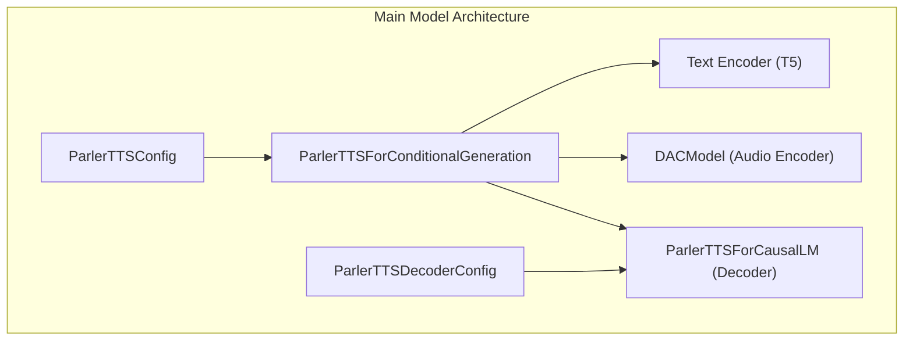
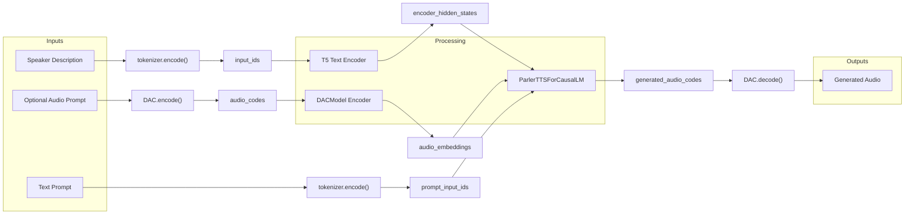
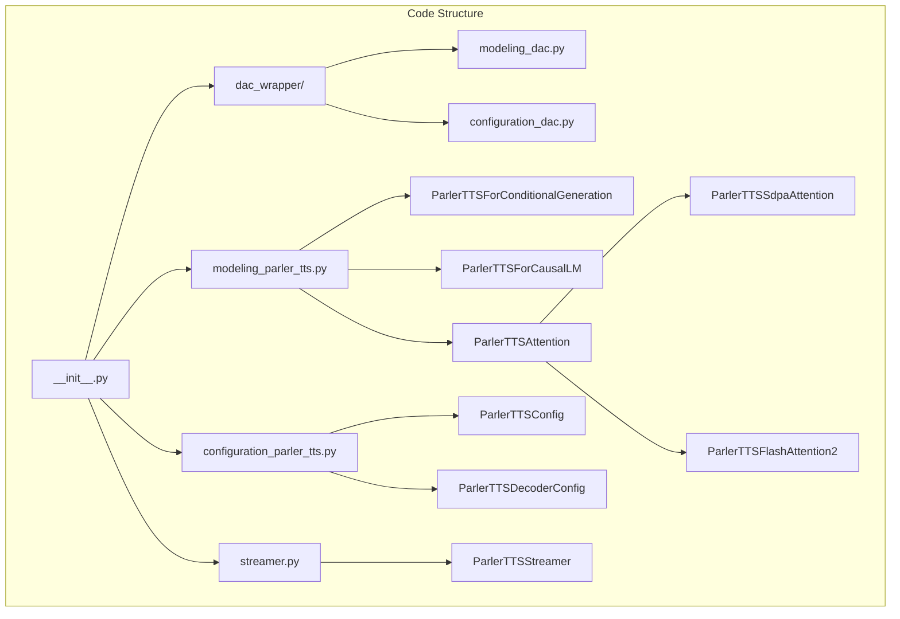

<!-- source: DeepWiki mcp.deepwiki.com · repo huggingface/parler-tts · page 1 Overview · fetched 2026-10-26 -->

# Overview

<details>
<summary>Relevant source files</summary>

The following files were used as context for generating this wiki page:

- [README.md](README.md)
- [parler_tts/__init__.py](parler_tts/__init__.py)
- [setup.py](setup.py)
- [training/README.md](training/README.md)

</details>


This document provides a comprehensive introduction to Parler-TTS, an open-source text-to-speech system that generates high-quality, natural-sounding speech controlled through natural language descriptions. For detailed information about specific components, please refer to their dedicated pages in this wiki.

## What is Parler-TTS?

Parler-TTS is a lightweight text-to-speech model that can generate speech in the style of a given speaker based on natural language descriptions of voice characteristics (gender, pitch, speaking style, etc.). It is a reproduction of work from the paper "Natural language guidance of high-fidelity text-to-speech with synthetic annotations" by Dan Lyth and Simon King.

Key distinguishing features:
- Fully open-source with all datasets, preprocessing, training code, and model weights released under permissive licenses
- Natural language control of voice characteristics through descriptive text prompts
- Support for 34 named speakers for consistent voice generation across multiple prompts
- Optimized inference with SDPA and Flash Attention 2 support

Sources: [README.md:3-5](), [README.md:82-85]()

## System Architecture

Parler-TTS follows an encoder-decoder architecture consisting of three primary components:



1. **Text Encoder**: A frozen T5 encoder that converts speaker descriptions into hidden state representations
2. **Audio Encoder**: The DAC (Descript Audio Codec) encoder that processes optional audio prompts
3. **Decoder**: A causal language model that generates audio tokens based on encoder outputs

Sources: [training/README.md:25-28](), [parler_tts/__init__.py:6-12]()

## Data Flow During Generation

This diagram illustrates how data flows through the system during speech generation:



The generation process includes:
1. Tokenizing the text prompt and speaker description
2. Encoding any optional audio prompt with the DAC encoder
3. Processing the description through the T5 encoder
4. Generating audio tokens with the decoder
5. Converting the generated tokens to audio waveforms using the DAC decoder

Sources: [README.md:56-77](), [README.md:89-108]()

## Core Components

Parler-TTS is composed of several core components that work together:



Key components include:

1. **ParlerTTSForConditionalGeneration**: The main model class that integrates the encoders and decoder
2. **ParlerTTSForCausalLM**: The decoder model that generates audio tokens
3. **DACModel**: Handles audio encoding and decoding
4. **ParlerTTSStreamer**: Enables real-time audio streaming during generation
5. **Attention Mechanisms**: Various attention implementations (standard, SDPA, Flash Attention 2)

Sources: [parler_tts/__init__.py:6-15]()

## Available Models

Parler-TTS currently offers two pre-trained checkpoints:

| Model | Parameters | Repository ID | Training Data |
|-------|------------|---------------|--------------|
| Parler-TTS Mini | 880M | parler-tts/parler-tts-mini-v1 | 45K hours of audiobooks |
| Parler-TTS Large | 2.3B | parler-tts/parler-tts-large-v1 | 45K hours of audiobooks |

Sources: [README.md:9-14]()

## Installation

Installing Parler-TTS is straightforward:

```bash
pip install git+https://github.com/huggingface/parler-tts.git
```

For Apple Silicon users, an additional step is needed for bfloat16 support:

```bash
pip3 install --pre torch torchaudio --index-url https://download.pytorch.org/whl/nightly/cpu
```

The package has several dependencies including transformers, torch, sentencepiece, and descript-audio-codec.

Sources: [README.md:28-40](), [setup.py:20-27]()

## Basic Usage

Basic usage involves providing a text prompt and a description of the desired voice:

```python
import torch
from parler_tts import ParlerTTSForConditionalGeneration
from transformers import AutoTokenizer
import soundfile as sf

device = "cuda:0" if torch.cuda.is_available() else "cpu"

model = ParlerTTSForConditionalGeneration.from_pretrained("parler-tts/parler-tts-mini-v1").to(device)
tokenizer = AutoTokenizer.from_pretrained("parler-tts/parler-tts-mini-v1")

prompt = "Hey, how are you doing today?"
description = "A female speaker delivers a slightly expressive and animated speech with a moderate speed and pitch."

input_ids = tokenizer(description, return_tensors="pt").input_ids.to(device)
prompt_input_ids = tokenizer(prompt, return_tensors="pt").input_ids.to(device)

generation = model.generate(input_ids=input_ids, prompt_input_ids=prompt_input_ids)
audio_arr = generation.cpu().numpy().squeeze()
sf.write("parler_tts_out.wav", audio_arr, model.config.sampling_rate)
```

Parler-TTS supports:
- Random voices through descriptive prompts
- 34 named speakers for consistent voices (Laura, Gary, Jon, Lea, etc.)
- Voice control through natural language descriptions

Sources: [README.md:53-114]()

## Optimizations for Inference

Parler-TTS includes several optimizations to improve inference speed:

1. **SDPA (Scaled Dot Product Attention)** for efficient attention computation
2. **Flash Attention 2** support for even faster processing
3. **Model compilation** for additional performance gains
4. **Streaming generation** via the ParlerTTSStreamer class

These optimizations significantly improve the generation speed, especially on newer hardware.

Sources: [README.md:16](), [README.md:116-118]()

---

