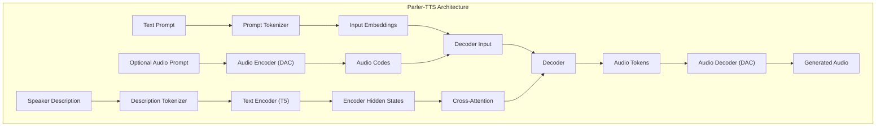
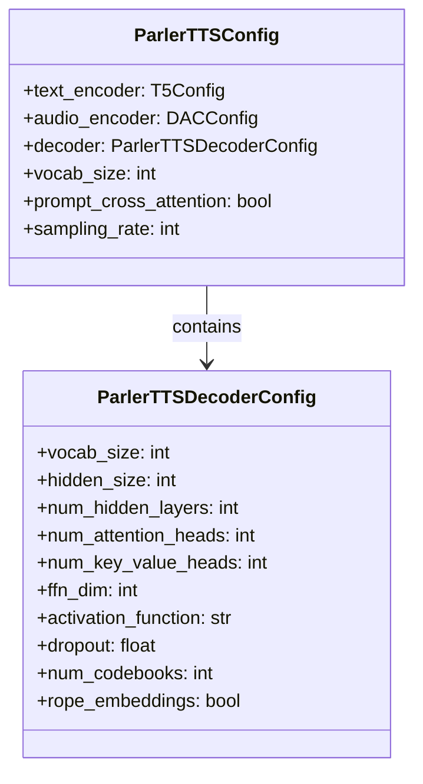
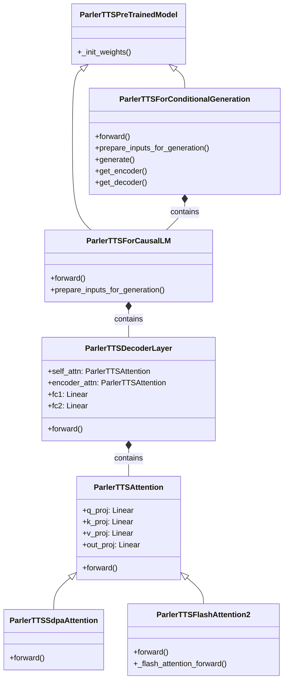
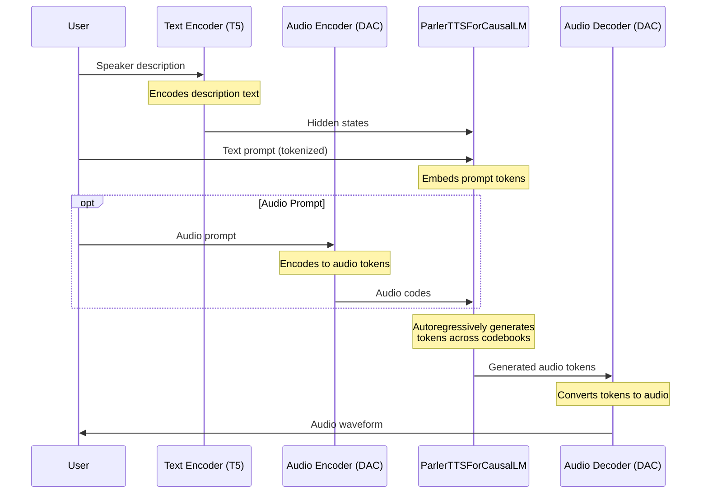
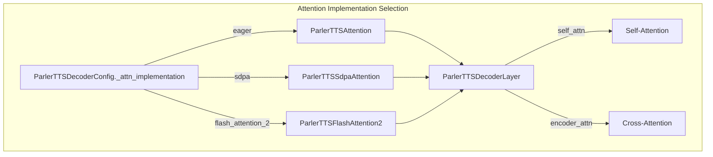
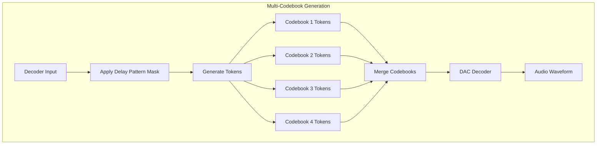
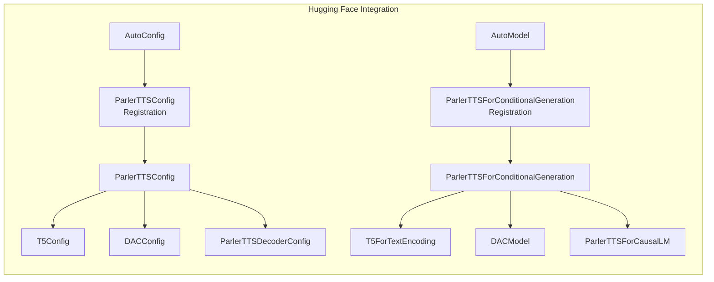

<!-- source: DeepWiki mcp.deepwiki.com · repo huggingface/parler-tts · page 1.1 Architecture · fetched 2026-10-26 -->

# Architecture

Relevant source files

The following files were used as context for generating this wiki page:

- [README.md](README.md)
- [parler_tts/configuration_parler_tts.py](parler_tts/configuration_parler_tts.py)
- [parler_tts/modeling_parler_tts.py](parler_tts/modeling_parler_tts.py)
- [training/README.md](training/README.md)

This document describes the architecture of the Parler-TTS system, a text-to-speech model that can generate high-quality, natural sounding speech conditioned on text descriptions of speaker characteristics. The architecture section explains the core components, how they interact, and the data flow through the system during both training and inference. For information about installation and basic usage, see [Installation and Setup](#1.2).

## Overview

Parler-TTS is an encoder-decoder architecture that converts text into speech while giving users control over speaker characteristics through natural language descriptions. It leverages three core components:

1. A **Text Encoder** (based on T5) that processes speaker descriptions
2. An **Audio Encoder** (based on DAC) that encodes optional audio prompts
3. A **Decoder** that generates audio tokens, which are later converted to waveforms

Sources: 
- [README.md:3-7]()
- [training/README.md:24-34]()
- [parler_tts/modeling_parler_tts.py:101-160]()

## Core Components

The Parler-TTS architecture consists of several key components that work together to generate speech:

### 1. Text Encoder

The text encoder processes natural language descriptions of speaker characteristics and speaking style. It's based on the Flan-T5 encoder and produces hidden state representations that guide the decoder.

- Implemented as a frozen pre-trained T5 model
- Takes tokenized speaker descriptions as input
- Outputs hidden states that influence speaking style, gender, pitch, etc.
- Connected to the decoder via cross-attention layers

### 2. Audio Encoder (DAC)

The Descript Audio Codec (DAC) serves as both the audio encoder during prompting and the audio decoder during generation:

- Encodes optional audio prompts into a sequence of discrete audio tokens
- Produces multi-codebook representations (typically 4 codebooks)
- Allows for high-fidelity audio reconstruction
- Supports 44.1kHz sampling rate

### 3. Decoder (ParlerTTSForCausalLM)

The decoder is a transformer-based language model that generates audio tokens autoregressively:

- Takes encoder hidden states and optional audio codes as input
- Implements a delayed pattern mask for multi-codebook generation
- Supports various attention mechanisms (standard, SDPA, FlashAttention2)
- Outputs tokens that can be converted back to audio using DAC

### 4. Configuration System

The model uses a hierarchical configuration system:

- `ParlerTTSConfig`: Top-level configuration that composes all sub-configurations
- `ParlerTTSDecoderConfig`: Configuration for the decoder architecture
- Configurations from T5 and DAC for the respective encoders

Sources:
- [parler_tts/configuration_parler_tts.py:33-166]()
- [parler_tts/configuration_parler_tts.py:175-291]()
- [training/README.md:24-34]()

## Model Architecture

The Parler-TTS model is implemented as a single end-to-end system with the following class hierarchy:

Sources:
- [parler_tts/modeling_parler_tts.py:101-1075]()
- [parler_tts/modeling_parler_tts.py:1077-1103]()

## Data Flow During Inference

During inference, data flows through the system as follows:

The key steps in data flow are:

1. **Text Description Processing**: The speaker description is tokenized and encoded by T5 to produce hidden states
2. **Text Prompt Processing**: The text prompt is tokenized and embedded directly
3. **Audio Prompt Processing** (optional): An audio prompt can be encoded into audio tokens by DAC
4. **Token Generation**: The decoder generates audio tokens autoregressively, using cross-attention to condition on the encoded description
5. **Audio Synthesis**: The generated tokens are decoded back to audio using DAC

Sources:
- [README.md:52-108]()
- [parler_tts/modeling_parler_tts.py:205-276]()

## Attention Mechanisms

Parler-TTS supports three different attention implementations to balance performance and efficiency:

1. **Standard Attention** (`ParlerTTSAttention`): The default attention mechanism with standard matrix operations
2. **SDPA Attention** (`ParlerTTSSdpaAttention`): Uses PyTorch's scaled dot-product attention for better performance
3. **FlashAttention2** (`ParlerTTSFlashAttention2`): Optimized attention implementation for maximum speed

The attention implementations are interchangeable and can be selected based on hardware availability and performance requirements.

Sources:
- [parler_tts/modeling_parler_tts.py:439-933]()
- [parler_tts/modeling_parler_tts.py:933-937]()
- [README.md:116-119]()

## Multi-Codebook Generation

One of the key architectural features of Parler-TTS is its multi-codebook generation approach. The model generates tokens for multiple codebooks in parallel using a specialized pattern:

The delay pattern mask ensures that each codebook is generated with an offset from the others, allowing for a structured approach to multi-codebook generation:

- Codebook 1 starts at position 1
- Codebook 2 starts at position 2
- And so on...

This approach enables the model to properly handle dependencies between codebooks and generate coherent audio.

Sources:
- [parler_tts/modeling_parler_tts.py:205-276]()

## Available Model Variants

Parler-TTS currently comes in two pre-trained variants:

| Model | Parameters | Training Data | Characteristics |
|-------|------------|---------------|-----------------|
| Parler-TTS Mini | 880M | 45K hours | Lightweight but high quality |
| Parler-TTS Large | 2.3B | 45K hours | Higher quality, more capabilities |

Both models follow the same architecture but differ in size (number of layers, hidden dimensions, attention heads) and consequently in their generation capabilities.

Sources:
- [README.md:9-16]()

## Integration with Hugging Face Ecosystem

The Parler-TTS architecture is designed to integrate seamlessly with the Hugging Face ecosystem:

This integration enables:
- Easy loading of pre-trained models with `from_pretrained()`
- Automatic handling of model configs and weights
- Compatibility with Transformers pipelines
- Support for model quantization and optimization

Sources:
- [parler_tts/modeling_parler_tts.py:68-74]()
- [parler_tts/configuration_parler_tts.py:259-285]()

## Summary

The Parler-TTS architecture combines a frozen text encoder, an audio codec, and a decoder to create a flexible and powerful text-to-speech system that can be controlled through natural language descriptions. Its multi-codebook approach enables high-quality audio generation, while its integration with the Hugging Face ecosystem makes it accessible and easy to use.

The architecture balances flexibility and performance, with optimized attention mechanisms and support for various hardware configurations. The model's design allows for both fast inference and high-quality audio generation, making it suitable for a wide range of applications.

---

