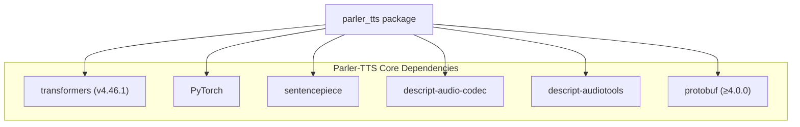
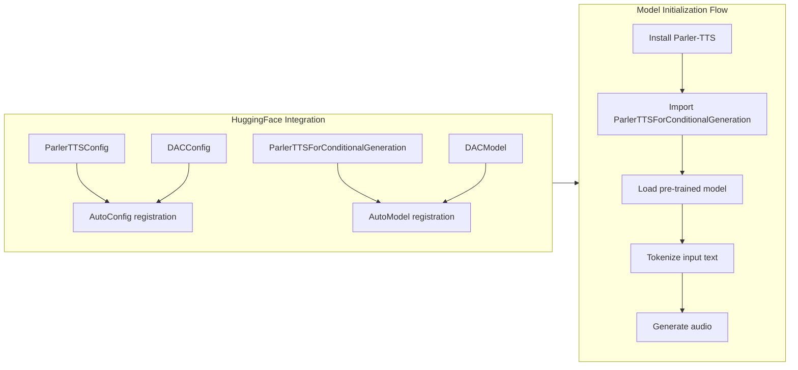
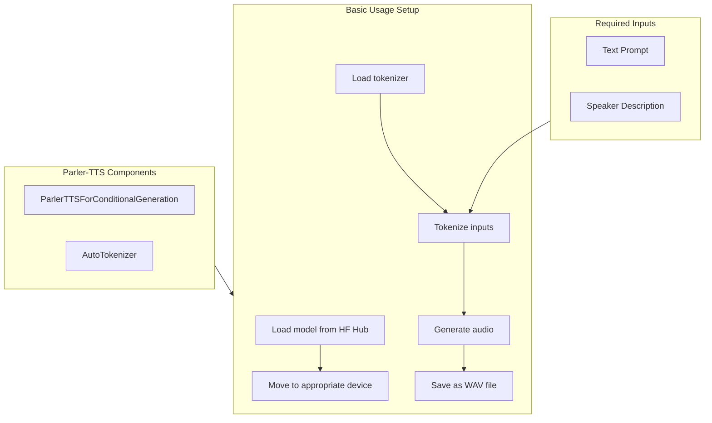
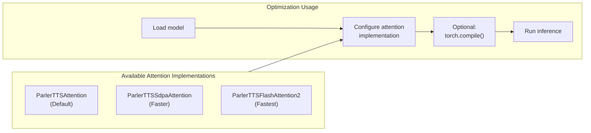

<!-- source: DeepWiki mcp.deepwiki.com · repo huggingface/parler-tts · page 1.2 Installation and Setup · fetched 2026-10-26 -->

# Installation and Setup

<details>
<summary>Relevant source files</summary>

The following files were used as context for generating this wiki page:

- [README.md](README.md)
- [parler_tts/__init__.py](parler_tts/__init__.py)
- [setup.py](setup.py)
- [training/README.md](training/README.md)

</details>


This guide covers the installation process and initial setup for Parler-TTS, a lightweight text-to-speech model that can generate high-quality, natural-sounding speech. For detailed information about training setup and advanced configuration, see [Training](#3) and [Inference and Deployment](#4).

## 1. Installation Methods

Parler-TTS has lightweight dependencies for standard usage, with additional requirements for training.

### 1.1 Basic Installation

The simplest way to install Parler-TTS is using pip:

```bash
pip install git+https://github.com/huggingface/parler-tts.git
```

### 1.2 Apple Silicon Installation

Apple Silicon users need to run an additional command to install a nightly build of PyTorch with bfloat16 support:

```bash
pip3 install --pre torch torchaudio --index-url https://download.pytorch.org/whl/nightly/cpu
```

### 1.3 Installation from Source (for Development/Training)

For development or training, install from source:

```bash
git clone https://github.com/huggingface/parler-tts.git
cd parler-tts
pip install -e .              # Basic installation
pip install -e .[train]       # Installation with training dependencies
pip install -e .[dev]         # Installation with development dependencies
```

Sources: [README.md:28-40](), [training/README.md:47-58](), [setup.py:57-69]()

## 2. Dependencies

Parler-TTS relies on several key dependencies that enable its audio generation capabilities.

### 2.1 Core Dependencies



**Key Dependencies Diagram**

Sources: [setup.py:20-27]()

### 2.2 Training Dependencies

If planning to train models, additional dependencies are required:

```bash
pip install -e .[train]
```

This will install:
- jiwer (Word Error Rate calculation)
- wandb (experiment tracking)
- accelerate (distributed training)
- evaluate (evaluation framework)
- datasets[audio] (audio dataset handling)

Sources: [setup.py:35-41](), [training/README.md:47-58]()

## 3. Post-Installation Setup

After installing Parler-TTS, several additional setup steps may be required depending on your use case.

### 3.1 Configuration for Inference

Parler-TTS integrates with the Hugging Face ecosystem through AutoConfig and AutoModel registration:



**Model Initialization and Registration Diagram**

Sources: [parler_tts/__init__.py:4-25](), [README.md:66-78]()

### 3.2 Training Setup (Optional)

For those interested in training Parler-TTS models, additional setup is required:

1. **Configure Accelerate** (for distributed training):
   ```bash
   accelerate config
   ```

2. **Login to Hugging Face Hub** (for saving models):
   ```bash
   git config --global credential.helper store
   huggingface-cli login
   ```

3. **Optional: Set up Weights & Biases** for experiment tracking

Sources: [training/README.md:60-74]()

## 4. Basic Usage Setup

Once installed, here's how to set up Parler-TTS for basic text-to-speech generation:



**Basic Usage Workflow Diagram**

### 4.1 Loading the Model and Tokenizer

```python
import torch
from parler_tts import ParlerTTSForConditionalGeneration
from transformers import AutoTokenizer

device = "cuda:0" if torch.cuda.is_available() else "cpu"

model = ParlerTTSForConditionalGeneration.from_pretrained("parler-tts/parler-tts-mini-v1").to(device)
tokenizer = AutoTokenizer.from_pretrained("parler-tts/parler-tts-mini-v1")
```

### 4.2 Available Pretrained Models

The following pre-trained models are available:

| Model | Parameters | Hub ID |
|-------|------------|--------|
| Parler-TTS Mini | 880M | parler-tts/parler-tts-mini-v1 |
| Parler-TTS Large | 2.3B | parler-tts/parler-tts-large-v1 |

Sources: [README.md:66-78](), [README.md:9-16]()

## 5. Optimizing Inference

Parler-TTS supports several optimization techniques for faster inference.

### 5.1 Available Optimization Methods

| Method | Description | Requirements |
|--------|-------------|--------------|
| SDPA Attention | Scaled dot-product attention | PyTorch 2.0+ |
| Flash Attention 2 | Optimized attention algorithm | Flash Attention library |
| Model Compilation | JIT or TorchDynamo compilation | PyTorch 2.0+ |

### 5.2 Attention Mechanisms

The model supports different attention implementations that can be configured at load time:



**Attention Mechanisms Diagram**

Sources: [README.md:115-118]()

## 6. Troubleshooting

### 6.1 Common Installation Issues

- **Missing or incompatible dependencies**: Ensure all dependencies are properly installed
- **CUDA compatibility issues**: Verify CUDA version is compatible with installed PyTorch
- **Apple Silicon issues**: Make sure to run the additional installation command for Apple Silicon

### 6.2 Support Resources

- GitHub Issues: For bug reports and feature requests
- Hugging Face Community: For usage questions and community support

Sources: [README.md:28-40]()

This installation and setup guide provides the foundation for using Parler-TTS. For more advanced topics, please refer to the specific documentation sections on [Model Components](#2), [Training](#3), and [Inference and Deployment](#4).

---

