<!-- source: DeepWiki mcp.deepwiki.com · repo huggingface/parler-tts · page 2 Model Components · fetched 2026-10-26 -->

# Model Components

Relevant source files

The following files were used as context for generating this wiki page:

- [parler_tts/configuration_parler_tts.py](parler_tts/configuration_parler_tts.py)
- [parler_tts/modeling_parler_tts.py](parler_tts/modeling_parler_tts.py)

This document provides a comprehensive overview of the core components that make up the Parler-TTS text-to-speech system. It covers the model architecture, key classes, their configurations, and how they interact to form a complete TTS pipeline. For details on training these components, see [Training](#3), and for inference and deployment information, see [Inference and Deployment](#4).

## High-Level Architecture

Parler-TTS follows an encoder-decoder architecture specifically designed for conditional text-to-speech generation. The system consists of three main components that work together to transform text input into high-quality audio output.

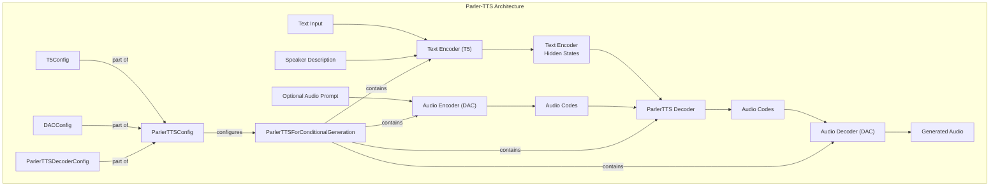

Sources: [parler_tts/configuration_parler_tts.py:175-291](), [parler_tts/modeling_parler_tts.py:2800-3031]()

## Core Components

Parler-TTS consists of three main components that work together:

1. **Text Encoder**: Processes the text input and speaker description
2. **Audio Encoder**: Processes the optional audio prompt
3. **Decoder**: Generates the audio codes, which are then converted to audio

Let's examine each component in detail:

### Text Encoder (T5)

The text encoder in Parler-TTS is based on the T5 model architecture. It takes as input both the text to be synthesized and a description of how the speech should sound (speaker description). The text encoder produces hidden state representations that are fed to the decoder.

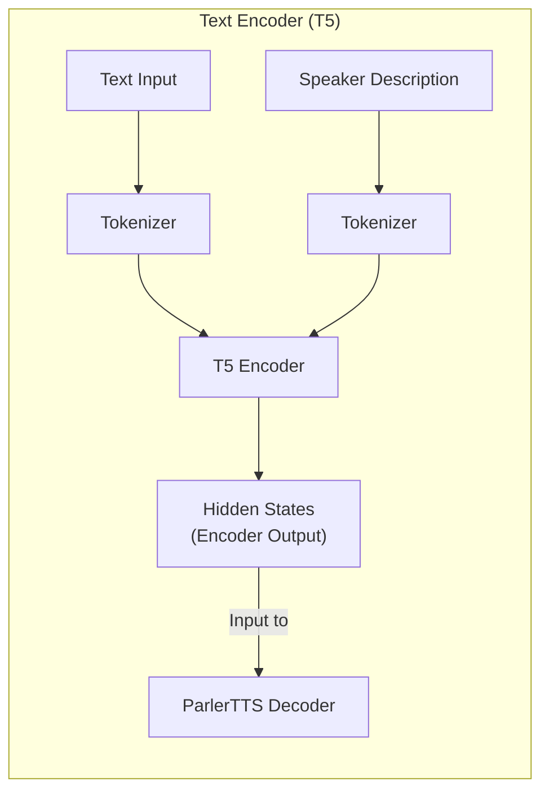

The model uses the text encoder from the Hugging Face transformers library, loaded via AutoModelForTextEncoding. This flexible approach allows different text encoder architectures to be used, although the default is T5.

Sources: [parler_tts/modeling_parler_tts.py:2817-2824](), [parler_tts/configuration_parler_tts.py:193-195]()

### Audio Encoder (DAC)

The Descript Audio Codec (DAC) serves as the audio encoder for Parler-TTS. It can encode audio prompts into a discrete representation (audio codes) that can be processed by the decoder. These audio codes represent the acoustic characteristics that the model should emulate in the generated speech.

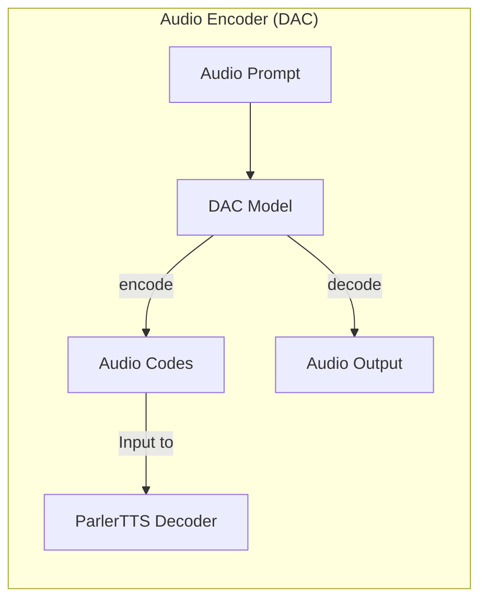

The DAC model handles both encoding audio prompts and decoding the generated audio codes back into waveforms. The encoder portion compresses the audio into a more compact discrete representation, while the decoder portion reconstructs audio from these codes.

Sources: [parler_tts/modeling_parler_tts.py:2825-2833](), [parler_tts/configuration_parler_tts.py:196-198]()

### Decoder (ParlerTTSForCausalLM)

The decoder is the heart of the Parler-TTS model. It takes the encoded text and optional audio codes as input and generates new audio codes autoregressively (one token at a time). The decoder is based on a transformer architecture, specifically designed for audio generation.

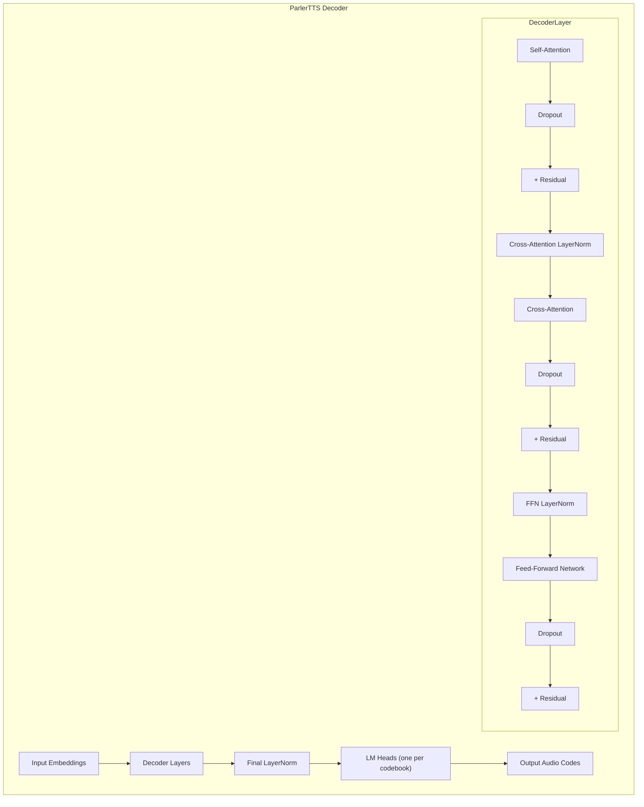

The decoder includes several key features:
- Multiple codebook support for representing audio
- Support for various attention mechanisms
- Rotary positional embeddings (RoPE) or sinusoidal positional embeddings
- Multiple language modeling heads (one per codebook)

Sources: [parler_tts/modeling_parler_tts.py:1338-1806](), [parler_tts/modeling_parler_tts.py:1824-2799]()

## Configuration System

The Parler-TTS configuration system consists of several configuration classes that control the behavior and architecture of different components:

### ParlerTTSConfig

This is the main configuration class that defines the overall model architecture. It contains configurations for the text encoder, audio encoder, and decoder.

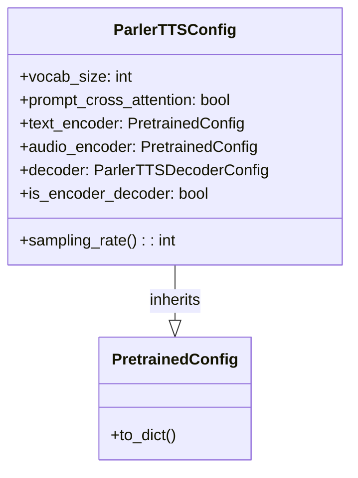

Key parameters:
- `vocab_size`: Size of the vocabulary for prompt token IDs
- `prompt_cross_attention`: Whether to use cross-attention for prompting
- `text_encoder`: Configuration for the text encoder
- `audio_encoder`: Configuration for the audio encoder
- `decoder`: Configuration for the decoder

Sources: [parler_tts/configuration_parler_tts.py:175-291]()

### ParlerTTSDecoderConfig

This configuration class defines the architecture and behavior of the decoder component.

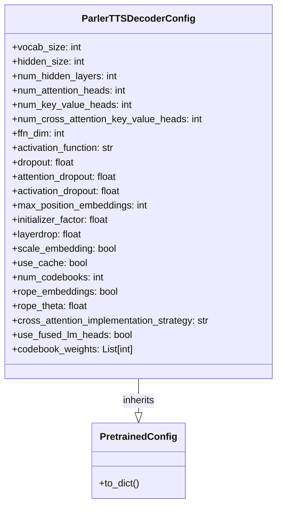

Key parameters:
- `vocab_size`: Vocabulary size for the decoder (typically 2049)
- `hidden_size`: Dimension of the hidden layers
- `num_hidden_layers`: Number of decoder layers
- `num_attention_heads`: Number of attention heads
- `num_key_value_heads`: Number of key/value heads for GQA or MQA
- `ffn_dim`: Dimension of the feed-forward network
- `num_codebooks`: Number of parallel codebooks (typically 4)
- `rope_embeddings`: Whether to use rotary positional embeddings

Sources: [parler_tts/configuration_parler_tts.py:33-172]()

## Model Implementation

### ParlerTTSForConditionalGeneration

This is the main model class that integrates the text encoder, audio encoder, and decoder components.

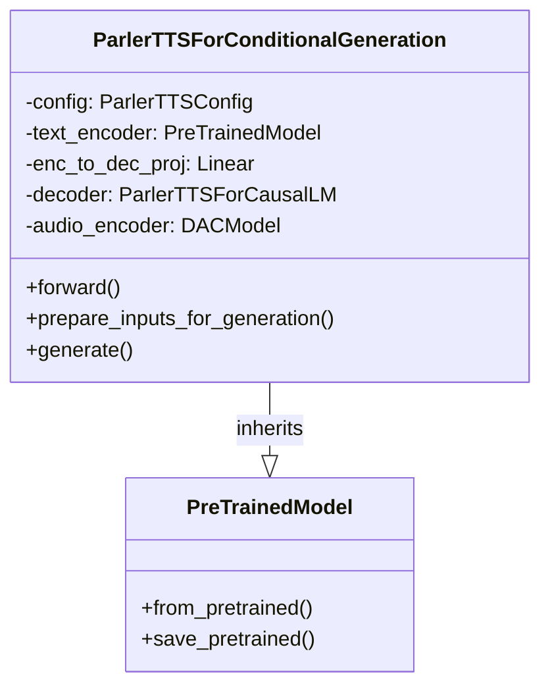

The `ParlerTTSForConditionalGeneration` class manages the flow of data through the entire model:
1. Encodes text and speaker description using the text encoder
2. Optionally encodes audio prompts using the audio encoder
3. Projects the encoder outputs to the decoder dimension
4. Feeds the encoded data to the decoder to generate audio codes
5. Decodes the audio codes back to waveforms using the audio decoder

Sources: [parler_tts/modeling_parler_tts.py:2800-3031]()

### ParlerTTSForCausalLM

This class implements the decoder with a language modeling head. It takes encoder outputs and generates audio codes autoregressively.

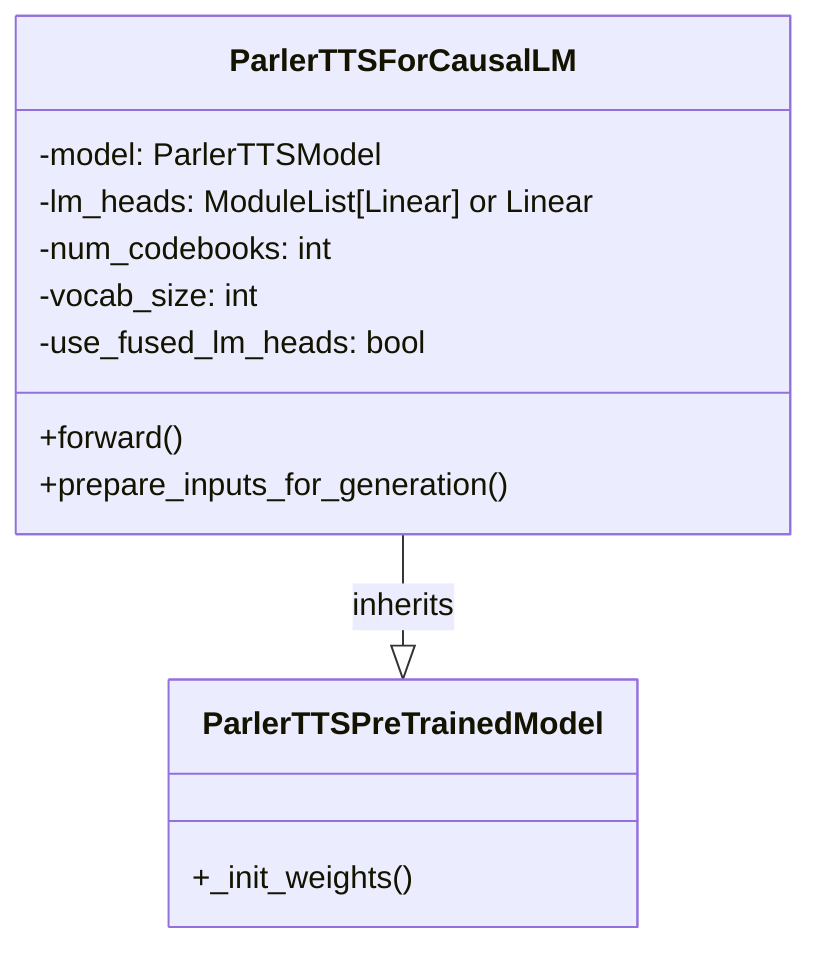

The `ParlerTTSForCausalLM` class contains:
- A `ParlerTTSModel` for processing inputs
- Language modeling heads for predicting audio codes
- Support for multiple codebooks
- Optional fused language modeling heads for efficiency

Sources: [parler_tts/modeling_parler_tts.py:1824-2799]()

## Attention Mechanisms

Parler-TTS supports multiple attention implementation strategies for optimal performance across different hardware:

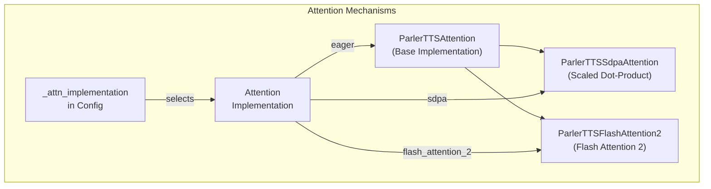

The model supports three attention implementations:

1. **ParlerTTSAttention** (eager): Standard attention implementation
   - Supports both self-attention and cross-attention
   - Works with GQA (grouped query attention) and MQA (multi-query attention)
   - Optional rotary positional embeddings (RoPE)

2. **ParlerTTSSdpaAttention** (sdpa): Uses PyTorch's scaled dot-product attention
   - More efficient than the eager implementation
   - Falls back to eager implementation when unsupported features are requested

3. **ParlerTTSFlashAttention2** (flash_attention_2): Uses Flash Attention 2 for maximum efficiency
   - Fastest implementation on supported hardware
   - Handles padding in inputs for optimal performance

The attention implementation can be selected through the `_attn_implementation` parameter in the configuration.

Sources: [parler_tts/modeling_parler_tts.py:439-937]()

## Data Flow and Generation Process

This diagram illustrates the flow of data through the Parler-TTS model during generation:

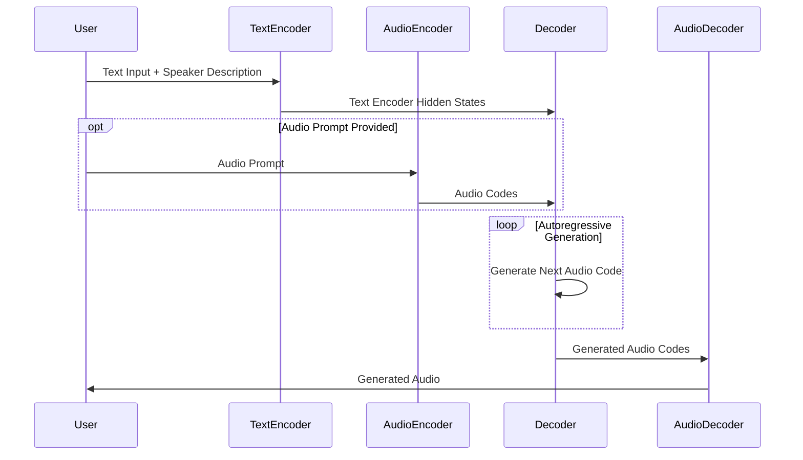

The generation process:
1. Text and speaker description are encoded through the text encoder
2. If provided, an audio prompt is encoded through the audio encoder
3. The decoder generates audio codes autoregressively
4. The audio decoder converts the audio codes back to waveforms

During the autoregressive generation, the model uses cached attention states for efficiency. The decoder uses a delayed pattern mask when working with multiple codebooks, which allows it to generate tokens in parallel for each codebook.

Sources: [parler_tts/modeling_parler_tts.py:3188-3413]()

## Component Relationship Table

The following table summarizes the relationship between model components and their configurations:

| Component | Implementation Class | Configuration Class | Description |
|-----------|---------------------|---------------------|-------------|
| Text Encoder | AutoModelForTextEncoding | T5Config | Encodes text and speaker description |
| Audio Encoder | DACModel | DACConfig | Encodes audio prompts, decodes audio outputs |
| Decoder | ParlerTTSForCausalLM | ParlerTTSDecoderConfig | Generates audio codes |
| Main Model | ParlerTTSForConditionalGeneration | ParlerTTSConfig | Orchestrates the entire generation process |
| Attention | ParlerTTSAttention and variants | Configured via ParlerTTSDecoderConfig | Implements different attention mechanisms |

Sources: [parler_tts/configuration_parler_tts.py:33-291](), [parler_tts/modeling_parler_tts.py:1338-3413]()

## Advanced Features

### Multi-Codebook Generation

Parler-TTS uses multiple codebooks to represent audio, which allows for more expressive speech generation:

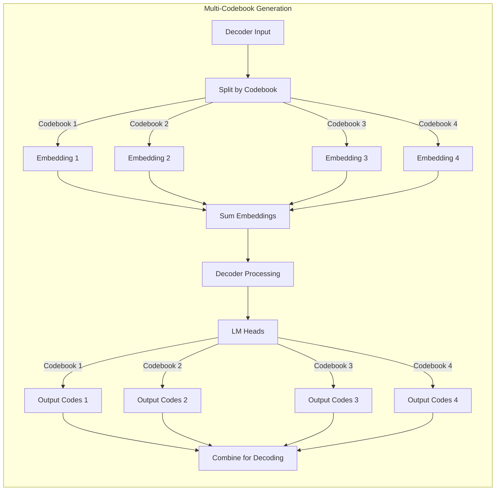

Each codebook captures different aspects of the audio, and the model can either use:
- Multiple language modeling heads (one per codebook)
- A fused language modeling head (when `use_fused_lm_heads=True`)

Sources: [parler_tts/modeling_parler_tts.py:1834-1840](), [parler_tts/configuration_parler_tts.py:98-99]()

### Positional Encodings

Parler-TTS supports two types of positional encodings:

1. **Sinusoidal Positional Embeddings**: Traditional positional encoding that adds positional information to token embeddings
2. **Rotary Positional Embeddings (RoPE)**: Applies rotations to the query and key vectors in the attention mechanism

The type of positional encoding is controlled by the `rope_embeddings` parameter in the decoder configuration.

Sources: [parler_tts/modeling_parler_tts.py:327-406](), [parler_tts/configuration_parler_tts.py:92-95]()

## Summary

Parler-TTS is a comprehensive text-to-speech system with a modular architecture:
- Text encoder for processing text and speaker descriptions
- Audio encoder for processing audio prompts
- Decoder for generating audio codes
- Multiple attention mechanisms for optimal performance
- Support for multiple codebooks for expressive speech generation

The system is highly configurable through its configuration classes, allowing for different model sizes and architectural choices. The components work together to create a pipeline that can generate high-quality speech from text inputs, with optional control through speaker descriptions and audio prompts.

Sources: [parler_tts/configuration_parler_tts.py:33-291](), [parler_tts/modeling_parler_tts.py:2800-3031]()

---

