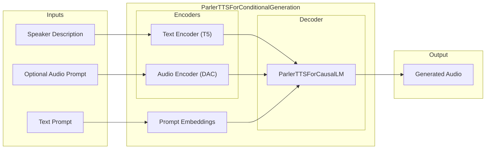
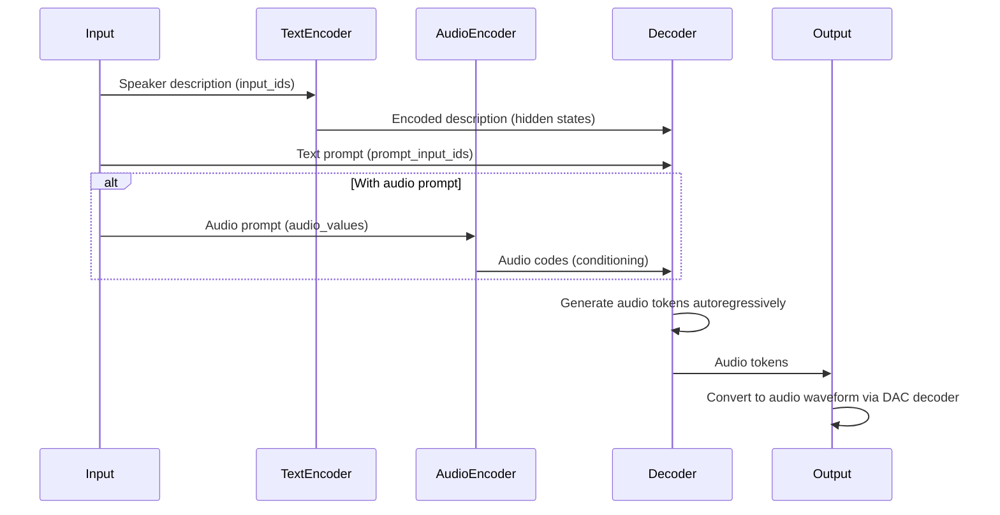
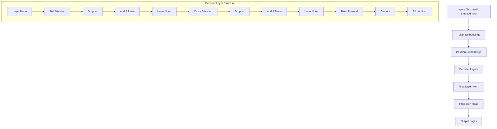
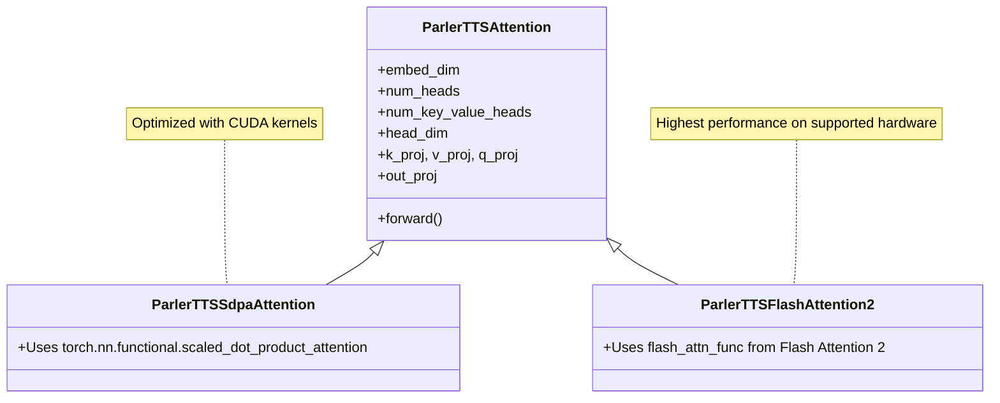
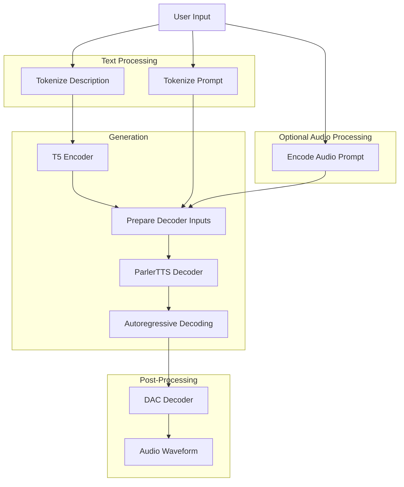
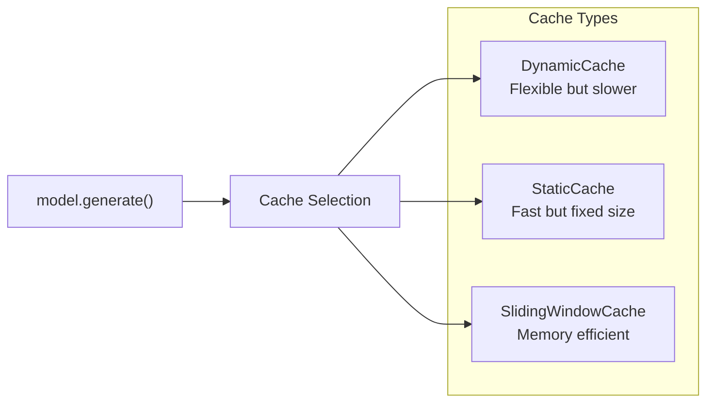
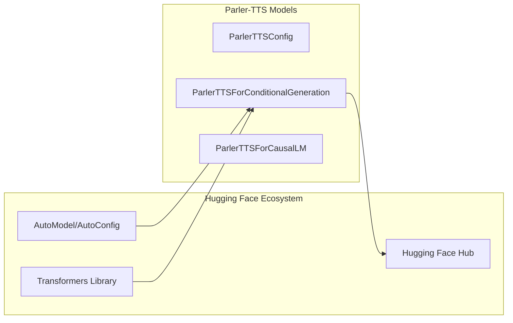

<!-- source: DeepWiki mcp.deepwiki.com · repo huggingface/parler-tts · page 2.1 ParlerTTS Model · fetched 2026-10-26 -->

# ParlerTTS Model

<details>
<summary>Relevant source files</summary>

The following files were used as context for generating this wiki page:

- [README.md](README.md)
- [parler_tts/modeling_parler_tts.py](parler_tts/modeling_parler_tts.py)
- [training/README.md](training/README.md)

</details>


## Purpose and Scope

This document provides a detailed explanation of the core model architecture of Parler-TTS, focusing on the `ParlerTTSForConditionalGeneration` and `ParlerTTSForCausalLM` model classes. It covers their structure, internal components, and how they work together to generate high-quality speech from text input. For information about model configuration, see [Model Configuration](#2.2), and for details about the audio codec, see [Audio Codec (DAC)](#2.3).

## Model Architecture Overview

Parler-TTS follows an encoder-decoder architecture similar to other conditional generation models, but specialized for text-to-speech synthesis.

### High-Level Architecture Diagram



Sources: [parler_tts/modeling_parler_tts.py:1742-2450](), [training/README.md:25-34]()

The model consists of three main components:

1. **Text Encoder**: A frozen T5 encoder that converts speaker descriptions into hidden representations
2. **Audio Encoder**: A DAC (Descript Audio Codec) encoder that converts optional audio prompts into code embeddings
3. **Decoder**: A transformer-based decoder that generates audio tokens autoregressively

## ParlerTTSForConditionalGeneration

The `ParlerTTSForConditionalGeneration` class is the main end-to-end model for text-to-speech generation.

### Component Structure

```mermaid
classDiagram
    class ParlerTTSForConditionalGeneration {
        +text_encoder: T5EncoderModel
        +decoder: ParlerTTSForCausalLM
        +audio_encoder: DACModel
        +enc_to_dec_proj: Linear
        +config: ParlerTTSConfig
        +generation_config: GenerationConfig
        +forward()
        +generate()
        +prepare_inputs_for_generation()
    }
    
    ParlerTTSForConditionalGeneration --> "T5EncoderModel" : text_encoder
    ParlerTTSForConditionalGeneration --> "ParlerTTSForCausalLM" : decoder
    ParlerTTSForConditionalGeneration --> "DACModel" : audio_encoder
    ParlerTTSForConditionalGeneration --> "Linear" : enc_to_dec_proj
```

Sources: [parler_tts/modeling_parler_tts.py:3100-3564]()

### Data Flow During Generation



Sources: [parler_tts/modeling_parler_tts.py:3329-3564](), [README.md:56-78]()

### Key Features

1. **Flexible Input Handling**: 
   - Can process text description for voice characteristics
   - Accepts text prompt to determine what to say
   - Optionally takes audio prompt for voice cloning

2. **Integrated Generation Pipeline**:
   - Processes all inputs through respective encoders
   - Coordinates between text and audio modalities
   - Handles autoregressive generation of audio tokens
   - Converts generated tokens to audio waveform

3. **Optimized Inference**:
   - Supports SDPA (Scaled Dot-Product Attention)
   - Compatible with Flash Attention 2
   - Supports model compilation

Sources: [README.md:116-118](), [parler_tts/modeling_parler_tts.py:3329-3564]()

## ParlerTTSForCausalLM (Decoder)

The `ParlerTTSForCausalLM` class is the decoder component responsible for generating audio tokens conditioned on encoded text and optional audio inputs.

### Decoder Architecture



Sources: [parler_tts/modeling_parler_tts.py:1338-1737](), [parler_tts/modeling_parler_tts.py:940-1075]()

### Multi-Head Attention Mechanisms

The decoder supports multiple attention implementations for different performance and compatibility needs:



Sources: [parler_tts/modeling_parler_tts.py:439-585](), [parler_tts/modeling_parler_tts.py:599-815](), [parler_tts/modeling_parler_tts.py:818-930]()

### Decoder Layer Components

Each decoder layer in `ParlerTTSForCausalLM` consists of:

1. **Self-attention mechanism**: Processes the sequence history
2. **Cross-attention mechanism**: Attends to encoder outputs
3. **Feed-forward neural network**: Processes transformed representations

The decoder also supports various optimizations:

- Rotary position embeddings (RoPE) for better handling of sequence positions
- Group Query Attention (GQA) and Multi-Query Attention (MQA) for efficiency
- Various caching strategies for faster autoregressive generation

Sources: [parler_tts/modeling_parler_tts.py:940-1075](), [parler_tts/modeling_parler_tts.py:372-436]()

## Generation Process

### Input Processing and Token Generation



Sources: [README.md:56-78](), [parler_tts/modeling_parler_tts.py:3329-3564]()

### Generation Parameters

The generation process can be controlled through various parameters:

| Parameter | Description | Default Value |
|-----------|-------------|---------------|
| `temperature` | Controls randomness in sampling | 1.0 |
| `top_k` | Limits sampling to top k tokens | 50 |
| `top_p` | Nucleus sampling parameter | 1.0 |
| `use_cache` | Enable KV-caching for faster generation | True |
| `max_new_tokens` | Maximum number of tokens to generate | None |
| `attn_implementation` | Attention implementation to use | 'sdpa' |

Sources: [parler_tts/modeling_parler_tts.py:3329-3564](), [README.md:116-118]()

## Optimization Features

### Attention Implementations

Parler-TTS supports three attention implementations:

1. **Eager Attention** (`ParlerTTSAttention`): Standard implementation, most compatible
2. **SDPA Attention** (`ParlerTTSSdpaAttention`): Uses PyTorch's scaled dot-product attention
3. **Flash Attention 2** (`ParlerTTSFlashAttention2`): Fastest on supported hardware

These implementations can be selected via the model configuration or at inference time:

```python
# Example of selecting attention implementation during model loading
model = ParlerTTSForConditionalGeneration.from_pretrained(
    "parler-tts/parler-tts-mini-v1", 
    attn_implementation="flash_attention_2"
)
```

Sources: [parler_tts/modeling_parler_tts.py:933-937](), [README.md:116-118]()

### Caching Strategies

The model supports different caching strategies for optimized inference:

- **Dynamic Cache**: Default cache for standard generation
- **Static Cache**: Pre-allocated cache for fixed-length generation
- **Sliding Window Cache**: Limited context window for memory efficiency



Sources: [parler_tts/modeling_parler_tts.py:97-97](), [parler_tts/modeling_parler_tts.py:1657-1731]()

## Integration with Hugging Face Ecosystem

Parler-TTS is fully integrated with the Hugging Face ecosystem, including:

- Registration with `AutoConfig` and `AutoModel`
- Compatibility with Hugging Face generation utilities
- Support for model loading and saving via `from_pretrained` and `save_pretrained`



Sources: [parler_tts/modeling_parler_tts.py:69-74](), [README.md:66-68](), [README.md:96-98]()

## Summary

The ParlerTTS model consists of two main components:

1. `ParlerTTSForConditionalGeneration`: The complete text-to-speech model that:
   - Processes speaker descriptions and text prompts
   - Optionally handles audio prompts
   - Manages the flow between encoders and decoder
   - Generates high-quality speech output

2. `ParlerTTSForCausalLM`: The decoder component that:
   - Takes encoded inputs from text and audio encoders
   - Implements a transformer-based architecture
   - Supports various attention mechanisms for optimization
   - Generates audio tokens autoregressively

Together, these components provide a flexible and powerful text-to-speech system capable of generating natural-sounding speech with controllable voice characteristics.

---

