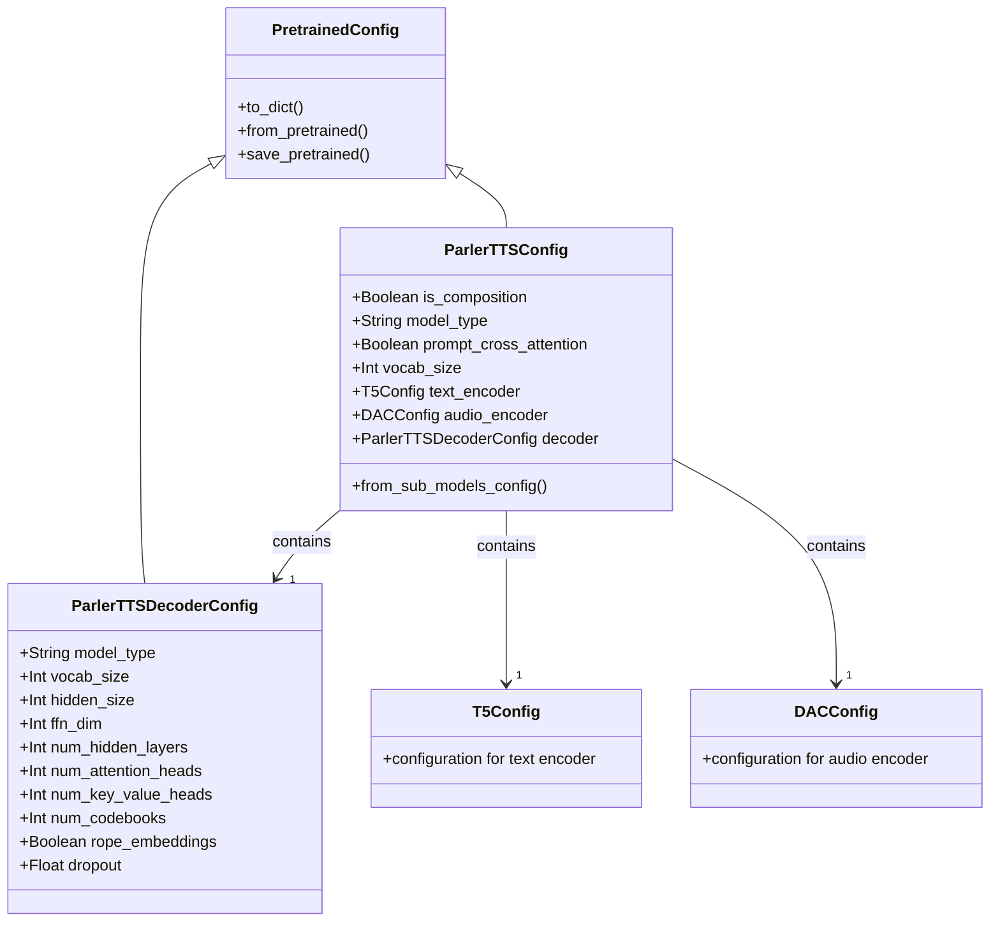
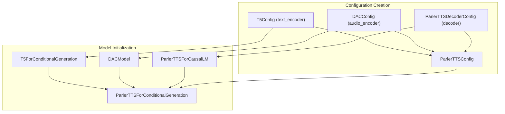
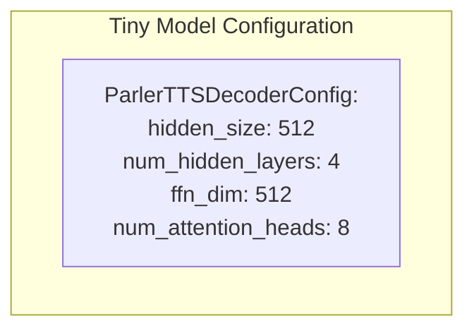
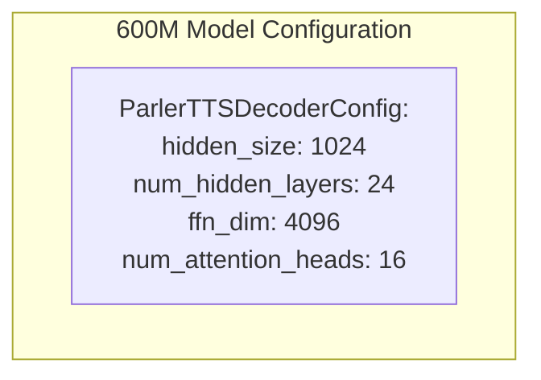
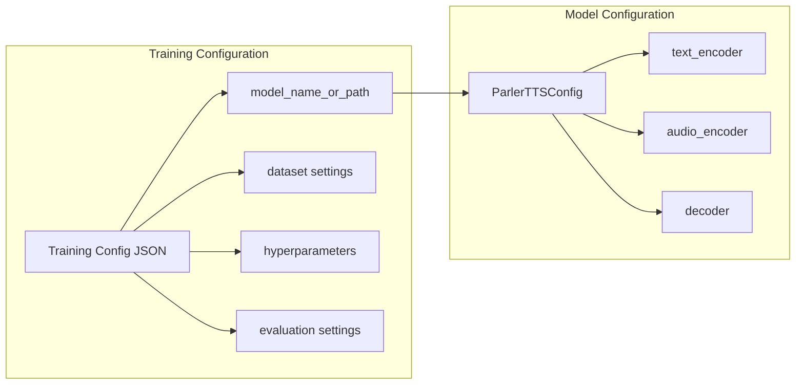

<!-- source: DeepWiki mcp.deepwiki.com · repo huggingface/parler-tts · page 2.2 Model Configuration · fetched 2026-10-26 -->

# Model Configuration

<details>
<summary>Relevant source files</summary>

The following files were used as context for generating this wiki page:

- [helpers/model_init_scripts/init_dummy_model.py](helpers/model_init_scripts/init_dummy_model.py)
- [helpers/model_init_scripts/init_dummy_model_with_encodec.py](helpers/model_init_scripts/init_dummy_model_with_encodec.py)
- [helpers/model_init_scripts/init_model_600M.py](helpers/model_init_scripts/init_model_600M.py)
- [helpers/training_configs/librispeech_tts_r_300M_dummy.json](helpers/training_configs/librispeech_tts_r_300M_dummy.json)
- [helpers/training_configs/starting_point_0.01.json](helpers/training_configs/starting_point_0.01.json)
- [parler_tts/configuration_parler_tts.py](parler_tts/configuration_parler_tts.py)

</details>


This page documents the configuration system for Parler-TTS, which defines the model architecture, parameters, and behavior. The configuration system provides a structured way to instantiate, customize, and save Parler-TTS models. For information about the models themselves, see [ParlerTTS Model](#2.1).

## Configuration Architecture

The Parler-TTS configuration system consists of two main configuration classes:

1. `ParlerTTSConfig`: The top-level configuration that defines the entire Parler-TTS model, including the text encoder, audio encoder, and decoder components.
2. `ParlerTTSDecoderConfig`: A specialized configuration for the decoder component of the Parler-TTS model.

These configuration classes inherit from Hugging Face's `PretrainedConfig`, allowing them to seamlessly integrate with the broader Hugging Face ecosystem for saving, loading, and modifying model configurations.



Sources: [parler_tts/configuration_parler_tts.py:33-172](), [parler_tts/configuration_parler_tts.py:175-291]()

## ParlerTTSConfig

`ParlerTTSConfig` is the main configuration class for the Parler-TTS model. It is a composition of three sub-configurations:

1. **Text Encoder Config**: Configuration for the T5 model used to encode speaker descriptions.
2. **Audio Encoder Config**: Configuration for the DAC (Descript Audio Codec) model used to encode audio.
3. **Decoder Config**: Configuration for the Parler-TTS decoder that generates audio codes.

### Key Attributes

- `vocab_size`: Size of the text prompt vocabulary.
- `prompt_cross_attention`: Whether to use cross-attention for the prompt inputs.
- `text_encoder`: Configuration for the text encoder model (T5).
- `audio_encoder`: Configuration for the audio encoder model (DAC).
- `decoder`: Configuration for the Parler-TTS decoder.
- `is_encoder_decoder`: Set to `True` to indicate this is an encoder-decoder model.

### Creation Methods

The class provides a `from_sub_models_config` method to create a configuration from individual sub-model configurations:

```python
@classmethod
def from_sub_models_config(
    cls,
    text_encoder_config: PretrainedConfig,
    audio_encoder_config: PretrainedConfig,
    decoder_config: ParlerTTSDecoderConfig,
    **kwargs,
):
    return cls(
        text_encoder=text_encoder_config.to_dict(),
        audio_encoder=audio_encoder_config.to_dict(),
        decoder=decoder_config.to_dict(),
        **kwargs,
    )
```

Sources: [parler_tts/configuration_parler_tts.py:175-286]()

## ParlerTTSDecoderConfig

`ParlerTTSDecoderConfig` defines the architecture and behavior of the Parler-TTS decoder, which is responsible for generating audio codes based on encoded text and optional audio prompts.

### Key Parameters

The decoder configuration includes numerous parameters to customize the model architecture:

| Parameter | Description | Default |
|-----------|-------------|---------|
| `vocab_size` | Vocabulary size of the decoder (audio tokens) | 2049 |
| `hidden_size` | Dimension of hidden layers | 1024 |
| `num_hidden_layers` | Number of decoder layers | 24 |
| `num_attention_heads` | Number of attention heads | 16 |
| `num_key_value_heads` | Number of key/value heads for GQA | Same as attention heads |
| `ffn_dim` | Dimension of feed-forward layer | 4096 |
| `dropout` | Dropout probability | 0.1 |
| `attention_dropout` | Dropout for attention probabilities | 0.0 |
| `activation_function` | Non-linear activation function | "gelu" |
| `max_position_embeddings` | Maximum sequence length | 2048 |
| `num_codebooks` | Number of parallel codebooks | 4 |
| `rope_embeddings` | Whether to use RoPE embeddings | False |
| `rope_theta` | Base period for RoPE | 10000.0 |
| `use_fused_lm_heads` | Whether to fuse audio LM heads | False |
| `codebook_weights` | Weights for each codebook in loss | None |

Sources: [parler_tts/configuration_parler_tts.py:33-172]()

## Model Instantiation Flow

The following diagram illustrates how the configuration classes are used to instantiate a complete Parler-TTS model:



Sources: [helpers/model_init_scripts/init_dummy_model.py:20-69](), [helpers/model_init_scripts/init_model_600M.py:20-68]()

## Usage Examples

### Creating a Configuration from Scratch

To create a Parler-TTS model configuration from scratch, you first create the sub-model configurations and then combine them:

```python
from transformers import T5Config, AutoConfig
from parler_tts import ParlerTTSConfig, ParlerTTSDecoderConfig

# Create sub-model configurations
text_encoder_config = T5Config()
audio_encoder_config = AutoConfig.from_pretrained("ylacombe/dac_44khZ_8kbps")

# Create decoder configuration
decoder_config = ParlerTTSDecoderConfig(
    vocab_size=audio_encoder_config.codebook_size + 1,
    max_position_embeddings=2048,
    num_hidden_layers=24,
    ffn_dim=4096,
    num_attention_heads=16,
    hidden_size=1024,
    num_codebooks=audio_encoder_config.num_codebooks,
)

# Create the complete model configuration
model_config = ParlerTTSConfig.from_sub_models_config(
    text_encoder_config=text_encoder_config,
    audio_encoder_config=audio_encoder_config,
    decoder_config=decoder_config,
    vocab_size=text_encoder_config.vocab_size,
)
```

Sources: [helpers/model_init_scripts/init_model_600M.py:20-54]()

### Model Size Variants

Parler-TTS provides different model size variants by adjusting the configuration parameters. Below are examples of parameters for different model sizes:

#### Tiny Model (for testing)



Sources: [helpers/model_init_scripts/init_dummy_model.py:27-44]()

#### 600M Parameter Model



Sources: [helpers/model_init_scripts/init_model_600M.py:27-44]()

## Configuration for Training

When configuring a model for training, additional settings are specified in a JSON configuration file. These settings include:

1. Model initialization path
2. Dataset configurations
3. Training hyperparameters
4. Evaluation settings

The training configuration works in conjunction with the model configuration, specifying how the model should be trained without changing its architecture.



Sources: [helpers/training_configs/librispeech_tts_r_300M_dummy.json:1-72](), [helpers/training_configs/starting_point_0.01.json:1-74]()

## Accessing Model Configuration

After a model is initialized, its configuration can be accessed through the `config` attribute, which contains the top-level `ParlerTTSConfig`. The sub-model configurations can be accessed through the `text_encoder`, `audio_encoder`, and `decoder` attributes of this configuration.

```python
# Accessing configuration from a loaded model
model = ParlerTTSForConditionalGeneration.from_pretrained("parler-tts/parler-tts-mini-v1")

# Top-level configuration
config = model.config  # ParlerTTSConfig

# Sub-model configurations
text_encoder_config = model.config.text_encoder  # T5Config
audio_encoder_config = model.config.audio_encoder  # DACConfig
decoder_config = model.config.decoder  # ParlerTTSDecoderConfig
```

Sources: [parler_tts/configuration_parler_tts.py:200-234]()

## Saving and Loading Configurations

Parler-TTS configurations can be saved and loaded using the standard Hugging Face methods:

```python
# Save configuration
model.config.save_pretrained("path/to/save")

# Load configuration
config = ParlerTTSConfig.from_pretrained("path/to/save")
```

This integration with the Hugging Face ecosystem simplifies model sharing and reproducibility.

Sources: [parler_tts/configuration_parler_tts.py:200-234]()

---

