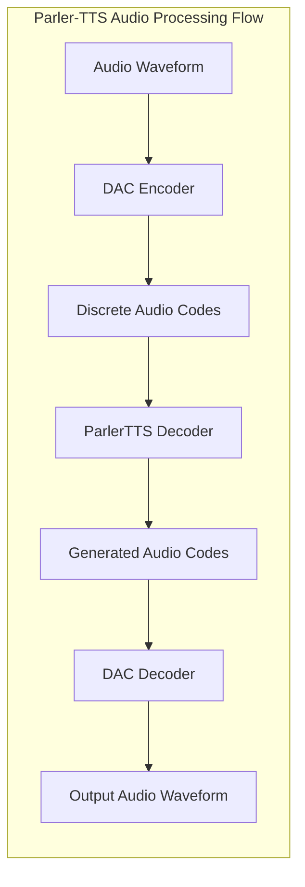
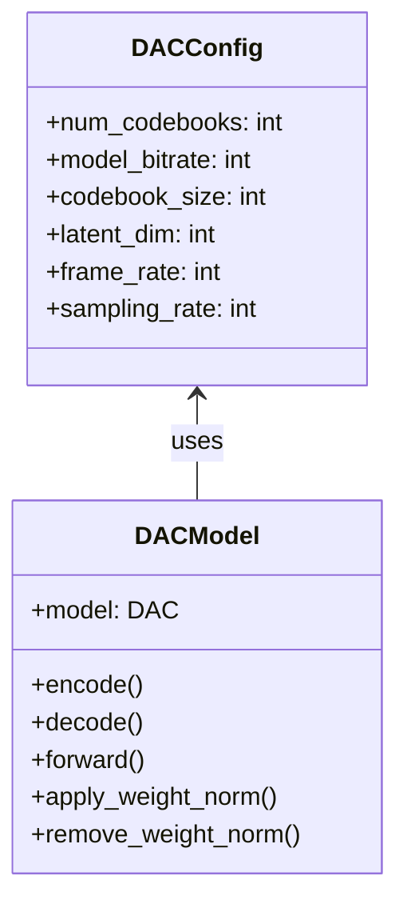
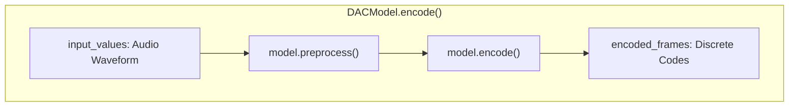
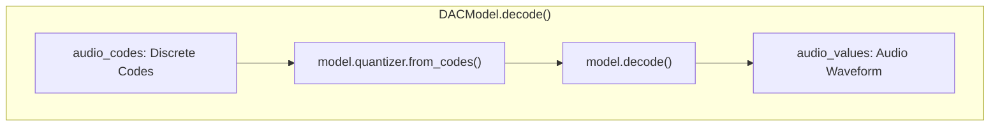
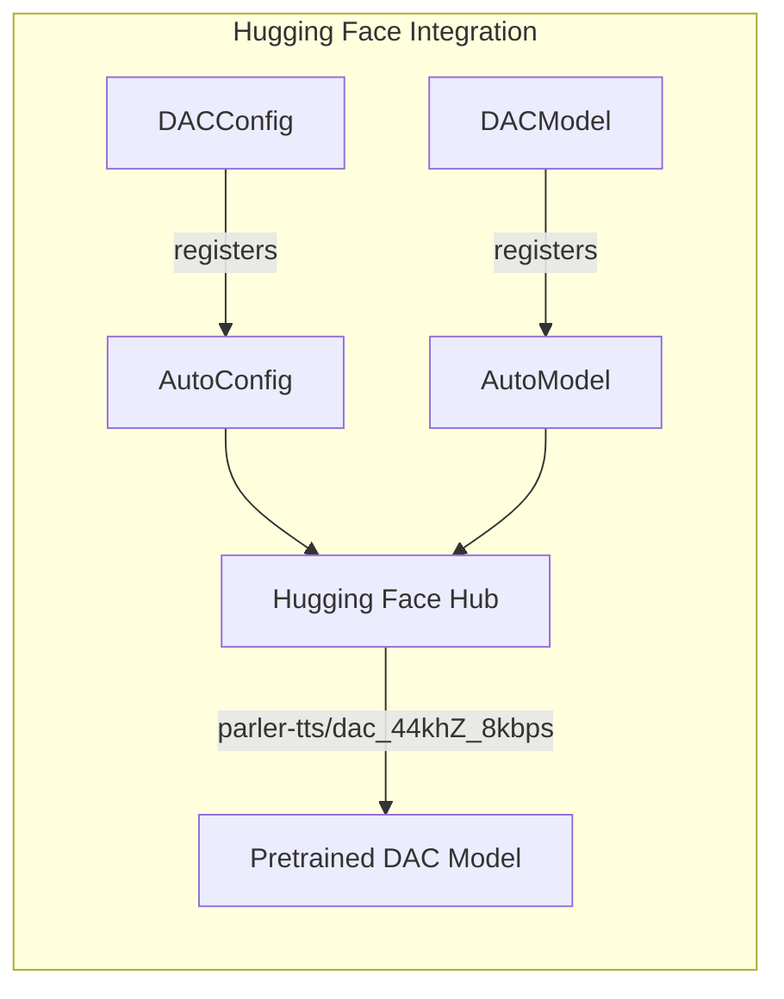
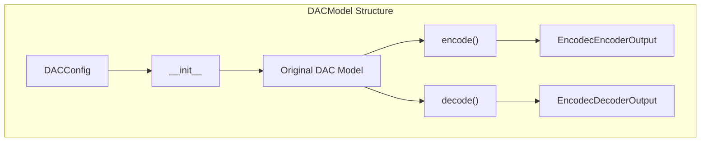

<!-- source: DeepWiki mcp.deepwiki.com · repo huggingface/parler-tts · page 2.3 Audio Codec (DAC) · fetched 2026-10-26 -->

# Audio Codec (DAC)

<details>
<summary>Relevant source files</summary>

The following files were used as context for generating this wiki page:

- [helpers/push_to_hub_scripts/push_dac_to_hub.py](helpers/push_to_hub_scripts/push_dac_to_hub.py)
- [parler_tts/dac_wrapper/__init__.py](parler_tts/dac_wrapper/__init__.py)
- [parler_tts/dac_wrapper/configuration_dac.py](parler_tts/dac_wrapper/configuration_dac.py)
- [parler_tts/dac_wrapper/modeling_dac.py](parler_tts/dac_wrapper/modeling_dac.py)

</details>


The Audio Codec component, specifically the Descript Audio Codec (DAC), is a critical part of the Parler-TTS system responsible for encoding raw audio waveforms into discrete codes and decoding these codes back into audio. This document covers the implementation, configuration, and usage of the DAC component within the Parler-TTS framework. For information about the overall model architecture, see [Architecture](#1.1).

## Overview and Position in the Architecture

The DAC serves as both the Audio Encoder and Decoder in the Parler-TTS pipeline. It handles the conversion between continuous audio signals and discrete representations that the model can work with.



Sources: [parler_tts/dac_wrapper/modeling_dac.py:33-104](), [parler_tts/dac_wrapper/modeling_dac.py:106-142]()

## Implementation Components

The DAC implementation in Parler-TTS consists of two main classes wrapping the original DAC model to make it compatible with the Hugging Face ecosystem.



Sources: [parler_tts/dac_wrapper/configuration_dac.py:7-27](), [parler_tts/dac_wrapper/modeling_dac.py:14-164]()

## Configuration

The `DACConfig` class defines the parameters for the DAC model, setting important values that control the codec's behavior:

| Parameter | Default Value | Description |
|-----------|---------------|-------------|
| `num_codebooks` | 9 | Number of codebooks used for vector quantization |
| `model_bitrate` | 8 kbps | Target bitrate for audio compression |
| `codebook_size` | 1024 | Number of entries in each codebook |
| `latent_dim` | 1024 | Dimension of the latent representation |
| `frame_rate` | 86 | Frames per second for encoding |
| `sampling_rate` | 44100 Hz | Audio sampling frequency |

Sources: [parler_tts/dac_wrapper/configuration_dac.py:10-27]()

## Audio Encoding Process

The encoding process converts raw audio waveforms into discrete codes that represent the audio content in a compressed form.



Key steps in the encoding process:
1. Audio input is preprocessed to match the model's requirements
2. The preprocessed audio is passed through the DAC encoder
3. The encoder produces discrete codes representing the audio content
4. These codes are returned in a format compatible with the Hugging Face ecosystem

Sources: [parler_tts/dac_wrapper/modeling_dac.py:33-104]()

## Audio Decoding Process

The decoding process converts discrete codes back into audio waveforms that can be played.



Key steps in the decoding process:
1. Discrete codes are converted to audio embeddings using the quantizer
2. These embeddings are passed through the DAC decoder
3. The decoder generates the audio waveform
4. The audio is returned in a format compatible with the Hugging Face ecosystem

Sources: [parler_tts/dac_wrapper/modeling_dac.py:106-142]()

## Integration with Hugging Face

The DAC model is integrated with the Hugging Face ecosystem, allowing it to be used with standard Hugging Face interfaces and tools.



Sources: [helpers/push_to_hub_scripts/push_dac_to_hub.py:11-16](), [helpers/push_to_hub_scripts/push_dac_to_hub.py:25-26]()

## Model Structure

The `DACModel` is a wrapper around the original DAC implementation, adding compatibility with the Hugging Face `PreTrainedModel` interface. It handles:

1. Initialization with the specified configuration
2. Encoding audio waveforms to discrete codes
3. Decoding discrete codes to audio waveforms
4. Weight normalization for improved model performance



Sources: [parler_tts/dac_wrapper/modeling_dac.py:21-32](), [parler_tts/dac_wrapper/modeling_dac.py:148-164]()

## Practical Usage

### Model Initialization

```python
from parler_tts import DACConfig, DACModel

# Initialize with default configuration
config = DACConfig()
dac_model = DACModel(config)

# Load a pretrained model
from transformers import AutoModel
pretrained_dac = AutoModel.from_pretrained("parler-tts/dac_44khZ_8kbps")
```

### Encoding Audio

```python
# Assuming audio_waveform is a tensor of shape [batch_size, channels, length]
encoded_output = dac_model.encode(audio_waveform)
audio_codes = encoded_output.audio_codes
```

### Decoding Audio

```python
# Convert discrete codes back to audio
decoded_output = dac_model.decode(audio_codes, audio_scales=None)
reconstructed_audio = decoded_output.audio_values
```

Sources: [parler_tts/dac_wrapper/modeling_dac.py:33-104](), [parler_tts/dac_wrapper/modeling_dac.py:106-142]()

## Limitations

The current DAC implementation has some limitations to be aware of:

1. Limited batching support: The model has constraints on batched processing as noted in the comments
2. The `forward()` method is not implemented, requiring direct use of `encode()` and `decode()`
3. `chunk_length` handling is still under development

Sources: [parler_tts/dac_wrapper/modeling_dac.py:11-12](), [parler_tts/dac_wrapper/modeling_dac.py:144-145](), [parler_tts/dac_wrapper/modeling_dac.py:68-73]()

---

